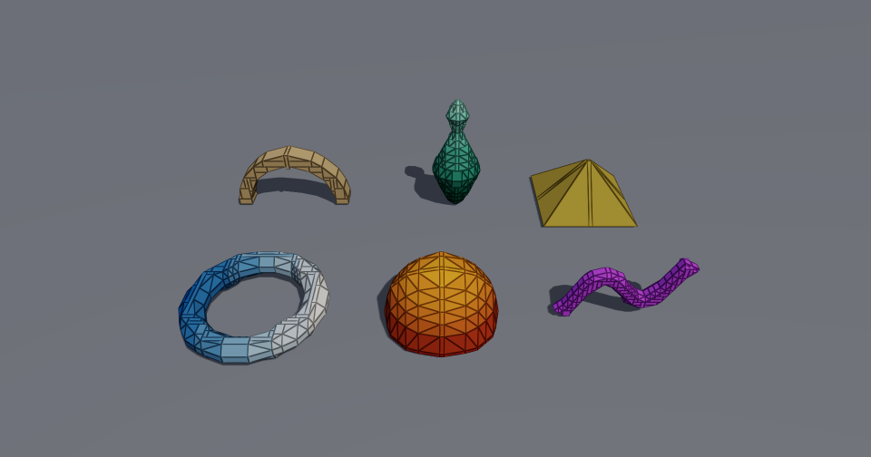
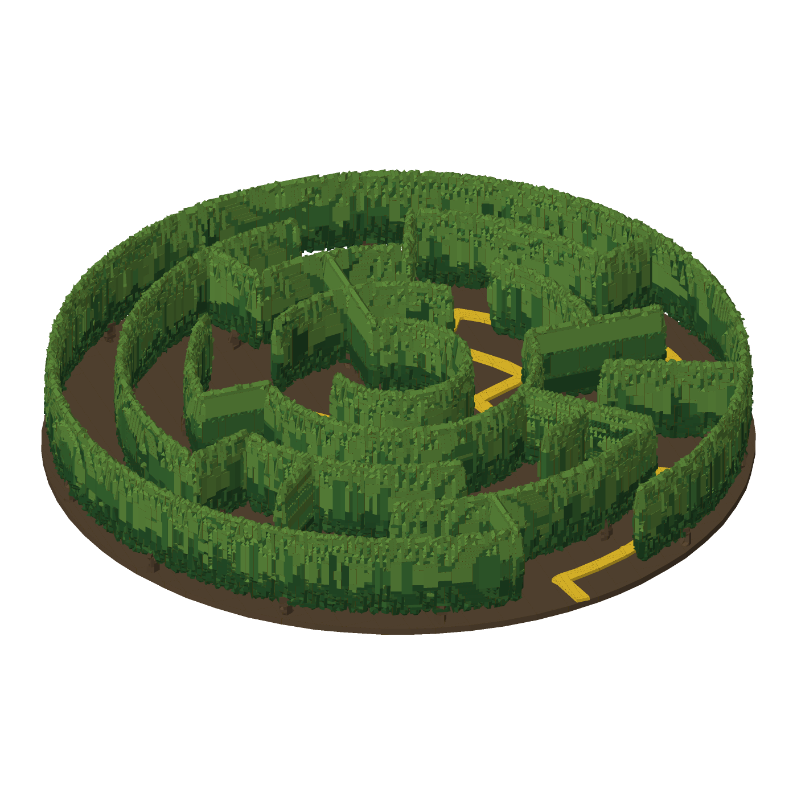
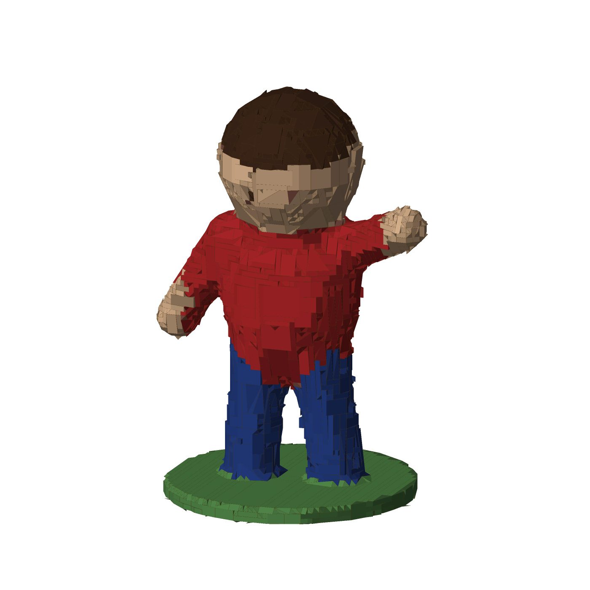
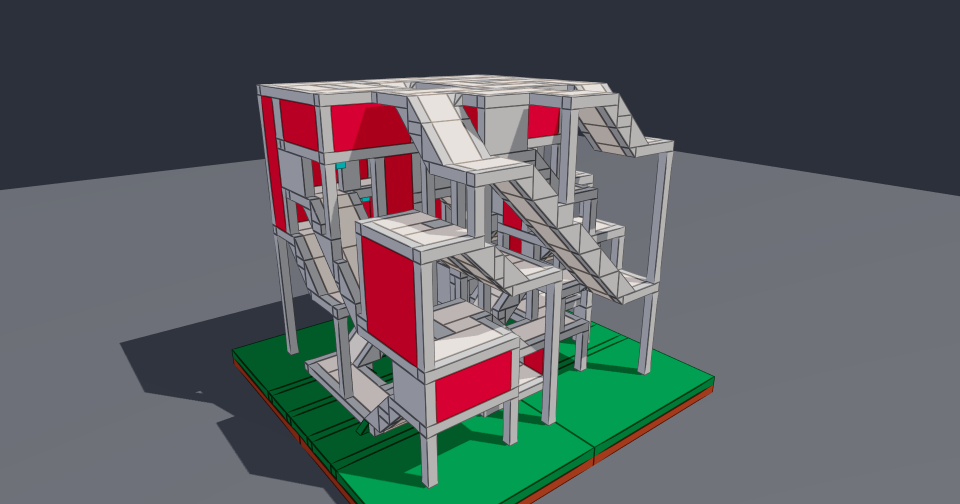
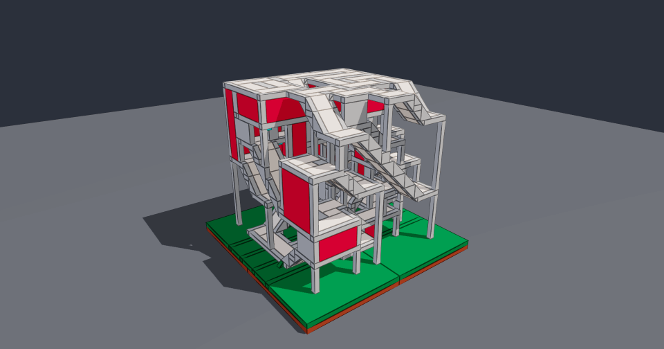
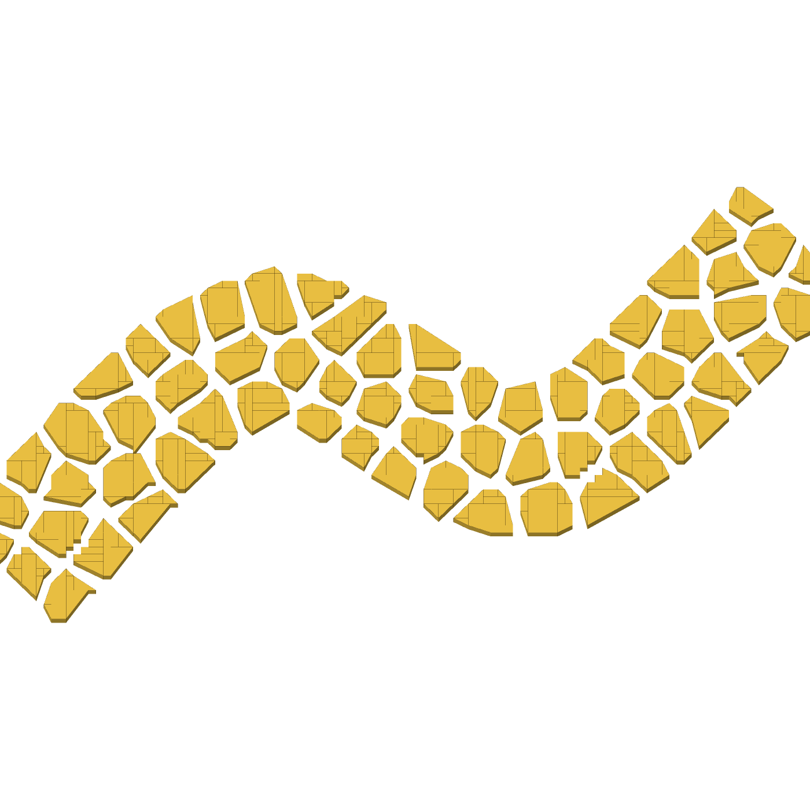
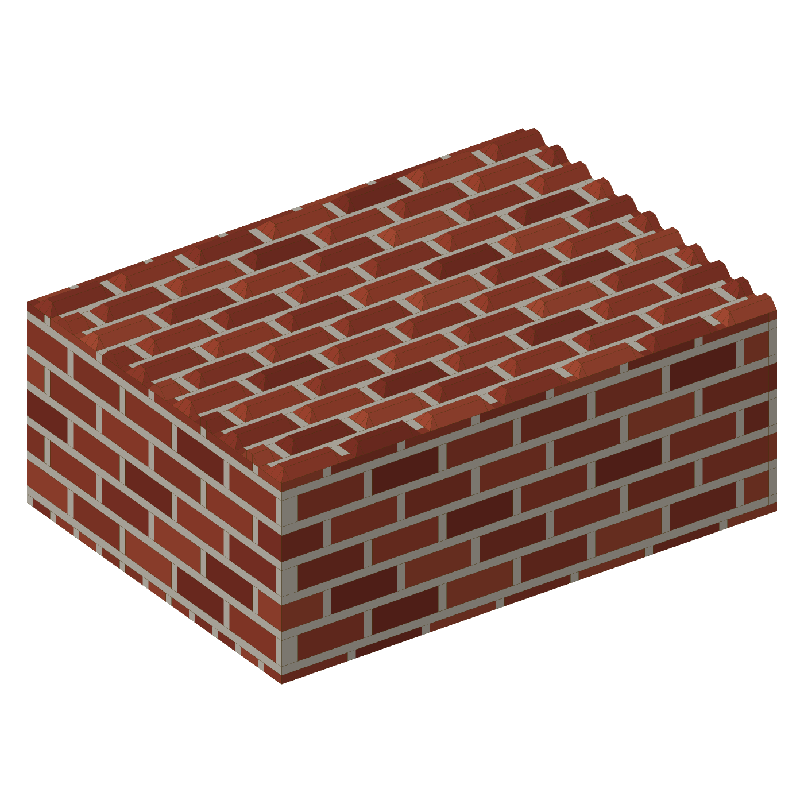

# Brickloft

Brickloft builds curved shapes out of bricks for
[Brickadia](https://brickadia.com). You shape an arch, a dome, a torus or a
vase on screen, Brickloft works out the bricks that make it, and you paste
the result into the game.


Brickadia is a building game, and its smallest pieces are microbricks:
cubes, ramps and corner wedges that sit on a grid and can be stretched to
any length. The fixed set of shapes and the grid are what make building
approachable. A brick cannot be placed wrongly, everything built shares one
style, and the game can draw a large build cheaply because it is the same
few shapes repeated. The cost is curves. A grid has none, so a curve has to
be approximated with many more pieces than a straight wall, and the usual
result is a staircase where a smooth slope should be.

Building a curve by hand is hard for a reason that has little to do with
skill. Every brick is a decision with several parts: which shape, how long,
turned which way, and whether it will meet the bricks already beside it and
the ones still to come. You have to hold all of that in your head while
also aiming the mouse, switching tools and remembering keys, and the whole
time keep hold of the shape you set out to make. A curve multiplies the
decisions, so most of your attention goes on placing bricks and little is
left for the design.

Brickloft lets you work on the shape and leaves the bricks to the program.
You edit a form through a few dots and settings: drag a foot of an arch,
pull one point of a ring outwards, mirror it, turn it, colour it. The
bricks are refitted as you go, so you see the real result at every step and
can keep refining it. A tool that only converts a finished model into
bricks gives you one answer at the end and no say in between. Here the
choices that make a build yours stay in your hands, and the thousands of
small placements do not.

The bricks it chooses are also few and large, which matters once a build is
in the game. Brickloft stretches each brick as far as the shape allows and
joins neighbours into one. Fewer bricks are less for the game to store,
send and draw, so a curved build made this way stays light.

It can do this because every brick shape is a box with some of its corners
kept. For each box Brickloft asks which corners lie inside the shape you
drew, and that answer names the brick. Neighbouring bricks share their
corners, so when the corners are right the bricks meet face to face and the
slopes run on from one brick to the next. Each kind of shape has its own
method for placing the boxes, described in
[docs/algorithm.md](docs/algorithm.md). When the bricks are chosen,
Brickloft measures them against the true shape and reports the difference,
so you can see how good a fit is before you paste it.

It is a single desktop program, written in Rust. Nothing is installed in
the game or on a server: the bricks travel on the clipboard as an ordinary
Brickadia prefab. If you use Claude, it can drive the editor for you and
build while you watch (see [docs/mcp.md](docs/mcp.md)).

## What it makes



| Form | Shaped by |
|---|---|
| Arch | two feet and a height (round, pointed, triangular, elliptical, parabolic, catenary) |
| Circle | a centre and a radius: a ring, a disc, or, as a round tube, a torus |
| Spline | a smooth curve through any number of points |
| Bézier | a curve pulled towards weighted points |
| Sphere | a centre and a radius: solid or a hollow shell, stretched to an ellipsoid, cut to a dome or a segment |
| Revolve | a profile spun about an upright axis: vases, bells, bowls |
| Pyramid | a base and a height: solid, or a hollow tent |
| Cube | a box with a length along each axis: a block, a floor, a wall, or a hollow room |
| Plant | a tree, a bush or a flower grown from a seed: a pine, a palm, an oak, a beech, a boxwood, a hedge, a hydrangea, peonies, sunflowers, tulips, petunias, daisies, daffodils, a mixed bed, a single rose, water lily or gerbera, a birch, a willow, a cherry in blossom, a Scots pine, a date palm, a cypress, a yucca, reeds, grass with ponds and streams |
| Furniture | pieces that rebuild themselves at any size, in five styles, from a seed: a bookcase with its books, cupboards, tables, chairs and sofas, lamps that light in the game, a bed, plants in pots, a trellis with a climber, and framed paintings and portraits |
| Maze | a maze to walk through, in rings or in squares, grown from a seed: one way in, a room in the middle, walls plain, of brick, stone or planks, or of hedge |
| Imported | a 3D model from a `.glb`, `.obj` or `.ply` file, at any size, in its own colours |

Curves are built as a flat band or as a round tube. Every form can be
stretched, mirrored, turned, pulled out of shape at any point, coloured, and
combined with others in one workspace.

A cube or a curve can be laid as a pattern in place of plain brick:
stepping stones, medallions, a rug, planks, bricks or cobblestone.
Stepping stones cut a flat form into separate stones. The other five
colour the form and leave its shape as it was, except that bricks can
have their tops bevelled. Each pattern is generated from a seed and takes
up to eight colours (see
[docs/features.md](docs/features.md#patterns)).


A maze has one way in and one way to the room in its middle, with every
part of it reachable. Its ring walls are fitted as a circle is, in long
sloped bricks, and can be laid as brick courses that bend round the
rings, or grown as hedge (see
[docs/features.md](docs/features.md#mazes)). It replaces the author's
earlier brickmaze generator.

 

A model made in another program is built from its file: drop a `.glb`,
`.obj` or `.ply` file on the window. Ramps and corner pieces are laid in
the model's own faces, so a roof at a whole-number slope is long ramps
and not stairs, and each brick takes the colour of the model's surface
at it (see [docs/features.md](docs/features.md#meshes-from-files)).

 

A rule program grows a building on a grid, a little each turn, and you
can watch it: a block of flats, a tower, a house, a villa over the sea.
Its stairs are built as slopes. The language and the programs are from
[MarkovJunior](https://github.com/mxgmn/MarkovJunior) by Maxim Gumin, and
a program of your own can be imported from its `.xml` file (see
[docs/features.md](docs/features.md#rule-programs)).

 

 

## How good the result is

Each fit is scored two ways.

- **Discrepancy:** the volume where the bricks and the true form disagree, as
  a share of the form's volume. Shown in the panel as you work.
- **Stepped faces:** the share of the outside that is a level or upright
  face where the form's surface slopes, which is what a staircase is. Shown
  in a saved report.

Typical results: a solid sphere of radius 50 is 2,215 bricks, 1.2%
discrepancy and no stepped faces. A torus of radius 40 and 8 thick is 645
bricks with about 1% of its faces stepped.

## Get it

**Windows:** download `brickloft-*-windows.zip` from the
[releases page](../../releases), unzip it, and run `brickloft.exe`. The program
is not code-signed, so an antivirus may hold it back as unknown the first
time.

**From source,** with [Rust](https://rustup.rs) installed:

```sh
git clone https://github.com/Gameboard-dev/brickloft
cd brickloft
cargo run --release -p brickloft-editor
```

The first build takes about a minute. Putting the file on the clipboard is
written for Windows; elsewhere the program still writes `brickloft-build.brz`
to the folder `brickloft` in the system's temporary folder, to be loaded
by hand.

## Use it

1. The editor opens with a cube. Pick another form from the menu if you
   want one, and drag its dots.
2. Press **Ctrl+C**.
3. In Brickadia, paste.

[docs/features.md](docs/features.md) covers everything else: the workspace,
grids at an angle, joining forms, added points, mirroring, patterns,
colours, saved forms, the camera and every key.

## Documentation

| | |
|---|---|
| [docs/features.md](docs/features.md) | What the editor does and how to use it |
| [docs/algorithm.md](docs/algorithm.md) | The principles and the algorithms, with the equations |
| [docs/performance.md](docs/performance.md) | What makes it fast, with measurements |
| [docs/web-page.md](docs/web-page.md) | The optional browser page and how it works |
| [docs/development.md](docs/development.md) | Building, running, testing, inspecting a fit |
| [docs/mcp.md](docs/mcp.md) | Letting Claude drive the editor: setting up, the tools, security |
| [docs/generate.md](docs/generate.md) | The generator, a separate program not yet used by the editor: a mesh from a picture or a prompt, with models run on this computer |
| [docs/future-work.md](docs/future-work.md) | Planned additions: more for Claude to do, and what remains for joined forms, the patterns, the plants, the furniture and rule programs |

## Layout

| Folder | What it is |
|---|---|
| `core/` | The geometry: curves, solids as distance functions, the fitters, the measurements. No game or interface code, and one dependency (`glam`). |
| `editor/` | The program: the 3D view, the panel, the workspace, and the `.brz` file it copies. |
| `generate/` | The generator: a program of its own, built apart from the other two (see [docs/generate.md](docs/generate.md)). |

The project began as omegga-arcs, an omegga plugin that placed arcs of
bricks on a running server. The plugin was removed, because copy and paste
does the same with nothing to install and is the only route that can carry
forms on grids of their own. The name went with it once the program had
grown past arcs: lofting is the shipbuilder's craft of laying a hull's
smooth curves out at full size before anything is cut.

## Licence

MIT. See [LICENSE](LICENSE).

The rule programs that come with the editor, their tilesets and their
palette are copied unchanged from
[MarkovJunior](https://github.com/mxgmn/MarkovJunior) by Maxim Gumin,
which is also under the MIT licence. They are in
[core/models/markov/](core/models/markov/), with the original's licence
file and a note of the commit they were taken from, and they are
compiled into the program. The language those programs are written in
is MarkovJunior's, and the interpreter in `core/src/rewrite/` was
written from the original's source. CarmaTower is credited in the
original as "a proceduralization of a voxel scene by Antoine Lendrevie".
