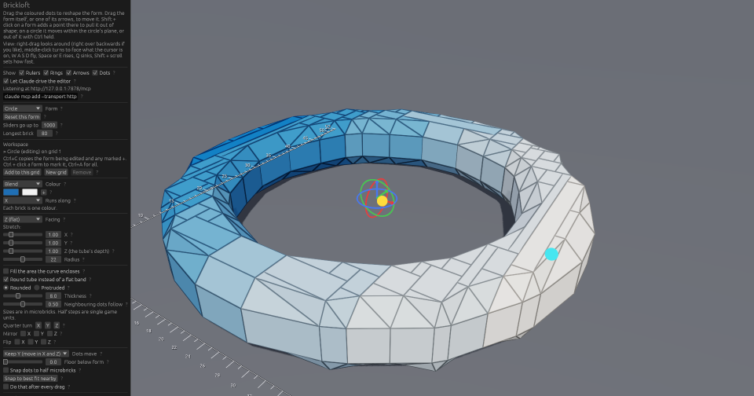

# Brickloft

Brickloft builds curved shapes out of bricks for
[Brickadia](https://brickadia.com). You shape an arch, a dome, a torus or a
vase on screen, Brickloft works out the bricks that make it, and you paste
the result into the game.



Brickadia is a building game, and its smallest pieces are microbricks:
cubes, ramps and corner wedges that sit on a grid and can be stretched to
any length. Anything square is easy to build from them. A curve is hard,
because a grid has no curves. The usual result is a staircase, a row of
little steps where a smooth slope should be.

Take a stone ball to sit on top of a gatepost, 100 microbricks across. Built well, it
is 2,215 bricks. Each one has to be the right shape, the right size and
turned the right way, and each has to meet its neighbours exactly, because
one misplaced wedge shows as a notch in the surface. By hand that is an
evening of careful work, and the next ball, a little larger, starts again
from nothing. In Brickloft you pick Sphere, drag one dot until the size is
right, and press Ctrl+C. The ball that pastes into the game has no steps
anywhere on it, and it differs from a true sphere over only 1.2% of its
volume.

Brickloft can do this because every brick shape is a box with some of its
corners kept. For each box it asks which corners lie inside the shape you
drew, and that answer names the brick. Neighbouring bricks share their
corners, so when the corners are right the bricks meet face to face and the
slopes run on from one brick to the next. The care goes into where the
boxes are put, and each kind of shape has its own method for that, described
in [docs/algorithm.md](docs/algorithm.md). When the bricks are chosen,
Brickloft measures them against the true shape and tells you how far apart
the two are, so you can see how good a fit is before you paste it.

It is a single desktop program, written in Rust. Nothing is installed in
the game or on a server: the bricks travel on the clipboard as an ordinary
Brickadia prefab. If you use Claude, it can drive the editor for you and
build while you watch (see [docs/mcp.md](docs/mcp.md)).

## What it makes


| Form | Shaped by |
|---|---|
| Arch | two feet and a height (round, pointed, triangular, elliptical, parabolic, catenary) |
| Circle | a centre and a radius: a ring, a disc, or, as a round tube, a torus |
| Spline | a smooth curve through any number of points |
| Bézier | a curve pulled towards weighted points |
| Sphere | a centre and a radius: solid or a hollow shell, stretched to an ellipsoid, cut to a dome or a segment |
| Revolve | a profile spun about an upright axis: vases, bells, bowls |
| Pyramid | a base and a height: solid, or a hollow tent |

Curves are built as a flat band or as a round tube. Every form can be
stretched, mirrored, turned, pulled out of shape at any point, coloured, and
combined with others in one workspace.

## How good the result is

Each fit is scored two ways.

- **Discrepancy:** the volume where the bricks and the true form disagree, as
  a share of the form's volume. Shown in the panel as you work.
- **Stepped faces:** the share of the outside that is a level or upright
  face where the form's surface slopes, which is what a staircase is. Shown
  in a saved report.

Typical results: a solid sphere of radius 50 is 2,215 bricks, 1.2%
discrepancy and no stepped faces. A torus of radius 40 and 8 thick is 645
bricks with about 1% of its faces stepped.

## Get it

**Windows:** download `brickloft-*-windows.zip` from the
[releases page](../../releases), unzip it, and run `brickloft.exe`. The program
is not code-signed, so an antivirus may hold it back as unknown the first
time.

**From source,** with [Rust](https://rustup.rs) installed:

```sh
git clone https://github.com/Gameboard-dev/brickloft
cd brickloft
cargo run --release -p brickloft-editor
```

The first build takes about a minute. Putting the file on the clipboard is
written for Windows; elsewhere the program still writes `brickloft-build.brz`
to the folder `brickloft` in the system's temporary folder, to be loaded
by hand.

## Use it

1. Pick a form from the menu and drag its dots.
2. Press **Ctrl+C**.
3. In Brickadia, paste.

[docs/features.md](docs/features.md) covers everything else: the workspace,
grids at an angle, added points, mirroring, colours, saved forms, the camera
and every key.

## Documentation

| | |
|---|---|
| [docs/features.md](docs/features.md) | What the editor does and how to use it |
| [docs/algorithm.md](docs/algorithm.md) | The principles and the algorithms, with the equations |
| [docs/performance.md](docs/performance.md) | What makes it fast, with measurements |
| [docs/web-page.md](docs/web-page.md) | The optional browser page and how it works |
| [docs/development.md](docs/development.md) | Building, running, testing, inspecting a fit |
| [docs/mcp.md](docs/mcp.md) | Letting Claude drive the editor: setting up, the tools, security |
| [docs/future-work.md](docs/future-work.md) | Planned additions: more for Claude to do, and generated patterns |

## Layout

| Folder | What it is |
|---|---|
| `core/` | The geometry: curves, solids as distance functions, the fitters, the measurements. No game or interface code, and one dependency (`glam`). |
| `editor/` | The program: the 3D view, the panel, the workspace, and the `.brz` file it copies. |

The project began as omegga-arcs, an omegga plugin that placed arcs of
bricks on a running server. The plugin was removed, because copy and paste
does the same with nothing to install and is the only route that can carry
forms on grids of their own. The name went with it once the program had
grown past arcs: lofting is the shipbuilder's craft of laying a hull's
smooth curves out at full size before anything is cut.

## Licence

MIT. See [LICENSE](LICENSE).
