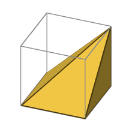
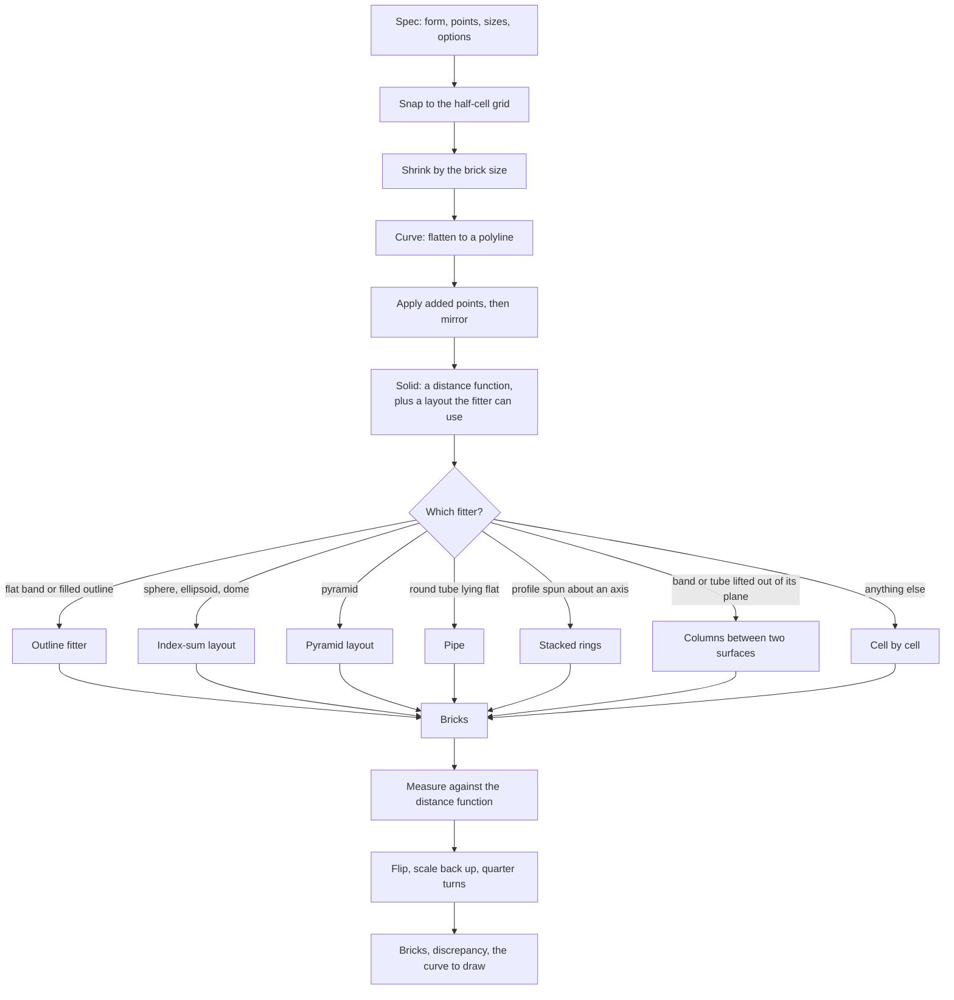
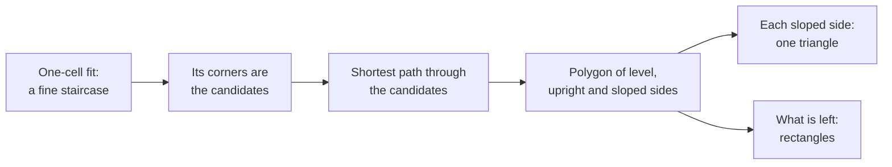

# How a form becomes bricks

arcs takes a smooth form, such as an arch, a dome or a ring, and chooses the
Brickadia microbricks that build it. This page explains how, for a reader
who knows what a brick and a grid are.

- [1. The problem](#1-the-problem)
- [2. The grid and the bricks](#2-the-grid-and-the-bricks)
- [3. From a form to bricks: the pipeline](#3-from-a-form-to-bricks-the-pipeline)
- [4. Curves](#4-curves)
- [5. Solids as distance functions](#5-solids-as-distance-functions)
- [6. What is being minimised](#6-what-is-being-minimised)
- [7. The fitters](#7-the-fitters)
- [8. Changing a form: added points, mirror, turning, grids](#8-changing-a-form-added-points-mirror-turning-grids)
- [9. Fit against brick count](#9-fit-against-brick-count)
- [10. Measuring the result](#10-measuring-the-result)
- [11. Symmetry](#11-symmetry)
- [12. Limits](#12-limits)

## 1. The problem

A form, such as an arch, a sphere or a torus, is a smooth solid. Bricks are
boxes and wedges whose corners sit on a grid. The program has to choose
bricks that come as close to the form as bricks can, and that show a slope
wherever the form slopes, instead of the treads and risers of a staircase.
Where the form is its own mirror image, the bricks should be too. There
should also be few of them, because every brick costs the player time and
the game memory.

These four aims pull against each other, and the clearest case is closeness
against slopes. Picture the side of a hill drawn in bricks. One way is a
staircase of cubes; another is a row of wedges laid end to end.

```
  a staircase of cubes          one long ramp
          ##                              /
        ####                           /##
      ######                        /#####
    ########                     /########
```

Both can hold the same amount of material, so a measure of volume alone
cannot tell them apart. Worse, the fit that is closest by volume is usually
a staircase, because many small bricks can follow a curve a little more
tightly than a few long wedges. arcs therefore gives up a little closeness
to get slopes that meet end to end, and it measures closeness and slopes
separately so that the trade can be seen.

## 2. The grid and the bricks

### The grid

The smallest microbrick is a cube one fifth of a stud on each side. The
game measures positions in units, and this cube is 2 units on a side. arcs
calls this cube a **cell**, and every length in arcs is counted in cells.

A brick's position in the game must be a whole number of units, which is a
half cell. So before anything is computed, every point, radius and
thickness of a form is rounded to the nearest half cell (`Spec::snapped` in
[core/src/spec.rs](../core/src/spec.rs)). A form
placed between units could only be approximated by bricks that are all
slightly off it, and the error would drift in and out along a curve. On the
half-cell grid, a form's straight edges and its symmetries line up with the
bricks', and those parts come out exact.

Cells are numbered by three whole numbers. Cell $`(i, j, k)`$ is the cube
$`[i, i+1] \times [j, j+1] \times [k, k+1]`$, which means the cube whose
$`x`$ runs from $`i`$ to $`i+1`$, whose $`y`$ runs from $`j`$ to $`j+1`$,
and whose $`z`$ runs from $`k`$ to $`k+1`$. The corners of cells, the points
whose coordinates are all whole numbers, are called **lattice points**. The
middles of cells are the points whose coordinates all end in a half.

### The nine brick shapes

A brick is a **box** that is a whole number of cells long in each direction,
filled with one of nine **shapes**. Every shape is one of the game's own
microbricks ([core/src/shapes.rs](../core/src/shapes.rs),
the enum `Kind`). To describe a shape, take its box as the unit cube, where
$`x`$, $`y`$ and $`z`$ each run from 0 to 1. The column "Solid" gives the
rule a point of that cube must meet to be inside the shape. Each picture shows
the shape in yellow inside the outline of its box. The ramp is drawn lying
down, with $`z`$ in place of $`y`$ in its rule, so that its slope faces up. The pictures are drawn
from the mesh the editor itself displays, by
[editor/examples/shape_pictures.rs](../editor/examples/shape_pictures.rs).

| | Shape | Game brick | Solid | Corners held | Share of box | Poses |
|---|---|---|---|---|---|---|
|  | Cube | Micro-Brick | all of it | 8 | 1 | 1 |
|  | Ramp | Micro-Wedge | $`x + y \le 1`$ | 6 | 1/2 | 12 |
|  | Tetrahedron | Micro-Wedge Triangle Corner | $`x + y + z \le 1`$ | 4 | 1/6 | 8 |
|  | Cut cube | Micro-Wedge Outer Corner | $`x + y + z \le 2`$ | 7 | 5/6 | 8 |
|  | Hip | Micro-Wedge Corner | $`\max(x, y) \le 1 - z`$ | 5 | 1/3 | 24 |
|  | Inner corner | Micro-Wedge Inner Corner | $`\min(x, y) + z \le 1`$ | 7 | 2/3 | 24 |
|  | Half outer corner | Micro-Wedge 1/2 Outer Corner | $`x + y \le 1,\ z \le x + y`$ | 5 | 1/3 | 24 |
|  | Half inner corner | Micro-Wedge 1/2 Inner Corner | $`x + y \le 1,\ z \le y`$ | 4 | 1/6 | 12 |
|  | its mirror image | Micro-Wedge 1/2 Inner Corner Inv. | $`x + y \le 1,\ z \le x`$ | 4 | 1/6 | 12 |

Each rule is a test on the point's coordinates. The ramp's rule $`x + y \le 1`$
says that a point is inside when its distance from one side plus its
distance from the next side is at most one box width. That cuts the box in
half along a diagonal plane, which is a wedge. The tetrahedron's rule adds a
third distance, so only the corner near the origin passes: a small
three-sided pyramid with a sixth of the box. The hip is a quarter of a
square pyramid. It is the piece at the corner of a hipped roof, where two
slopes meet along a ridge, and its rule says the point must be under both
slopes.

"Poses" is the number of different ways the shape can sit in its box when
the box is turned in any of the 24 ways a cube can be turned. A cube looks
the same every way, so it has one pose. A ramp has 12 because its sloped
face can face any of the cube's 12 edges. Across all nine shapes there are
125 poses.

### A shape is a set of corners

The program describes a shape by which of its box's eight corners it
touches. Every shape except one is exactly the **convex hull** of the
corners it holds. The convex hull of some points is the solid you get by
stretching shrink-wrap around them: the smallest solid with no dents that
contains them all. So once you know which corners a shape holds, you know
the whole shape.

Eight corners, each either held or not, fit in one 8-bit number. Think of a
row of eight switches, one per corner, each on or off. This number is the
shape's **corner mask**. Corner $`(x, y, z)`$, where each of $`x, y, z`$ is
0 or 1, is switch number $`x + 2y + 4z`$. For example, the tetrahedron at
the origin holds corners 0, 1, 2 and 4, which are $`(0,0,0)`$, $`(1,0,0)`$,
$`(0,1,0)`$ and $`(0,0,1)`$. Switches 0, 1, 2 and 4 on give the binary
number 00010111, which is 0x17 in the hexadecimal notation programmers use.
These are the first lines of `Kind::canonical` in `shapes.rs`:

```rust
        match self {
            Kind::Cube => 0xff,
            Kind::Ramp => 0x77, // missing the edge x=1,y=1: solid where x + y <= 1
            Kind::Tet => 0x17,  // corner 0 and its neighbours: x + y + z <= 1
            Kind::Cut => 0x7f,  // missing corner 7: x + y + z <= 2
```

The cube has every switch on (0xff). The ramp lacks corners 3 and 7, which
are $`(1,1,0)`$ and $`(1,1,1)`$, the two ends of one edge.

Stretching a box to any size stretches its shape with it, and the corner
mask does not change, so one mask describes a ramp one cell long or twenty.
Turning or mirroring a brick moves its corners to other corners, so the
program turns or mirrors a brick by reordering the eight switches, without
any geometry. The program can tell a shape from its mask with one table
lookup (`shape_info` in `shapes.rs`), and a mask that is no shape at all is
caught the same way. Two bricks whose boxes share a face, and whose masks
agree on that face's four corners, meet exactly, with no gap and no
overlap. The fitters therefore only have to get the corners right, and the
faces between bricks follow.

To test whether a point is inside a shape, the program measures the point's
distance from a special corner of the shape (the tetrahedron's right-angle
corner, the cut cube's missing corner) and applies the shape's rule. This is
part of `inside_shape` in `shapes.rs`; `a`, `b` and `d` are the point's
three coordinates measured from that corner:

```rust
    let c = info.corner;
    let a = if c & 1 != 0 { 1.0 - u } else { u };
    let b = if c & 2 != 0 { 1.0 - v } else { v };
    let d = if c & 4 != 0 { 1.0 - w } else { w };
    // ...
    match info.kind {
        Kind::Cube => true,
        Kind::Tet => a + b + d < 1.0,
        Kind::Cut => a + b + d > 1.0,
```

The tests are strict (`<` and `>`), so a point lying exactly on a sloped
face counts as outside. A regular grid of samples puts many samples exactly
on a 45° face, so this rule decides how much of a ramp the measurement of
section 10 counts.

### The inner corner

 

The inner corner is the one shape that is not the convex hull of its
corners. It is a box with a hip taken out of it: a valley where two slopes
meet in an inside corner, as in the corner of a room under a sloping roof.
It touches seven corners, the same seven a cut cube touches, so the corners
alone cannot tell the two apart. Its corner mask is therefore written
differently. It is the three corners that the missing hip does not touch.
No other shape has a mask of only three corners, so the mask is still
unique. Turning or mirroring still works by moving the switches, because the
missing hip turns with the brick. Only code that reads a mask as "these
corners are solid" has to check for this case first (`corners` in
`shapes.rs`).

### How the shapes fit together

Several pairs of shapes fill a box exactly between them. A tetrahedron and a cut cube fill a box between them, split by the
plane $`x + y + z = \text{const}`$, a plane tilted equally towards all three
axes. A plane tilted on all three axes therefore passes through the grid
cutting alternate layers of cells into tetrahedra and cut cubes. A ramp and
the ramp facing it fill a box. So do a hip and an inner corner. Two half
inner corners make a hip, and a ramp standing upright plus a half outer
corner make a cut cube. When a fitter takes one shape out of a box, it can often name
the brick that fills the rest (`rest_of_box` in
[core/src/fit_round.rs](../core/src/fit_round.rs)).

### Naming a brick for the game

The game does not know about corner masks. It names a brick by its asset
(which of the nine bricks), its size, and one of 24 orientations. The
module [core/src/orient.rs](../core/src/orient.rs) (`Solver::place`)
translates. For each corner mask it finds the orientation that turns the
game's unturned brick into that pose, preferring orientations that keep the
brick upright, and reorders the box's three sizes to match the turn. The
game's assets are the same nine shapes in their unturned pose, so every one
of the 125 poses can be reached.

## 3. From a form to bricks: the pipeline

Every form passes through the same stages, from the settings the player
chose to the finished bricks. The main function is `build` in
[core/src/spec.rs](../core/src/spec.rs).



For every form the program computes a **distance function**, a precise
description of the solid that can be asked about any point (section 5). It
also computes a **layout**, which is whatever structure the right fitter
needs: an outline in two dimensions, a list of cut positions, or a profile.
The bricks are made from the layout. The distance function is used
afterwards to measure them, so the measurement does not depend on which
fitter made the bricks, and no fitter measures its own work.

Some forms cannot be laid out. A sphere whose centre is off the half-cell
grid, or a hollow shell whose wall is too thin for its layout, are
examples. Those forms fall through to the cell-by-cell fitter, which needs
only the distance function and works for any solid at all. It is the safety
net, and it is also the roughest method, which is why each common form has a
fitter of its own.

## 4. Curves

Arches, circles, splines and Bézier curves all start as a curve, and every
curve is turned into a **polyline**: a chain of short straight segments
([core/src/curves.rs](../core/src/curves.rs), `flatten`). The segments are
made short enough that the chain never strays more than 0.02 of a cell from
the true curve, which is far below anything a brick can show. The program
splits each piece in half, and keeps splitting, until the middle of the
true curve is within that distance of the middle of the straight segment.
Everything after this point works on polylines. As a result, adding a new
kind of curve never touches a fitter.

### Circle through three points

An arch with a third point added becomes the circular arc through all three
points. To find that circle's centre, write $`a = P_1 - P_0`$ and
$`b = P_2 - P_0`$ for the two arrows from the first point to the others, and
$`n = a \times b`$ for their cross product, which is an arrow standing
square to the plane of the three points. The centre is

```math
c = P_0 + \frac{\lvert a\rvert^2\,(b \times n) + \lvert b\rvert^2\,(n \times a)}{2\,\lvert n\rvert^2}
```

Here $`\lvert a\rvert`$ is the length of the arrow $`a`$. In words, the
centre is the first point moved by a blend of two directions lying in the
plane, each weighted by the squared length of the other arrow, so that the
result is the same distance from all three points. `circle3` in `curves.rs`
has it as one line:

```rust
    let center =
        p0 + (b.cross(n) * a.length_squared() + n.cross(a) * b.length_squared()) / (2.0 * n2);
```

Three points in a straight line have $`n = 0`$, since two arrows in the same
line have no plane between them. No circle passes through them, and the
program says so instead of dividing by zero.

### Arches

A round arch is given by its two feet a span $`L`$ apart and its rise
$`s`$, the height of its crown above the feet. The circular arc through the
feet and the crown has radius

```math
R = \frac{L^2/4 + s^2}{2s}
```

This comes from a right-angled triangle formed by the centre, one foot and
the point under the crown. As a check, a span of 16 with a rise of 8 gives
$`R = (64 + 64)/16 = 8`$, a semicircle, and in general the arch is a
semicircle when $`s = L/2`$. A lower rise of 4 on the same span gives
$`R = (64 + 16)/8 = 10`$, a flatter arc of a larger circle.

The other arch kinds are formulas between the same feet (`arch` in
`curves.rs`). A pointed arch is two arcs meeting at a point at the top,
each centred on the line between the feet. A triangular arch is two straight
sides. An elliptical arch is half an ellipse. A parabolic arch is
$`z = s\,(1 - (2x/L)^2)`$, where $`x`$ is the distance from the middle: at
the middle $`z = s`$, and at the feet, where $`x = \pm L/2`$, $`z = 0`$. A
catenary arch is the shape of a hanging chain turned upside down,
$`z = s - a\,(\cosh(x/a) - 1)`$. The number $`a`$ sets how sharply the chain
curves, and no formula gives it directly from the rise, so the program finds
it by repeated halving. It tries a value, checks whether that arch is too
tall or too short, and narrows the range, 200 times.

### Spline

A spline is a smooth curve through any number of points. arcs uses a
centripetal Catmull-Rom spline (`catmull_rom` in `curves.rs`). It passes
through every point, and between two points it bends according to the
points on either side. The word "centripetal" refers to how the curve's
progress is spaced between points. The spacing grows with the square root
of the distance between neighbouring points, $`\lvert P_{i+1} - P_i\rvert^{1/2}`$.
This spacing is the one choice known never to make a cusp (a sharp point) or
a small loop between two points, which the other common spacings can do when
points are unevenly spread.

### Bézier

A Bézier curve does not pass through its points. Each point pulls the curve
towards itself, and the curve passes near them as a blend. arcs uses the
rational form, with a weight $`w_i`$ for each point $`P_i`$
(`rational_bezier` in `curves.rs`):

```math
C(t) = \frac{\sum_i w_i\,B_i(t)\,P_i}{\sum_i w_i\,B_i(t)}
```

As $`t`$ runs from 0 to 1, $`C(t)`$ traces the curve. The $`B_i(t)`$ are the
Bernstein polynomials, a standard set of blending amounts that are never
negative and always add up to one, so the curve is a weighted average of
the points. Each point's share is multiplied by its weight, and the bottom
line divides by the total so that the shares still add up to one. A larger
weight therefore pulls the curve closer to its point.

With weights, a Bézier curve can draw an exact circular arc. With three
points, the middle weight decides what kind of curve comes out. Below 1 it
is part of an ellipse, exactly 1 is a parabola, above 1 a hyperbola, and
$`\cos(\theta/2)`$ gives an exact circular arc of angle $`\theta`$. For
example, a quarter circle has $`\theta = 90^\circ`$, so the middle weight is
$`\cos 45^\circ \approx 0.707`$. A Bézier curve without weights cannot draw a
circle exactly, only approximately.

## 5. Solids as distance functions

### What a distance function is

A fitter needs to ask one question many millions of times: is this point
inside the form? arcs answers it with a **distance function**
([core/src/sdf.rs](../core/src/sdf.rs), the enum `Field`). It is a rule
$`f(p)`$ that takes a point $`p`$ and gives one number. The number is
negative inside the form and positive outside, and near the surface it
equals the distance to the surface, in cells. At the surface it is zero.

The numbers work like heights on a contour map that has the form's surface
as sea level. A point under the sea has a negative height and a point on land a positive
one, and the height tells you how far you are from the shore. For a sphere
of radius 10 centred at the origin, $`f(p)`$ is the point's distance from
the centre minus 10: a point 3 from the centre gives $`-7`$ (inside, 7 cells
from the surface), and a point 12 from the centre gives $`2`$ (outside, 2
cells away).

### The solids

The forms are built from five basic solids, each with a short rule for
$`f`$.

| Solid | $`f(p)`$ |
|---|---|
| Round tube of radius $`r`$ along a curve | $`\mathrm{dist}(p, \text{curve}) - r`$ |
| Flat band along a curve in a plane | $`\max\big(\mathrm{dist}_{\text{in plane}} - \tfrac{t}{2},\ \lvert\text{height above plane}\rvert - \tfrac{d}{2}\big)`$ |
| Ellipsoid with radii $`r_x, r_y, r_z`$ | $`\big(\sqrt{\sum (p_k/r_k)^2} - 1\big)\cdot \min_k r_k`$ |
| Outline spun about an upright axis | the outline's 2D function at $`\big(\sqrt{x^2+y^2},\ z\big)`$ |
| Pyramid | the largest of the distances out of its four slopes, its base and its top |

A round tube is every
point within $`r`$ of its curve, so the function is the distance to the
curve less $`r`$. A point is inside a flat band of width $`t`$ and depth
$`d`$ only if it is both within $`t/2`$ of the curve in its plane and within
$`d/2`$ of that plane. The larger of the two numbers is negative only when both are,
so taking the maximum means "inside both". For an ellipsoid, $`p_k/r_k`$
measures each coordinate in units of that axis's radius, and the square
root is 1 exactly on the surface. It is exact for a sphere and a close
estimate near the surface of any ellipsoid. A form spun about an upright
axis, such as a vase, is described by its outline in a half-plane: how far
out from the axis, and how high. Any point in space is answered by finding
its distance from the axis, $`\sqrt{x^2 + y^2}`$, and asking the outline. A
pyramid is inside all four of its slopes, above its base and below its top,
so again the largest of the six numbers decides.

### Combining solids

Solids combine by taking the smaller or larger of two numbers.

| Combination | $`f`$ |
|---|---|
| Both of $`A`$ and $`B`$ together | $`\min(f_A, f_B)`$ |
| $`A`$ cut to where $`B`$ is | $`\max(f_A, f_B)`$ |
| $`A`$ with $`B`$ taken out | $`\max(f_A, -f_B)`$ |

A point is in "both together" if it is in either, and the smaller number is
negative when either is. A point is in "$`A`$ cut to $`B`$" only if it is in
both, which is the larger number again. Taking $`B`$ out uses $`-f_B`$,
which turns $`B`$ inside out, because it is negative outside $`B`$. In
`Field::eval` in `sdf.rs` each combination is one line:

```rust
            Field::Either(a, b) => a.eval(p).min(b.eval(p)),
            // ...
            Field::Without(a, b) => a.eval(p).max(-b.eval(p)),
```

With these, a dome is an ellipsoid cut by a flat floor, a segment is an
ellipsoid cut between two heights, and a hollow shell is an ellipsoid with
a smaller one taken out. None of these needs its own case in the code.

### Why whole regions can be skipped

Every fitter relies on the fact that $`f`$ never claims the surface is
further away than it is. If $`f(p) = 5`$, there is certainly no surface
within 5 cells of $`p`$. That lets the fitters and the measurement test one
point in the middle of a large region and skip the whole region when the
number is large enough ([performance.md](performance.md) explains how much
time this saves). Operations that stretch space, such as squashing a round
tube into an oval or pulling a point out of a sphere, could break the
property, because stretching moves the surface further from where the
formula thinks it is. They therefore scale their result down by the largest
stretch they can cause, which keeps the number an underestimate.

## 6. What is being minimised

Write $`F`$ for the form and $`B`$ for the solid made by all the bricks
together. The **discrepancy** is the volume where they disagree:

```math
E = \mathrm{vol}(F \setminus B) + \mathrm{vol}(B \setminus F)
```

Read $`F \setminus B`$ as "the part of $`F`$ that is not in $`B`$". The
first term is material that should be there and is not, and the second is
material that is there and should not be. The program reports $`E`$ as a
share of the form's volume. For a flat form, the same idea is measured in
area.

Suppose the form fills exactly half of one cell, cut by a diagonal plane.
An empty cell then misses half a
cell of form, so $`E = 0.5`$. A cube adds half a cell too much, so
$`E = 0.5`$. The ramp that matches the cut has $`E = 0`$.

Each brick has its box to itself, because the game refuses bricks whose
boxes overlap (section 7.7 has the one exception). $`E`$
is then a sum over boxes, and each box can be judged on its own. That makes
the simplest case exactly solvable. If every brick is one cell, each cell
can hold nothing or one shape, the choices in different cells do not affect
each other, and trying every choice in every cell finds the true smallest
$`E`$ for one-cell bricks.

However, that best answer is a staircase wherever the surface is not at
45°, and its sloped bricks do not line up with one another. Each fitter
below therefore adds structure so that slopes are long and neighbouring
bricks share whole faces, and pays for it with a slightly larger $`E`$. For
a sphere of radius 12, the trade is 3 to 4% discrepancy with no stepped
faces, against 2 to 3% with a third of the surface stepped. The second
number is closer and looks worse, which is why the program measures the
surface separately (section 10).

## 7. The fitters

### 7.1 Cell by cell

The cell-by-cell fitter ([core/src/fit_volume.rs](../core/src/fit_volume.rs),
`fit_volume`) is the general method. It is used when no layout applies, and
it works for any solid that has a distance function. It classifies each
cell, chooses a shape for it, removes spikes, stretches ramps and merges
cubes, in that order.

#### Classifying each cell

The program tests 64 points in each cell, a
$`4 \times 4 \times 4`$ grid of **samples**. Each sample is either inside
the form or not, which is one switch, so the 64 answers fit in one 64-bit
number, a row of 64 switches. This is `cell_bits`:

```rust
    let bits = (0..K * K * K).fold(0u64, |bits, s| {
        let p = DVec3::new(
            (s % K) as f64 + 0.5,
            (s / K % K) as f64 + 0.5,
            (s / (K * K)) as f64 + 0.5,
        ) / K as f64;
        // strictly inside, to agree with the planar fitter on samples
        // lying exactly on the surface
        bits | ((f(cell + p) < 0.0) as u64) << s
    });
```

`K` is 4. Sample number `s` sits at the middle of one of the 64 small cubes
the cell is divided into, and its switch is on when the distance function
is negative there.

#### Choosing a shape for each cell

Each candidate shape has its own 64-bit
number, worked out once: which samples it covers. The disagreement between
the cell and a candidate is the number of samples where the two rows of
switches differ, which a processor finds in two instructions. The
exclusive-or (written `^`) of two numbers has a switch on wherever the two
differ, and `count_ones` counts the switches that are on.

```rust
                            let mut scores = [(0u32, 0u32); 30];
                            for (score, (mask, pattern)) in scores.iter_mut().zip(patterns) {
                                *score =
                                    ((bits ^ pattern).count_ones(), (corners ^ mask).count_ones());
                            }
                            let (mask, pattern) =
                                patterns[least_unshared(&scores[..patterns.len()], 2)];
```

The cell gets the candidate that disagrees least. When two candidates
disagree equally, the second number decides, which is how many of the
cell's eight corners the candidate gets wrong. There are 30 candidates: nothing, a cube,
12 ramps, 8 tetrahedra and 8 cut cubes. Hips and the other newer shapes are
left out on purpose. They belong on a ridge or a valley that a layout
places, and offering them to every cell of a curved surface would nearly
double the work for a brick that suits almost none of them.

#### Removing spikes

Where a gently curving surface clips the corner of an
otherwise empty cell, the best brick for that cell by volume is a
tetrahedron, and it stands alone on the surface like a thorn. A tetrahedron
looks right only in an inside corner, with at least two of its three flat
faces against neighbouring bricks. So any tetrahedron with fewer than two
backed faces is removed (`drop_spikes`). The volume this leaves unbuilt is
at most a sixth of a cell. The check is repeated, up to four times, because
removing one spike can leave a neighbouring tetrahedron without its backing.

#### Stretching ramps

A one-cell ramp always slopes at 45°. A gentler surface,
such as the top of a dome, would therefore come out as a row of teeth, each
tooth the best brick for its own cell. One ramp two to six cells long and
one cell high (or one cell long and two to six high) follows such a slope
far better. A second pass (`stretch_ramps`) tries such ramps through every
cell the surface crosses and replaces the cells' bricks wherever a stretched
ramp disagrees less with the form than they did. The biggest improvements
are taken first. A stretched ramp may not reach into a cell the form does
not touch, because its thin end would poke through flat faces, such as the
underside of a dome's rim.

#### Merging

Cubes next to each other are then joined into larger boxes,
first along $`x`$, then the run along $`y`$, then the slab along $`z`$
(`merge`). Ramps of the same pose are joined end to end along their length,
up to the longest brick allowed. Merging changes the brick count and never
the shape, because two cubes side by side are exactly one longer box.

The result is the closest of all the methods by volume and the roughest to
look at, because no cell knows what its neighbours hold, so nothing makes
one cell's slope continue into the next.

### 7.2 Flat outlines

A flat band, a ring or a filled outline is a two-dimensional shape pushed
straight through the grid, like a biscuit cutter pushed through dough. So it
is fitted in two dimensions and then extended through the depth
([core/src/fit_planar.rs](../core/src/fit_planar.rs), `fit_planar`). In two
dimensions the bricks become flat **pieces**: rectangles, which become
cubes, and right-angled triangles, which become ramps standing through the
depth.

This fitter is smooth because it fits an outline first and fills it
afterwards. The fitted outline is a polygon whose corners are lattice
points. Each side of the polygon is level, upright or sloped. A sloped side
is the long side of exactly one right-angled triangle whose other two sides
lie along the grid, so each sloped side becomes one triangle piece.
Neighbouring sides share a corner by construction, so slopes always meet
end to end and there is no place for a stray step. The fitter's work is
therefore to choose which lattice points are the corners.



#### Finding candidate corners

The form is first fitted with one-cell pieces, as in 7.1, but in two
dimensions and with a finer $`8 \times 8`$ grid of samples per cell. Each
cell gets an empty square, a full square or one of four half-square
triangles, whichever disagrees least with the form. A cell exactly half
full, where empty and full are equally wrong, is settled by its neighbours:
it is filled if at least two of the cells beside it hold something. The
boundary of this one-cell fit is a fine staircase with 45° corners that hugs
the true outline, and the lattice points along it are the candidates.

#### Cutting the outline into stretches

The staircase is then cut where it truly turns back, at its highest,
lowest, leftmost and rightmost places (`turning_points`). A turn counts
only if the outline comes back by two cells or more, because a wobble of
one cell is just the one-cell fit rounding. Between two cuts, the outline
runs one way in $`x`$ and one way in $`y`$, like one quarter of a circle.
The cuts matter because a triangle's long side can only stand in for a
stretch that runs one way, so every stretch can be solved separately.

#### Choosing corners by a shortest-path search

Along each stretch, the corners are chosen by a **shortest-path search**
(`Search::cheapest`). Think of planning a journey along a road with many
possible overnight stops. Each day's travel has a cost, and you want the
cheapest whole journey. You do not need to try every combination of stops.
For each stop in turn, the cheapest way to arrive there is the cheapest way
to reach some earlier stop plus the cost of the last day, and the earlier
stops have already been worked out. This method, which builds the best
answer from the best answers to smaller problems, is called dynamic
programming. It finds the exact best journey in a fraction of the time it
would take to try them all.

Here the stops are the candidate corners, and a "day" is one side of the
polygon. Going from candidate $`i`$ to a later candidate $`j`$ in one side
costs

```math
\text{cost}(i \to j) = \underbrace{e(i, j)}_{\text{area between the side and the true outline}} + \underbrace{\lambda}_{\text{price of a corner}}
```

The first term, $`e(i, j)`$, is the disagreement the side brings. In the
program it is how much the side's triangle gets wrong, less what the
one-cell pieces it replaces got wrong. The second term, $`\lambda`$, is a fixed price
for each corner of the polygon. The search finds the chain of sides with the
least total cost. $`\lambda`$ is 0.1 of a cell plus the **Simplify**
setting. Even at Simplify 0 the price favours slopes, because a step is two
corners where a slope is one, so a slope wins whenever it fits as well as
the step. The
base price is kept small because a tenth of a cell is about the least
disagreement that can be seen at all.

For example, take a stretch where the true outline climbs 1 cell over 3
cells across, and suppose the one-cell fit there is a level tread 2 cells
long followed by a 45° chamfer. That is two sides, and pays the corner
price twice. One side from start to end is a single triangle 3 by 1, and
pays it once. If the triangle gets the area about as right as the two
sides did, it costs $`\lambda`$ less, so it is chosen.

#### Turning one way

Chosen on area alone, a slope that the lattice has no single side for is
made by alternating the two nearest slopes: 1 in 1, 1 in 2, 1 in 1, 1 in 2.
This is fractionally closer by area, but it turns left, right, left, right.
Seen from above, the result is a curve with a ripple in it. So the search
also charges three quarters of a cell every time the outline changes the
direction it is turning in. A curve really bending one way pays nothing, and
an S-bend pays once. Because of this charge, the state of the search is a
corner together with the way the outline last turned, and the sides come out
in order of slope. These lines of `Search::cheapest` add the charge:

```rust
                        let now = match turn {
                            0 => was,
                            1 => 1,
                            _ => 2,
                        };
                        let wiggle = if was != 0 && now != was { WIGGLE } else { 0 };
                        let total = earlier.cost[was] + cost + wiggle;
```

`turn` is 0 for straight on, 1 for one way and anything else for the other.
`was` is the way the outline last turned (0 if it has not turned yet), and
`WIGGLE` is the three quarters of a cell, counted in samples.

#### Thin walls, rings and filling

Where the two faces of a thin wall want the same cell, the larger triangle
has it, and the stretch on the other face is solved again around what was
taken. This is repeated up to four rounds. The longer stretches, which are
the outer faces of curves, are solved first.

A ring is moved half a cell where needed so that its edge runs along
lattice lines where it crosses an axis (`off_lattice` in `spec.rs`). Left
half a cell off, that straight part of its edge fits best by area as a row
of small triangles, each half a cell, which looks like the teeth of a saw.
An open band, such as an arch, is run on half a cell past its end points
where those sit at cell centres. Cut off exactly at the end points, the band
would cover half of each end cell, and half a cell is the one amount no
brick can build.

The finished polygon is filled with the triangles of its sloped sides and,
for everything else inside it, rectangles found by a sweep across the rows
(`scan_fill`). The discrepancy is then measured from the finished pieces
sample by sample.

An earlier version chose each triangle separately on its own merit. It
measured slightly closer and left a step wherever two triangles' ends did
not happen to meet, and patching those afterwards never fully worked. That
is why continuity is now built into the structure, as one outline, instead
of repaired afterwards.

### 7.3 Spheres, ellipsoids and domes

A sphere is laid out whole, by one rule, with no cell-by-cell choosing
([core/src/fit_round.rs](../core/src/fit_round.rs), `fit_round`). The rule
works because the equation of a sphere is a sum of one term for each axis.

#### Turning the sphere's equation into a count

The sphere of radius $`r`$ is

```math
\frac{x^2}{r^2} + \frac{y^2}{r^2} + \frac{z^2}{r^2} \le 1
```

In words, a point is inside when the squares of its three distances from
the centre, each measured in units of the radius, add up to at most 1. This
is a sum of three separate terms, one per axis. Now cut each axis at chosen
distances $`t_0 < t_1 < \dots < t_K`$ from the centre, numbered 0 to $`K`$,
and choose them so that

```math
\left(\frac{t_i}{r}\right)^2 = \frac{i}{K} \quad\text{that is}\quad t_i = r\sqrt{i/K}
```

Each cut $`i`$ is placed so that its term in the sphere's sum is exactly
$`i/K`$. So a lattice point at cut numbers $`(i, j, k)`$ along the three
axes has $`x^2/r^2 + y^2/r^2 + z^2/r^2 = (i + j + k)/K`$. It is inside the
sphere exactly when

```math
i + j + k \le K
```

The curved test has become a sum of three whole numbers compared with
$`K`$. In `fit_round`, the corners of each box are tested this way:

```rust
                let within = |limit: usize| {
                    (0..8u8).fold(0u8, |m, corner| {
                        let sum: usize = (0..3)
                            .map(|k| lines[k][at[k] + (corner >> k & 1) as usize].1)
                            .sum();
                        m | ((sum <= limit) as u8) << corner
                    })
                };
```

For each of the eight corners of a box, it adds the three cut numbers and
switches that corner on if the sum is at most the limit. The result is a
corner mask, which is the brick for that box.

#### Why every box holds exactly one brick

The cuts divide space into boxes. Moving from a box's inner corner (the one
nearest the centre) to any neighbouring corner raises one cut number by one.
So a box's eight corners have index sums $`s, s+1, s+1, s+1, s+2, s+2, s+2, s+3`$,
where $`s`$ is the sum at its inner corner. Which of them are inside depends
only on how $`s`$ compares with $`K`$:

| $`s`$ compared with $`K`$ | Corners inside | Brick |
|---|---|---|
| $`s + 3 \le K`$ | all 8 | cube |
| $`s + 2 = K`$ | 7 | cut cube |
| $`s + 1 = K`$ | 4 | tetrahedron |
| $`s = K`$ | 1 | none (a point) |

Every row is one of the shapes, so every box is nothing, a whole box, or
one stretched brick. Where the centre is in the middle of a cell, the two
cuts either side of the middle are both numbered 0, and a box between them
has corners whose sums do not rise along that axis. The same count then
gives a ramp. Neighbouring boxes share their corners, so every brick meets
its neighbours face to face. The surface has no steps and no gaps by
construction, and with the ideal cuts every corner on the surface lies on
the sphere.

#### A worked example

Take a sphere of radius $`r = 4`$ centred on a lattice point, and
$`K = 2`$. The ideal cuts are $`t_0 = 0`$, $`t_1 = 4\sqrt{1/2} \approx 2.83`$
and $`t_2 = 4`$. The cuts must be whole numbers of cells, so they become 0,
3 and 4. Here is the quarter of the slice $`z = 0`$, with each lattice point
marked with its index sum $`i + j`$ (the $`z`$ number is 0) and whether
that sum is at most $`K = 2`$:

```
             x = 0     x = 3     x = 4
  y = 4      2 in      3 out     4 out
  y = 3      1 in      2 in      3 out
  y = 0      0 in      1 in      2 in
```

Now take the boxes of the bottom layer, from $`z = 0`$ to $`z = 3`$:

| Box, in cells | Sum at inner corner $`s`$ | Rule | Brick |
|---|---|---|---|
| $`x`$ 0 to 3, $`y`$ 0 to 3 | 0 | $`s + 2 = K`$ | cut cube, 3 by 3 by 3 |
| $`x`$ 3 to 4, $`y`$ 0 to 3 | 1 | $`s + 1 = K`$ | tetrahedron, 1 by 3 by 3 |
| $`x`$ 0 to 3, $`y`$ 3 to 4 | 1 | $`s + 1 = K`$ | tetrahedron, 3 by 1 by 3 |
| $`x`$ 3 to 4, $`y`$ 3 to 4 | 2 | $`s = K`$ | nothing |

In the layer above, from $`z = 3`$ to $`z = 4`$, only the box over the
centre has $`s = 1`$ and holds a tetrahedron. So one eighth of this sphere
is four bricks: one cut cube and three tetrahedra. The corner at
$`(4, 0, 0)`$ lies exactly on the sphere. The corner at $`(3, 3, 0)`$ is
$`\sqrt{18} \approx 4.24`$ from the centre instead of 4, because the cut
2.83 had to be rounded to 3. That rounding is the only error left, so the
cuts are placed to keep it small.

#### Putting the cuts on the lattice

The ideal cuts $`r\sqrt{i/K}`$ are not whole numbers, and rounding each one
on its own gives uneven gaps such as 2, 1, 2, 1, which make a surface that
folds in and out along every ring. So the cuts are chosen together by
dynamic programming (`cuts` in `fit_round.rs`), the same kind of search as
in 7.2, under two rules. Every gap must be at least one cell, and gaps must
never grow going outwards. The second rule keeps the solid convex, without
dents. The search works from the outside in, because the outer gaps are the
narrow ones and those are the ones the lattice constrains.

#### Choosing K

$`K`$ is the number of rings of facets. More rings means finer facets, but
each cut is then nearer its neighbours than rounding can place it. The
program tries every $`K`$ the lattice has room for, each with the corners
aimed at the true surface and also slightly outside it (0.15 and 0.3 of a
cell). It scores each against the true solid without building anything,
from the cut positions alone. The best four are then improved by moving one
cut a cell at a time while the score improves, and the best result is kept.
About one ring per two to three cells of radius is typical.

#### Ellipsoids, domes and shells

An ellipsoid uses the same method with a different radius on each axis. A
dome or a segment is cut off flat at one of the cuts along $`z`$, so its
flat face is a layer of whole boxes. A hollow shell is the same solid with
a smaller one taken out, so the corners with $`i + j + k \le K - m`$ are
hollow. The wall is then $`m`$ numbered layers thick, and $`m`$ is at
least 2. With $`m = 1`$, a box could have both the outer and the inner surface
passing through it, and one box can hold only one brick. A shell needs a
wall of about 2.5 cells or more for the lattice to have room. Thinner walls
fall back to the cell-by-cell fitter of 7.1.

### 7.4 Pyramids

A pyramid uses the same box layout with a different rule
([core/src/fit_pyramid.rs](../core/src/fit_pyramid.rs), `fit_pyramid`).
Number the cuts across the base from the middle outwards, and the levels
from the base upwards, with $`L`$ levels in all. A corner is inside the
pyramid when

```math
\max(i_x, i_y) + i_z \le L
```

Here $`i_x`$ and $`i_y`$ are the corner's cut numbers across, and $`i_z`$ its
level. The larger of the two numbers across says how far out the corner is,
measured in the square rings a pyramid's level is made of. Adding the level
says that each step up shrinks the allowed ring by one. In code:

```rust
                let under = |lower: usize| {
                    (0..8u8).fold(0u8, |m, corner| {
                        let number = |k: usize| lines[k][[x, y, z][k] + (corner >> k & 1) as usize].1;
                        m | ((number(0).max(number(1)) + number(2) + lower <= levels as usize) as u8) << corner
                    })
                };
```

With this rule the boxes hold ramps on the four slopes and hips on the four
ridges. The bricks are exactly the pyramid's four slopes. For example, centre a pyramid on a lattice
point with $`L = 1`$. Each quarter is one box from the middle to the edge
and from the base to the apex. Its corners at the base have
$`\max(i_x, i_y) + 0 \le 1`$, so all four are inside; at the top, only the
corner over the middle has $`0 + 1 \le 1`$. Four base corners and one apex
corner are a hip. So that pyramid is four hips and nothing else. The number
of levels $`L`$ is as small as keeps every brick within the longest
allowed.

A pyramid that is not filled is hollow, a tent open underneath. It has a
smaller pyramid, $`\max(i_x, i_y) + i_z \le L - 2`$, taken out of it. The
inner one is two levels lower for the same reason a shell's wall is two
layers thick, which is that no box then has both the outer and the inner
slope passing through it. The bricks on the inside are what the smaller pyramid's bricks
would leave of their boxes. A ramp leaves a ramp, and a hip leaves an inner
corner, which runs up each inside ridge. $`L`$ is chosen to divide the
height and both half-widths evenly, so that the slopes stay flat. The wall
then comes out near the thickness asked for, but not exactly.

### 7.5 Round tubes and tori

A round tube along a curve lying flat, and a torus, are built as a pipe
whose cross-section is an octagon ([core/src/fit_stack.rs](../core/src/fit_stack.rs),
`pipe`). An octagon is the roundest section bricks allow, because ramps
make 45° faces. It has a flat top, a wall each side, and a sloped chamfer
between them, all running along the curve.

```
       ______
      /      \      the chamfer: c cells in, c cells up
     |        |     the wall
     |        |
      \______/
     <---w---->
```

For a section $`w`$ cells across, the sloping sides are as long as the flat
ones when each chamfer is

```math
c = w\left(1 - \tfrac{1}{\sqrt{2}}\right)
```

rounded to whole cells. This comes from the regular octagon: its slanted
side, $`c\sqrt{2}`$ long, equals its flat side, $`w - 2c`$. For a tube 8
across, $`c = 8 \times 0.293 \approx 2.3`$, so the chamfer is 2 cells. In
`spec.rs` it is one line, which also stops the chamfer short of the middle:

```rust
    let chamfer_of = |count: i32| ((count as f64 * (1.0 - std::f64::consts::FRAC_1_SQRT_2)).round() as i32).min((count - 1) / 2);
```

The program also chooses between the whole number of cells just below and
just above the asked thickness, whichever makes an octagon nearer the
circle in area. A tube 6.5 across is far closer to an octagon 6 across (28
cells in section, against the circle's 33) than to one 7 across (41).

The pipe is built wall first, then the chamfers.

1. The band of the tube's full width is fitted as an outline, as in 7.2.
2. The chamfer is cut back from that outline towards the narrower top. Each
   level or upright side of the outline gets a ramp; the triangle of each
   sloped side becomes a tetrahedron; and where two sides meet there is a
   corner brick. An inside corner between two ramps is an inner corner.
   Each of these bricks spans all the chamfer's layers at once.
3. The same is done at the underside.

These bricks share whole faces and start exactly on the wall, so the
chamfer is one continuous surface. Internally the chamfer is worked out as
the air above it growing inwards from the air around the wall (`grow`), and
each block of air becomes the brick that fills the rest of its box. Because
it is the air that grows, where bricks from two sides of a tight curve
would cross and one must be left out, what remains is solid standing a
little proud, not a hole.

The wall's outline is fitted knowing that the top will be cut back from it
(`fit_planar_towards` in `fit_planar.rs`). A sloped side is charged for
landing the top's outline off the true surface. A level or upright side
shorter than the chamfer is charged for the corner bricks it has no room
for. And no sloped side may be deeper than the chamfer.

The chamfer was first built the other way, outwards from the narrow top
band. Where that band ran diagonally it could only be fitted as a staircase,
its chamfer bricks collided and were dropped, and the wall was left with
holes. A ring of radius 19 had 29% of its faces stepped that way and has 1%
now.

A torus is a circle built as a round tube, and needs nothing of its own.
Stretched within its plane, the circle becomes an ellipse; stretched across
its plane, the tube becomes that many times as deep as it is wide, an oval
in section. Filled, every layer takes in everything the circle encloses,
which makes a disc with a rounded rim. The **Protruded** option builds the
tube differently, as flat bands of different widths stacked side by side.
That is smooth along the curve and stepped across it.

### 7.6 Profiles spun about an axis

A vase, a bell or a bowl is a profile spun about an upright axis, like a
pot on a potter's wheel ([core/src/fit_lathe.rs](../core/src/fit_lathe.rs),
`fit_lathe`). Its section, the outline in the half-plane of (distance from
the axis, height), is fitted as an outline, as in 7.2. Each side of that
outline becomes a ring when spun:

| A side of the section | becomes |
|---|---|
| upright | a wall standing on a circle |
| level | a flat face |
| sloped | a ring whose circle shrinks as it rises |

Each circle is itself fitted as an outline. A sloped ring is then exactly
the chamfer of a pipe from 7.5: the outline of its wide end is cut back to
its narrow end. Each ring's wide outline is fitted for that ring, knowing
how far in its narrow end is, because the depth of the chamfer's bricks is
set by the outline's own triangles. Reusing one outline for the next ring
was tried first, and made a cone bulge between its four axes.

Sloped sides of the section are kept to one cell across or one cell up, so
that the bricks of a wall's two faces keep to their own cells. That can be
done two ways, during the fitting or after it. Neither is better for every
form, since a straight cone suits one and a thin curved wall the other. So both
are built, both are measured, and the one with the lower discrepancy is
kept. While a form is being dragged, only the first is built, for speed.

### 7.7 Bands and tubes lifted out of their plane

When a point added to a flat curve pulls it up out of its plane, the
curve's outline seen from above is unchanged, and only its height varies
along it. These forms are built by [core/src/fit_ribbon.rs](../core/src/fit_ribbon.rs).

#### A lifted tube

A lifted round tube is treated as two surfaces over the ground it covers:
its top and its underside. Take a point of the ground at distance $`d`$
from the curve, where the curve is at height $`\ell`$ and climbing with
slope $`m`$ (the height gained per cell travelled). The tube's top and
underside there are at

```math
z_{\pm} = \ell \pm \sqrt{r^2 - d^2}\,\sqrt{1 + m^2}
```

The first square root is the half-height of a circle of radius $`r`$ at a
distance $`d`$ from its middle, from Pythagoras. The second square root is
there because the tube's round section stands square to its curve. Where the
curve climbs, a vertical line crosses the section at a slant, so the tube
is taller measured straight up. For example, with $`r = 4`$ directly over
the curve ($`d = 0`$) on a level stretch, the top is 4 above the curve. On
a slope of 1 in 1 ($`m = 1`$) it is $`4\sqrt{2} \approx 5.7`$ above. This
is `span` inside `lifted_tube` in `spec.rs`:

```rust
    let span = |u: f64, v: f64| {
        let (off, lift, slope) = near(u, v);
        let tall = if off < radius { (radius * radius - off * off).sqrt() * (1.0 + slope * slope).sqrt() } else { 0.0 };
        (centre + lift - tall, centre + lift + tall)
    };
```

Each surface is built one cell of ground at a time, from its heights at the
cell's four corners rounded to whole cells (`columns` and `parts_of` in
`fit_ribbon.rs`). Corner heights that differ by any whole amount are joined
by one brick as tall as needed:

| The four corners | Brick or bricks |
|---|---|
| all level | none |
| two next to each other higher | a ramp |
| one higher | a hip, or a tetrahedron on half the cell if the surface is hollow there |
| three higher | an inner corner, or a cut cube if the surface bulges there |
| two opposite higher (a saddle) | two half outer corners along the ridge, or two tetrahedra along the valley |
| three heights, one opposite pair level | each half of the cell rises from the level pair to its own corner: a tetrahedron where that corner is higher, a half outer corner where it is lower |

Where the table offers two answers, the true surface's height over the
middle of the cell decides which one fits. The underside is the same table
applied upside down, and everything between the two surfaces is whole
cubes.

A cell whose four corners are at three or four heights with neither
opposite pair level cannot be joined by single bricks. A tube running at an
angle to the grid has many such cells, since its top falls one way across
it and climbs another way along it. The nearer opposite pair is then set
level at the height between them, which makes the cell two half squares.
Its edge no longer quite meets its neighbours' at those two corners. The
mismatch is a lip of half the height difference, where a plain block would
be a step of all of it.

Away from the lift, the tube keeps its ordinary pipe from 7.5. The ground is
shared out a cell at a time. Cells under the lifted part are rebuilt from
top to bottom, and so are cells under any sloped pipe brick that reaches
into them, since such a brick cannot be cut.

#### A lifted flat band

A lifted flat band keeps the flat band's own bricks, each raised to the
curve's height where it stands (`fit_ribbon`). Where the curve climbs, a
sloped brick goes on top and the matching brick underneath, wherever one
brick can make the slope. In these lifted forms, and nowhere else, two
bricks may share a box, as the two halves of a cell folded along its
diagonal.

## 8. Changing a form: added points, mirror, turning, grids

### Added points

A point added at $`a`$ and dragged by an amount $`b`$ moves the form near
$`a`$ and leaves the rest alone. A point of the form at distance $`d`$ from
$`a`$ moves by $`b\,w(d)`$, where

```math
w(d) = \tfrac{1}{2}\left(1 + \cos\frac{\pi d}{\rho}\right)\ \text{for } d < \rho, \qquad w(d) = 0 \text{ otherwise}
```

and $`\rho`$ is the reach. The weight $`w`$ is 1 at the point itself,
falls smoothly to 0 at the reach, and stays 0 beyond. The cosine makes the
fall gentle at both ends, so the bump joins the rest of the form with no
corner. For example, with a reach of 8 cells and a pull of 6 cells, the
form moves 6 cells at the point, $`6 \times \tfrac12(1 + \cos 90^\circ) = 3`$
cells at 4 cells away, and not at all 8 cells away. This is the loop in
`pulled` in `spec.rs`:

```rust
    for (at, by) in pulls {
        let held = (0..fine.len()).min_by(|a, b| fine[*a].distance_squared(*at).total_cmp(&fine[*b].distance_squared(*at))).unwrap();
        for i in 0..fine.len() {
            let mut d = (along[i] - along[held]).abs();
            if closed {
                d = d.min(whole - d);
            }
            if d < reach {
                moved[i] += *by * (0.5 * (1.0 + (PI * d / reach).cos()));
            }
        }
    }
```

On a curve, $`d`$ is measured along the curve (`along`), not straight
across. So a pull on one side of a narrow loop leaves the other side alone,
even though the two are close in space. The polyline is first cut into
pieces of half a cell, since a straight run is one long segment that could
only move by its ends. A revolve's profile is pulled the same way.

On a sphere or pyramid, $`d`$ is straight-line distance, and the pull acts
on the distance function instead of on a curve. To answer the pulled form
at a point $`p`$, the program needs the point that ended up at $`p`$. That
point is $`p - t\,b`$, where the share $`t`$ satisfies
$`t = w(\lvert p - t\,b - a\rvert)`$. The share $`t`$ appears on both sides,
so there is no formula for it. It lies between 0 and 1, and the program
finds it by bisection: it halves the range 14 times (`Field::Warp` in
`sdf.rs`). Taking $`w`$ at $`p`$ itself, the easy approximation, is badly
wrong when the pull is as long as its reach; a sphere pulled six cells
bulged only three.

#### Keeping the layout

A sphere, pyramid or pipe with a point added keeps its own bricks wherever
the pull does not reach (`patched` and `lifted_tube` in `spec.rs`). A cell
counts as unchanged if the form's distance function is as it was at the
cell's centre and one cell to each side. Bricks made only of unchanged
cells are kept. The changed cells are refitted (by 7.1 for solids, by 7.7
for tubes) and no others, so no cell is filled twice or left out. Without
this, one bump on a ring 70 across sent the whole ring to the cell-by-cell
fitter, and a fifth of its faces became steps.

### Mirror

Mirroring along an axis about the plane $`x_k = c`$ keeps the form's low
side and replaces the high side with its mirror image. Here $`x_k`$ is the
coordinate along that axis. For a curve, this is done to the polyline: the
part with $`x_k \le c`$ is kept and followed by its reflection (`mirrored`
in `spec.rs`). For a solid, it is done to the distance function, which is
asked about the point

```math
x_k' = c - \lvert x_k - c\rvert
```

instead of the point itself. A point on the low side is left as it is, and
a point on the high side is reflected onto the low side. For example, with
the mirror at $`c = 10`$, a point at $`x = 13`$ is answered as if it were at
$`10 - 3 = 7`$.

Because the mirror is applied to the form before fitting, a lopsided arch
becomes a symmetric arch and is fitted as one. Added points on the high
side are moved to the low side first, so a point added on either side
counts (`folded_pulls`).

### Flip and quarter turns

Flip and quarter turns act on the finished bricks, not on the form. Flipping
along an axis reflects each brick's position and swaps the bits of its
corner mask along that axis, which is the reordering of switches from
section 2. This is from `build_at` in `spec.rs`:

```rust
            b.min[k] = twice as i32 - b.min[k] - b.ext[k];
            // each corner of the box changes ends along this axis
            b.mask = (0..8u8).fold(0u8, |m, c| m | (b.mask >> c & 1) << (c ^ (1 << k)));
```

`c ^ (1 << k)` is corner `c` with its coordinate along axis `k` changed from
0 to 1 or back. A quarter turn reorders each brick's position, size and
corner mask about a lattice point at the middle of the form (`Turn` in
`spec.rs`). The form is therefore the same bricks whichever way it faces,
and forms that can only be fitted upright, such as a pyramid or a spun
profile, can lie on their sides.

### Grids at an angle

The game keeps bricks on grids, and a grid other than the world's can stand
at any angle. Each form carries a grid number, a rotation $`q`$ and a
translation $`t`$, shared by every form on that grid. The rotation is
stored as a quaternion, which is four numbers that together describe one
turn in space. A point
$`p`$ of a form is shown at

```math
p_{\text{world}} = t + R(q)\,p
```

where $`R(q)`$ means "turned by $`q`$". The point is turned with its grid,
then moved to where the grid is. In the editor this is `out_of_grid` in
[editor/src/state.rs](../editor/src/state.rs):

```rust
/// Where a point of a form's grid is in the world: turned by the grid's
/// angle, then moved to where the grid is.
pub fn out_of_grid(spec: &Spec, p: DVec3) -> DVec3 {
    DVec3::from_array(spec.grid_at) + turned_way(spec.grid, p, false)
}
```

Nothing in the fitting reads these values. A form on a tilted grid is
fitted exactly as if it were level, which is why it stays as smooth as it
was. The rotation only decides where the finished bricks are drawn and how
they are written to the copied file. In the file, a tilted grid becomes a
frozen grid of its own holding all its forms
([editor/src/brz.rs](../editor/src/brz.rs)).

Turning a grid with one of its rings combines $`q`$ with a turn about that
ring's axis, in whole degrees, and adjusts $`t`$ so that the middle of
everything on the grid stays where it is.

## 9. Fit against brick count

### Simplify

**Simplify** applies to outlines (7.2). It is added to the corner price
$`\lambda`$, measured in cells of area. Several short sides then give way to
one long side wherever that costs less disagreement than the corners it
saves. The price is judged in the outline alone and not multiplied by the
form's depth, so making a form deeper never changes how its outline is
fitted.

Volumes have no such price. One was tried and removed. A tetrahedron or cut
cube corrects at most a sixth of a cell, so any price large enough to
matter stripped every tetrahedron and cut cube and left a pit wherever
three slopes meet. In the plane, a price swaps several short triangles for one long one and the
outline stays continuous; on a surface made of one-cell bricks there is
nothing longer to swap to.

### Brick size

**Brick size** $`g`$ fits the form shrunk by $`g`$ and scales the bricks
back up, so every brick is a multiple of $`g`$ cells (`build_at` in
`spec.rs`). A sphere of radius 50 at brick size 2 is fitted as a sphere of
radius 25, and every brick is then doubled. A surface takes about
$`1/g^2`$ as many bricks, because each brick covers $`g \times g`$ times as
much of it, and it is followed $`g`$ times as coarsely.

**Automatic** tries sizes 8, 6, 4, 3, 2 and 1 in that order and keeps the
finest that is within the brick budget. It keeps a wall at least two bricks
thick and a round solid at least four bricks to its radius. Past those limits the brick count would fall only because the form
was no longer being built. The search goes from coarse to fine because a fit
$`g`$ times coarser has about $`g^3`$ fewer cells to look at, so every size
tried on the way costs less than the one finally kept.

### Where a form fits cleanly

A form fits well only where its surfaces land on the grid. A round arch
whose rise makes its radius 8.3 has a wall 2 cells thick running from 7.3 to
9.3 cells out. Bricks can only put it at 7 to 9, a third of a cell off all
the way round. At radius 8 the same wall sits on lattice lines and the
discrepancy halves. **Snap to best fit nearby** searches for such values
(`snap_best` in [editor/src/state.rs](../editor/src/state.rs)). It tries
each of the form's points a whole cell either way (and half a cell too when
the dots snap to half cells), and each size half a cell and a whole cell
either way. It keeps a change only if it improves the discrepancy by at
least 3%, so that it does not wander for the sake of noise. It repeats the
round up to three times, or once for a form that takes long to build, and
stops early when a round improves nothing.

## 10. Measuring the result

### Discrepancy

Every cell near the surface is sampled at 64 points, both for the form
(from its distance function) and for the bricks (from each brick's shape),
and the samples that disagree are counted
([core/src/report.rs](../core/src/report.rs), `measure`). This is
independent of whichever fitter made the bricks.

A regular grid of samples lines up with a 45° face, which would bias the
count. In a ramp's cell, a quarter of the samples lie exactly on its
sloped face. Counted all inside, the ramp would measure 62% of its box, and
counted all outside, 38%, where its true volume is 50%. So, for the bricks,
the middle half of those samples count as inside, which makes a ramp
measure exactly half (`inside_sampled` in `shapes.rs`). "Middle" is measured
from the ramp's own corners, so a ramp and its mirror image are counted as
mirror images. For the form, a sample exactly on its surface agrees with
whatever the bricks do there. Without that rule, a pyramid built exactly
from its own slopes measured 5% wrong.

### Surface survey

Volume cannot tell a slope from a staircase, as section 1 showed, so the
surface is measured separately ([core/src/surface.rs](../core/src/surface.rs)).
Every exposed face of every brick is sampled. At each sample, the direction
the face points is compared with the direction the form's surface points
there. The surface's direction is given by the **gradient** of the distance
function, written $`\nabla f`$: the direction in which $`f`$ grows fastest,
which on the contour-map picture is straight uphill, out of the form. The
angle between the two directions is

```math
\theta = \arccos\left(\hat{n}_{\text{face}} \cdot \frac{\nabla f}{\lvert\nabla f\rvert}\right)
```

Here $`\hat{n}_{\text{face}}`$ is an arrow of length one pointing straight
out of the brick's face, and dividing $`\nabla f`$ by its length makes it an
arrow of length one too. The dot product of two such arrows is the cosine of
the angle between them, and $`\arccos`$ turns it back into the angle. A
face that points exactly the way the surface does is 0° off.

The report gives the share of the outside within 10, 20, 30 and 45 degrees
of the surface, and the **stepped** share: level and upright faces that are
30° or more off the surface. Those are the treads and risers of a
staircase. Faces of a faceted curve are within about 20° of it, and a riser
on even a gentle slope is 60° or more off, so 30° separates the two
cleanly. The report also draws cuts through the bricks and the form
together.

## 11. Symmetry

A form that is its own mirror image should get bricks that are too. Two
things can break that symmetry: ties between candidate bricks, and the
direction in which a search runs.

Where two candidate bricks score exactly the same, they are almost always
mirror images on a plane of symmetry, such as the two ramps that could cap
a cell cut straight across. If the program took "whichever comes first", the two halves of a symmetric form would get
different bricks. So a tie goes to the best candidate that nothing ties
with (`least_unshared` in `shapes.rs`):

```rust
pub(crate) fn least_unshared(scores: &[(u32, u32)], plain: usize) -> usize {
    let shared = |s: &(u32, u32)| scores.iter().filter(|o| *o == s).count() > 1;
    let lowest = scores.iter().min().expect("no candidates");
    if !shared(lowest) {
        return scores.iter().position(|s| s == lowest).unwrap();
    }
    (0..scores.len())
        .filter(|&i| !shared(&scores[i]))
        .min_by_key(|&i| scores[i])
        .unwrap_or_else(|| {
            (0..plain.clamp(1, scores.len()))
                .min_by_key(|&i| scores[i])
                .unwrap()
        })
}
```

If the lowest score is unique it wins. Otherwise the lowest score that no
other candidate shares wins. If every score is shared, the choice falls back
to the first `plain` candidates, which are nothing and the full cube, since
those look the same from every side.

The outline search of 7.2 runs along the outline in one direction, so any
rule that does not read the same backwards would favour one side. Its costs are therefore written to be the same in both
directions. Each stretch is also solved from both ends, and if the two
answers differ, it is cut at its middle and each half is solved again.
Midpoints are rounded to the nearer lattice point on either side.

As a last guarantee, the option **Tidy symmetric bricks** (and any mirrored
form) checks, along each axis, whether the form is its own mirror image
about the middle of its bricks. Where it is, the bricks on the low side are
kept and the high side is replaced with their mirror images (`symmetrise`
in `spec.rs`). Tests build rings, arches and spheres and check that the
bricks are mirror images.

## 12. Limits

Curves tilted off the grid are fitted cell by cell, so their surfaces can
show stray pieces and steps. The outline methods need a curve lying flat
across the grid.

A thin pipe's outline has few directions. No sloped side of a pipe's
outline may be deeper than its chamfer, so a tube under 6 cells across,
whose chamfer is one cell, can only use slopes of 1 in $`n`$.

A pipe has one chamfer, so its section is eight-sided whatever its size.
Building thick tori as spun profiles was tried and measured rougher.

A lifted tube or band is rougher than a flat one, more so the steeper it
climbs. Where a tube is thinner than it climbs across one cell, that cell
falls back to a plain block.

A sphere's radius should end on the lattice. With the centre in the middle
of a cell, a radius of 12.5 or 13.5 ends on a lattice plane, and 13 does
not.

A hollow sphere needs a wall of about 2.5 cells or more to be laid out. A
wall of 2 above about radius 40 is fitted cell by cell and needs many
bricks. Laid-out shells with thin walls come out slightly thicker or
thinner than asked.

Where two faces of a spun profile run into each other, at the bottom of a
groove or the root of a lip, bricks that will not fit are built as whole
cells.

Thin forms read as a high discrepancy percentage. A band a few cells thick
is nearly all surface, and the disagreement is all at the surface.

Tilted flat curves cannot be filled. Only a curve lying flat across the
grid has an outline the two-dimensional fitter can fill.

### Why no machine learning

The quantity being minimised, the discrepancy, is exact and cheap to
compute. The one-cell case has a provable best answer found by trying every
option. The results are repeatable and symmetric. A trained model could at
best imitate that, and could not guarantee either property.
