# How a form becomes bricks

Brickloft takes a smooth form, such as an arch, a dome or a ring, and chooses the
Brickadia microbricks that build it. This page explains how, for a reader
who knows what a brick and a grid are.

- [1. The problem](#1-the-problem)
- [2. The grid and the bricks](#2-the-grid-and-the-bricks)
- [3. From a form to bricks: the pipeline](#3-from-a-form-to-bricks-the-pipeline)
- [4. Curves](#4-curves)
- [5. Solids as distance functions](#5-solids-as-distance-functions)
- [6. What is being minimised](#6-what-is-being-minimised)
- [7. The fitters](#7-the-fitters)
- [8. Changing a form: added points, mirror, turning, grids](#8-changing-a-form-added-points-mirror-turning-grids)
- [9. Fit against brick count](#9-fit-against-brick-count)
- [10. Measuring the result](#10-measuring-the-result)
- [11. Symmetry](#11-symmetry)
- [12. Limits](#12-limits)

## 1. The problem

A form, such as an arch, a sphere or a torus, is a smooth solid. Bricks are
boxes and wedges whose corners sit on a grid. The program has to choose
bricks that come as close to the form as bricks can, and that show a slope
wherever the form slopes, instead of the treads and risers of a staircase.
Where the form is its own mirror image, the bricks should be too. There
should also be few of them, because every brick costs the player time and
the game memory.

These four aims pull against each other, and the clearest case is closeness
against slopes. Picture the side of a hill drawn in bricks. One way is a
staircase of cubes; another is a row of wedges laid end to end.

```
  a staircase of cubes          one long ramp
          ##                              /
        ####                           /##
      ######                        /#####
    ########                     /########
```

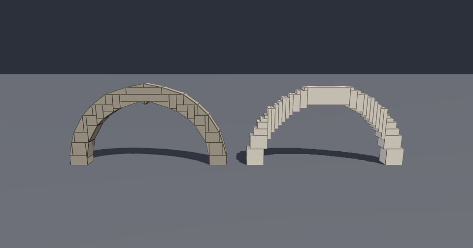

The same arch fitted with sloped bricks, on the left, and with cubes alone,
on the right.

Both can hold the same amount of material, so a measure of volume alone
cannot tell them apart. Worse, the fit that is closest by volume is usually
a staircase, because many small bricks can follow a curve a little more
tightly than a few long wedges. Brickloft therefore gives up a little closeness
to get slopes that meet end to end, and it measures closeness and slopes
separately so that the trade can be seen.

## 2. The grid and the bricks

### The grid

The smallest microbrick is a cube one fifth of a stud on each side. The
game measures positions in units, and this cube is 2 units on a side. Brickloft
calls this cube a **cell**, and every length in Brickloft is counted in cells.

A brick's position in the game must be a whole number of units, which is a
half cell. So before anything is computed, every point, radius and
thickness of a form is rounded to the nearest half cell (`Spec::snapped` in
[core/src/spec.rs](../core/src/spec.rs)). A form
placed between units could only be approximated by bricks that are all
slightly off it, and the error would drift in and out along a curve. On the
half-cell grid, a form's straight edges and its symmetries line up with the
bricks', and those parts come out exact.

Cells are numbered by three whole numbers. Cell $`(i, j, k)`$ is the cube
$`[i, i+1] \times [j, j+1] \times [k, k+1]`$, which means the cube whose
$`x`$ runs from $`i`$ to $`i+1`$, whose $`y`$ runs from $`j`$ to $`j+1`$,
and whose $`z`$ runs from $`k`$ to $`k+1`$. The corners of cells, the points
whose coordinates are all whole numbers, are called **lattice points**. The
middles of cells are the points whose coordinates all end in a half.

### The nine brick shapes

A brick is a **box** that is a whole number of cells long in each direction,
filled with one of nine **shapes**. Every shape is one of the game's own
microbricks ([core/src/shapes.rs](../core/src/shapes.rs),
the enum `Kind`). To describe a shape, take its box as the unit cube, where
$`x`$, $`y`$ and $`z`$ each run from 0 to 1. The column "Solid" gives the
rule a point of that cube must meet to be inside the shape. Each picture shows
the shape in yellow inside the outline of its box. The ramp is drawn lying
down, with $`z`$ in place of $`y`$ in its rule, so that its slope faces up. The pictures are drawn
from the mesh the editor itself displays, by
[editor/examples/shape_pictures.rs](../editor/examples/shape_pictures.rs).

| | Shape | Game brick | Solid | Corners held | Share of box | Poses |
|---|---|---|---|---|---|---|
|  | Cube | Micro-Brick | all of it | 8 | 1 | 1 |
|  | Ramp | Micro-Wedge | $`x + y \le 1`$ | 6 | 1/2 | 12 |
|  | Tetrahedron | Micro-Wedge Triangle Corner | $`x + y + z \le 1`$ | 4 | 1/6 | 8 |
|  | Cut cube | Micro-Wedge Outer Corner | $`x + y + z \le 2`$ | 7 | 5/6 | 8 |
|  | Hip | Micro-Wedge Corner | $`\max(x, y) \le 1 - z`$ | 5 | 1/3 | 24 |
|  | Inner corner | Micro-Wedge Inner Corner | $`\min(x, y) + z \le 1`$ | 7 | 2/3 | 24 |
| 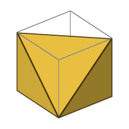 | Half outer corner | Micro-Wedge 1/2 Outer Corner | $`x + y \le 1,\ z \le x + y`$ | 5 | 1/3 | 24 |
|  | Half inner corner | Micro-Wedge 1/2 Inner Corner | $`x + y \le 1,\ z \le y`$ | 4 | 1/6 | 12 |
| 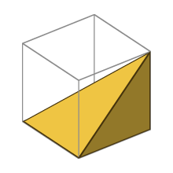 | its mirror image | Micro-Wedge 1/2 Inner Corner Inv. | $`x + y \le 1,\ z \le x`$ | 4 | 1/6 | 12 |

Each rule is a test on the point's coordinates. The ramp's rule $`x + y \le 1`$
says that a point is inside when its distance from one side plus its
distance from the next side is at most one box width. That cuts the box in
half along a diagonal plane, which is a wedge. The tetrahedron's rule adds a
third distance, so only the corner near the origin passes: a small
three-sided pyramid with a sixth of the box. The hip is a quarter of a
square pyramid. It is the piece at the corner of a hipped roof, where two
slopes meet along a ridge, and its rule says the point must be under both
slopes.

"Poses" is the number of different ways the shape can sit in its box when
the box is turned in any of the 24 ways a cube can be turned. A cube looks
the same every way, so it has one pose. A ramp has 12 because its sloped
face can face any of the cube's 12 edges. Across all nine shapes there are
125 poses.

### A shape is a set of corners

The program describes a shape by which of its box's eight corners it
touches. Every shape except one is exactly the **convex hull** of the
corners it holds. The convex hull of some points is the solid you get by
stretching shrink-wrap around them: the smallest solid with no dents that
contains them all. So once you know which corners a shape holds, you know
the whole shape.

Eight corners, each either held or not, fit in one 8-bit number. Think of a
row of eight switches, one per corner, each on or off. This number is the
shape's **corner mask**. Corner $`(x, y, z)`$, where each of $`x, y, z`$ is
0 or 1, is switch number $`x + 2y + 4z`$. For example, the tetrahedron at
the origin holds corners 0, 1, 2 and 4, which are $`(0,0,0)`$, $`(1,0,0)`$,
$`(0,1,0)`$ and $`(0,0,1)`$. Switches 0, 1, 2 and 4 on give the binary
number 00010111, which is 0x17 in the hexadecimal notation programmers use.
These are the first lines of `Kind::canonical` in `shapes.rs`:

```rust
        match self {
            Kind::Cube => 0xff,
            Kind::Ramp => 0x77, // missing the edge x=1,y=1: solid where x + y <= 1
            Kind::Tet => 0x17,  // corner 0 and its neighbours: x + y + z <= 1
            Kind::Cut => 0x7f,  // missing corner 7: x + y + z <= 2
```

The cube has every switch on (0xff). The ramp lacks corners 3 and 7, which
are $`(1,1,0)`$ and $`(1,1,1)`$, the two ends of one edge.

Stretching a box to any size stretches its shape with it, and the corner
mask does not change, so one mask describes a ramp one cell long or twenty.
Turning or mirroring a brick moves its corners to other corners, so the
program turns or mirrors a brick by reordering the eight switches, without
any geometry. The program can tell a shape from its mask with one table
lookup (`shape_info` in `shapes.rs`), and a mask that is no shape at all is
caught the same way. Two bricks whose boxes share a face, and whose masks
agree on that face's four corners, meet exactly, with no gap and no
overlap. The fitters therefore only have to get the corners right, and the
faces between bricks follow.

To test whether a point is inside a shape, the program measures the point's
distance from a special corner of the shape (the tetrahedron's right-angle
corner, the cut cube's missing corner) and applies the shape's rule. This is
part of `inside_shape` in `shapes.rs`; `a`, `b` and `d` are the point's
three coordinates measured from that corner:

```rust
    let c = info.corner;
    let a = if c & 1 != 0 { 1.0 - u } else { u };
    let b = if c & 2 != 0 { 1.0 - v } else { v };
    let d = if c & 4 != 0 { 1.0 - w } else { w };
    // ...
    match info.kind {
        Kind::Cube => true,
        Kind::Tet => a + b + d < 1.0,
        Kind::Cut => a + b + d > 1.0,
```

The tests are strict (`<` and `>`), so a point lying exactly on a sloped
face counts as outside. A regular grid of samples puts many samples exactly
on a 45° face, so this rule decides how much of a ramp the measurement of
section 10 counts.

### The inner corner


The inner corner is the one shape that is not the convex hull of its
corners. It is a box with a hip taken out of it: a valley where two slopes
meet in an inside corner, as in the corner of a room under a sloping roof.
It touches seven corners, the same seven a cut cube touches, so the corners
alone cannot tell the two apart. Its corner mask is therefore written
differently. It is the three corners that the missing hip does not touch.
No other shape has a mask of only three corners, so the mask is still
unique. Turning or mirroring still works by moving the switches, because the
missing hip turns with the brick. Only code that reads a mask as "these
corners are solid" has to check for this case first (`corners` in
`shapes.rs`).

### How the shapes fit together

Several pairs of shapes fill a box exactly between them. A tetrahedron and a cut cube fill a box between them, split by the
plane $`x + y + z = \text{const}`$, a plane tilted equally towards all three
axes. A plane tilted on all three axes therefore passes through the grid
cutting alternate layers of cells into tetrahedra and cut cubes. A ramp and
the ramp facing it fill a box. So do a hip and an inner corner. Two half
inner corners make a hip, and a ramp standing upright plus a half outer
corner make a cut cube. When a fitter takes one shape out of a box, it can often name
the brick that fills the rest (`rest_of_box` in
[core/src/fit_round.rs](../core/src/fit_round.rs)).

### Naming a brick for the game

The game does not know about corner masks. It names a brick by its asset
(which of the nine bricks), its size, and one of 24 orientations. The
module [core/src/orient.rs](../core/src/orient.rs) (`Solver::place`)
translates. For each corner mask it finds the orientation that turns the
game's unturned brick into that pose, preferring orientations that keep the
brick upright, and reorders the box's three sizes to match the turn. The
game's assets are the same nine shapes in their unturned pose, so every one
of the 125 poses can be reached.

## 3. From a form to bricks: the pipeline

Every form passes through the same stages, from the settings the player
chose to the finished bricks. The main function is `build` in
[core/src/spec.rs](../core/src/spec.rs).

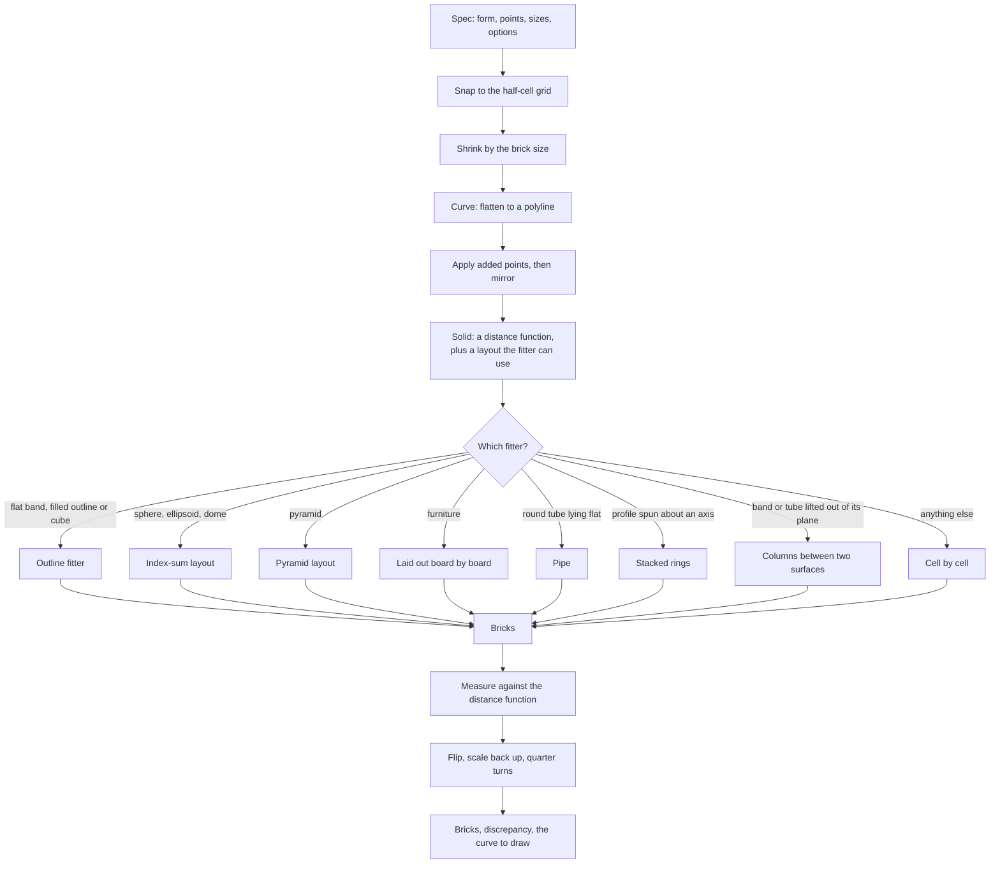

For every form the program computes a **distance function**, a precise
description of the solid that can be asked about any point (section 5). It
also computes a **layout**, which is whatever structure the right fitter
needs: an outline in two dimensions, a list of cut positions, or a profile.
The bricks are made from the layout. The distance function is used
afterwards to measure them, so the measurement does not depend on which
fitter made the bricks, and no fitter measures its own work.

Some forms cannot be laid out. A sphere whose centre is off the half-cell
grid, or a hollow shell whose wall is too thin for its layout, are
examples. Those forms fall through to the cell-by-cell fitter, which needs
only the distance function and works for any solid at all. It is the safety
net, and it is also the roughest method, which is why each common form has a
fitter of its own.

## 4. Curves

Arches, circles, splines and Bézier curves all start as a curve, and every
curve is turned into a **polyline**: a chain of short straight segments
([core/src/curves.rs](../core/src/curves.rs), `flatten`). The segments are
made short enough that the chain never strays more than 0.02 of a cell from
the true curve, which is far below anything a brick can show. The program
splits each piece in half, and keeps splitting, until the middle of the
true curve is within that distance of the middle of the straight segment.
Everything after this point works on polylines. As a result, adding a new
kind of curve never touches a fitter.

### Circle through three points

An arch with a third point added becomes the circular arc through all three
points. To find that circle's centre, write $`a = P_1 - P_0`$ and
$`b = P_2 - P_0`$ for the two arrows from the first point to the others, and
$`n = a \times b`$ for their cross product, which is an arrow standing
square to the plane of the three points. The centre is

```math
c = P_0 + \frac{\lvert a\rvert^2\,(b \times n) + \lvert b\rvert^2\,(n \times a)}{2\,\lvert n\rvert^2}
```

Here $`\lvert a\rvert`$ is the length of the arrow $`a`$. In words, the
centre is the first point moved by a blend of two directions lying in the
plane, each weighted by the squared length of the other arrow, so that the
result is the same distance from all three points. `circle3` in `curves.rs`
has it as one line:

```rust
    let center =
        p0 + (b.cross(n) * a.length_squared() + n.cross(a) * b.length_squared()) / (2.0 * n2);
```

Three points in a straight line have $`n = 0`$, since two arrows in the same
line have no plane between them. No circle passes through them, and the
program says so instead of dividing by zero.

### Arches

A round arch is given by its two feet a span $`L`$ apart and its rise
$`s`$, the height of its crown above the feet. The circular arc through the
feet and the crown has radius

```math
R = \frac{L^2/4 + s^2}{2s}
```

This comes from a right-angled triangle formed by the centre, one foot and
the point under the crown. As a check, a span of 16 with a rise of 8 gives
$`R = (64 + 64)/16 = 8`$, a semicircle, and in general the arch is a
semicircle when $`s = L/2`$. A lower rise of 4 on the same span gives
$`R = (64 + 16)/8 = 10`$, a flatter arc of a larger circle.

The other arch kinds are formulas between the same feet (`arch` in
`curves.rs`). A pointed arch is two arcs meeting at a point at the top,
each centred on the line between the feet. A triangular arch is two straight
sides. An elliptical arch is half an ellipse. A parabolic arch is
$`z = s\,(1 - (2x/L)^2)`$, where $`x`$ is the distance from the middle: at
the middle $`z = s`$, and at the feet, where $`x = \pm L/2`$, $`z = 0`$. A
catenary arch is the shape of a hanging chain turned upside down,
$`z = s - a\,(\cosh(x/a) - 1)`$. The number $`a`$ sets how sharply the chain
curves, and no formula gives it directly from the rise, so the program finds
it by repeated halving. It tries a value, checks whether that arch is too
tall or too short, and narrows the range, 200 times.

### Spline

A spline is a smooth curve through any number of points. Brickloft uses a
centripetal Catmull-Rom spline (`catmull_rom` in `curves.rs`). It passes
through every point, and between two points it bends according to the
points on either side. The word "centripetal" refers to how the curve's
progress is spaced between points. The spacing grows with the square root
of the distance between neighbouring points, $`\lvert P_{i+1} - P_i\rvert^{1/2}`$.
This spacing is the one choice known never to make a cusp (a sharp point) or
a small loop between two points, which the other common spacings can do when
points are unevenly spread.

### Bézier

A Bézier curve does not pass through its points. Each point pulls the curve
towards itself, and the curve passes near them as a blend. Brickloft uses the
rational form, with a weight $`w_i`$ for each point $`P_i`$
(`rational_bezier` in `curves.rs`):

```math
C(t) = \frac{\sum_i w_i\,B_i(t)\,P_i}{\sum_i w_i\,B_i(t)}
```

As $`t`$ runs from 0 to 1, $`C(t)`$ traces the curve. The $`B_i(t)`$ are the
Bernstein polynomials, a standard set of blending amounts that are never
negative and always add up to one, so the curve is a weighted average of
the points. Each point's share is multiplied by its weight, and the bottom
line divides by the total so that the shares still add up to one. A larger
weight therefore pulls the curve closer to its point.

With weights, a Bézier curve can draw an exact circular arc. With three
points, the middle weight decides what kind of curve comes out. Below 1 it
is part of an ellipse, exactly 1 is a parabola, above 1 a hyperbola, and
$`\cos(\theta/2)`$ gives an exact circular arc of angle $`\theta`$. For
example, a quarter circle has $`\theta = 90^\circ`$, so the middle weight is
$`\cos 45^\circ \approx 0.707`$. A Bézier curve without weights cannot draw a
circle exactly, only approximately.

## 5. Solids as distance functions

### What a distance function is

A fitter needs to ask one question many millions of times: is this point
inside the form? Brickloft answers it with a **distance function**
([core/src/sdf.rs](../core/src/sdf.rs), the enum `Field`). It is a rule
$`f(p)`$ that takes a point $`p`$ and gives one number. The number is
negative inside the form and positive outside, and near the surface it
equals the distance to the surface, in cells. At the surface it is zero.

The numbers work like heights on a contour map that has the form's surface
as sea level. A point under the sea has a negative height and a point on land a positive
one, and the height tells you how far you are from the shore. For a sphere
of radius 10 centred at the origin, $`f(p)`$ is the point's distance from
the centre minus 10: a point 3 from the centre gives $`-7`$ (inside, 7 cells
from the surface), and a point 12 from the centre gives $`2`$ (outside, 2
cells away).

### The solids

The forms are built from five basic solids, each with a short rule for
$`f`$.

| Solid | $`f(p)`$ |
|---|---|
| Round tube of radius $`r`$ along a curve | $`\mathrm{dist}(p, \text{curve}) - r`$ |
| Flat band along a curve in a plane | $`\max\big(\mathrm{dist}_{\text{in plane}} - \tfrac{t}{2},\ \lvert\text{height above plane}\rvert - \tfrac{d}{2}\big)`$ |
| Ellipsoid with radii $`r_x, r_y, r_z`$ | $`\big(\sqrt{\sum (p_k/r_k)^2} - 1\big)\cdot \min_k r_k`$ |
| Outline spun about an upright axis | the outline's 2D function at $`\big(\sqrt{x^2+y^2},\ z\big)`$ |
| Pyramid | the largest of the distances out of its four slopes, its base and its top |

A round tube is every
point within $`r`$ of its curve, so the function is the distance to the
curve less $`r`$. A point is inside a flat band of width $`t`$ and depth
$`d`$ only if it is both within $`t/2`$ of the curve in its plane and within
$`d/2`$ of that plane. The larger of the two numbers is negative only when both are,
so taking the maximum means "inside both". For an ellipsoid, $`p_k/r_k`$
measures each coordinate in units of that axis's radius, and the square
root is 1 exactly on the surface. It is exact for a sphere and a close
estimate near the surface of any ellipsoid. A form spun about an upright
axis, such as a vase, is described by its outline in a half-plane: how far
out from the axis, and how high. Any point in space is answered by finding
its distance from the axis, $`\sqrt{x^2 + y^2}`$, and asking the outline. A
pyramid is inside all four of its slopes, above its base and below its top,
so again the largest of the six numbers decides.

### Combining solids

Solids combine by taking the smaller or larger of two numbers.

| Combination | $`f`$ |
|---|---|
| Both of $`A`$ and $`B`$ together | $`\min(f_A, f_B)`$ |
| $`A`$ cut to where $`B`$ is | $`\max(f_A, f_B)`$ |
| $`A`$ with $`B`$ taken out | $`\max(f_A, -f_B)`$ |

A point is in "both together" if it is in either, and the smaller number is
negative when either is. A point is in "$`A`$ cut to $`B`$" only if it is in
both, which is the larger number again. Taking $`B`$ out uses $`-f_B`$,
which turns $`B`$ inside out, because it is negative outside $`B`$. In
`Field::eval` in `sdf.rs` each combination is one line:

```rust
            Field::Either(a, b) => a.eval(p).min(b.eval(p)),
            // ...
            Field::Without(a, b) => a.eval(p).max(-b.eval(p)),
```

With these, a dome is an ellipsoid cut by a flat floor, a segment is an
ellipsoid cut between two heights, and a hollow shell is an ellipsoid with
a smaller one taken out. None of these needs its own case in the code.

### Why whole regions can be skipped

Every fitter relies on the fact that $`f`$ never claims the surface is
further away than it is. If $`f(p) = 5`$, there is certainly no surface
within 5 cells of $`p`$. That lets the fitters and the measurement test one
point in the middle of a large region and skip the whole region when the
number is large enough ([performance.md](performance.md) explains how much
time this saves). Operations that stretch space, such as squashing a round
tube into an oval or pulling a point out of a sphere, could break the
property, because stretching moves the surface further from where the
formula thinks it is. They therefore scale their result down by the largest
stretch they can cause, which keeps the number an underestimate.

## 6. What is being minimised

Write $`F`$ for the form and $`B`$ for the solid made by all the bricks
together. The **discrepancy** is the volume where they disagree:

```math
E = \mathrm{vol}(F \setminus B) + \mathrm{vol}(B \setminus F)
```

Read $`F \setminus B`$ as "the part of $`F`$ that is not in $`B`$". The
first term is material that should be there and is not, and the second is
material that is there and should not be. The program reports $`E`$ as a
share of the form's volume. For a flat form, the same idea is measured in
area.

Suppose the form fills exactly half of one cell, cut by a diagonal plane.
An empty cell then misses half a
cell of form, so $`E = 0.5`$. A cube adds half a cell too much, so
$`E = 0.5`$. The ramp that matches the cut has $`E = 0`$.

Each brick has its box to itself, because the game refuses bricks whose
boxes overlap (section 7.7 has the one exception). $`E`$
is then a sum over boxes, and each box can be judged on its own. That makes
the simplest case exactly solvable. If every brick is one cell, each cell
can hold nothing or one shape, the choices in different cells do not affect
each other, and trying every choice in every cell finds the true smallest
$`E`$ for one-cell bricks.

However, that best answer is a staircase wherever the surface is not at
45°, and its sloped bricks do not line up with one another. Each fitter
below therefore adds structure so that slopes are long and neighbouring
bricks share whole faces, and pays for it with a slightly larger $`E`$. For
a sphere of radius 12, the trade is 3 to 4% discrepancy with no stepped
faces, against 2 to 3% with a third of the surface stepped. The second
number is closer and looks worse, which is why the program measures the
surface separately (section 10).

## 7. The fitters

### 7.1 Cell by cell

The cell-by-cell fitter ([core/src/fit_volume.rs](../core/src/fit_volume.rs),
`fit_volume`) is the general method. It is used when no layout applies, and
it works for any solid that has a distance function. It classifies each
cell, chooses a shape for it, removes spikes, stretches ramps and merges
cubes, in that order.


A hollow sphere with a wall 2 thick, fitted cell by cell. Each cell has the
brick that suits it best, and neighbouring slopes do not line up.

#### Classifying each cell

The program tests 64 points in each cell, a
$`4 \times 4 \times 4`$ grid of **samples**. Each sample is either inside
the form or not, which is one switch, so the 64 answers fit in one 64-bit
number, a row of 64 switches. This is `cell_bits`:

```rust
    let bits = (0..K * K * K).fold(0u64, |bits, s| {
        let p = DVec3::new(
            (s % K) as f64 + 0.5,
            (s / K % K) as f64 + 0.5,
            (s / (K * K)) as f64 + 0.5,
        ) / K as f64;
        // strictly inside, to agree with the planar fitter on samples
        // lying exactly on the surface
        bits | ((f(cell + p) < 0.0) as u64) << s
    });
```

`K` is 4. Sample number `s` sits at the middle of one of the 64 small cubes
the cell is divided into, and its switch is on when the distance function
is negative there.

#### Choosing a shape for each cell

Each candidate shape has its own 64-bit
number, worked out once: which samples it covers. The disagreement between
the cell and a candidate is the number of samples where the two rows of
switches differ, which a processor finds in two instructions. The
exclusive-or (written `^`) of two numbers has a switch on wherever the two
differ, and `count_ones` counts the switches that are on.

```rust
                            let mut scores = [(0u32, 0u32); 30];
                            for (score, (mask, pattern)) in scores.iter_mut().zip(patterns) {
                                *score =
                                    ((bits ^ pattern).count_ones(), (corners ^ mask).count_ones());
                            }
                            let (mask, pattern) =
                                patterns[least_unshared(&scores[..patterns.len()], 2)];
```

The cell gets the candidate that disagrees least. When two candidates
disagree equally, the second number decides, which is how many of the
cell's eight corners the candidate gets wrong. There are 30 candidates: nothing, a cube,
12 ramps, 8 tetrahedra and 8 cut cubes. Hips and the other newer shapes are
left out on purpose. They belong on a ridge or a valley that a layout
places, and offering them to every cell of a curved surface would nearly
double the work for a brick that suits almost none of them.

#### Removing spikes

Where a gently curving surface clips the corner of an
otherwise empty cell, the best brick for that cell by volume is a
tetrahedron, and it stands alone on the surface like a thorn. A tetrahedron
looks right only in an inside corner, with at least two of its three flat
faces against neighbouring bricks. So any tetrahedron with fewer than two
backed faces is removed (`drop_spikes`). The volume this leaves unbuilt is
at most a sixth of a cell. The check is repeated, up to four times, because
removing one spike can leave a neighbouring tetrahedron without its backing.

#### Stretching ramps

A one-cell ramp always slopes at 45°. A gentler surface,
such as the top of a dome, would therefore come out as a row of teeth, each
tooth the best brick for its own cell. One ramp two to six cells long and
one cell high (or one cell long and two to six high) follows such a slope
far better. A second pass (`stretch_ramps`) tries such ramps through every
cell the surface crosses and replaces the cells' bricks wherever a stretched
ramp disagrees less with the form than they did. The biggest improvements
are taken first. A stretched ramp may not reach into a cell the form does
not touch, because its thin end would poke through flat faces, such as the
underside of a dome's rim.

#### Merging

Cubes next to each other are then joined into larger boxes,
first along $`x`$, then the run along $`y`$, then the slab along $`z`$
(`merge`). Ramps of the same pose are joined end to end along their length,
up to the longest brick allowed. Merging changes the brick count and never
the shape, because two cubes side by side are exactly one longer box.

The result is the closest of all the methods by volume and the roughest to
look at, because no cell knows what its neighbours hold, so nothing makes
one cell's slope continue into the next.

### 7.2 Flat outlines

A flat band, a ring or a filled outline is a two-dimensional shape pushed
straight through the grid, like a biscuit cutter pushed through dough. So it
is fitted in two dimensions and then extended through the depth
([core/src/fit_planar.rs](../core/src/fit_planar.rs), `fit_planar`). In two
dimensions the bricks become flat **pieces**: rectangles, which become
cubes, and right-angled triangles, which become ramps standing through the
depth.

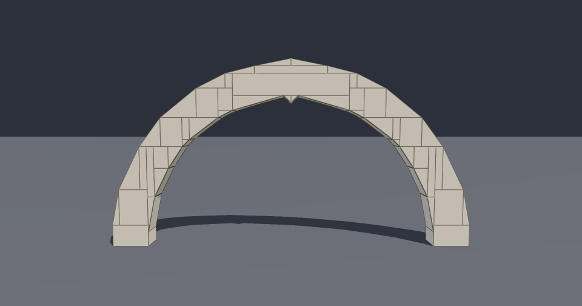

This fitter is smooth because it fits an outline first and fills it
afterwards. The fitted outline is a polygon whose corners are lattice
points. Each side of the polygon is level, upright or sloped. A sloped side
is the long side of exactly one right-angled triangle whose other two sides
lie along the grid, so each sloped side becomes one triangle piece.
Neighbouring sides share a corner by construction, so slopes always meet
end to end and there is no place for a stray step. The fitter's work is
therefore to choose which lattice points are the corners.

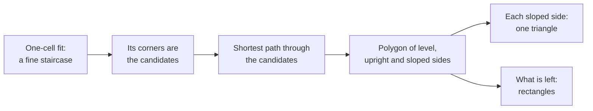

#### Finding candidate corners

The form is first fitted with one-cell pieces, as in 7.1, but in two
dimensions and with a finer $`8 \times 8`$ grid of samples per cell. Each
cell gets an empty square, a full square or one of four half-square
triangles, whichever disagrees least with the form. A cell exactly half
full, where empty and full are equally wrong, is settled by its neighbours:
it is filled if at least two of the cells beside it hold something. The
boundary of this one-cell fit is a fine staircase with 45° corners that hugs
the true outline, and the lattice points along it are the candidates.

#### Cutting the outline into stretches

The staircase is then cut where it truly turns back, at its highest,
lowest, leftmost and rightmost places (`turning_points`). A turn counts
only if the outline comes back by two cells or more, because a wobble of
one cell is just the one-cell fit rounding. Between two cuts, the outline
runs one way in $`x`$ and one way in $`y`$, like one quarter of a circle.
The cuts matter because a triangle's long side can only stand in for a
stretch that runs one way, so every stretch can be solved separately.

#### Choosing corners by a shortest-path search

Along each stretch, the corners are chosen by a **shortest-path search**
(`Search::cheapest`). Think of planning a journey along a road with many
possible overnight stops. Each day's travel has a cost, and you want the
cheapest whole journey. You do not need to try every combination of stops.
For each stop in turn, the cheapest way to arrive there is the cheapest way
to reach some earlier stop plus the cost of the last day, and the earlier
stops have already been worked out. This method, which builds the best
answer from the best answers to smaller problems, is called dynamic
programming. It finds the exact best journey in a fraction of the time it
would take to try them all.

Here the stops are the candidate corners, and a "day" is one side of the
polygon. Going from candidate $`i`$ to a later candidate $`j`$ in one side
costs

```math
\text{cost}(i \to j) = \underbrace{e(i, j)}_{\text{area between the side and the true outline}} + \underbrace{\lambda}_{\text{price of a corner}}
```

The first term, $`e(i, j)`$, is the disagreement the side brings. In the
program it is how much the side's triangle gets wrong, less what the
one-cell pieces it replaces got wrong. The second term, $`\lambda`$, is a fixed price
for each corner of the polygon. The search finds the chain of sides with the
least total cost. $`\lambda`$ is 0.1 of a cell plus the **Simplify**
setting. Even at Simplify 0 the price favours slopes, because a step is two
corners where a slope is one, so a slope wins whenever it fits as well as
the step. The
base price is kept small because a tenth of a cell is about the least
disagreement that can be seen at all.

For example, take a stretch where the true outline climbs 1 cell over 3
cells across, and suppose the one-cell fit there is a level tread 2 cells
long followed by a 45° chamfer. That is two sides, and pays the corner
price twice. One side from start to end is a single triangle 3 by 1, and
pays it once. If the triangle gets the area about as right as the two
sides did, it costs $`\lambda`$ less, so it is chosen.

#### Turning one way

Chosen on area alone, a slope that the lattice has no single side for is
made by alternating the two nearest slopes: 1 in 1, 1 in 2, 1 in 1, 1 in 2.
This is fractionally closer by area, but it turns left, right, left, right.
Seen from above, the result is a curve with a ripple in it. So the search
also charges three quarters of a cell every time the outline changes the
direction it is turning in. A curve really bending one way pays nothing, and
an S-bend pays once. Because of this charge, the state of the search is a
corner together with the way the outline last turned, and the sides come out
in order of slope. These lines of `Search::cheapest` add the charge:

```rust
                        let now = match turn {
                            0 => was,
                            1 => 1,
                            _ => 2,
                        };
                        let wiggle = if was != 0 && now != was { WIGGLE } else { 0 };
                        let total = earlier.cost[was] + cost + wiggle;
```

`turn` is 0 for straight on, 1 for one way and anything else for the other.
`was` is the way the outline last turned (0 if it has not turned yet), and
`WIGGLE` is the three quarters of a cell, counted in samples.

#### Thin walls, rings and filling

Where the two faces of a thin wall want the same cell, the larger triangle
has it, and the stretch on the other face is solved again around what was
taken. This is repeated up to four rounds. The longer stretches, which are
the outer faces of curves, are solved first.

A ring is moved half a cell where needed so that its edge runs along
lattice lines where it crosses an axis (`off_lattice` in `spec.rs`). Left
half a cell off, that straight part of its edge fits best by area as a row
of small triangles, each half a cell, which looks like the teeth of a saw.
An open band, such as an arch, is run on half a cell past its end points
where those sit at cell centres. Cut off exactly at the end points, the band
would cover half of each end cell, and half a cell is the one amount no
brick can build.

The finished polygon is filled with the triangles of its sloped sides and,
for everything else inside it, rectangles found by a sweep across the rows
(`scan_fill`). The discrepancy is then measured from the finished pieces
sample by sample.

An earlier version chose each triangle separately on its own merit. It
measured slightly closer and left a step wherever two triangles' ends did
not happen to meet, and patching those afterwards never fully worked. That
is why continuity is now built into the structure, as one outline, instead
of repaired afterwards.

#### A cube is an outline with square corners

A cube has no fitter of its own
([core/src/spec/cube.rs](../core/src/spec/cube.rs)). It is a rectangle
pushed through the box's shortest length, fitted by the outline fitter
like a band or a filled curve. An outline that runs along lattice lines
is all whole cells to that fitter, which joins them into the largest
boxes it can. A solid cube no longer than the longest brick is therefore
one brick, and a cube is built with no discrepancy. Laying the boxes out
directly would have been a few lines of code. The outline was used so
that stepping stones, tile patterns and added points, which are all laid
on a flat outline, work on a cube with nothing further written.

Each pair of sides is put on lattice lines a whole number of cells apart.
With $`r`$ for the cube's half side, $`s_k`$ for its stretch along axis
$`k`$ and $`c_k`$ for its middle, the length and the two sides are

```math
\ell_k = \max\big(1,\ \text{round}(2\,r\,s_k)\big), \qquad a_k = \big\lceil c_k - \tfrac{\ell_k}{2} - \tfrac{1}{2} \big\rceil, \qquad b_k = a_k + \ell_k
```

For example, a cube with $`r = 8.5`$ and its middle at 0.5 has
$`\ell = 17`$, $`a = \lceil -8.5 \rceil = -8`$ and $`b = 9`$, which is
centred on 0.5. A length that cannot be centred on the middle, an even
one about the middle of a cell or an odd one about a
lattice line, lies half a cell to the low side.

The axis the rectangle is pushed through is the one the cube is shortest
along, and of two as short as each other the later one, so that a cube
with all sides equal is built through its height (`through`). A pattern
is pushed through the same axis, so it shows on the largest face.

The outline is the rectangle itself, from its four corners. A curve's
band is everything within half its thickness of a path, which rounds the
outside of every corner, and a frame drawn that way came out with its
corners cut off.

A hollow cube is one of two things, by its size:

| The hollow cube | What is built |
|---|---|
| its walls would meet in the middle | a solid cube |
| too short for a hollow between a floor and a lid | a frame: the rectangle less a smaller one inside it, open through its shortest length |
| anything larger | closed on all six sides, as three outlines stacked: a slab, a frame and a slab |

Walls on four sides only, as a hollow pyramid is open underneath, would
have left a room without a floor or a tower without a shaft, depending on
which length happened to be shortest.

A cube one cell each way is laid directly as one brick, because the
outline fitter loses a square cell that stands alone. A cube with points
added to it is no longer a box and is handed on as a closed curve. A
cube is never a round tube.

### 7.3 Spheres, ellipsoids and domes

A sphere is laid out whole, by one rule, with no cell-by-cell choosing
([core/src/fit_round.rs](../core/src/fit_round.rs), `fit_round`). The rule
works because the equation of a sphere is a sum of one term for each axis.


#### Turning the sphere's equation into a count

The sphere of radius $`r`$ is

```math
\frac{x^2}{r^2} + \frac{y^2}{r^2} + \frac{z^2}{r^2} \le 1
```

In words, a point is inside when the squares of its three distances from
the centre, each measured in units of the radius, add up to at most 1. This
is a sum of three separate terms, one per axis. Now cut each axis at chosen
distances $`t_0 < t_1 < \dots < t_K`$ from the centre, numbered 0 to $`K`$,
and choose them so that

```math
\left(\frac{t_i}{r}\right)^2 = \frac{i}{K} \quad\text{that is}\quad t_i = r\sqrt{i/K}
```

Each cut $`i`$ is placed so that its term in the sphere's sum is exactly
$`i/K`$. So a lattice point at cut numbers $`(i, j, k)`$ along the three
axes has $`x^2/r^2 + y^2/r^2 + z^2/r^2 = (i + j + k)/K`$. It is inside the
sphere exactly when

```math
i + j + k \le K
```

The curved test has become a sum of three whole numbers compared with
$`K`$. In `fit_round`, the corners of each box are tested this way:

```rust
                let within = |limit: usize| {
                    (0..8u8).fold(0u8, |m, corner| {
                        let sum: usize = (0..3)
                            .map(|k| lines[k][at[k] + (corner >> k & 1) as usize].1)
                            .sum();
                        m | ((sum <= limit) as u8) << corner
                    })
                };
```

For each of the eight corners of a box, it adds the three cut numbers and
switches that corner on if the sum is at most the limit. The result is a
corner mask, which is the brick for that box.

#### Why every box holds exactly one brick

The cuts divide space into boxes. Moving from a box's inner corner (the one
nearest the centre) to any neighbouring corner raises one cut number by one.
So a box's eight corners have index sums $`s, s+1, s+1, s+1, s+2, s+2, s+2, s+3`$,
where $`s`$ is the sum at its inner corner. Which of them are inside depends
only on how $`s`$ compares with $`K`$:

| $`s`$ compared with $`K`$ | Corners inside | Brick |
|---|---|---|
| $`s + 3 \le K`$ | all 8 | cube |
| $`s + 2 = K`$ | 7 | cut cube |
| $`s + 1 = K`$ | 4 | tetrahedron |
| $`s = K`$ | 1 | none (a point) |

Every row is one of the shapes, so every box is nothing, a whole box, or
one stretched brick. Where the centre is in the middle of a cell, the two
cuts either side of the middle are both numbered 0, and a box between them
has corners whose sums do not rise along that axis. The same count then
gives a ramp. Neighbouring boxes share their corners, so every brick meets
its neighbours face to face. The surface has no steps and no gaps by
construction, and with the ideal cuts every corner on the surface lies on
the sphere.

#### A worked example

Take a sphere of radius $`r = 4`$ centred on a lattice point, and
$`K = 2`$. The ideal cuts are $`t_0 = 0`$, $`t_1 = 4\sqrt{1/2} \approx 2.83`$
and $`t_2 = 4`$. The cuts must be whole numbers of cells, so they become 0,
3 and 4. Here is the quarter of the slice $`z = 0`$, with each lattice point
marked with its index sum $`i + j`$ (the $`z`$ number is 0) and whether
that sum is at most $`K = 2`$:

```
             x = 0     x = 3     x = 4
  y = 4      2 in      3 out     4 out
  y = 3      1 in      2 in      3 out
  y = 0      0 in      1 in      2 in
```

Now take the boxes of the bottom layer, from $`z = 0`$ to $`z = 3`$:

| Box, in cells | Sum at inner corner $`s`$ | Rule | Brick |
|---|---|---|---|
| $`x`$ 0 to 3, $`y`$ 0 to 3 | 0 | $`s + 2 = K`$ | cut cube, 3 by 3 by 3 |
| $`x`$ 3 to 4, $`y`$ 0 to 3 | 1 | $`s + 1 = K`$ | tetrahedron, 1 by 3 by 3 |
| $`x`$ 0 to 3, $`y`$ 3 to 4 | 1 | $`s + 1 = K`$ | tetrahedron, 3 by 1 by 3 |
| $`x`$ 3 to 4, $`y`$ 3 to 4 | 2 | $`s = K`$ | nothing |

In the layer above, from $`z = 3`$ to $`z = 4`$, only the box over the
centre has $`s = 1`$ and holds a tetrahedron. So one eighth of this sphere
is four bricks: one cut cube and three tetrahedra. The corner at
$`(4, 0, 0)`$ lies exactly on the sphere. The corner at $`(3, 3, 0)`$ is
$`\sqrt{18} \approx 4.24`$ from the centre instead of 4, because the cut
2.83 had to be rounded to 3. That rounding is the only error left, so the
cuts are placed to keep it small.

#### Putting the cuts on the lattice

The ideal cuts $`r\sqrt{i/K}`$ are not whole numbers, and rounding each one
on its own gives uneven gaps such as 2, 1, 2, 1, which make a surface that
folds in and out along every ring. So the cuts are chosen together by
dynamic programming (`cuts` in `fit_round.rs`), the same kind of search as
in 7.2, under two rules. Every gap must be at least one cell, and gaps must
never grow going outwards. The second rule keeps the solid convex, without
dents. The search works from the outside in, because the outer gaps are the
narrow ones and those are the ones the lattice constrains.

#### Choosing K

$`K`$ is the number of rings of facets. More rings means finer facets, but
each cut is then nearer its neighbours than rounding can place it. The
program tries every $`K`$ the lattice has room for, each with the corners
aimed at the true surface and also slightly outside it (0.15 and 0.3 of a
cell). It scores each against the true solid without building anything,
from the cut positions alone. The best four are then improved by moving one
cut a cell at a time while the score improves, and the best result is kept.
About one ring per two to three cells of radius is typical.

#### Ellipsoids, domes and shells

An ellipsoid uses the same method with a different radius on each axis. A
dome or a segment is cut off flat at one of the cuts along $`z`$, so its
flat face is a layer of whole boxes. A hollow shell is the same solid with
a smaller one taken out, so the corners with $`i + j + k \le K - m`$ are
hollow. The wall is then $`m`$ numbered layers thick, and $`m`$ is at
least 2. With $`m = 1`$, a box could have both the outer and the inner surface
passing through it, and one box can hold only one brick. A shell needs a
wall of about 2.5 cells or more for the lattice to have room. Thinner walls
fall back to the cell-by-cell fitter of 7.1.

### 7.4 Pyramids

A pyramid uses the same box layout with a different rule
([core/src/fit_pyramid.rs](../core/src/fit_pyramid.rs), `fit_pyramid`).
Number the cuts across the base from the middle outwards, and the levels
from the base upwards, with $`L`$ levels in all. A corner is inside the
pyramid when

```math
\max(i_x, i_y) + i_z \le L
```

Here $`i_x`$ and $`i_y`$ are the corner's cut numbers across, and $`i_z`$ its
level. The larger of the two numbers across says how far out the corner is,
measured in the square rings a pyramid's level is made of. Adding the level
says that each step up shrinks the allowed ring by one. In code:

```rust
                let under = |lower: usize| {
                    (0..8u8).fold(0u8, |m, corner| {
                        let number = |k: usize| lines[k][[x, y, z][k] + (corner >> k & 1) as usize].1;
                        m | ((number(0).max(number(1)) + number(2) + lower <= levels as usize) as u8) << corner
                    })
                };
```

With this rule the boxes hold ramps on the four slopes and hips on the four
ridges. The bricks are exactly the pyramid's four slopes. For example, centre a pyramid on a lattice
point with $`L = 1`$. Each quarter is one box from the middle to the edge
and from the base to the apex. Its corners at the base have
$`\max(i_x, i_y) + 0 \le 1`$, so all four are inside; at the top, only the
corner over the middle has $`0 + 1 \le 1`$. Four base corners and one apex
corner are a hip. So that pyramid is four hips and nothing else. The number
of levels $`L`$ is as small as keeps every brick within the longest
allowed.


A hollow pyramid seen from underneath.

A pyramid that is not filled is hollow, a tent open underneath. It has a
smaller pyramid, $`\max(i_x, i_y) + i_z \le L - 2`$, taken out of it. The
inner one is two levels lower for the same reason a shell's wall is two
layers thick, which is that no box then has both the outer and the inner
slope passing through it. The bricks on the inside are what the smaller pyramid's bricks
would leave of their boxes. A ramp leaves a ramp, and a hip leaves an inner
corner, which runs up each inside ridge. $`L`$ is chosen to divide the
height and both half-widths evenly, so that the slopes stay flat. The wall
then comes out near the thickness asked for, but not exactly.

### 7.5 Round tubes and tori

A round tube along a curve lying flat, and a torus, are built as a pipe
whose cross-section is an octagon ([core/src/fit_stack.rs](../core/src/fit_stack.rs),
`pipe`). An octagon is the roundest section bricks allow, because ramps
make 45° faces. It has a flat top, a wall each side, and a sloped chamfer
between them, all running along the curve.

```
       ______
      /      \      the chamfer: c cells in, c cells up
     |        |     the wall
     |        |
      \______/
     <---w---->
```

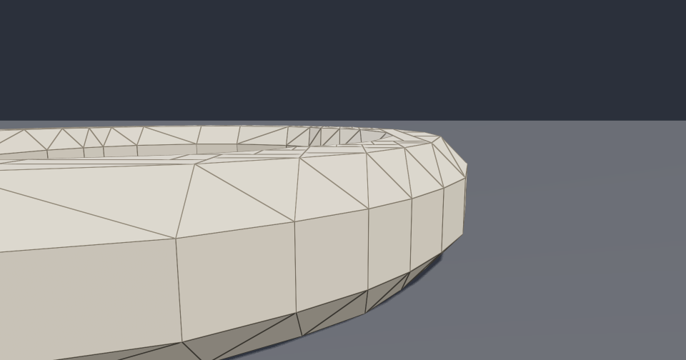

For a section $`w`$ cells across, the sloping sides are as long as the flat
ones when each chamfer is

```math
c = w\left(1 - \tfrac{1}{\sqrt{2}}\right)
```

rounded to whole cells. This comes from the regular octagon: its slanted
side, $`c\sqrt{2}`$ long, equals its flat side, $`w - 2c`$. For a tube 8
across, $`c = 8 \times 0.293 \approx 2.3`$, so the chamfer is 2 cells. In
`spec.rs` it is one line, which also stops the chamfer short of the middle:

```rust
    let chamfer_of = |count: i32| ((count as f64 * (1.0 - std::f64::consts::FRAC_1_SQRT_2)).round() as i32).min((count - 1) / 2);
```

The program also chooses between the whole number of cells just below and
just above the asked thickness, whichever makes an octagon nearer the
circle in area. A tube 6.5 across is far closer to an octagon 6 across (28
cells in section, against the circle's 33) than to one 7 across (41).

The pipe is built wall first, then the chamfers.

1. The band of the tube's full width is fitted as an outline, as in 7.2.
2. The chamfer is cut back from that outline towards the narrower top. Each
   level or upright side of the outline gets a ramp; the triangle of each
   sloped side becomes a tetrahedron; and where two sides meet there is a
   corner brick. An inside corner between two ramps is an inner corner.
   Each of these bricks spans all the chamfer's layers at once.
3. The same is done at the underside.

These bricks share whole faces and start exactly on the wall, so the
chamfer is one continuous surface. Internally the chamfer is worked out as
the air above it growing inwards from the air around the wall (`grow`), and
each block of air becomes the brick that fills the rest of its box. Because
it is the air that grows, where bricks from two sides of a tight curve
would cross and one must be left out, what remains is solid standing a
little proud, not a hole.

The wall's outline is fitted knowing that the top will be cut back from it
(`fit_planar_towards` in `fit_planar.rs`). A sloped side is charged for
landing the top's outline off the true surface. A level or upright side
shorter than the chamfer is charged for the corner bricks it has no room
for. And no sloped side may be deeper than the chamfer.

The chamfer was first built the other way, outwards from the narrow top
band. Where that band ran diagonally it could only be fitted as a staircase,
its chamfer bricks collided and were dropped, and the wall was left with
holes. A ring of radius 19 had 29% of its faces stepped that way and has 1%
now.

A torus is a circle built as a round tube, and needs nothing of its own.
Stretched within its plane, the circle becomes an ellipse; stretched across
its plane, the tube becomes that many times as deep as it is wide, an oval
in section. Filled, every layer takes in everything the circle encloses,
which makes a disc with a rounded rim. The **Protruded** option builds the
tube differently, as flat bands of different widths stacked side by side.
That is smooth along the curve and stepped across it.

### 7.6 Profiles spun about an axis

A vase, a bell or a bowl is a profile spun about an upright axis, like a
pot on a potter's wheel ([core/src/fit_lathe.rs](../core/src/fit_lathe.rs),
`fit_lathe`). Its section, the outline in the half-plane of (distance from
the axis, height), is fitted as an outline, as in 7.2. Each side of that
outline becomes a ring when spun:

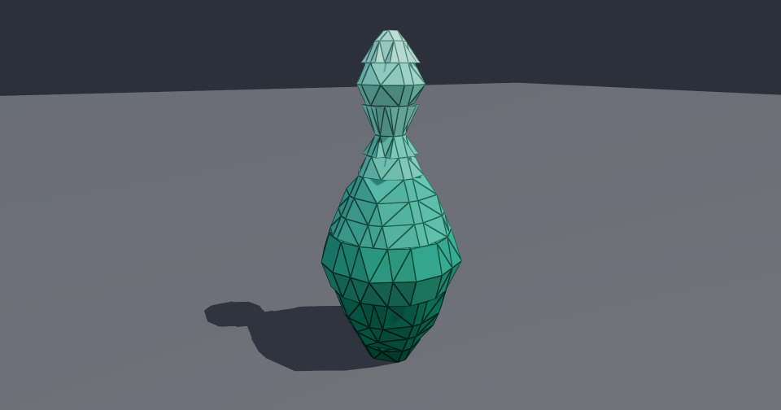

| A side of the section | becomes |
|---|---|
| upright | a wall standing on a circle |
| level | a flat face |
| sloped | a ring whose circle shrinks as it rises |

Each circle is itself fitted as an outline. A sloped ring is then exactly
the chamfer of a pipe from 7.5: the outline of its wide end is cut back to
its narrow end. Each ring's wide outline is fitted for that ring, knowing
how far in its narrow end is, because the depth of the chamfer's bricks is
set by the outline's own triangles. Reusing one outline for the next ring
was tried first, and made a cone bulge between its four axes.

Sloped sides of the section are kept to one cell across or one cell up, so
that the bricks of a wall's two faces keep to their own cells. That can be
done two ways, during the fitting or after it. Neither is better for every
form, since a straight cone suits one and a thin curved wall the other. So both
are built, both are measured, and the one with the lower discrepancy is
kept. While a form is being dragged, only the first is built, for speed.

#### Creases

A hollow form has two faces, the outer face and the wall of its hollow, and
in two kinds of place they end on the same circle. One is the crest of a
lip, where the solid between the faces comes to an edge. The other is the
bottom of a groove, where the air between them does. Both are called a
crease here.

Since each ring's outline is fitted for that ring, the two rings that end on
a crease's circle had two outlines of it, which differ by slivers. Along one
face that is only a ledge a fraction of a cell wide. At a crease the bricks
of the two rings lie against each other all the way round, and a sliver puts
the boxes of one ring in the cells of the other, so none of them fit. They
were built as whole cells, a ring of steps round every crease.

The two rings of a crease are now built on one outline of its circle
(`Crease` in `fit_lathe.rs`).

1. The ring that narrows away from the crease is cut back from that outline,
   as any ring is. The ring that widens away from it is grown outwards from
   the same outline, which the chamfer's code (`grow`) does equally well. A
   wall that ends in a crease stands on the outline.
2. Under a level or upright side of the outline, the two rings' ramps lie
   back to back in separate boxes. Under a sloped side they need the same
   box, because that side crosses its box on the diagonal and each ring's
   face comes to the diagonal from its own side. The two bricks share the
   box, one on each side of the diagonal, as the two halves of a folded cell
   do in a lifted band (7.7). In a groove they are two tetrahedra. On a
   ridge they are two half outer corners, which together make a roof with
   its ridge along the diagonal.
3. Two bricks share a box only if they go through the same layers. Where
   the two sides of the section that meet in a crease differ in height, the
   taller is cut at the height of the shorter (`level_creases`). Part of it
   becomes a wall, since a sloped side taller than its neighbour is only
   one cell across.

The shared outline is fitted for the shallower of the two rings, so that
both can use every sloped side of it. The deeper ring then stands up to a
cell proud just inside the crease, as a reused outline always does.

On a bell with an upturned lip, built as a shell 3.5 cells thick, the
stepped share of the surface fell from 11.8% to 5.6%, and the ring of whole
cubes round the lip's crest is gone.

A wall whose bricks will not fit, because the wall is so thin that the
boxes of its two faces cross, is built cell by cell along that face: a
staircase within half a cell of it. Its bricks' whole boxes were built solid
before, and stood as far out as a box is deep.

### 7.7 Bands and tubes lifted out of their plane

When a point added to a flat curve pulls it up out of its plane, the
curve's outline seen from above is unchanged, and only its height varies
along it. These forms are built by [core/src/fit_ribbon.rs](../core/src/fit_ribbon.rs).

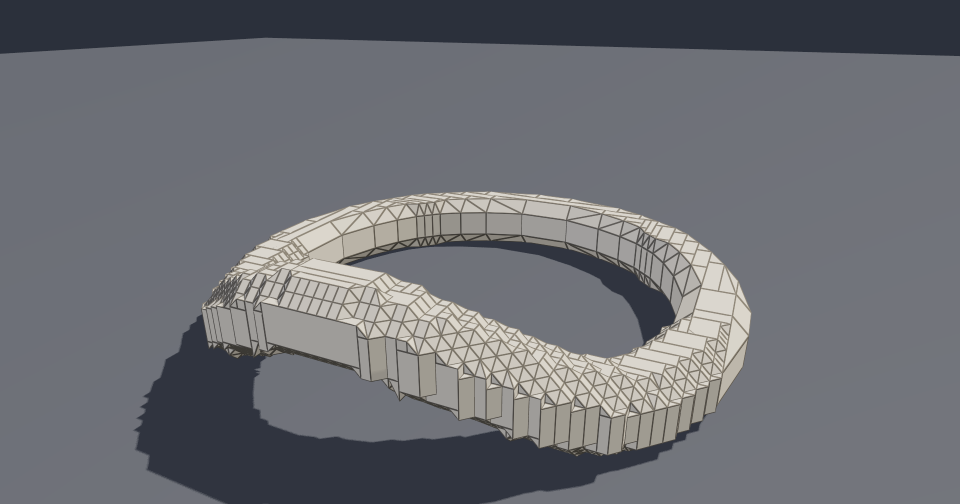

A torus with one point pulled up by 10. The part still lying flat keeps its
pipe, and the lifted part is built one cell of ground at a time.

#### A lifted tube

A lifted tube is treated as two surfaces over the ground it covers: its top
and its underside. It keeps the eight-sided section of the flat pipe in
7.5, moved straight up with the curve. Take a point of the ground at
distance $`d`$ from the curve, where the curve is at height $`\ell`$ and
climbing with slope $`m`$ (the height gained per cell travelled). Write
$`r`$ for half the tube's width, $`H`$ for half its height and $`c`$ for
its chamfer. The tube's top and underside there are at

```math
z_{\pm} = \ell \pm \big(H - \min(\max(d - (r - c),\ 0),\ c)\big)\sqrt{1 + m^2}
```

The bracket is the half-height of the octagon at distance $`d`$ from its
middle. It is $`H`$ across the level top, falls one for one across the
chamfer, and is $`H - c`$ at the wall. The square root is there because
the tube's section stands square to its curve. Where the curve climbs, a
vertical line crosses the section at a slant, so the tube is taller
measured straight up. For example, with $`H = 4`$ directly over the curve
($`d = 0`$) on a level stretch, the top is 4 above the curve. On a slope of
1 in 1 ($`m = 1`$) it is $`4\sqrt{2} \approx 5.7`$ above. This is `span`
inside `lifted_tube` in `spec.rs`:

```rust
    let span = |u: f64, v: f64| {
        let (off, lift, slope) = near(u, v);
        let tall = (half_tall - (off - (radius - chamfer)).clamp(0.0, chamfer)) * (1.0 + slope * slope).sqrt();
        (centre + lift - tall, centre + lift + tall)
    };
```

A round section was used first. Its top falls away ever more steeply
towards its sides, and a surface steeper than one cell up per cell across
cannot be made of bricks one cell square, so the sides came out as tall
slivers standing proud of one another. With the octagon, the steep part is
an upright wall. The stretch by $`\sqrt{1 + m^2}`$ is limited, so that the
tube never reaches further than $`H`$ past the lowest and highest points of
the curve over that ground. Without the limit, a curve that turns straight
up for a short way made $`m`$ very large there and the tube a tall blade. A
curve pulled into a loop passes over the same ground twice at two heights,
and each pass is built as its own tube. Whole cells would give that wall the outline of a
staircase wherever the tube runs at an angle to the grid, so each notch of
the staircase is filled with half a cell, a ramp standing on end.

Upright columns still fail where the curve itself climbs more steeply than
one cell up per cell along, because the top and the underside are then
steeper than a brick one cell square can follow, and the tube came out as a
comb of tall fins. A curve cannot run steeply along all three axes at once,
so such a stretch is built in columns lying on their sides, along the axis
the curve runs least along there (`steep_stretches` in `spec.rs`). Seen
along that axis, the steep stretch is a gently sloped tube again. Where a
stretch built one way gives way to a stretch built the other, both are cut
off square at a lattice plane the curve crosses once, and each keeps to its
own side. A last pass leaves out any brick that shares room with one
already placed, since the two ways of building do not agree to the cell at
a tight turn.

Bricks are laid a cell at a time and then joined: a row of like bricks end
to end becomes one brick (`in_rows` in `fit_ribbon.rs`), so a slope that is
level across a tube five cells wide is one ramp five wide.

On a tube 11 across pulled up by 25 cells, the stepped share of the outside
fell from 6.7% with a round section in upright columns to 3.5% now, and the
brick count from 4,387 to 3,592.

Each surface is built one cell of ground at a time, from its heights at the
cell's four corners rounded to whole cells (`columns` and `parts_of` in
`fit_ribbon.rs`). Corner heights that differ by any whole amount are joined
by one brick as tall as needed:

| The four corners | Brick or bricks |
|---|---|
| all level | none |
| two next to each other higher | a ramp |
| one higher | a hip, or a tetrahedron on half the cell if the surface is hollow there |
| three higher | an inner corner, or a cut cube if the surface bulges there |
| two opposite higher (a saddle) | two half outer corners along the ridge, or two tetrahedra along the valley |
| three heights, one opposite pair level | each half of the cell rises from the level pair to its own corner: a tetrahedron where that corner is higher, a half outer corner where it is lower |

Where the table offers two answers, the true surface's height over the
middle of the cell decides which one fits. The underside is the same table
applied upside down, and everything between the two surfaces is whole
cubes.

A cell whose four corners are at three or four heights with neither
opposite pair level cannot be joined by single bricks. A tube running at an
angle to the grid has many such cells, since its top falls one way across
it and climbs another way along it. The nearer opposite pair is then set
level at the height between them, which makes the cell two half squares.
Its edge no longer quite meets its neighbours' at those two corners. The
mismatch is a lip of half the height difference, where a plain block would
be a step of all of it.

Away from the lift, the tube keeps its ordinary pipe from 7.5. The ground is
shared out a cell at a time. Cells under the lifted part are rebuilt from
top to bottom, and so are cells under any sloped pipe brick that reaches
into them, since such a brick cannot be cut.

#### A lifted flat band

A lifted flat band is built the same way as a lifted tube: its flat bricks
are kept where the curve is still in its plane, and the rest is columns
between an underside and a top (`lifted_band` in `spec.rs`). Only the
section differs. A band's section is a rectangle, $`t`$ thick across the
curve in the plane it lay in and $`D`$ deep the other way, and it stands
square to the curve as the tube's octagon does. Where the curve climbs with
slope $`m`$, the top and underside of an upright column are at

```math
z_{\pm} = \ell \pm \tfrac{D}{2}\sqrt{1 + m^2}
```

The band's two faces in its plane stay exactly upright however the curve
climbs, so in upright columns they are walls, and the ground the columns
stand on is the flat band's own outline. That outline has already been
fitted, with long three-cornered bricks, by the outline fitter of 7.2. So
the ground is taken from the flat band's bricks: one cell for each cell of a
block, and half a box for each three-cornered brick, which is then given
one sloped brick on top and one underneath, as long as the brick itself. A
three-cornered brick is kept only where the band's top climbs no more than
a cell and a half from one of its corners to another (`LONG_RISE`). One
brick cannot follow a top that bends along it. Where a brick is given up,
its ground is whole cells with their notches filled, as for a tube.

Where the curve climbs steeply the columns are laid on their sides, as a
tube's are. A rectangle has two pairs of faces, and for columns along any
axis the pair that faces more nearly along the columns is their top and
underside, and the other pair is the walls they stop at (`band_over` in
`spec.rs`). The walls are taken to run straight along the columns. That is
exact when the curve runs square to the columns as seen from above. When
it does not, the rectangle is built as a slanted four-sided figure with the
same top, underside and width through its middle.

The band was first built from the flat band's own bricks, each moved up or
down to the curve's height where it stood, with a sloped brick on top and
the matching brick underneath where the curve climbed. That kept the
fitted outline everywhere, and failed in two ways. A long three-cornered
brick of the outline cannot be bent, so where the curve climbed along one
it was moved whole and stood out of the band as a slab. And where the
curve climbed more than a cell per cell, a cell's corners were further
apart than the band was deep, and the cell became a plain block. The form
was also measured as the flat band's rectangle slid straight up and down,
which is thinner the steeper it climbs.

| Form | Stepped before | Stepped now |
|---|---|---|
| ring of radius 8, 2 thick and 2 deep, pulled up by 7.5 and 3.5 | 23.9% | 11.2% |
| the same ring 3.5 thick | 16.3% | 8.9% |
| ring of radius 20, 4 thick and 3 deep, pulled up by 5 | 3.5% | 2.3% |
| ring of radius 16, 4 thick and 4 deep, pulled up by 16 | 13.9% | 8.6% |
| round arch of span 32, 3 thick and 4 deep, its crown pulled out by 8 | 10.9% | 5.7% |

In these lifted forms, and nowhere else, two bricks may share a box, as
the two halves of a cell folded along its diagonal.

### 7.8 Stepping stones

A flat band or a filled outline can be laid as separate stones in place of
solid brick ([core/src/pattern.rs](../core/src/pattern.rs)). The stones
follow whatever region the form gives: the band along a curved path, a
ring, a disc. With a gap between them they are a path of stepping stones.
With the gap at 0 they are fitted together, as in a stone wall or a paved
floor.


#### Scattering the stones

Points are scattered over the region, one for each stone, by throwing
darts. A dart is a random place in the region, and it is kept only if it is
no nearer than a least distance to every point already kept. This is
called Poisson disc sampling. It spreads the points evenly, the way stones
are, without the rows and columns a grid would show. The least distance is
the **Stone size** made smaller by the **Uneven** setting, so uneven stones
are allowed to crowd.

The random places come from a small number generator started from the
form's **Seed**. One seed therefore always gives the same path of stones,
and the next seed a different one.

#### The shape of a stone

A stone is the ground nearer its own point than any other point. This
division of ground among points is a Voronoi diagram. The edge between two
stones is the line half way between their points, so a stone is a polygon.

Take a stone grown from the point $`s`$ and a neighbour grown from $`t`$.
How far a place $`p`$ is on the stone's own side of the line half way
between them is

```math
e_t(p) = \frac{\lvert p - t\rvert^2 - \lvert p - s\rvert^2}{2\,\lvert t - s\rvert}
```

This is positive on the stone's side, zero on the line and negative past
it. For example, with $`s`$ at the origin and $`t`$ 8 cells away along x,
the place 1 cell along x gives $`(49 - 1)/16 = 3`$, which is its distance
from the line at $`x = 4`$.

A place is inside the stone when it is on the stone's side of every such
line by at least half the gap $`g`$, and that far inside the region's edge
too. Writing $`e_0(p)`$ for the distance inside the region's edge, the test
is

```math
\min_t\, e_t(p) \ge \tfrac{g}{2}
```

With the gap at 0 the test is $`\min_t e_t(p) \ge 0`$, and two neighbouring
stones meet along the line between them.

That gives a polygon with sharp corners. A stone's corners are rounded, so
the smallest of the distances is replaced by a smooth version of the
smallest,

```math
m(p) = -\frac{1}{k}\,\ln \sum_t e^{-k\,e_t(p)}
```

Where one distance is much smaller than the others, the sum is almost its
one largest term and $`m`$ equals that distance, so the edges stay where
they were. Where two distances are nearly equal, at a corner, $`m`$ falls a
little below both, which draws the corner in and rounds it. The number
$`k`$ sets how tight the rounding is, and is 2.5 per cell, which rounds a
corner over about half a cell. A rounder setting was tried first. It fell
short of the true smallest along the whole of every edge, since a small
stone has several lines within a cell or two of any place on its edge, and
the stones came out a cell and a half short all round.

The smooth smallest differs from the plain smallest only near a corner,
where two distances are within a cell or so of each other. `Stone::eval`
therefore finds the plain smallest first. Where that puts a place well
inside the stone or well outside, the answer is taken from it, and the
exponentials are worked out only for the places that are left. Taking the
exponential of every distance at every place was most of the time a path of
stones took: 170 ms for a path that takes 20 ms as solid brick.

```rust
        // how far the smooth least can fall below the plain least, with room to spare
        let near = 2.0 / self.sharp;
        let mut least = f64::INFINITY;
        for (towards, far) in &self.lines {
            least = least.min(far - towards.dot(p));
        }
        if least < self.half_gap - near {
            return self.half_gap - least; // well past a neighbour's line: outside
        }
        let edge = -region(p);
        let least = least.min(edge);
        if least < self.half_gap - near || least > self.half_gap + near {
            return self.half_gap - least;
        }
        let mut sum = (-self.sharp * edge).exp();
        for (towards, far) in &self.lines {
            sum += (-self.sharp * (far - towards.dot(p))).exp();
        }
        self.half_gap + sum.ln() / self.sharp
```

Each line is kept as a direction towards the neighbour and the line's
distance along it, so `far - towards.dot(p)` is $`e_t(p)`$.

#### Fitting the stones

Each stone is fitted by itself with the outline fitter of 7.2, so every
edge of every stone gets the sloped bricks an outline of its own gets. The
stones were first fitted all at once, as one solid of many parts. Two
stones either side of a narrow gap then wanted cells of the same box for
the triangles of their facing edges. The fitter gave the box to one stone,
and the other's edge was finished in steps, which left it with a corner
missing its wedge.

Fitted apart, the sloped bricks of two facing edges may lie in boxes that
share cells. Both bricks are kept when their solid halves do not meet,
because the gap then runs between them. Whether they meet is tested at nine
places in every cell the two boxes share.

A fit may stray half a cell from its stone, so two fits can meet where the
stones themselves do not. A stone whose bricks would meet a stone already
laid is fitted again drawn in by half a cell, and then by a whole cell if
they still meet. A brick that meets one even then is left out.

#### Stones with no gap

With the gap at 0 every stone meets its neighbours, and stones fitted to
the lines between them do not meet exactly. Each fit strays up to half a
cell from its line, one stone's to this side and its neighbour's to that.
They overlapped in places, the later stone was drawn in, and seams up to a
cell wide were left round every stone: 5% to 38% of a floor was bare,
most where the stones were small.

Two stones meet exactly only if they are given the same edge, and an edge
that bricks can lay exactly from both sides. A straight line from one
corner of the grid to another is such an edge. It is the sloped side of a
right triangle, or of a few alike end to end, and the triangle on its other
side fills the rest of the same box, as the two halves of a cut tile do.

So with no gap each stone's outline is drawn with its corners moved to the
nearest corners of the grid (`Stone::outline` in `pattern.rs`). The
outline is the stone's ground cut out of a box by the line half way to
each neighbour in turn
([Sutherland and Hodgman's clipping](https://en.wikipedia.org/wiki/Sutherland%E2%80%93Hodgman_algorithm)).
A corner is where three stones meet. Each of the three works it out from
the same three points and moves it to the same corner of the grid, so the
two stones either side of an edge have the same two ends for it. Each
stone is then fitted to its outline by itself, on its own thread as
before, and the outline fitter lays an outline of grid corners exactly.

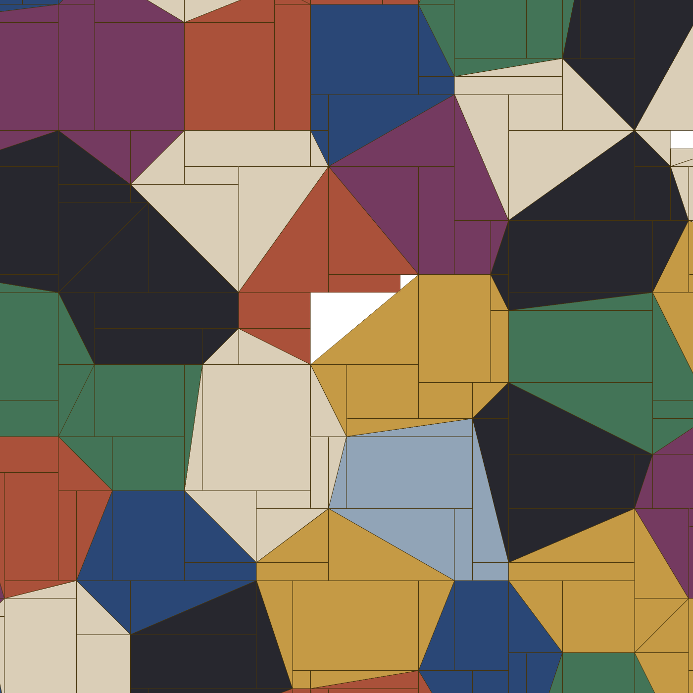

A stone's corners are sharp this way, where with a gap they are rounded,
because a rounded corner would be a hole where three stones meet. A corner
moves by up to seven tenths of a cell, which changes a stone's shape a
little and not its size.

What is left is slivers, of two kinds.

- At the rim of the region an edge ends on the rim and not on a corner of
  the grid, and the two stones may be fitted differently there. A piece
  that would overlap a stone already laid is cut down to the whole cells
  of it that are free, so the hole is the sliver that was amiss and not a
  whole brick.
- An edge that is nearly level (13 cells along for 1 across) is now and
  then fitted as a slope from one side and as a step from the other.

Measured over four floors, four places to a cell, 0.1% to 0.6% of the
ground more than a stone and a half in from the rim is bare, and 0.4% to
4% of the whole floor. Nothing is filled twice away from the rim.

Two other ways were tried. Fitting each stone to the bricks of those laid
before it asked the fitter to follow another fit's staircase. It smooths
across a staircase by design, since a corner costs it something, so its
pieces overlapped the laid bricks and whole pieces had to be left out,
which left a floor with holes in it. Filling the seams afterwards cannot
work, because a seam between two sloped edges that do not match is a
sliver no brick fills.

#### A number for each stone

Every stone has a number, counted from 0 in the order the stones are laid
and starting again after 7, and each brick of a stone carries its stone's
number. The colouring **As the pattern has it** turns the numbers into
colours by the rule in
[Colours by feature](#colours-by-feature), so the bricks of one stone are
always one colour and up to eight colours are shared among the stones.

The number is given when the stone is laid. An earlier colouring worked the
stones out afterwards from the finished bricks alone (`pieces` in
`pattern.rs`), by sampling each brick's solid part and joining samples that
lie side by side. That function remains, and the tests use it to check
that a path's bricks fall into separate stones.

#### Why not wave function collapse

The patterns were asked for under the name of
[wave function collapse](https://github.com/mxgmn/WaveFunctionCollapse),
which fills a grid with tiles that agree with their neighbours. It does not
suit stones, for two reasons. Its rules reach only a few cells, and nothing
that local says how large a stone has grown, since the tiles that make a
stone's inside can be laid without end. Its output is also the grid's own
squares, where a stone wants an outline at any angle. Scattered points give
stones of a chosen size by construction and outlines the fitter can follow.
The tile patterns of 7.9 do not use it either, for the reasons given
[there](#why-not-wave-function-collapse-for-the-tile-patterns).

### 7.9 Tile patterns

A form can also be laid as a pattern of coloured tiles: medallions, a
rug, planks, bricks or cobblestone
(`lay_mosaic` in [core/src/pattern.rs](../core/src/pattern.rs)). A tile is
one cell. It is one colour, or it is cut along a diagonal into two
triangles of two colours. This section describes the pattern on a flat
band, a filled outline or a cube, where the tiles run through the form.
[Further on](#forms-that-are-not-flat-all-over-and-the-sides-of-a-box) it
is laid on the flat part of other forms and on the sides of a box.

Every style is drawn by a rule. The rule is a function that gives a number
for any place on the floor: 0 for the ground, and 1 to 7 for the parts of
the pattern. The tiles are decided from that function, and the numbers are
turned into colours afterwards (see
[Colours by feature](#colours-by-feature)). A rule can be asked about any
place at any size, so one rule draws a floor ten tiles across and a floor
two hundred across.

#### From a region to coloured bricks

The region is first fitted as the one solid it is, by the outline fitter of
7.2, so a patterned floor has the same smooth edge as a plain one. The
pattern then only colours the result, in four steps.

1. The region is cut into tiles of one cell. A tile is decided by the
   pattern only if the fit made its cell a whole cell. Where the edge cuts
   into a cell there is a sloped brick, which is one colour and is dealt
   with last (see [The edge](#the-edge-the-forms-own)). A
   tile within the **Border** setting of the edge is plain ground.
2. The style's rule decides every tile (see the next section).
3. A tile cut into two triangles becomes two sloped bricks of one cell
   each. The two fill one box between them, as the two halves of a sloped
   pair do anywhere else.
4. The remaining whole cells are sorted by colour and joined into bricks.
   Cells of one colour side by side in a row become one run, and a run is
   joined onto the brick above it when that brick is the same run in the
   same colour. Tiles of one colour side by side are therefore one brick
   and not a brick each.

Step 4 gives rectangles that are not always the largest possible. Finding
the largest would give fewer bricks still, and is a harder problem than a
floor's worth of bricks is worth.

The colours were first fitted one at a time, each colour's tiles as a
solid of its own. The outline fitter prefers a slope to a staircase, so it
turned the stepped edge between two colours of small tiles into a slope,
and it did so on both sides, which put bricks of two colours in one place.
Sorting whole cells cannot do that.

A tile could once be set larger than one cell, and wider than it was deep.
That drew the same pattern coarser or stretched and did nothing else a
player wanted, so a tile is now always one cell.

A form with a tile pattern is also built at the finest brick
size whatever the brick budget (section 9). The budget keeps a solid form
from being more bricks than it needs, and a pattern needs every one of its
bricks. A rug 240 cells by 160 is some twenty thousand bricks, and kept
within a budget of 2,500 it was built three times coarser. A larger brick
size can still be chosen by name.

The medallions and the rug are their own mirror images, and their tiles
are set out from the middle of the floor. Set out on the
grid's own lines, a floor that did not lie evenly on them had a part row of
tiles down one side and none down the other, and the pattern sat to one
side. The middle is placed on a corner of the grid and not in the middle of
a tile, because a figure about a corner is made of whole and half tiles. A
floor an odd number of tiles across therefore has one row left over, which
stays plain. Planks, bricks and cobblestone have no middle and are set
out on the grid's lines.

#### How a tile is decided from four samples

A tile's two diagonals cut it into four quarters, towards its top, right,
bottom and left sides. The rule is asked for the number at one place in
each quarter, and the four answers decide the tile (`tile_at`):

| The four samples | The tile |
|---|---|
| all four alike | one colour |
| top and left alike, bottom and right alike, the two pairs different | cut from bottom left to top right, one colour each side |
| top and right alike, bottom and left alike, the two pairs different | cut from top left to bottom right, one colour each side |
| anything else | one colour, the colour at the tile's middle |

```rust
    // the quarters towards the tile's top, right, bottom and left sides
    let [top, right, bottom, left] = [(0.5, 1.0 / 6.0), (5.0 / 6.0, 0.5), (0.5, 5.0 / 6.0), (1.0 / 6.0, 0.5)].map(|(dx, dy)| colour(x + dx, y + dy));
    if top == left && bottom == right && top != bottom {
        [top, ON_CUT, ON_CUT, bottom] // cut from bottom left to top right
    } else if top == right && bottom == left && top != bottom {
        [ON_CUT, top, bottom, ON_CUT] // cut from top left to bottom right
    } else if top == right && right == bottom && bottom == left {
        [top; 4]
    } else {
        [colour(x + 0.5, y + 0.5); 4]
    }
```

A tile is kept as the colour at each of its four corners. The two corners
a cut runs through belong to neither triangle and are marked `ON_CUT`.

An edge between two colours that runs along the grid or along its
diagonals is therefore drawn exactly, and an edge at any other angle is
drawn as the nearest run of whole and cut tiles. The diagonals are the only
slopes on offer because a tile is one cell, and one cell is cut in two only
corner to corner. This is why the rules below are built from lines along
the grid and at 45 degrees wherever they can be.

#### Medallions: bands of a distance measure


Medallions repeats a few ringed figures over the whole floor. Each figure
is a lozenge, a square or an octagon, and each is described by a measure of
how far a place is from it. For a figure with its middle at
$`(c_x, c_y)`$, write $`a = \lvert u - c_x\rvert`$ and
$`b = \lvert v - c_y\rvert`$ for how far the place $`(u, v)`$ is from the
middle across and along. The measure is

```math
f(u, v) = \max\left(a - w,\ \ b - h,\ \ a + b - s\right)
```

The three limits are half the figure's width $`w`$, half its height $`h`$,
and the most that $`a + b`$ may be, $`s`$. A limit that is left out is no
limit. The third alone gives a lozenge, the first two a rectangle, and all
three an octagon. The measure is 0 on the figure's outline, negative
inside it, and grows steadily with distance outside it. For example, a
lozenge with $`s = 3`$ at the origin gives the place $`(4, 1)`$ the measure
$`4 + 1 - 3 = 2`$, two tiles outside it.

One number is worked out for every place, the least of all the figures'
measures there, and the floor is cut into bands one tile wide by its whole
part:

```math
d(p) = \min_i f_i(p), \qquad n(p) = \lfloor d(p) \rfloor
```

The seed draws a short run of bands that are on and off by turns: one to
three pairs of on and off, one or two bands wide each, starting with a band
that is on. Band $`n`$ is on when entry $`n \bmod m`$ of the run is on, where $`m`$
is the run's length, and the run repeats inwards as well as outwards. A
place in a band that is on takes the number of the figure nearest it. A
place in a band that is off is ground.

Because the first band is on, every figure has its outline. Because the run
repeats, every figure is ringed inside and out by bands of its own shape.
Taking the least of the measures is how two distance functions are joined
into one solid in section 5, so where the bands of two figures meet they
join into one outline round both. That joining gives the pattern its
crowded, interlocked look without any rule about which figure may sit
beside which.

The measures are made of $`a`$, $`b`$ and $`a + b`$, which change by whole
tiles along the grid's lines and along its diagonals. A band's edge
therefore runs along the grid or at 45 degrees, the two directions a tile
shows exactly, and nearly every tile is a whole tile or a cut one. The few
tiles where several figures' bands meet take the colour at their middle.

The repeat is $`P`$ tiles each way, with $`P`$ an even number from 8 to 16
as the seed has it, or less on a floor too small for that. A place is folded onto one eighth of a repeat before it is
measured: each coordinate is taken as its distance from the nearest
multiple of $`P`$, and the larger of the two is put first. Four figures are
placed in that eighth, at the middle of the repeat, at its corner, at the
middle of its side and at one place between. Folding makes every repeat its
own mirror image eight ways from four figures.

#### The rug: a medallion carpet


The rug is set out as a medallion carpet of Tabriz or Kashan is, with each
part on a ground of its own colour (`rug_garden`). One quarter of it is
drawn and the other three are its mirror images. From the edge inwards it
has these parts.

| Part | What it is |
|---|---|
| Guard | a line, a chain of small lozenges, a line. A lozenge is two tiles across and made of four tiles cut on the diagonal, so the chain is exact on the grid and meets itself at a corner. |
| Main border | on a dark ground, one stem swinging from side to side as a sine curve, a flower in every hollow of the stem on one side and the other by turns, and a small knot wherever the stem crosses the middle |
| Second guard | as the first, and then the field |
| Medallion | at the middle of the field, up to four layers one inside the next. Each layer has a ring of pointed lobes with round ones between them, an outline, a ground of its own and a bud in every pointed lobe. A flower is at the heart, and a pointed pendant and two lozenges hang from the medallion at each end of the rug's longer way. |
| Corner pieces | a quarter of such a figure in each corner of the field |
| Field | scrolls: a stem coiling in to a flower, with leaves along it. Small flowers fill what is left. |

##### A layered figure

A layer of the medallion is the places within a round body or within one
of the lobes that stand out from it. A round lobe is a disc. A pointed
lobe is what two equal discs have in common, set a little to each side of
the lobe's axis: two bows meeting in a point, the shape of a pointed arch
(the [vesica piscis](https://en.wikipedia.org/wiki/Vesica_piscis)).

The lobes of a layer are all alike, so a place is first turned into one
lobe's slice of the figure and asked about once. For a place $`p`$ at the
distance $`r`$ from the middle, how far it is inside the layer's outline
is

```math
d(p) = \max\Big(R_0 - r,\ \ \rho_1 - \lvert p - c_1\rvert,\ \ \rho_2 - \lvert p - c_2\rvert\Big)
```

Here $`R_0`$ is the size of the round body, $`c_1`$ and $`\rho_1`$ are
the middle and size of the disc that bounds the pointed lobe on the far
side of its axis from $`p`$, and $`c_2`$ and $`\rho_2`$ are those of the
round lobe. Each term is how far inside one disc the place is, and the
greatest of them is how far inside the three together. For example, a
place 2 tiles inside the body and outside both lobes has $`d = 2`$.

The outline is the band $`0 \le d < 1`$, the first tile in, and a second
line is drawn further in where the layer is broad enough. Both follow every
lobe, because both are bands of the one number $`d`$. This is the banding
of a distance measure that the medallions use, applied to discs.

The first rug's medallion was a single rose curve, and its layers were the
same flower drawn smaller. It read as a child's drawing of a flower. A
woven medallion has lobes of two kinds by turns, with each layer turned
half a lobe from the last so that the points of one show between the
points of the next, and the layered figure is built to give that.

##### The field: packing circles

The field is filled by the loop of Wong, Zongker and Salesin
("[Computer-generated floral ornament](https://doi.org/10.1145/280814.280948)",
SIGGRAPH 1998), which grows ornament into whatever space is empty. Find the
largest empty circle left in the field, put a motif in it, and repeat until
what is left is too small. The room at every tile is kept in a grid: how
large a circle about that tile would touch the border, the medallion, a
corner piece or a circle placed so far. Each new circle only lowers the
room near it, so the grid is updated and never rebuilt.

Two changes were made to the loop. The largest circle is not always taken:
each tile's room is first lessened by a share of its own, up to a fifth,
because with the strict rule every seed filled a field the same way. A
circle is also limited in size, because without a limit the first one
filled the whole of the field beside the medallion.

A circle found this way touches something, most often an earlier circle.
Its stem then starts from that circle's stem and coils the opposite way,
so the two run together where they meet, like two gears. This is how
Hamekasi and Samavati join the scrolls of such patterns
("[Designing Persian floral patterns using circle packing](https://doi.org/10.5220/0003850101350142)",
GRAPP 2012). A stem is an
[Archimedean spiral](https://en.wikipedia.org/wiki/Archimedean_spiral),
which closes in by the same amount on every turn, so its coils stay evenly
spaced.

The first rug threw darts for its flowers and joined each to its nearest
neighbour with a straight stem. Darts leave holes and crowds, and straight
stems make a net where a rug has a vine.

##### Small things are drawn on the grid

A flower's size is how far it reaches from its middle. A flower of a size
under five tiles is a lozenge and a square on one middle. Together they make an eight-pointed star whose edges are the grid's
lines and diagonals, so it is drawn in whole tiles and tiles cut in two,
exactly. A round outline that small comes out as a blot of steps. A flower
under two and a half tiles is a lozenge alone.

A larger flower is a
[rose curve](https://en.wikipedia.org/wiki/Rose_(mathematics)) with a
constant added, so that its petals do not reach the middle. Going round
the middle by the angle $`\theta`$, a flower of size $`R`$ with $`n`$
petals has its edge at the distance

```math
r(\theta) = R\left(0.58 + 0.42\,\left\lvert \cos\frac{n\theta}{2} \right\rvert^{0.6}\right)
```

The edge is $`R`$ from the middle at the tip of a petal and $`0.58R`$ at
the notch between two. The power 0.6 makes a petal round at its tip and
the notch sharp. Without it the outline is a wavy circle.

##### Tones, not parts

The rug's seven numbers are tones and not parts: 1 is every line (the
outlines, the guard lines, the stems), 2 the dark ground, 3 the pale
ground, 4 the petals, 5 the leaves, 6 the shaded half of a leaf and the
ground of the corners, and 7 the hearts of flowers. Every part is made of
several tones, and the same few come back all over the rug, which is what
makes it read as one design. A flower is three tones: its petals, a smaller
flower within them and a heart. The first rug gave each part one number,
and each part came out one flat colour.

The cost is that the rug needs its colours. With two colours every tone
but the field's ground is the second colour, and the border, the medallion
and the corners become solid blocks. The rug starts in sets of eight
colours for this reason.

##### What the size of the floor decides

A figure given as a rule is drawn afresh at whatever size the rug is, and
that is the reason the flowers are not small pictures stamped over the
field. A picture is one size, and a flower drawn in tiles for a rug forty
tiles across is a blot on one two hundred across.

The rule also decides how much there is room to show. A layer under five
or six tiles broad is all outline, so the medallion has one layer where its
points reach under 10 tiles from the middle, two from 10, three from 22
and four from 34. It may have twelve lobes only from a reach of 24, and
has eight below it.

##### A small rug

A floor under 48 tiles on its shorter side has no room for a rug's parts at
their own sizes. Drawn by the rules above they came out cut short: a
corner piece was three tiles of one lobe, the pendants were blots, and the
border's knots fell at uneven steps because its swing did not divide the
side. A small rug is therefore set out by rules of its own, with the same
parts made simpler and each of them whole.


| Part | On a small rug |
|---|---|
| Guards | single lines |
| Border | lozenges four tiles across, one at the middle of each side and one every four tiles from it, with a square holding a star at each corner. Under 24 tiles the border is a chain of lozenges two tiles across, which divides a side of any length. |
| Medallion | one layer or two, as its reach allows, and no pendants |
| Corners of the field | cut off on the diagonal behind a line, with one lozenge in the corner where there is room |
| Field | scrolls where they fit and small flowers elsewhere, as on a large rug |

The border is counted from the middle of each side and not from the
corner. A side of any length is then its own mirror image with a whole
lozenge at its middle, and what does not divide by four is taken up beside
the corner squares. A lozenge that would run into a corner square is left
out and not cut short. The diagonal that cuts a corner of the field off is
whole tiles and tiles cut in two, so it is exact on the grid.

A rug of 48 tiles or more is untouched by these rules. Every sum is the
same sum, and the numbers drawn from the seed are drawn in the same order,
so a large rug is tile for tile what it was. A test holds six such rugs to
the tiles they had.

Worked through for a rug half as long again as it is broad, the medallion
has three layers on a floor of about 90 tiles on its shorter side and four
from about 130. A square rug needs more, because the medallion is kept to
0.55 of the field's longer way. A rug is therefore best laid 100 tiles or
more across to show all it can. The picture at the head of this section is
240 tiles by 160 and shows all four layers.

The rug is its own mirror image tile for tile. A place and its mirror
image reach the rule by different sums that can differ by a hair, so both
are first put on the same sixth of a tile, where the four samples of a tile
are taken.

A place asks about the frame and the two figures by a few sums each, and
about the scrolls only of its own square of four tiles by four, which are
two or three. Asking every scroll at every place would be hundreds of
them. The code's own measure is about 30 ms for a rug 250 tiles square.

#### Planks


Planks is a floor of boards laid end to end in rows, with no gap. The
**Size** setting is how broad a board is, in tiles. At the usual size, 2,
a board is 2 tiles broad and 8 to 24 long, and other sizes are in
proportion. The first board of a row is an offcut of any length, as a
carpenter starts a row with what was left of the last, so the joins of one
row fall where they will against the next. Every board has one of eight
numbers, never the number of the board before it in its row.

Wave function collapse can lay a floor of planks too, from a sample of
boards. A board's length is then whatever the sample's windows allow, which
is a few fixed lengths, and the lengths are the whole look of a floor of
planks. Drawing each length from the seed gives any length in the range.

#### Bricks and cobblestone

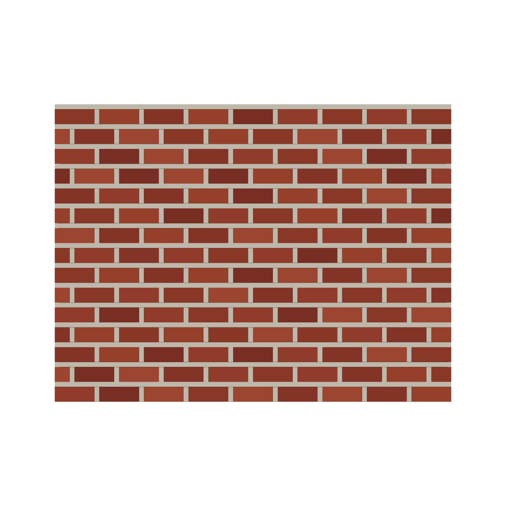 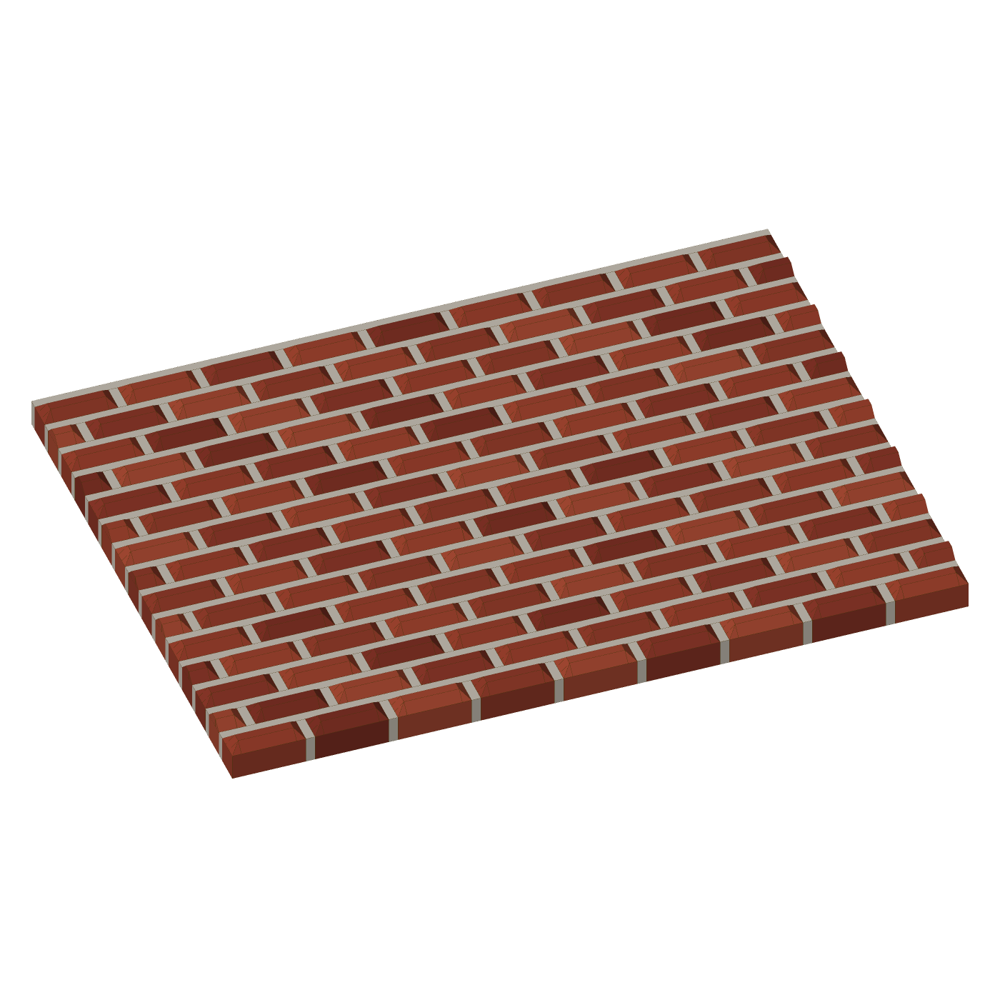 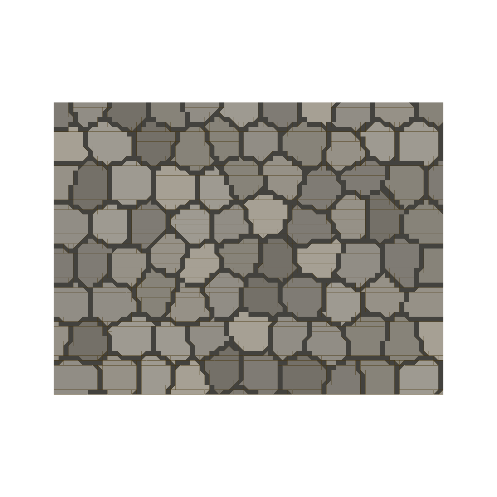

Bricks and cobblestone are a wall or a floor of pieces with mortar between
them (`Masonry` in `pattern.rs`). Bricks are rectangles in courses.
Cobbles are stones of any shape.

The two were one pattern for a while, with one setting between them. That
setting moved the bricks' points about and bent the measure of nearness
from one that makes rectangles to the plain distance. Halfway along it
gave neither: bricks with their corners sheared off at a slant that no
brick is cut at. A wall of bricks and a floor of cobbles are also wanted
in different colours, so each is now a pattern of its own, drawn its own
way.

##### Bricks: courses and joints

A wall of bricks is two sets of lines: the lines between courses, and in
each course the joints between bricks. Write $`s`$ for the **Size**
setting and $`m`$ for the mortar's width, 1 tile or 0. A brick's length
and a course's depth, each with its mortar, are

```math
L = 4s + m, \qquad D = \text{round}(1.5\,s) + m
```

At the usual size of 2 a brick is 8 tiles long and 3 deep before its
mortar.

Course $`r`$ begins at the line $`y_r`$, and brick $`k`$ of that course at
the joint $`x_{r,k}`$:

```math
y_r = rD + \text{round}\big(0.9\,u_2\,(n_r - \tfrac{1}{2})\,(D - m - 1)\big)
```

```math
x_{r,k} = kL - o_r + \text{round}\big(0.9\,u_1\,(n_{r,k} - \tfrac{1}{2})\,(L - m - 1)\big)
```

$`u_1`$ and $`u_2`$ are **Uneven along** and **Uneven across** as numbers
from 0 to 1. $`n_r`$ and $`n_{r,k}`$ are numbers from 0 to 1 that belong
to the course and to the brick, worked out from the seed. $`o_r`$ is how
far the course is moved along (see the stagger below). A place belongs to
the course whose two lines it lies between, and in it to the brick whose
two joints it lies between.

With both settings at 0 the lines are evenly spaced and the bricks are all
alike. As a setting rises, each line moves by an amount of its own.
$`L - m - 1`$ is what a brick has to spare over one tile of brick, and a
line moves by less than half of that, so no brick is squeezed to nothing.
Every line is rounded to a whole tile, so every brick stays a rectangle of
whole tiles whatever the settings. For example, at size 2 with mortar,
$`L = 9`$ and $`D = 4`$. A joint has 7 tiles to spare and moves by up to 3
at $`u_1 = 1`$. A course line has 2 to spare and moves by 1 at most, and
by nothing while $`u_2`$ is under about 0.56, because the product rounds
to 0.

##### Cobblestone: one point to a square

Cobbles are a Voronoi diagram, as the stepping stones of 7.8 are, with
the points placed differently. The points stand one to a square of a grid,
$`2s + 3 + m`$ tiles a side. Each point is moved from the middle of its
square by up to $`0.4\,u_1`$ of the square along and $`0.4\,u_2`$ across.
Every other row is moved along by half a square, so four stones never
meet at one corner. A cobble is the ground nearer its own point than any
other's.

A point never leaves its square, so the nearest point to a place is one
of the 25 in its own row and the two rows either side, two squares along
each way. Only those are compared. The stepping stones scatter their
points by throwing darts, which needs every point kept in a list and a
search through it. A grid gives the same irregular stones with nothing
kept.

With both settings at 0 the points are a regular grid and the cobbles are
squares in staggered rows, so the pattern starts with both at 60%.

##### Mortar, numbers and stagger

For either pattern the rule also gives how far inside its own outline a
place is, $`h`$. For a brick it is the least of the distances to its four
sides, less half the mortar:

```math
h = \min\big(x - x_{r,k},\; x_{r,k+1} - x,\; y - y_r,\; y_{r+1} - y\big) - \tfrac{m}{2}
```

For a cobble it is the least of the distances $`e_t`$ to the lines half
way to its neighbours' points (the formula in 7.8), less the same half.

A place with $`h \le 0`$ is mortar, which is the ground, 0. That is the
half tile either side of a line, so the mortar is one tile wide. Every
place is first moved by half a tile, so that the tile of mortar is one
whole tile of the grid and not half of one and half of the next. For
example, with a joint at $`x = 9`$, a place a quarter of a tile past it
has $`h = 0.25 - 0.5 = -0.25`$ and is mortar, and a place one tile past it
has $`h = 0.5`$ and is brick. With **Mortar between** off, $`m = 0`$ and
the pieces touch.

Every brick has one of six numbers, odd and even by turns along a course,
so two bricks side by side differ in shade even with no mortar between
them. Every cobble has one of seven.

Each course of bricks is moved along from the one before. **Stagger** sets
one share $`t`$ of a brick's length for every course, so that
$`o_r = \text{round}(r\,L\,t)`$: a half is the usual bond, and nothing
stacks the bricks in columns. **Uneven stagger** moves every course by an
amount of its own, so the upright joints fall anywhere, as in a wall laid
without a bond in mind. **Courses upright** swaps the two directions, so
the courses run up the floor and the stagger is from side to side.

The tiles are then decided from four samples as for every style. A
brick's sides lie on the grid's lines, so every tile of a wall of bricks
is a whole tile. A cobble's sides run at any angle and are drawn as the
nearest run of whole and cut tiles.

##### The bevel of a brick

**Bevelled** uses $`h`$ as a height. It applies to bricks alone, it is on
or off, and it is one cell deep. The top cell of every brick is not laid
full. At its outline the brick stands a cell short of the wall's face,
and one cell in from the outline it is whole, so its top slopes down to
its edge all round. The mortar lies at the foot of the slope, one cell
below the face. The form must be 2 cells or more deep, and a wall one
cell deep is laid flat.

The slope is found cell by cell (`lay_tiles`). For each cell of a brick
in the top layer, the brick is asked at the cell's eight corners whether
it reaches that high there. A corner at the bottom of the layer is
reached when $`h \ge 0`$ and a corner at its top when $`h \ge 1`$. The
corners that are reached name the brick, as they do everywhere else in
the program (section 2).

| Corners reached | What is laid |
|---|---|
| all eight | a whole cell |
| the four below and two above | a sloped brick, along a side of the brick |
| the four below and one above | a hipped brick, at a corner of the brick |

This is how the fitter of solid forms chooses a cell's brick (7.1). It is
done by hand here, for one layer, and the solid fitter is not called. A
wall is hundreds of small solids, and that fitter is made for one large
one.

The cells are then joined into the longest bricks that fill the same room
(`joined` in `pattern.rs`). Two bricks join when they are the same shape
and colour, lie end to end with the same extent across, and the shape is
the same all the way along the direction of joining. A sloped brick may
therefore be lengthened along its ridge and not across its slope, which
would change the slope. The top of one brick of the wall comes out as
nine bricks: a sloped one the length of each side, four hipped corners and
a block between them. At the usual size that is 9 bricks where the cells
alone would be 24.

The bevel was once as many cells deep as the player asked. Cobbles had it
too, and each piece could stand a cell or more short of the wall's face.
A cobble's sides run at any angle, and a slope along a side that is not
on the grid or its diagonals came out as a heap of odd single cells.
Deeper bevels and uneven heights read as clutter at one cell to a tile.
What is left is the one case that comes out exactly: a brick, whose sides
are on the grid, with one cell of slope.

##### Grooved planks and sunk mortar

Planks and cobblestone each have one depth of their own. Like the bevel it
is on or off, off to begin with, one cell deep, and cut into the top face
of a form 2 cells or more deep. Both are built only of whole cells and of
ramps as long as a row, which is what the bevel had to be cut down to
before it looked clean.

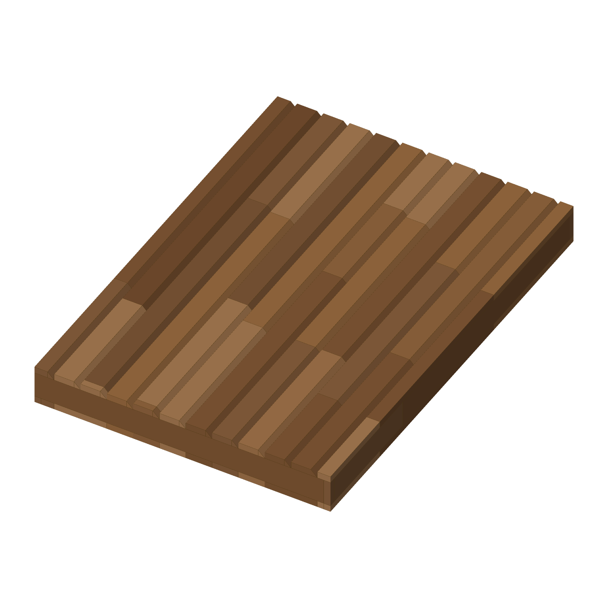 

**Grooved** planks: the last row of tiles of every row of boards is one
long ramp down to the next row. Each row of boards then stands a cell
proud of the one beside it along a straight line, as lapped boards do. The
ramps of one board join into a single brick the length of the board. It
needs boards three tiles broad or more, which is a **Size** of 3. At the
usual size a board is two tiles broad, half of it would be ramp, and a
floor of such boards looked ribbed like corrugated iron in its picture, so
it is left flat. A groove of two ramps facing each other was tried first
and takes a narrow board down to a ridge with no level top.

**Mortar sunk**, for cobblestone: the mortar's tiles have no top cell, so
the stones stand a cell proud of the mortar with upright sides. Where a
stone's slanting edge cuts a tile in two, the stone's half keeps its top
cell and the mortar's half does not. It needs mortar to sink. Cobbles
domed, or bevelled as bricks are, were not brought back, because a slope
along a side at any angle is a spray of single wedges.

#### Colours by feature

 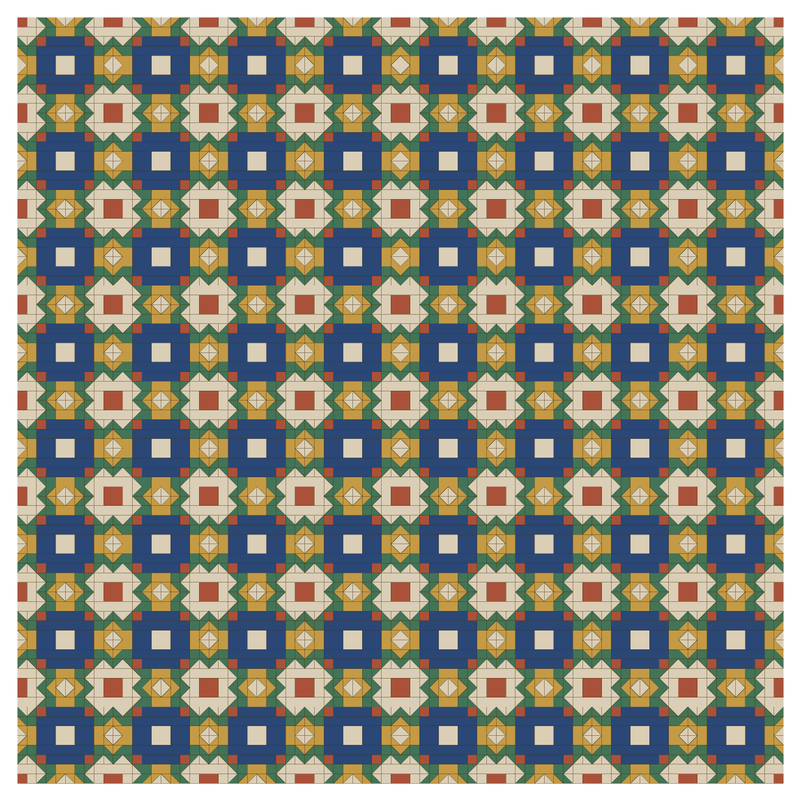

A pattern numbers its parts and not its colours. 0 is the ground, and each
number from 1 to 7 is one feature of the pattern: one of the four figures
of a medallions repeat, one of a rug's tones, one shade of brick or cobble. The
player chooses how many colours there are, up to eight, and `colour_of`
decides which colour a number takes. With $`s`$ for a brick's number and
$`N`$ for the number of colours, counting the colours from 0,

```math
c(s, N) = \begin{cases} 0 & \text{if } s = 0 \text{ or } N \le 1 \\ 1 + \big((s - 1) \bmod (N - 1)\big) & \text{otherwise} \end{cases}
```

The ground has the first colour to itself. The features share the other
colours out in turn, and go round again when there are more features than
colours. For example, with $`N = 4`$ the features 1 to 7 take the colours
1, 2, 3, 1, 2, 3, 1.

Two colours therefore give the whole pattern in one colour on the other,
and every colour added picks one more feature out, until each has its own.
The two pictures above are one floor of medallions, which has four
features, with two colours and with five.

The first rule went round all the colours, the ground's among them. With
fewer colours than features it painted some feature the colour of the
ground, and that feature vanished from the pattern. Keeping the first
colour for the ground prevents that at any number of colours.

Planks and stepping stones have no ground. A board or a stone numbered 0
takes the first colour by the same formula, and the other numbers share the
rest. The colour sets these two start in are shades of one material, so the
first colour is one more shade among them. For bricks and cobblestone the
ground is the mortar.

#### The edge: the form's own

A pattern colours a form and does not reshape it. The floor is fitted
exactly as it is with no pattern, so its outline and its figures for
closeness are the same either way.

Along a slanting edge that fit lays sloped bricks up to twenty cells long.
A sloped brick is one colour, and each takes the pattern's colour at the
middle of its solid half. The floor was once fitted with no brick longer
than five cells, so that the edge's bricks were small enough to carry the
pattern. That changed the form: on a band 20 cells wide curving through a
third of a turn, 1.5% of its area was amiss with bricks of five cells
against 0.6% with the fit's own. A form whose outline moved when a pattern
was chosen was the worse fault, and the limit was taken out.

A sloped brick whose two sides share a divisor is also taken apart into
that many smaller sloped bricks of the same slope, over a staircase of
whole cells. A triangle 4 cells by 2 becomes two of 2 by 1 and two whole
cells, and one of 5 by 3 has no smaller and stays as it is. The surface is
the same either way, since the small bricks' sloped sides are the large
one's laid end to end, and the whole cells take the pattern like any
others.

Each sloped brick that remains is then coloured by the pattern. It takes
the number the pattern has at the middle of its solid half, a third of the
way in from its square corner, unless that place is within the border.
Left plain, the edge of a pattern with no border was a row of bare
triangles.

#### Forms that are not flat all over, and the sides of a box

 

A tile pattern is tiles pushed straight through a form, so it can be laid
wherever the form is whole bricks from one face to the other. Two passes
over the finished bricks use that, after the form has been fitted at
brick size 1 (`pattern_flat_faces` and `pattern_side_faces` in
[core/src/spec.rs](../core/src/spec.rs)).

The first is for a form that is not flat all over, such as a disc with a
rounded rim or a round tube broad enough to have a flat top. The bricks
are looked at along each of the three axes in turn. A column of cells is
flat if unsloped bricks fill it from the form's lowest cell to its
highest along that axis. The axis with the most flat columns is chosen,
and fewer than 16 of them is a seam and not a face. The bricks of those
columns are taken out and the pattern is laid in their place
(`lay_mosaic_on` in `pattern.rs`), and a brick that lies partly in them is
cut down to the columns that are not flat. Everything else, which is the
sloped bricks of the rim and whatever lies over or under them, stays as
it was fitted, in the ground colour.

The pattern is not wrapped onto the curved part. That was built and taken
out again. Each form was given a sheet to lay the pattern on (a dome seen
from its pole, a turned profile and a tube as rings), its bricks were kept
exactly as fitted, and each took the pattern's colour at its place. A
sloped brick is one colour, and a curved form's bricks are large and
stretched: a sphere's are corner pieces 2 cells by 3 by 10, whose sides
share no divisor and so cannot be cut into smaller bricks of the same
slope. The pattern's lines then fell on brick edges that do not follow
them. Courses of bricks on a dome came out as rows of saw teeth, a rug as
fragments, and a torus could not be read at all. Making the pattern's
tile as large as the bricks (4 cells on a dome 60 in radius) left room for
six courses and no rug. Cutting the surface into bricks one cell across
would carry the lines, at many times the bricks and at the cost of the
smooth fit the sloped bricks are there for.

A patterned form's figure for how closely it is fitted is that of its
bricks before the pattern, wherever the pattern only colours them. The
two halves of a tile cut in two fill the cell between them, but places
that fall on the face the halves share were counted as amiss, and a
patterned disc read a few percent further from its form than the same
disc plain. A bevel, grooves and sunk mortar do change what the bricks
fill, and those forms are measured as they are built.

The second pass is for the sides of a box. Tiles pushed through a form
show on its sides only as their ends, which are stripes. On a floor a
cell or two deep that is all a side is. On a box with some height the
sides are faces of their own. A side is taken as a face when the form's
outermost layer of cells that way is whole bricks open to the air over at
least half the form's length each way, and over at least 4 cells. That
layer is taken off and the pattern is laid there one cell deep, seen from
that side. The form must be 6 cells or more through, because the top and
bottom cells are left to the pattern that runs through it, so that a
side does not overwrite the top face's own edge. A cell in a corner, open
two ways, goes to whichever side is taken first.

A box has four such sides and a disc has none. A disc's rim is a curve,
and the short flat steps a curve is built of each passed a simpler test,
which made the rim a patchwork. Which cells are open to the air is asked
of a grid with one entry for every cell of the form's box. A form whose
box is over $`2^{26}`$ cells keeps its sides as they are.

#### Why not wave function collapse for the tile patterns

Wave function collapse was built and used for the first tile patterns, and
then replaced. The solver is in
[core/src/wfc.rs](../core/src/wfc.rs). It learns which tiles may sit side by
side from a small sample picture, whose every small window becomes a tile,
and fills the floor so that neighbouring tiles agree. The first styles were
small sample pictures of repeated motifs, and the solver strewed each
sample's motifs over the floor.

The method knows only what may sit beside what, a few tiles across, and the
faults of its floors follow from that.

- The floors were even and aimless. A sampled floor looks the same
  everywhere, where a drawn one has a middle and is its own mirror image.
- A rug could not be made. Tried for a rug's field, the method gave the
  rug its scattered small motifs, which is a plain rug. What makes a rug
  look like one is a few large figures that govern the whole of it, and a
  rule a few tiles across places no such figure.
- Lengths cannot vary freely. A board in a floor of planks has one of the
  few lengths the sample's windows allow.

The drawn rules work the other way. They start from the large figures and
work down to the tile, so the middle, the symmetry and the sizes are
decided first. The sampled styles and their samples were removed. `wfc.rs` is kept, with its tests, and no pattern calls it at
present. A pattern made only of small repeated motifs, with no figure
larger than a few tiles, is the case it still suits (see
[future-work.md](future-work.md)).

### 7.10 Trees, bushes and flowers

A plant is one solid, fitted cell by cell (section 7.1) and coloured part
by part ([core/src/tree.rs](../core/src/tree.rs)). The solid is the union
of several thousand simple parts: tapered round branches, the eight-sided
lengths of a palm's trunk, and balls of leaves. There are four trees (a
pine, a palm, an oak and a beech), three bushes (a boxwood, a hedge of it
and a hydrangea), four flowers (a peony, a sunflower, a tulip and
petunias) and a stand of reeds, with more of each added since, and a
single flower head on its own. Each is grown by a method of its own,
because they differ in how they grow and a single rule general enough for
all of them describes none of them closely. The trees come first below,
and the bushes and flowers after them reuse their parts.

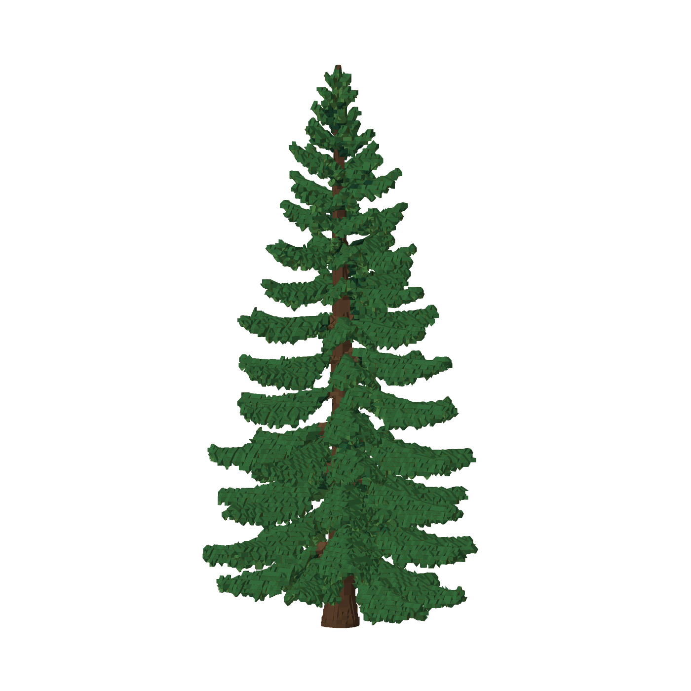 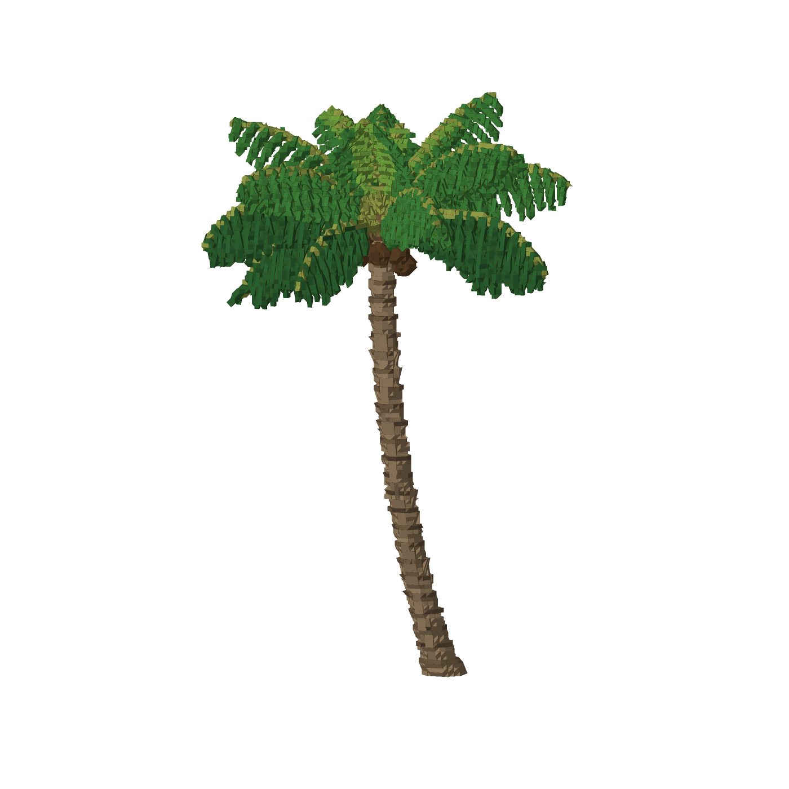

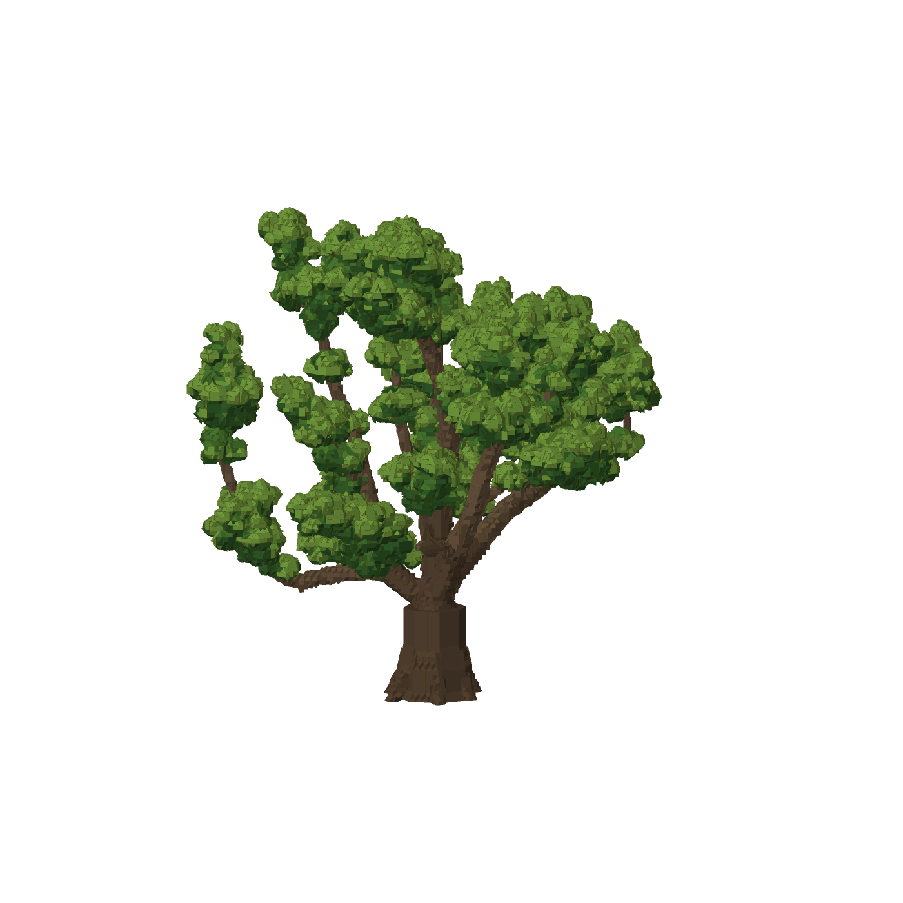

#### Why three methods

The standard model of a tree is Weber and Penn's
([Creation and rendering of realistic trees](https://courses.cs.duke.edu/fall02/cps124/resources/p119-weber.pdf),
1995): one recursive rule in which every level of branching has some forty
numbers. It was the starting point here, and two of its devices are used
as they stand: a branch angle that changes with height, and a pull upwards
on the ends of branches. The whole model was not taken. Its numbers
describe a tree's statistics, and at this size a tree is recognised by its
structure. A spruce is its separate tiers, a palm is one crown on one
stem, and an oak is a few heavy limbs. Each of those is easier to build
directly than to coax out of forty numbers per level.

Builders of brick trees work the same way. A brick spruce is built as
stacked rings of leaves, each drooping over the one below, and
[its builder notes](https://fullplatebuilds.com/2018/04/14/spruce-tutorial/)
that the lowest ring sets the shape of the whole tree. A brick palm is a
segmented trunk with about twenty fronds, the lowest of them hanging
([palm tutorial](https://fullplatebuilds.com/2018/11/21/palm-tree-tutorial/)).
Voxel generators that are public use rules of the same kind: tier by tier
for a spruce, and balls of leaves at the ends of branches for an oak.

#### The pine

The pine is a spruce or fir, the Christmas tree. It is built tier by tier
from four facts about a spruce's boughs
([Norway spruce](https://en.wikipedia.org/wiki/Picea_abies);
[its crown architecture, measured](https://bioresources.cnr.ncsu.edu/resources/crown-architecture-and-structural-development-of-young-norway-spruce-trees-picea-abies-karst-a-basis-for-more-realistic-growth-modelling/)).

The boughs come in tiers with air between them, one tier for each year's
growth, four to seven boughs to a tier. Each tier is turned by a random
angle from the one below. The tiers are closer together towards the top.
With $`u`$ running from 0 at the lowest tier to 1 at the highest, a tier
stands at the share

```math
h(u) = 0.55\,u + 0.45\left(1 - (1 - u)^{1.7}\right)
```

of the way from the lowest bough to the leader.

The boughs shorten to the top, which makes the cone, and the lowest tiers
are drawn in a little, as they are on a tree whose lowest boughs are
shaded. A tier's boughs are the length

```math
L(u) = R\,\frac{s(u)}{\max s}, \qquad s(u) = \left(0.9\,(1 - u)^{0.9} + 0.1\right)\left(0.84 + 0.16\,\min(1,\ u / 0.12)\right)
```

where $`R`$ is the spread asked for. One bough of each tier has the full
length and the others 84 to 100% of it.

The angle changes with height. A bough leaves the stem at the angle
$`e_0`$ above level, sags on the way out by an amount $`g`$ that the
**Droop** setting $`d`$ scales, and turns up again at its tip by $`t`$.
At the share $`x`$ of the way along it, it climbs at

```math
e(x) = e_0 - 2g\,x + (2g + t)\,x^3, \qquad e_0 = -0.2 + 0.95\,u^{1.4} - 0.22\,d\,(1 - u)
```

radians, with $`g = 0.55\,d\,(1 - 0.7u)`$ and $`t = 0.5 - 0.2u`$. The
lowest boughs therefore leave the stem pointing 20 degrees down, hang
lower still half way out and end level, and the highest climb at 40
degrees. The S of each bough is what separates a spruce from a cone.

A bough is a flat spray. It carries a pair of side shoots every 2.3
cells, angled forward and hanging a little, longest a quarter of the way
out. Long side shoots carry short shoots of their own. Near the stem the
bough is bare wood, more of it the lower the bough.

The needles are not built one by one. A side shoot with its needles is a
round cone a little over two cells thick. That is the thinnest a part can
be and still be built at any angle: a thinner one fills less than half of
some of the cells it passes through, and the fitter leaves those cells
empty.

Between the tiers a full tree has a few shorter boughs, and the leader
stands above the top tier with two small whorls of climbing shoots.

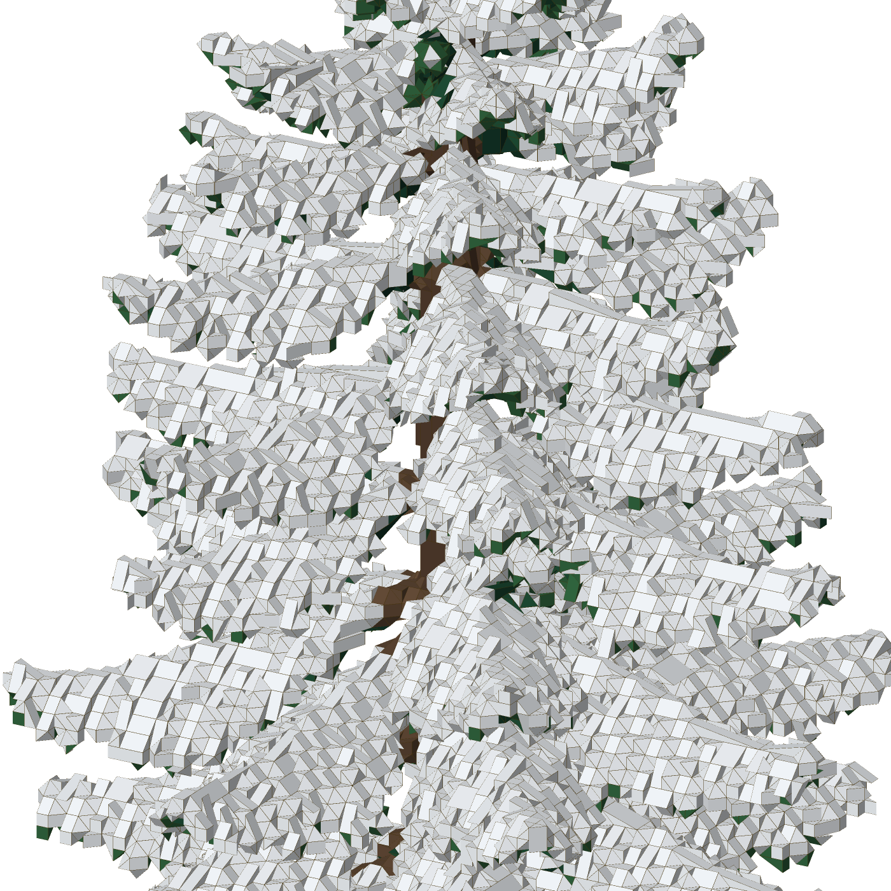

#### The palm

The palm is a coconut palm
([*Cocos nucifera*](https://www3.ctahr.hawaii.edu/gsp/doc/Forestry/Little_Skolmen_CFT/CFT_Cocos_nucifera.pdf)).
It has one level of structure, a stem and a crown, and both are placed by
rule.

The trunk leans from its foot and curves back to upright, as a palm does
that has grown towards the light. At the share $`t`$ of its height
$`H`$, its middle stands

```math
x(t) = \frac{a\,H}{2.7}\left(1 - (1 - t)^{2.7}\right)
```

to one side of its foot, where $`a`$ is the slope at the foot, set by
**Lean** up to 0.85. The slope is $`a\,(1 - t)^{1.7}`$, which is steepest
at the foot and zero at the top. The trunk is swollen at the foot to about
1.7 times its width higher up, and hardly tapers above that.

The trunk is eight-sided. Its section is taken level and not square to the
lean, so four of its eight faces lie on the grid's own planes at any lean
and the other four are 45 degree ramps. The distance from a point to a
length of trunk whose middle is at $`c`$ and whose faces are $`r`$ from
it is

```math
f = \sigma\left(\max\left(|q_x|,\ |q_y|,\ \frac{|q_x| + |q_y|}{\sqrt 2}\right) - r\right), \qquad q = p - c
```

with $`c`$ and $`r`$ taken at the point's own height. The factor
$`\sigma = 1 / \sqrt{1 + m^2 + w^2}`$, for a length that leans at the
slope $`m`$ and widens at the rate $`w`$, keeps $`f`$ from exceeding the
true distance (section 5). The trunk is a stack of such lengths, each a
few cells tall and a little wider at its top than the next is at its
foot. That step is a ring, and its top cell is a darker colour: the scar a
fallen frond leaves.

The fronds are set round the top of the trunk by the golden angle, each
137.5 degrees from the last, which is how a coconut palm sets them and the
turn that never puts one leaf directly over another
([Vogel's model](https://en.wikipedia.org/wiki/Golden_angle)). The
frond numbered $`i`$ of $`n`$ has the age $`\alpha = i / (n - 1)`$. It
leaves the crown at the angle $`\theta_0`$ from upright and has turned
over by a further $`\beta`$ at its tip:

```math
\theta(x) = \theta_0 + \beta\,x^{1.7}, \qquad \theta_0 = 0.12 + 1.32\,\alpha^{0.85}, \qquad \beta = 0.75 + 0.95\,\alpha
```

in radians, at the share $`x`$ of the way along it. The youngest fronds
stand nearly upright and arch a little. The oldest leave the crown below
level and hang. The bend grows towards the tip, so every frond's tip
droops.

A frond is pinnate. Its rib carries a pair of leaflets every three cells
from a fifth of the way along. The leaflets are shortest at the two ends
of the rib, are held out to the side on a young frond and hang on an old
one, and each bends down half way along its length.


#### The oak

The oak is an open-grown English or white oak: a short thick trunk that
divides low down into a few heavy limbs, and a crown as wide as the tree
is tall ([white oak](https://en.wikipedia.org/wiki/Quercus_alba)). Above
the trunk it has no leading stem, so it is the one tree here grown by a
recursive rule. The rule is one fork, applied until the branches are
twigs.

A limb of radius $`r`$ runs a length of about $`6.2\,r^{0.62}`$ and
divides in two. The two share its cross-section by Leonardo da Vinci's
rule: a share $`q`$, drawn between 0.52 and 0.86, carries on and the rest
turns aside, so

```math
r_1 = r\sqrt{q}, \qquad r_2 = r\sqrt{1 - q}, \qquad r_1^2 + r_2^2 = r^2
```

Measured trees keep the rule with an exponent between 1.8 and 2.3
([Eloy 2011](https://arxiv.org/abs/1105.2591)), and 2 is used. A share
near 0.5 is an even fork and a share near 0.86 is a small side branch off
a limb that carries on, so one rule gives both. The side branch turns
aside by 35 to 65 degrees and the limb turns the other way by less, in
proportion to what it gave up. Each fork is turned by the golden angle
about the limb from the fork before, which fills the crown in all round.
The trunk divides the same way into two to seven limbs.

Between forks a limb's direction $`v`$ is changed twice by

```math
v \leftarrow \frac{v + 0.44\,k\,\xi + \left(0.36\,w\,o - 0.1\,w\,z + 0.15\,(1 - w)^2\,z\right)}{\lVert\,\cdot\,\rVert}
```

where $`\xi`$ is a random direction and $`k`$ the **Gnarl** setting,
$`w = r / r_\text{trunk}`$ is how heavy the limb is, $`o`$ points level
away from the trunk and $`z`$ points up. A heavy limb is drawn outwards
and sags. A thin one turns up to the light. The result is limbs that
strike out wide, then climb at their ends.

A branch thinner than one cell is not built. It ends in leaves.

The crown has to fill a dome of the height and spread asked for, and no
rule gives the reach of a crooked limb before it is grown. The branches
are therefore grown twice from the same random numbers. The first growth
is at no particular size and only measures how far the branches reach.
The second is at the size that puts six sevenths of the branch ends
within nine tenths of the dome's width, and it is held in: a branch
nearer the outline than 0.7 of the way from the dome's heart is turned
back along it. A last small stretch brings the furthest end exactly to
the dome. Growing once and stretching the result was tried first. One
long limb then set the size of the whole crown, and the rest of it
huddled round the trunk.

The leaves are at the ends of the branches and nowhere else, so the crown
is separate masses with sky between them and the limbs show from below. A
branch that ends is carried on for three lengths as a spray too thin to
build, and at each length there is a tuft: one flattened ball of leaves
and two smaller ones beside it. A ball of leaves is itself built as a
smaller ball with many small balls, each two or three cells across,
standing out of it all over. The small balls are clusters of leaves and
the gaps between them are the hollows.

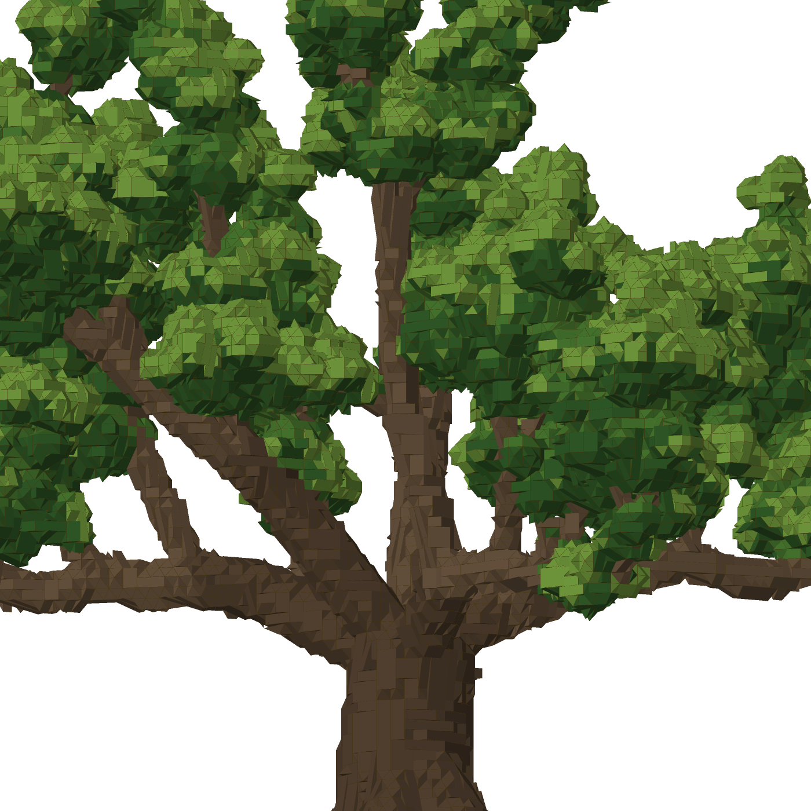

The first leaves were smooth balls with smooth noise added to their
distance, which is the usual way to roughen a surface. It looked much the
same and took four times as long. Noise steepens a distance function, so
every value had to be more than halved to stay an underestimate (section
5), and the fitter then sampled a shell of cells twice as deep, working
the noise out at each sample. A union of balls is an exact distance and
needs no such allowance.

[Space colonisation](https://algorithmicbotany.org/papers/colonization.egwnp2007.pdf)
(Runions, Lane and Prusinkiewicz 2007) was the other candidate for the
oak. It scatters points through the crown and grows branches towards
them, and it gives fine irregular broadleaf crowns. It was not taken for
two reasons. Its branches are one node spacing thick everywhere, and a
tree in bricks needs a few heavy limbs several cells thick, which a rule
that divides a limb's cross-section gives by construction. And each point
influences every branch near it, so changing one setting grows a
different tree. Here a seed is one skeleton, and the height, spread and
foliage can be changed while the tree stays recognisably itself.

#### The beech, and bare trees

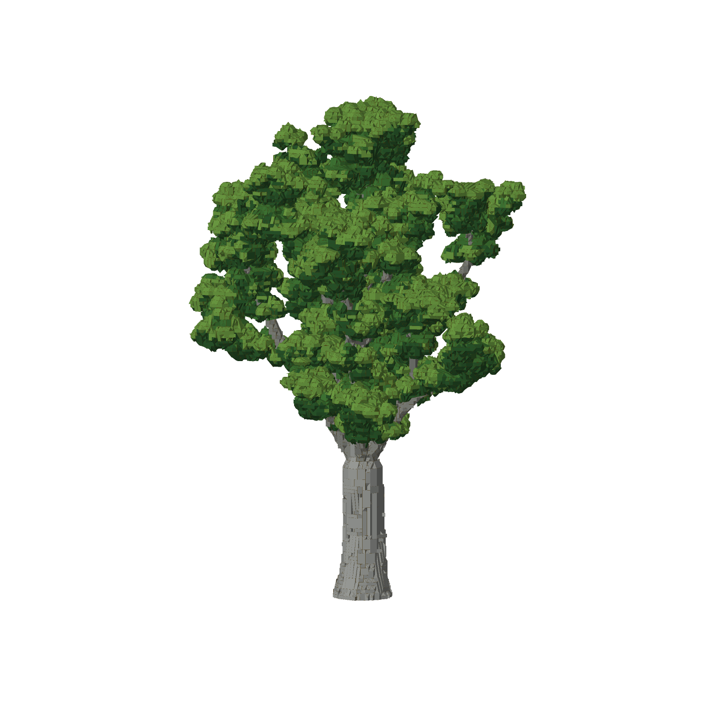 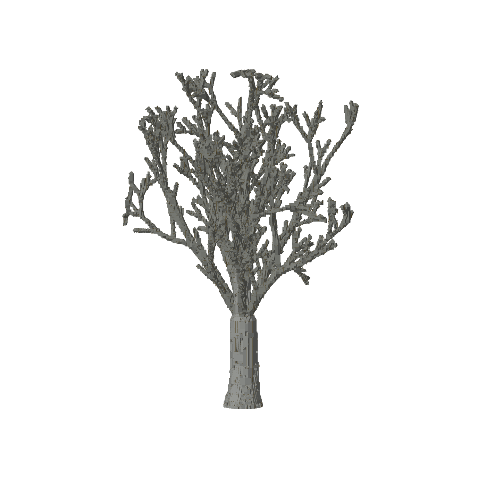

A beech is the oak's rule with other numbers
([*Fagus sylvatica*](https://plants.ces.ncsu.edu/plants/fagus-sylvatica/common-name/european-beech)).
Its smooth grey trunk carries on up through the crown as the thickest
limb, where an oak's ends at the first fork. Its limbs wander half as
much, are not pulled down, and leave the trunk at 43 to 63 degrees. Its
crown is an oval about three quarters as wide as the tree is tall, widest
a third of the way up. Its tufts of leaves are flatter, and branches up to
three cells thick carry them, where only an oak's thinnest do, so the
crown closes. The numbers are the `Habit` of each tree in
[core/src/tree.rs](../core/src/tree.rs).

**Bare** takes the leaves off an oak or a beech. A tree in leaf ends its
branches where they are one cell thick, and the leaves hide the stop.
Bare, each stop would be a stump. Every branch end is therefore carried
on in twigs: a shoot that forks into two shorter ones, and those again,
two forks deep on an oak and three on a beech, where a beech also carries
its shoot straight on between the two. A twig cannot be thinner than a
branch end, one cell being the least that is built, so twigs are told from
branches by their number and shortness. A beech's are many, straight and
close-angled, and an oak's fewer and crooked. The skeleton under them is
the tree's own: the same seed bare and in leaf is the same tree, limb for
limb.

#### The bushes

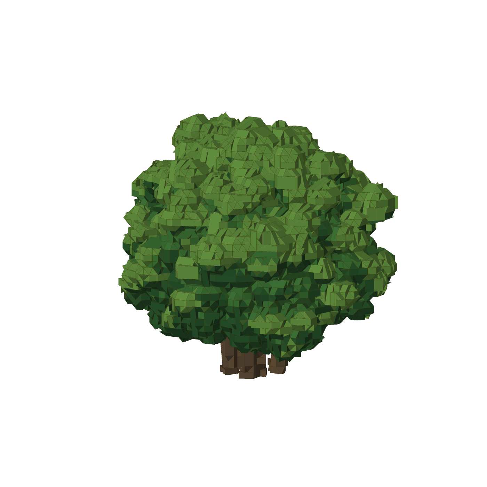

A boxwood is a dense rounded evergreen, about as tall as it is wide, on
several stems ([*Buxus sempervirens*](https://plants.ces.ncsu.edu/plants/buxus-sempervirens/)).
Its stems are grown by forks, as an oak's limbs are, three forks deep,
each from its own place in the ground. Its leaves are not left to the ends
of the branches as an oak's are, because a boxwood has no sky in it. Tufts
of leaves are set all over a dome instead, a golden angle apart: the tuft
numbered $`n`$ of $`N`$ stands at the height $`1 - 2(n + \tfrac12)/N`$
of the dome and at the angle $`n \cdot 137.5^\circ`$ round it, which
covers a ball evenly. Each tuft is pushed in a little by a random amount
that **Looseness** scales, and the lowest seventh of the dome is left open
so the stems show at the foot. That gives the lumpy, layered outline of a
shrub left to grow. Builders of brick bushes get the same effect by
turning each layer of leaves against the one below
([leafy bush tutorial](https://fullplatebuilds.com/2018/12/07/leafy-bush-tutorial/)).

A hedge is the boxwood clipped to a wall. It is a kind of its own and
not a setting of the boxwood, because a bush is round and has a number of
stems, and a hedge has a length and is a row of plants. Its outline is a
long box, a little narrower at the top than at the foot, which is the
"batter" a hedge is clipped to so that light reaches its base
([pruning hedges](https://www.rhs.org.uk/plants/types/hedges/pruning-hedges)).
The same tufts of leaves are set over the top, the two sides and the two
ends in rows, each row half a step along from the last, and each tuft is
set back by a random amount that **Looseness** scales: at none the hedge
is freshly clipped, at full it has grown out. The inside is filled, and
each plant of the row shows two or three stems under the leaves. A hedge follows a line. Its points are joined by the smooth curve a spline
has (section 4), closed into a ring if asked, and bent further by any
points added to it. The hedge is grown straight, as long as the line, and
then laid along it: a part that was $`s`$ along the straight hedge and
$`t`$ to one side of its middle goes to the place $`s`$ along the line and
$`t`$ to the side of it there. Each ball and branch is moved whole and none
is sheared, so the tufts on the outside of a bend stand a little apart and
those on the inside crowd. Laid along a straight line, a hedge is part for
part the hedge it was before it could bend. Reeds stand along a line the
same way.

With **Sharp corners at its dots** the line runs straight from point to
point. A straight hedge laid round a corner opens on the outside like a
hinge, so a round post of the same tufts stands in each corner and closes
it. Reeds inside a closed line fill it: each stem is thrown into the
line's box until it lands inside.

The line has a length of its own. At first the length was the thickness
times a number, so making a hedge thicker made it longer too: a hedge 240
long made 160 thick became 1,600 long and three quarters of a million
bricks, and each step back took seconds.

**Berries** puts small balls of another colour number just proud of the
tufts of a boxwood or a hedge. A box has no berries: its fruit is a small
brown capsule
([*Buxus sempervirens*](https://plants.ces.ncsu.edu/plants/buxus-sempervirens/)).
These are a holly's or a cotoneaster's, offered because a hedge in berry
is wanted in a build.

A hydrangea is a mophead
([*Hydrangea macrophylla*](https://plants.ces.ncsu.edu/plants/hydrangea-macrophylla/)):
a rounded shrub of broad leaves with large domed heads of flowers at the
ends of its shoots. The shrub is the boxwood's with larger, fewer tufts.
The heads stand over the upper two thirds of the dome, a golden angle
apart. A head is not a ball. Its florets are set over a cap by Vogel's
model, and each floret is four small balls in a cross about a middle of
another colour, lying on the cap, because a real floret has four
petal-like sepals. Four cells is the least a cross can be across, so a
head has a few dozen florets where the plant's has some five hundred.
The florets of a head take two colour numbers at random, which the sets
paint as two tones of blue, pink or white, or as blue running to pink.

 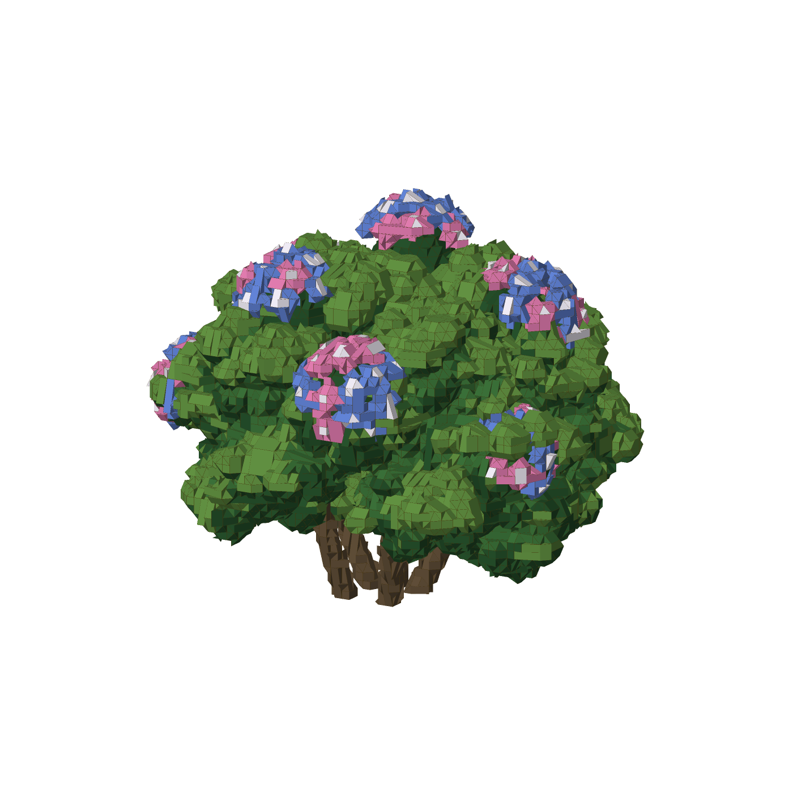

#### An arch of hedge

 

With **Texture** set to hedge, an arch is built as clipped hedge
([core/src/tree/over.rs](../core/src/tree/over.rs)). The hedge laid
along a line, above, is grown straight and then bent, which suits a line
on the ground. An arch's band climbs and comes down again, and a hedge
bent along it would be a wall laid over: its top would face sideways at
the crown and its stems would run along the soffit. The hedge is
therefore grown from the arch's own distance function $`d`$ (section 5),
which is negative inside the band.

The tufts are the hedge's own, the same balls of leaves set back from a
face by the same rule. What is new is where they go. Let
$`e(p) = d(p) - 1`$, the band made one cell larger all round. Points are
taken on a lattice $`s = 1.15\,m`$ apart, where $`m`$ is the size of a
tuft, each layer half a step along from the last. A lattice point $`p`$
with $`|e(p)| \le s/2`$ is moved onto the surface,

```math
q = p - e(p)\,n, \qquad n = \frac{\nabla e}{\lVert \nabla e \rVert}
```

with the slope $`\nabla e`$ taken by differences half a cell each way,
and a tuft is set at $`q`$ looking along $`n`$. One layer of the lattice
lies within half a step of any face, so every face has one layer of
tufts a step apart whichever way it looks: both fronts, the outside and
the soffit. A tuft of radius $`r`$ is then held $`r + 1`$ deep, or at
the middle of a band thinner than that, so that the clusters of leaves
that stand out of it stay inside. The inside is filled with balls on a
coarser lattice, each of radius 0.4 less than its depth under the
surface, so none of the filling shows.

The finished hedge $`h`$ is cut off where the enlarged band ends:

```math
f(p) = \max\bigl(h(p),\ d(p) - 1\bigr)
```

Each of the two is no more than the distance to its own solid, so their
maximum is no more than the distance to what the two share, and the
fitter's skipping of far cells stays sound. The hedge therefore stands
one cell outside the plain arch at the most, on any face, and the
opening keeps its shape. Measured on arches 60 across, 10 thick and 12
deep, the opening of a round arch is 46 wide and 25 high plain and 45 by
25 as hedge, a pointed arch's 48 by 44 and 47 by 45, and a parabolic
arch's 36 by 25 and 37 by 25.

The band is enlarged by that cell because of what was measured without
it. Held inside the band itself, as a hedge's tufts are held inside its
box, the hedge filled three fifths of the plain arch's cells and looked a
cell thin on every face. Grown over the enlarged band it fills seven
tenths to three quarters of them, with the hollows between tufts at the
arch's own surface and the tops of the tufts a cell proud of it, cut
level there.

Where the band stands on the ground its lowest tenth, 2 to 6 cells, is
bare of leaves, and stems stand in it, as a hedge's do. Leaves are light
where the sky is over them and dark where open air is under them, by the
rule every plant's leaves have, which makes the soffit dark. A hedge is
6 cells thick at the least, so a band thinner or less deep than that is
grown 6 thick and 6 deep, as a maze's hedges are. More than a million
cubic cells of band is built at the finest larger brick size that fits,
as a hedge maze is.

Nothing in this knows that the solid is an arch. A spline and a Bézier
curve pass through the same function and would be grown the same way.
They are not offered, because only arches have been looked at. The
round arch above is 5,010 bricks.

#### The flowers

 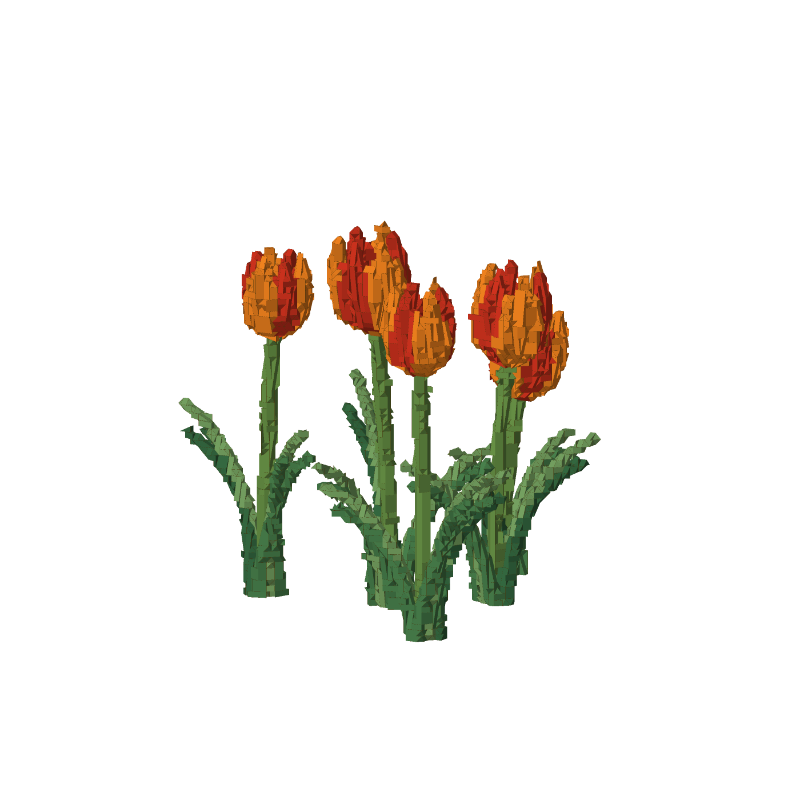

A flower is small, and a part must be two cells thick to be built, so the
flowers are large: a sunflower is 90 cells tall with a head 34 across, and
a tulip 64 tall with a cup 12 across. The head sets the size. A seed is a
ball two and a half cells through, and a head needs some dozens of them
before it reads as a disc of seeds and not a button.

A sunflower's head is built as the plant builds it, by Vogel's model
([Fermat's spiral and the golden angle](https://en.wikipedia.org/wiki/Fermat%27s_spiral#The_golden_ratio_and_the_golden_angle)).
The seed numbered $`k`$ stands at

```math
r_k = c\sqrt{k}, \qquad \theta_k = k \cdot 137.508^\circ
```

from the middle of the disc, with $`c = 1.3`$ cells. Each seed is a
golden angle on from the last, which packs them evenly at any size of
head. Rings of seeds, the obvious alternative, leave gaps between the
rings and line the seeds up in spokes. The inner seeds have one colour
number and the outer ring another, the disc bulges a little in the middle,
and its back is a coarser plate of the same pattern in green. The disc is
a cushion a third as high in the middle as it is wide across its radius,
and each petal is cupped forward where it leaves the disc and laid back at
its tip, so the head has depth and a rolled rim. A flat disc with flat
petals, which it was at first, read as a plate on a stick. Round the
disc are the ray florets, the petals: 13, 21 or 34 of them by the size of
the head, Fibonacci numbers as a real head's are, with a second row behind
and between the first. Each petal is two round ribs side by side at its
root that meet at its tip, so it is flat and pointed. The head faces to
one side and nods by an amount **Nod of the head** sets, and the heads of
a clump face the same way to within 35 degrees, as grown sunflowers all
face east ([common sunflower](https://en.wikipedia.org/wiki/Common_sunflower)).
The stem carries heart-shaped leaves, each a fan of five ribs, a golden
angle apart and smaller towards the top.

A tulip is a cup of six petals in two rings of three, the inner three
standing in the gaps of the outer, on a bare stem with two or three
strap-shaped leaves from the ground
([tulip](https://en.wikipedia.org/wiki/Tulip)). Each petal is three ribs
side by side, bowed out from the base of the cup and in again at the lip,
with the middle rib the longest so the petal comes to a point. The cup is
1.25 times as tall as it is wide. The two rings have different colour
numbers, so a cup can be one colour, two tones or flamed. A leaf is three
ribs that leave the ground nearly upright against the stem and turn
outwards along their length.

A clump of either flower is several plants from one seed. They stand
round the first by Vogel's model again, each at its own height between
60% and 96% of the tallest.

A peony is the double kind
([*Paeonia lactiflora*](https://en.wikipedia.org/wiki/Paeonia_lactiflora);
[its flower forms](https://americanpeonysociety.org/?p=35)): a few broad
guard petals outside, and inside them round after round of narrower ones.
It opens from a hard round bud, through a soft ball, to a full-blown bowl.
The petals are set by the golden angle, the innermost first, so that no
petal stands behind another in any round. The petal numbered $`k`$ of
$`N`$ has the place $`t = (k + \tfrac12)/N`$, 0 for the innermost and 1
for a guard petal. It leaves the heart leaning out from the bloom's axis
by $`\lambda`$ and curls back in by $`\kappa`$ along its length:

```math
\lambda = 0.25 + 0.5\,t + o\,(0.2 + 0.95\,t^{1.3}), \qquad \kappa = \left(1 - o\,(0.35 + 0.6\,t)\right)(1.5 + 0.9\,t)
```

in radians, where $`o`$ is **How open the bloom is**, from 0 to 1. At
$`o = 0`$ every petal stands nearly upright and curls over hard, and the
bloom is a ball. At $`o = 1`$ the guard petals lean right out and lie
nearly straight, and each round inside leans and uncurls less, which is
the bowl. One setting therefore takes the same petals from bud to full
blown. A full bloom shows a heart of stamens in a third colour. The plant
is a clump of stems from one crown, each with leaves of three lobed
leaflets and one bloom.

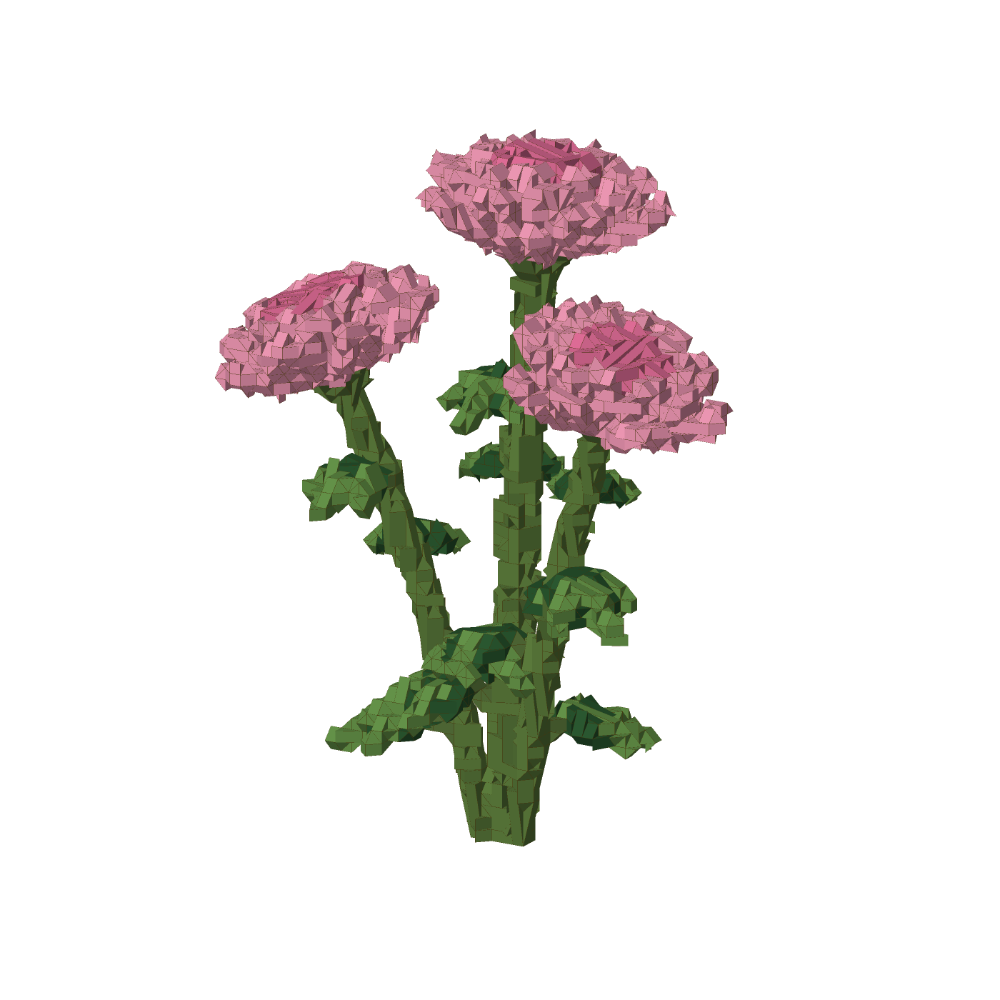 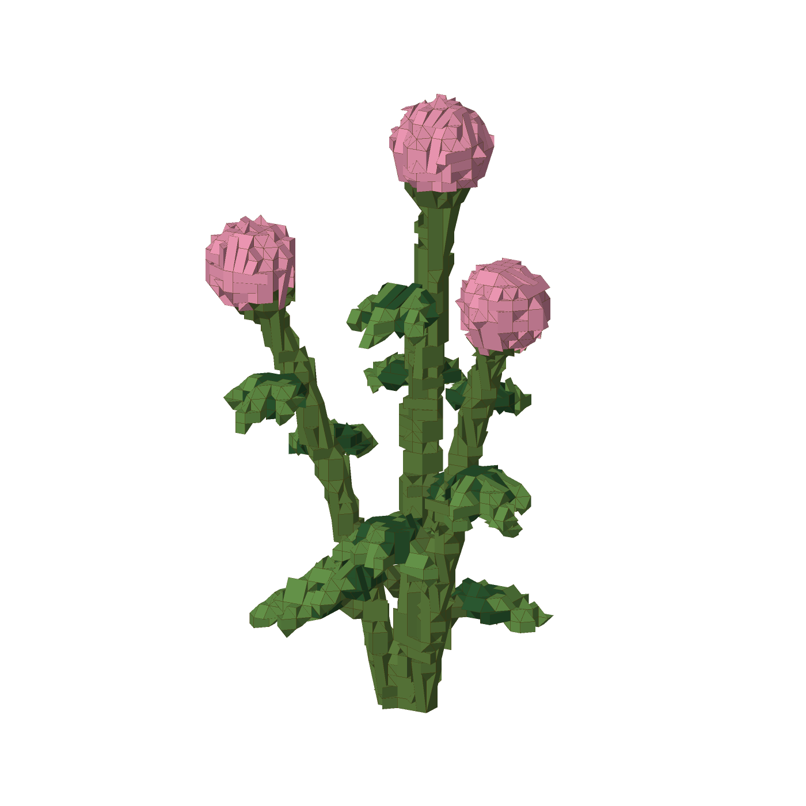

Petunias are a low mound of small leaves covered in funnel-shaped flowers
([*Petunia x hybrida*](https://plants.ces.ncsu.edu/plants/petunia-x-hybrida/)).
The flowers stand over the mound a golden angle apart, facing outwards and
up. A flower is a short green tube, five lobes round its mouth, each
leaning back so the face is a shallow funnel, and a throat of another
colour number in the middle. **How far it trails** makes the mound smaller
and sends stems out from under it along the ground, each ending in a tuft
of leaves and a flower.

#### Reeds

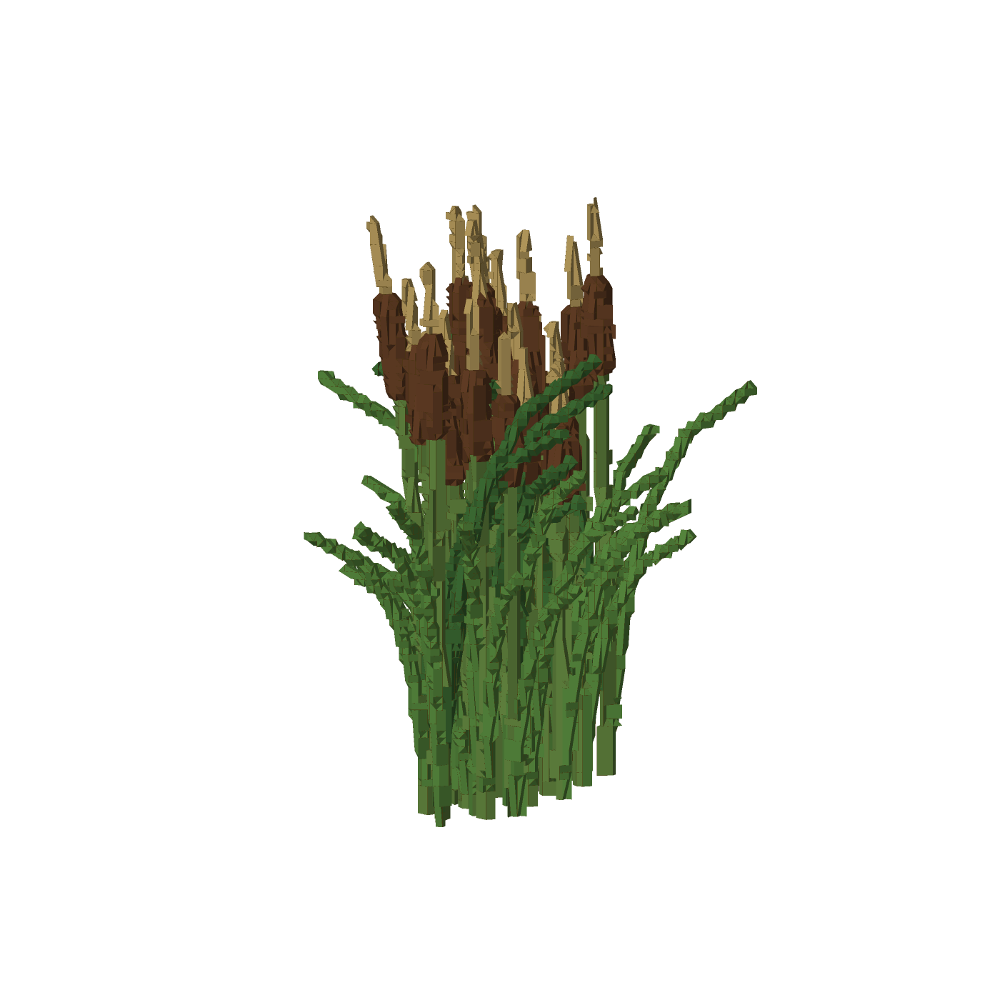 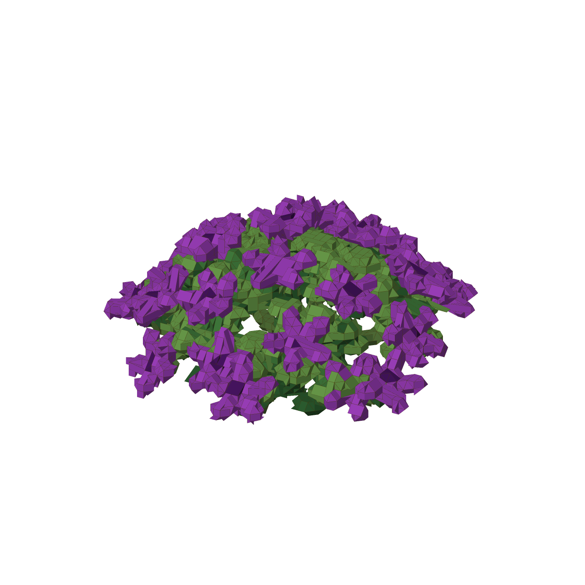

A stand of reeds is bulrushes
([*Typha latifolia*](https://en.wikipedia.org/wiki/Typha_latifolia)), or
with **Feathery plumes** the common reed
([*Phragmites australis*](https://en.wikipedia.org/wiki/Phragmites_australis)).
The bulrush is what a stand starts as because its brown sausage with the
thin spike above it can be told at this size. A plume is a soft thing,
and in bricks a soft thing is a rough lump. The stems are scattered evenly
over an oval by Vogel's model stretched to the oval's two lengths, and
like a hedge the stand has a length along x, for a bank. Every stem leans
downwind by an amount of its own that **Sway** scales. The leaves spring
low on the stem, stand nearly upright and flop outwards at the tip: the
angle from upright grows with the cube of the way along the leaf.

#### Grass


Grass covers the ground within its reach of a line, and everything the
line encloses if it is closed, so it is a strip along a path or a lawn of
any outline. It is a surface. Under the blades is a skin of soil two
cells thick in a colour of its own, so that a patch set on a floor leaves
no gap and a hill is closed on top. Under a hill there is nothing.

Grass is the one plant that is not fitted. A lawn is a height field with
things standing on it: the ground has one height at each place, so every
brick can be written down from that height, as a bookcase's are from its
size (section 7.12). It was first grown as the other plants are, soil,
water and every blade as parts of one solid, and fitted cell by cell.
A lawn 180 cells by 120 with 24 touches then took 15.6 million samples
of its distance function, 0.53 s on sixteen threads, and every touch of
the brush fitted all of it again. Written down it takes 4 ms
([performance.md](performance.md#a-lawn)). The code is
[core/src/grass.rs](../core/src/grass.rs).

##### The ground

The ground is shaped the way terrain is in games that have a tool for it,
by touches of a brush. A touch has a place, a range $`R`$ and an amount
$`a`$, and does one of two things. A push adds a smooth hill, or with a
negative amount takes a hollow out of the ground:

```math
h \leftarrow h + a\,\frac{1 + \cos(\pi d / R)}{2} \qquad (d < R)
```

at the distance $`d`$ from its middle. That curve is level at the middle
and level again at the edge, so hills run into each other and into the
flat without a crease. A flattening touch moves the ground towards one
height $`a`$: all the way within half its range, and by a share that
falls on the same curve from there to its edge, which leaves a level
terrace with a bank that runs back into the hill. The touches are applied
in the order they were made, as strokes are.

A touch may also be a stroke: with Ctrl held while the button is down,
the same touch is made again wherever the cursor has moved 0.4 of the
brush's range along the ground. A patch takes 240 touches. A touch is one
of the form's added points, so it is undone, saved and copied like any
other. A brush dragged across the ground was considered and not built:
the ground it leaves would have to be kept as a grid of heights in the
form, where everything a form keeps now is a few numbers a person can
read.

The height $`h`$ is worked out once for the middle of every cell the lawn
covers, and kept in a table with what else is at that cell (`Ground`).
The top of the soil is the whole number

```math
t = \operatorname{round}(h + 1.6)
```

of cells over the floor the lawn lies on, so level ground has soil in the
two cells under $`t = 2`$. The 1.6 is how far the soil stood over the
ground when it was fitted, and keeps a lawn saved then at the height it
had. The soil under a cell fills the cells from $`t - 2`$ up to $`t`$,
and further down where the ground beside it is lower, to one cell under
the lowest $`t`$ of the four cells beside it. A slope's skin then has no
gap in it. Soil columns of the same height that stand side by side are
joined into the largest boxes (`pattern::joined`), so level ground is one
brick for each tile of 32 cells by 32.

Where bare ground steps up one cell to one side and not on the side
opposite, a sloped brick fills the step, so sand going down to water is a
bank. A corner where two slopes meet is left a step.

The table answers what the land is like without the bricks being built:
`Ground::at` gives a cell's height, the top of its soil, the water
standing there and whether that water is a stream's, and `Ground::slope`
gives the rise each way from the heights of the cells beside it. Making
the table takes about a third of a lawn's build.

##### Ponds

A push down may go below the level the lawn lies on, and a hollow dug
deeper than the water stands is a pond. With the water $`w`$ below the
lawn and the ground at the height $`h`$:

| Ground | What is there |
|---|---|
| $`h > -w + 2`$ | grass as anywhere |
| $`-w + 0.3 < h \le -w + 2`$ | grass thinning: a tuft is kept with the chance $`(h + w - 0.3) / 1.7`$ |
| $`h \le -w + 1.2`$, and not the bed | the soil is sand |
| $`h \le -w - 1.5`$, under water | the bed of the pond, with a stone on about one cell in a hundred |
| $`h < -w - 1`$ and $`t < -w`$ | water from the top of the soil up to $`-w`$ |

The water is the cells between the top of the soil and the level. It is
joined into boxes greedily from the surface down: at each cell of water
not yet in a box, a row along x widened along y or a row along y widened
along x, whichever is larger, then made as deep as it can be. A pond is a
bowl, so each layer of its water is a whole disc, which is a few wide
boxes. The usual order, from the bottom up, leaves every layer above the
lowest a ring round the box that came up through it. A pond 31 across and
4 deep, 382 cells of water, is 58 bricks from the bottom up and 33 from
the surface down.

A stone is a low dome up to five cells across and two high, lying on
the bed. Reeds
stand where the ground is within 2.6 of the water's level, as thickly as
asked. A reed is a bulrush laid out by rule: a stem one cell wide that
leans by a cell half way up, a brown head three cells across with its
four corners sloped and a slope at each end, the stem's tip above the
head, and a leaf that arches away from the foot. A reed that would stand
in another is left out. Stones and reeds are placed by numbers worked out
from where they are, so digging a pond leaves the lawn round it as it
was.

In the game's file the water is the glass material at intensity 6 of 10,
with all four of its collision flags off. The writer the editor uses
knows no water brick or material. The view in the editor draws water and
ice after every solid brick, blended over what is behind them, tested
against the depth of the solid bricks and leaving none of their own. The
basin then shows through the water, and whatever stands in front of the
water still hides it. Ice is drawn more solid than water.

With **Pond levels** at 2, water stands at two heights (`Waters`). The
ground is flooded from the edge of the patch inwards with a priority
flood
([Barnes, Lehman and Mulla 2014](https://arxiv.org/abs/1511.04463)),
which gives each place its spill height: the height water would reach
there before it ran off the patch. A hollow is a connected set of places
lying under their spill height. With the rim of a hollow at the height
$`s`$ and the water $`w`$ below the lawn, the hollow's own level is

```math
\ell = \lfloor s - w \rfloor
```

and a hollow with $`s > 1.5`$ that is deeper than $`w + 1`$ is a raised
pond. All raised ponds stand at the lowest $`\ell`$ among them, so there
are two levels and none overflows. The lower level is $`-w`$ as before,
and a patch with no raised hollow builds the same bricks at 2 as at 1.
The flood is on a grid of places 2.4 cells apart, the grid the soil was
laid on when it was fitted, so a lawn saved then has the levels and the
streams it had.

A stream leaves each raised pond for the nearest water at the lower
level. Its way is the cheapest over the grid of the ground by Dijkstra's
search, where a step of length $`d`$ onto ground at height $`h`$ costs

```math
d\,\bigl(1 + 3\max(0,\; h - \ell)\bigr)
```

so it goes round a rise sooner than through it. A way that climbs more
than 1 over the pond's own rim is refused, and that pond has no stream.
The way is smoothed, then swung to each side by up to 2.4 on a sine 28
long whose phase comes from the seed, with no swing at either end. Along
it, a cell at a time, the water's level is

```math
z_k = \max\bigl(-w,\; \min(z_{k-1},\; \lfloor b_k - 0.5 \rfloor)\bigr)
```

where $`b_k`$ is the lowest ground within 4.4 to either side over the
next three cells, and $`z_0 = \ell`$ until the stream is out through the
rim. The level never rises, it is a whole number, and it lies under both
banks, so the water is flat reaches with a step down between them. The
channel is cut 2.8 under the water over a width of 4.4, with banks that
lie back further where the cut is deep, which leaves water one cell deep
along its bed. Its bed is sand, it has a third as many reeds as a pond's
margin, and a stone in it is a single cell, since a pond's stone would
dam it. Its water is the pond's water in the game's file, ice with it
when frozen. Eight streams are made at most, and a patch over 400,000
places of ground keeps one level.

##### Blades

The blades are in tufts on a grid shaken so that no rows show, three to
five blades to a tuft, each on a cell of its own beside the tuft's
middle, each of its own height and lean and one of three greens. A blade
is a column one cell wide with a sloped brick for its tip, the top two
fifths of it, sloping the way the blade leans. Where a blade leans far
enough to pass over the next cell it goes on there, and its two lengths
share one cell's height so that they meet face to face. Blades stand on
the ground wherever it has been pushed to.

A fitted blade was a round rib nearly two cells through, and what the
fitter made of it was a column with sloped bricks about it. The column
and its tip are that written down, one cell through, so a tuft has one
more blade than it had, to cover the ground as before. The lawn of 24
touches is 27,600 bricks where it was 63,500.

Two blades may want the same cell. The tufts are always taken in one
order, the first blade to ask for a cell has it, and nothing is put over
a blade's tip. Each tuft is placed and shaped by numbers worked out from
its own place on the grid of tufts. They were drawn in turn from one run
of numbers, which gives a tuft another shape whenever a tuft before it
changes, and makes one part of a lawn depend on all of it.

##### Tiles

The lawn is built in tiles of 32 cells by 32. A tile's bricks follow
from the ground of its own cells and of the cells a little way round
them (one cell for the soil, three for stones, a blade's reach for
blades) and from nothing else. The tiles are shared out over the
processor's cores and put end to end in their own order, so the bricks
are the same on any number of threads. A touch of the brush changes the
bricks of the tiles it reaches and of no others, which the editor uses
to give the graphics card only those tiles of a very large lawn. Water
and reeds belong to no tile: a pond's water is joined whole, and a reed
is a dozen cells across with its leaf.

##### Which part a brick is

Each brick comes with the number of its part: soil, sand, the bed, a
stone, water, or one of the three greens. The colours go by that
number. The game's file gives each brick a flag for what it stops (the
player, weapons, interaction and physics), and the bricks of the blades
are written with the first, second and fourth off, so a player walks
through the grass and stands on the soil. A brick's part is asked of the
lawn by where the brick is (`grass::Model::part`), since a brick cut by a
join is a piece of one of the lawn's bricks and has no number of its own.
A form joined into a lawn asks how far a place is from the lawn's bricks
(`grass::Model::distance`), as it does of furniture.

##### A lawn saved before

The form is kept as it was, in the same words, so a lawn saved when
grass was fitted opens. Its ground is the same ground, its ponds stand at
the same levels and its streams run the same ways. Its blades are the
same number of tufts on the same grid, and each is in another place with
another height, since their numbers are worked out differently. Its
reeds are thinner in the stem and stand in other places along the same
margins. The edge of the soil follows the lawn's outline cell by cell,
where the fitted soil reached about two cells past it. A flat lawn with
a pond dug in it has soil two cells thick everywhere, where the fitted
one hung a cell lower over its whole area once any of it was dug.

#### Trunks on the lattice

A round trunk fitted cell by cell is ramps and steps that change from one
layer to the next, because a circle crosses every cell differently. The
trunks of the pine and of every broadleaf tree are now eight-sided and
upright, in lengths each of one size all the way up. The size $`r`$ of a
length is rounded to a whole number of cells and a half, which puts its
four straight faces on the grid's own planes, since the trunk stands in
the middle of a cell. Its four slanting faces lie where the distances out
along x and y sum to the whole number nearest $`r\sqrt 2`$, so they run
through cell corners. Every layer of a length is then the same, each face
is one tall brick and each corner one tall ramp, and there is a step only
where the trunk changes size. An oak's trunk between its roots and its
fork was some hundreds of bricks and is under forty. The trunks no longer
lean or crook by the fraction of a cell they did, which could not be seen
as a lean and was a step every few cells. Limbs are still fitted cell by
cell.

Where one length is wider than the next above it, its top slopes in to
the narrower size over five cells of height for each cell of width, or
over the whole length if that is shorter. A broadleaf trunk of thickness
$`g`$ at height $`z`$ has the size

```math
g\,\bigl(1 + 0.36\,\rho\,e^{-z / 2.2g}\bigr)
```

with $`\rho`$ the kind's share of roots, so it widens to its foot by a
third at most, over about twice its own thickness of height. Buttress
roots are ridges 0.3 of the trunk thick that run down that flare from no
higher than half way to the fork, and a kind with $`\rho < 0.7`$ has
none. A tree that keeps its stem narrows to 0.78 of $`g`$ at its fork,
and the limbs there share that section by da Vinci's rule. A beech, a willow and a cherry do not divide at one place. Above the
fork the stem goes on for 5.5 (beech) or 3.6 (willow, cherry) of the
trunk's thicknesses, and the limbs leave it one after another along that
length. With the limbs still to leave having radii $`r_k`$, the stem at
any height has the radius

```math
\sqrt{\textstyle\sum_k r_k^2}
```

so it thins at each limb by da Vinci's rule and ends as the last of
them. Their trunks are also 0.83 of the thickness their crowns are grown
from (a birch's 0.71) and narrow by a seventh from foot to fork. Before
this, six or seven limbs left one point, each under two fifths of the
trunk's width, so a wide column ended in a collar with thin wood on top.

A pine's decorations are parts of the same solid
([core/src/tree.rs](../core/src/tree.rs), `pine`). Baubles are balls of
radius 1.9, 2.4 or 2.9 under the end and the middle of a bough, taken in
the order of a number hashed from each place, so asking for more keeps
those already hung, and one within a cell of another is left out. Tinsel
is one chain of round lengths wound down the outline of the boughs' ends,
a turn for every 17 cells of fall, hung at six places a turn and sagging
2.5 between them. A light is a box two cells each way standing on the
grid, and a candle's flame a box one by one by two, so each is fitted as
one brick and carries one light. Each kind of decoration has a part
number of its own that shares a colour with one of the plant's eight,
and the file's writer makes metal and lights by that number, whatever
colours the player has chosen. **Trunk
width** multiplies $`g`$ by 0.5 to 2 before any of this, so the flare, the
ridges and the limbs all follow it; the flare's height stays that of the
usual trunk when the trunk is made fatter, and no trunk is made under
1.6, which is the least that is still eight-sided. A pine's and a palm's
thickness are multiplied the same way, a palm's rings and swollen foot
being so many of its thickness. Before this
the sizes met in square steps and the buttresses were stout cones that
ended against a trunk that had hardly widened, which read as a post in a
collar.

#### More trees, bushes and flowers

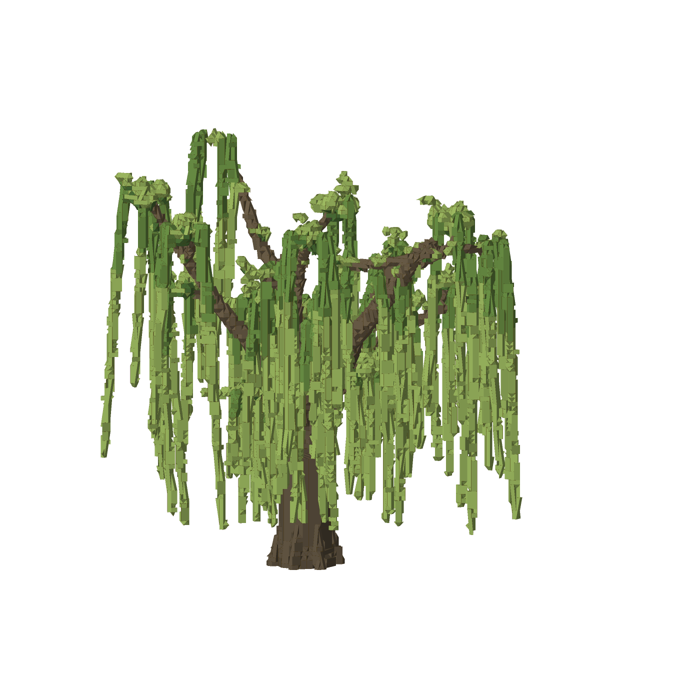 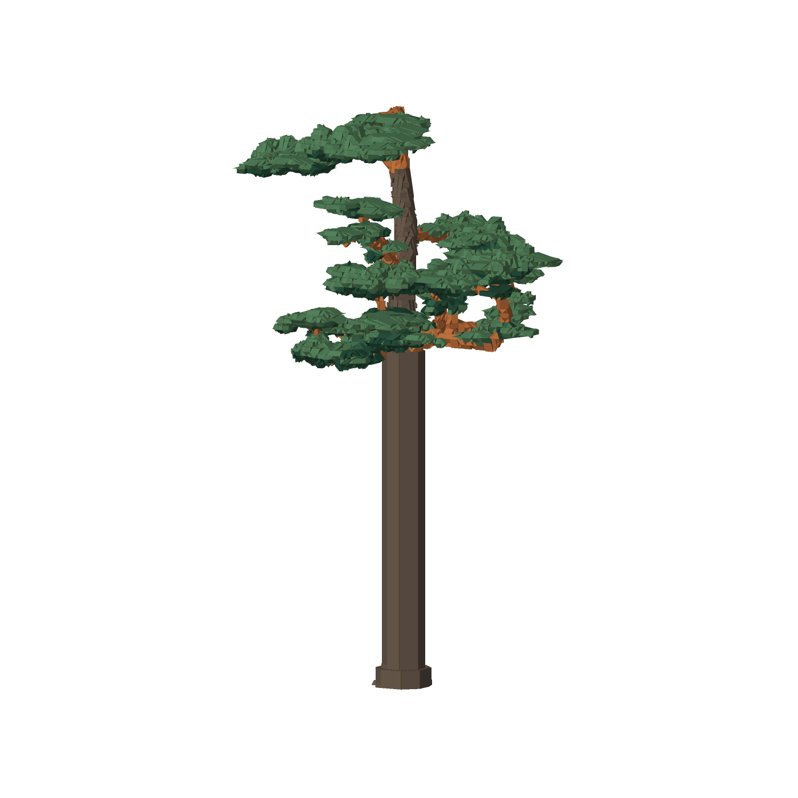

A birch, a willow and a Scots pine are the oak's rule of forking with
other numbers, as the beech is, and each has something of its own.

- **Birch** ([*Betula pendula*](https://en.wikipedia.org/wiki/Betula_pendula)):
  a stem a third as thick as an oak's for its height that runs to three
  fifths of the tree's height, narrowing to half its thickness, and only
  there divides in three. Its limbs leave the stem one after another
  from about a third of the way up, each turned from the last by the
  golden angle and half as thick as the stem where it leaves. They climb
  at 23 to 43 degrees from upright and end in small tufts with short
  hanging shoots. The bark is white on the stem and on every limb more
  than a cell thick, and smooth noise stretched sideways marks it with
  black bands.
- **Cherry** ([*Prunus serrulata*](https://en.wikipedia.org/wiki/Prunus_serrulata)):
  a short trunk that forks at 15% to 20% of the height into limbs that
  leave at 57 to 80 degrees from upright and turn up only a little, in a
  crown wider than it is tall. It carries no masses of leaves. Every
  branch under 5.5 thick has a loose cloud of small balls of blossom
  round it, each 1.6 to 2.7 in radius and scattered up to twice a leaf
  mass away, flattened to 0.45 in height. Of twenty balls nine are the
  middle pink, five white, four the deep pink, one a dark bud and one a
  bronze young leaf. Every third layer of the trunk is a pale band, broken
  by noise, for the lenticels of cherry bark. Fallen petals are flat
  drifts on the ground, thickest under the middle of the crown.

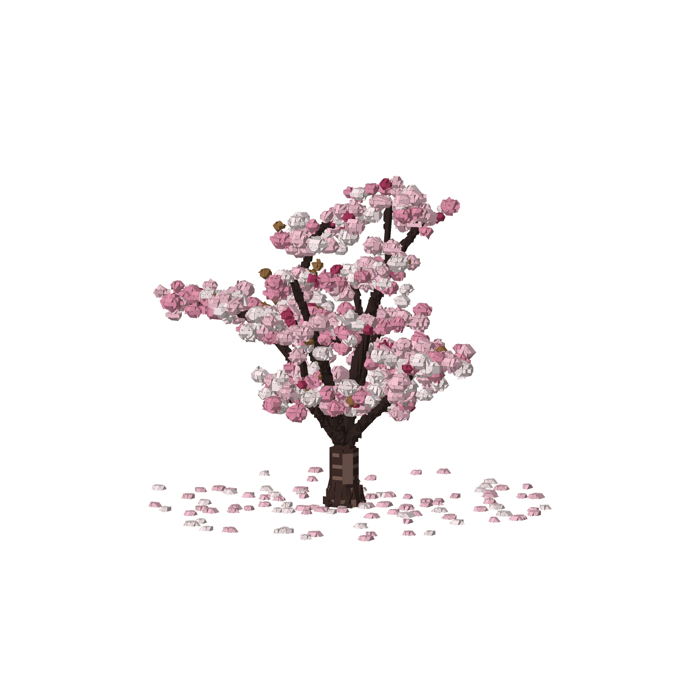 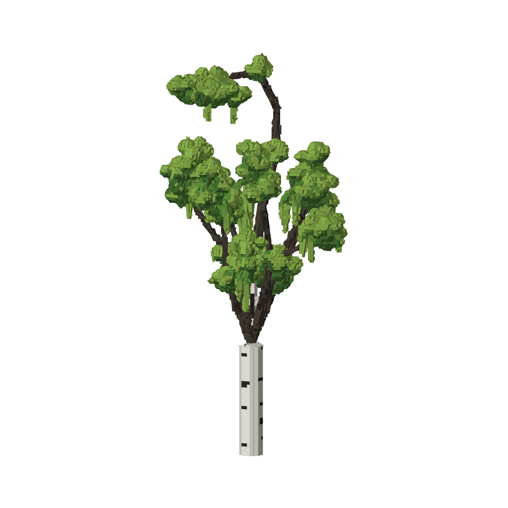
- **Willow** ([*Salix babylonica*](https://en.wikipedia.org/wiki/Salix_babylonica)):
  from every branch end three to six strands of leaves go out a little
  and then straight down, each for 45% to 97% of the way to the ground.
  The tufts at the ends are small, so the curtain is the tree.
- **Scots pine** ([*Pinus sylvestris*](https://en.wikipedia.org/wiki/Pinus_sylvestris)):
  the trunk divides more than half way up, the limbs leave it nearly
  level and wander, and the needles are plates a third as high as they
  are wide on the ends of the branches only. It is grown by forking and
  not by the pine's tiers because an old Scots pine has lost its tiers.
- **Beech**: its tufts are now 0.42 as high as wide, and the smaller tufts
  of a mass stand a quarter as far above and below its middle as an
  oak's, so the leaves lie in level layers.
- **Date palm** ([*Phoenix dactylifera*](https://en.wikipedia.org/wiki/Date_palm)):
  the coconut palm in other proportions. The trunk is 1.55 times as
  thick, upright, and steps out twice as far at each ring, for the stumps
  of cut fronds. The fronds leave the crown at every angle from upright to
  hanging, bend less than a third as much, and carry shorter leaflets held
  up in a V.

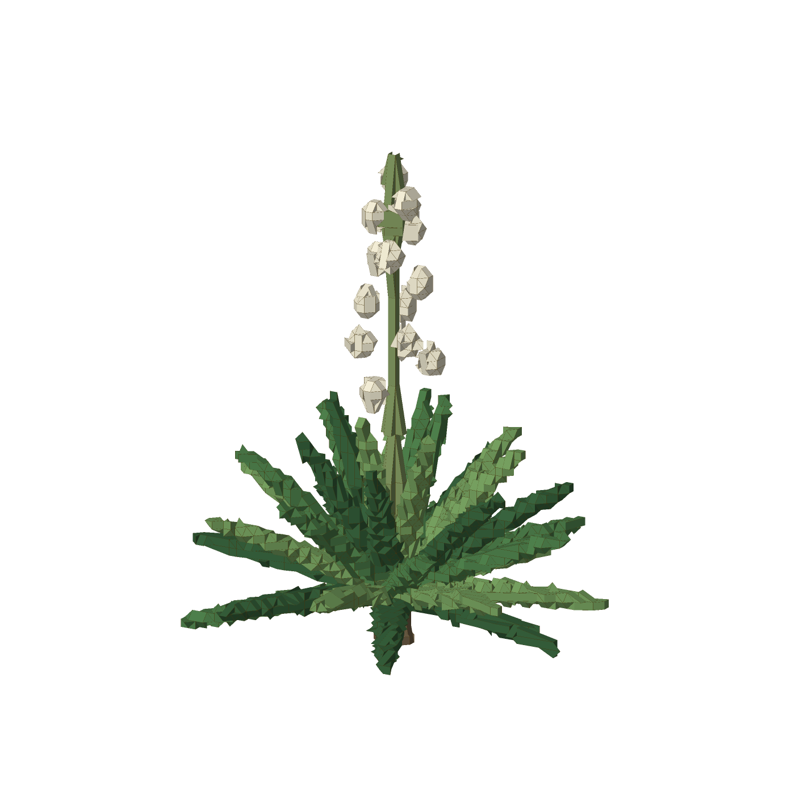 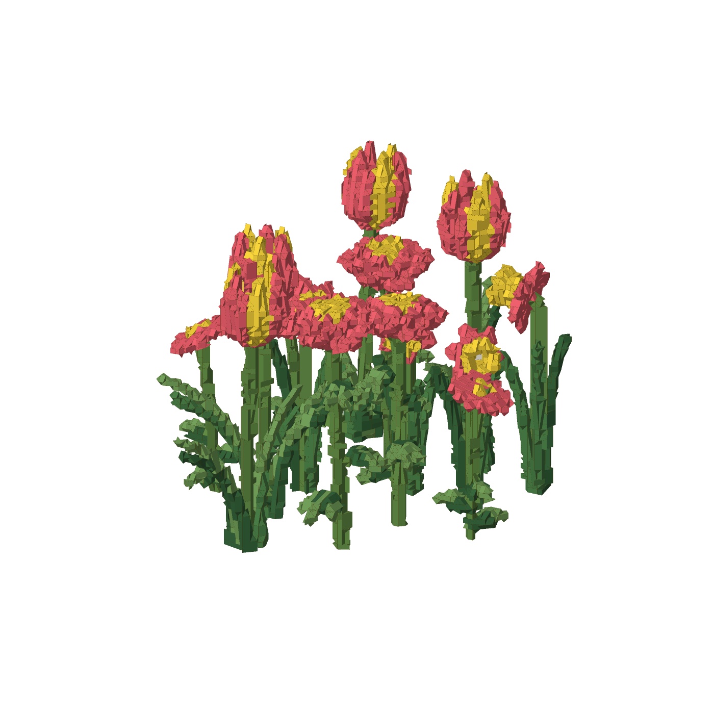

- **Cypress** ([*Cupressus sempervirens*](https://en.wikipedia.org/wiki/Cupressus_sempervirens)):
  tufts set up a spindle by the golden angle, each stretched to 1.7 times
  as tall as wide, so the outline is ribbed with upward strokes. The
  spindle is widest three tenths of the way up and comes to a point.
- **Yucca** ([*Yucca filamentosa*](https://en.wikipedia.org/wiki/Yucca_filamentosa)):
  blades from one crown, a golden angle apart. The blade of age
  $`\alpha`$ leans $`0.1 + 1.6\,\alpha^{0.8}`$ radians from upright, so
  the youngest stand and the oldest lie out. A blade is two ribs that meet
  at its tip. In flower it has a stalk of hanging bells as tall again.
- **Daisy**: a sunflower's head made small and simple, with one row of 13
  or 21 rays laid nearly flat and a disc a third of the head's width.
- **Daffodil** ([*Narcissus pseudonarcissus*](https://en.wikipedia.org/wiki/Narcissus_pseudonarcissus)):
  six petals in a flat star and a trumpet standing out of their middle,
  facing sideways. The trumpet is a ring of ten ribs round an empty
  middle that lean outwards at the mouth, with a heart of another colour
  down it. At the usual size it is five cells across, and its hollow is
  one cell.
- **Bed of mixed flowers**: tulips, daffodils, daisies and peonies in
  turn, scattered over a round bed by Vogel's model. Each is grown as it
  is alone and set down in its place. They share the bed's colours part
  for part, so a bed is a few colours that go together.

#### A single flower

 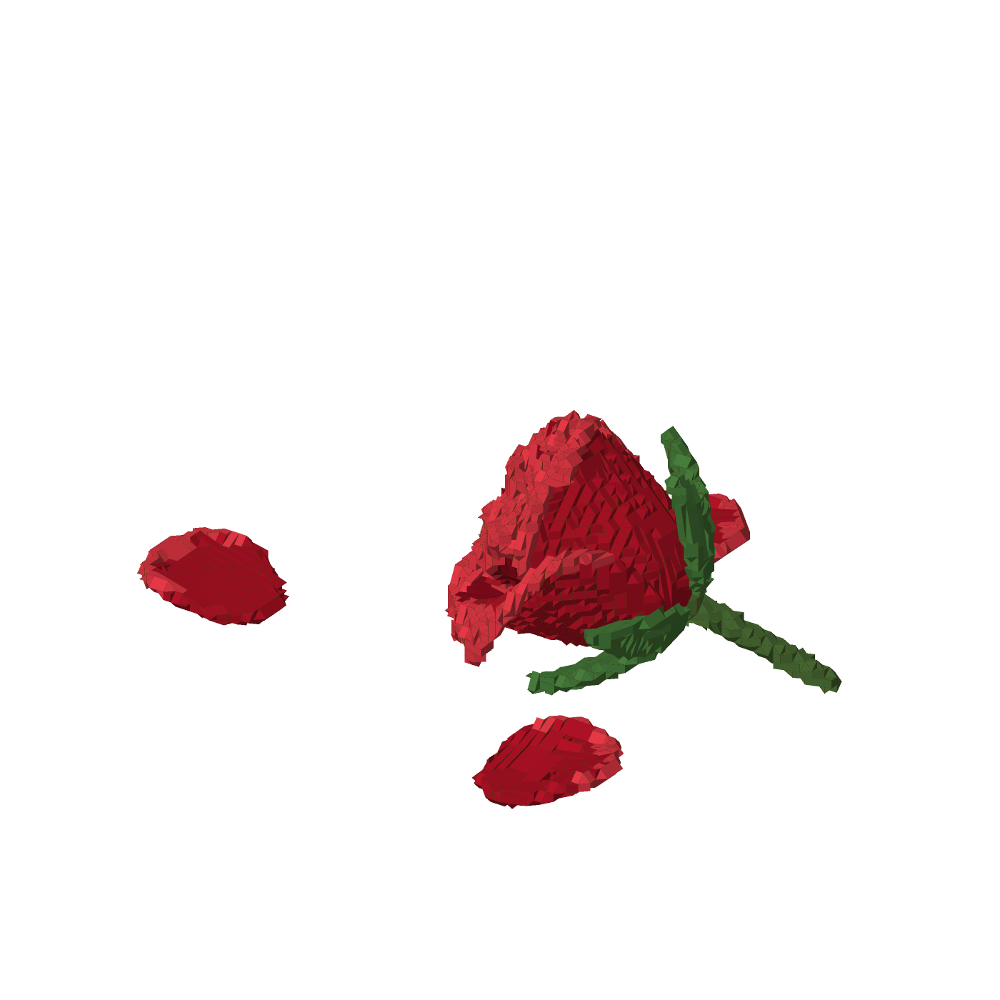

A single flower is one bloom with no plant under it, 48 cells across when
full blown, where a peony's bloom is 20. It exists because a rose cannot
be built smaller. A rose is told from other flowers by separate petals
furled round a heart, and at five or six cells across those petals are a
ball with a heart, which is why the rose bush was taken out. The kind
offers a rose, a water lily and a gerbera
([core/src/tree/bloom.rs](../core/src/tree/bloom.rs)).

All three are built from one part, the petal, a sheet 1.9 cells thick. A
petal is ribs side by side, 1.25 cells apart, and each rib is a chain of
round cones, so the sheet is a union of exact distances (section 5). A
sheet with a distance function of its own was the alternative. A sheet
bent three ways has no exact distance in closed form, and an approximate
one must be scaled down to stay under the truth, which is what made
noise on an oak's leaves cost four times as much as balls.

A rib is followed out from the petal's root by its heading
$`\theta`$, the angle between the rib and the bloom's axis. Let $`s`$ be
the share of the way along the rib, and $`w`$ the rib's place across the
petal, 0 for the middle rib and $`\pm 1`$ for the two edges. Then

```math
\theta(s, w) = \rho + (\lambda - \rho)\left(1 - \min\left(1,\ \frac{s}{0.4}\right)\right)^2 - \kappa\,s^2 + \ell\,(1 + e\,w^2)\,\max\left(0,\ \frac{s - 0.66}{0.34}\right)^2 + f\,w^2 s
```

Each number is one feature of the petal. It leaves the heart at the angle
$`\lambda`$ and has turned to $`\rho`$ by two fifths of its length, which
gives a cup its rounded bottom and its side. A petal that left at the
angle it ends at, as the first version did, made the bloom a funnel.
$`\kappa`$ turns the petal in over the top and is what closes a bud.
$`\ell`$ rolls the last third out again as a lip, more at the edges than
in the middle by $`e`$, and $`f`$ lifts the edges off the petal behind.

Across its width a petal is an arc. A rose's petal is curved as a cone
about the bloom's axis is curved where the petal stands: at the distance
$`r`$ from the axis, to the radius $`r / \cos\theta`$. A narrow petal
near the axis therefore goes most of the way round it, which is the
furled heart, and a petal lying out level is flat. A water lily's petals
and a gerbera's rays are curved to a radius of their own and are hollow
like a boat.

A rose is the high-centred double bloom of a hybrid tea. Four facts
about it are built.

- It has few, large petals for a double rose. The American Rose Society
  calls 17 to 25 petals double and 26 to 40 full
  ([rose forms and petal counts](https://www.marinrose.org/?p=487)), and
  **Petals** gives 10 to 30. The inner petals of a double rose are
  stamens made over into petals and are smaller
  ([Dubois et al. 2010](https://doi.org/10.1371/journal.pone.0009288)).
- Its innermost petals stay furled and stand as high as the open ones
  round them
  ([rose shapes](https://garden.org/ideas/view/Calif_Sue/1187/An-Explanation-of-Rose-Shapes-and-Types/)).
- Its outer petals roll their lips back, and the roll draws each lip to
  points. Zhang, Cohen, Moshe and Sharon
  ([2025](https://doi.org/10.1126/science.adt0672)) show that a growing
  rose petal relieves the strain in its margin by rolling it into cusps.
  Here the edges of a lip roll 1.8 times as far as its middle.
- Five sepals lie against the bud and turn back under the open bloom.

The petal numbered $`k`$ of $`N`$ has the place $`t = (k + \tfrac12)/N`$,
0 for the innermost and 1 for the outermost, and stands at the angle
$`k \cdot 137.5^\circ`$ round the axis. The golden angle is a choice
here and not a measurement of roses. It is the one turn that keeps every
petal out from behind the last at any number of petals, as in the peony.
With $`R`$ the spread, a petal is $`(0.83 + 0.18\,t)\,R`$ long and
$`(0.30 + 0.70\,t)\,R`$ wide at its widest, so the outermost are as wide
as they are long. A petal's size does not change as the bloom opens,
because a real petal's does not. With $`o`$ for **How open it is**, the
petal has opened by the share $`q = o\,(0.3 + 0.7\,t)`$, so the heart
opens last and least, and

```math
\lambda = 0.3 + (1 + 0.1\,q)\,t, \qquad \rho = q\left(0.2\,u + 0.7\,q\,u^{1.6} - 0.05\right), \qquad \kappa = 0.08 + (1 - q)^{1.5}\,(0.5 + 0.6\,t), \qquad \ell = q^{0.8}\,\max\left(0,\ \frac{t - 0.45}{0.55}\right)^{1.2}
```

in radians, with $`u = \min(1,\ t / 0.8)`$, $`e = 0.8`$ and
$`f = 0.45\,q\,t`$. At $`o = 0`$ every petal turns in. The outermost,
held close to the axis, wrap half way round the rest and over the top,
and the bud is a closed egg 16 cells across and 24 tall. At $`o = 1`$
the outer petals lie out with their lips rolled under, the bloom is the
spread to each side, and above 88% the heart shows its stamens. The
outermost fifth of the petals open alike, because one petal further out
than the rest made the bloom lopsided from above.

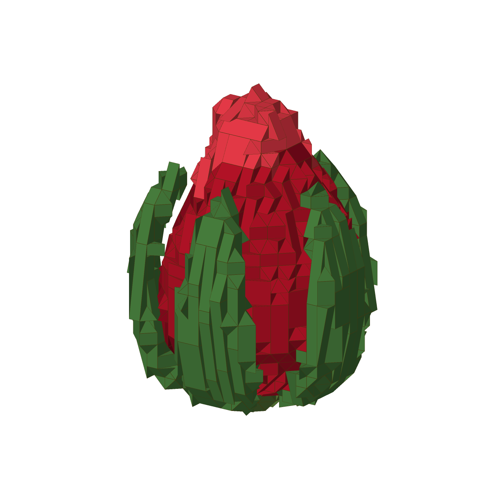 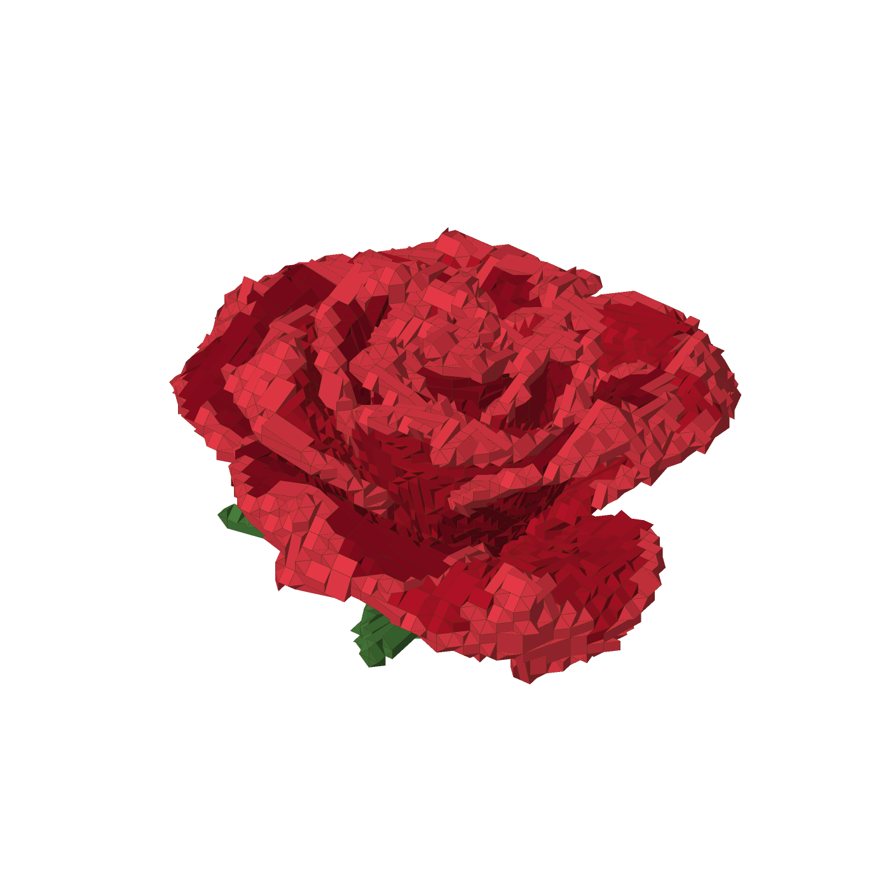

Petals in turn have two tones. A petal overlaps the third and the fifth
after it and never the next, so two petals that touch always differ, and
the eye parts them as it does by their shadows on a real bloom. One tone
for the inner half of the petals and another for the outer was tried
first and parted nothing, because every petal lay against others of its
own tone. The margin of every petal has a third, lighter colour, and the
lowest quarter of the inner petals a fourth, darker one, seen only down
inside the bloom.

A water lily ([*Nymphaea*](https://en.wikipedia.org/wiki/Nymphaea)) is
the same machinery with other numbers: 14 to 36 narrow petals, widest
low down and tapering straight to a point, with no lip. The outermost
lie out level and each round inside stands more upright, about a cushion
of stamens set by Vogel's model. It has four sepals.

A gerbera ([*Gerbera jamesonii*](https://en.wikipedia.org/wiki/Gerbera_jamesonii))
is two rows of 13, 21 or 34 rays round a disc of seeds, the disc darker
in its middle. The rays are spaced evenly and not by the golden angle,
because a row has no round behind it to stay out from behind. Each ray is
narrow enough to leave air between its end and the next. Wider, the rays
were a dish.

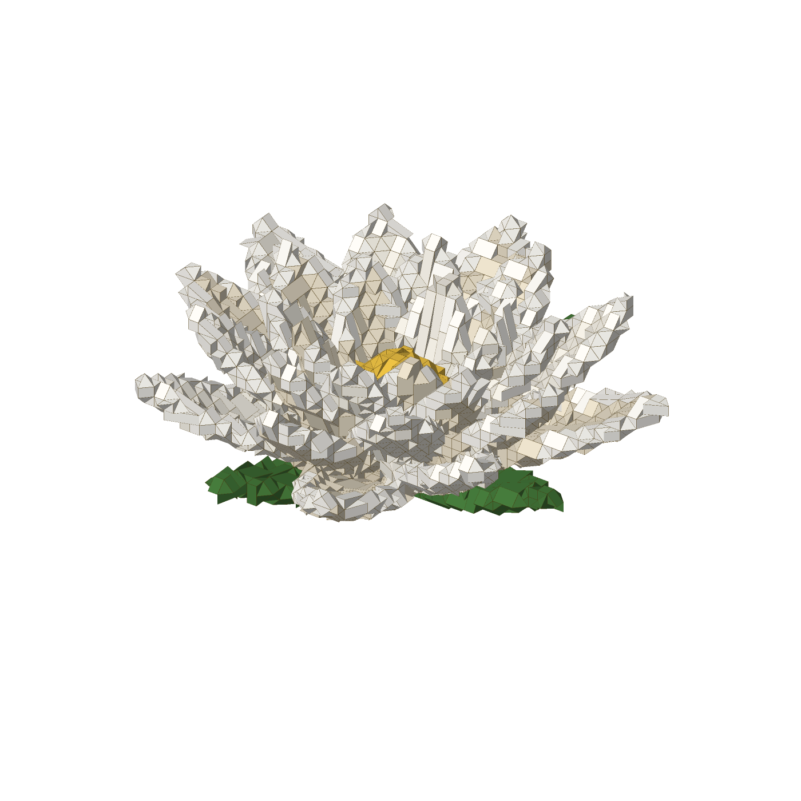 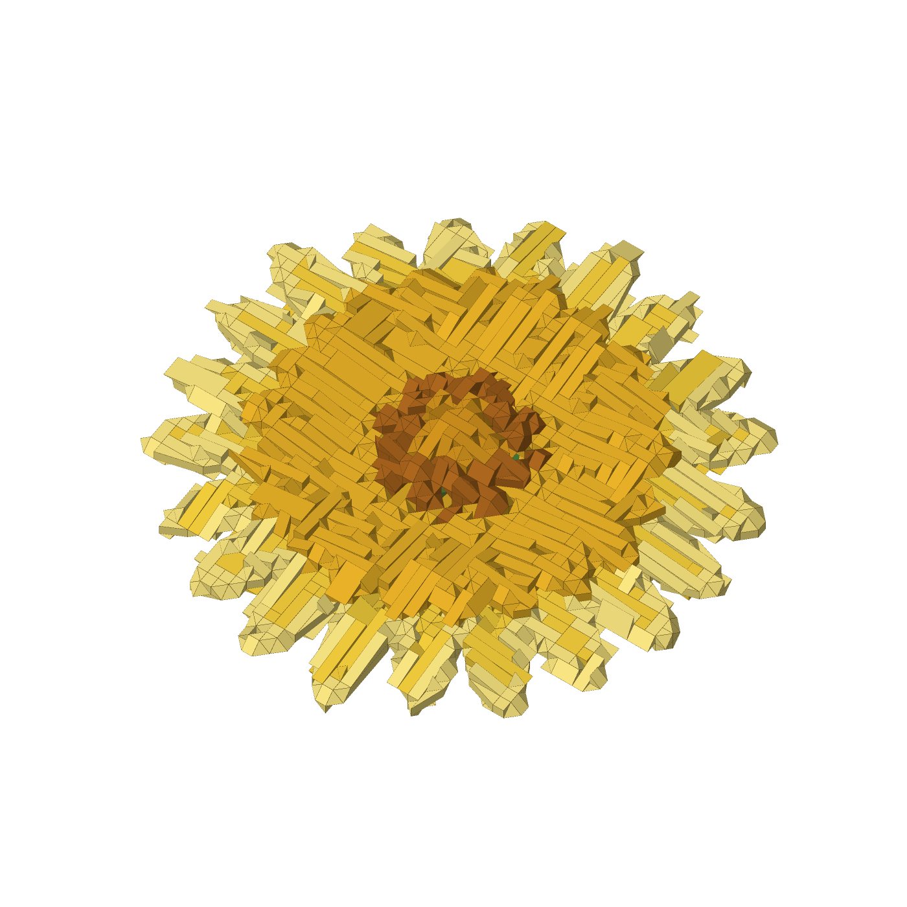

A dahlia was built and taken out. Its petals are many and small, and at
this size sixty of them four cells wide were told apart from the side
and were confetti from above.

**Tilt** and **Turn** are grown into the bloom. It is grown along +z
and every part is then turned about the middle of the bloom: tipped over
by the tilt towards +x, then turned about the upright. A round cone or a
ball turned is the same solid elsewhere, so its distance stays exact,
and the fitter lays the bricks on the grid as it does for any plant. The
bloom is then moved straight up or down until its lowest point touches
the floor, so it rests on its petals, its sepals or its stem and is
never below the floor of its point. The form's 24 quarter turns (section
8) cannot lay a rose down at a slant, and a grid at an angle turns every
other form on that grid with it. A bloom tilts to 90 degrees, which is on
its side. The quarter turns give the rest.

Fallen petals are petals of the same shape laid on their backs on the
floor, three to five of them, on the side the bloom faces.

At the usual size, 48 cells across full blown:

| Flower | Parts | Bricks | One thread | 16 threads |
|---|---|---|---|---|
| Rose, in bud | 4,289 | 1,757 | 0.52 s | 0.32 s |
| Rose, 60% open | 4,570 | 3,886 | 0.66 s | 0.21 s |
| Rose, full blown | 4,577 | 6,898 | 0.71 s | 0.14 s |
| Water lily, 60% open | 2,101 | 4,332 | 0.36 s | 0.15 s |
| Water lily, full blown | 2,073 | 4,140 | 0.34 s | 0.08 s |
| Gerbera, 60% open | 2,055 | 3,430 | 0.27 s | 0.08 s |
| Gerbera, full blown | 2,055 | 2,252 | 0.28 s | 0.09 s |

A bud takes as long as an open bloom for a quarter of the bricks, and
gains least from threads. Its 4,289 parts lie on one another in a
sixth of the room, so each sample has more of them to be compared
with. Where a bud's time goes was not measured further.

#### One colour for each part

Every part carries a number: the trunk or stem, leaves, leaves in shade,
new growth, limbs, and then petals, blooms and the heart of a flower. A brick takes the number of the part its middle
lies deepest in, and the colouring **As the pattern has it** paints it
(section 7.9, Colours by feature).

Some numbers are decided from the tree as a whole. On a pine, needles
with open air a cell and a half above them are the top of a bough. They
have a number of their own, which the natural sets of colours paint a
paler green and the snowy sets paint white. On an oak, leaves with open
air above them are light and leaves with open air below them are dark,
with the boundary made uneven by smooth noise. The oak's leaves were first
lit by where each brick lay in its own ball of leaves. Every ball was then
light on top and dark underneath, and a mass read as the balls it was
made of.

The fitter merges cubes into the largest boxes it can and knows nothing
of colour, so one box may run from a bough's bark out into its needles.
After the fit, every cell of every box is asked its number. A box of one
number is kept, and the cells of the others are merged again number by
number. No brick is of two colours.

#### Finding the parts near a sample

A fit of a tree asks for the distance at some ten million samples, and a
pine has five thousand parts. Comparing every sample with every part
would take minutes. The parts are filed in a uniform grid of buckets one
cell wide. A bucket lists the parts that come within 0.9 of a cell of it,
which is as far as the fitter looks from a cell's corner before it calls
the cell empty or full (section 7.1). A sample reads its own bucket's
list, which holds six parts on a pine, and takes the least of their
distances.

Two details make that sound and quick. An empty bucket has to answer with
a distance too, and the answer must not exceed the truth, because the
fitter skips a whole block of cells whose middle is far enough from the
surface. A second grid four times coarser records how many coarse buckets
lie between each bucket and the nearest part, and an empty bucket answers
with that gap. And a sample well inside one part stops looking: its depth
in that part is no deeper than its true depth, which is all the fitter
asks of a point inside.

The bucket size was measured. Buckets four cells wide, the size a curve's
segments are filed in, listed about fifty of a pine's side shoots each,
and the default pine took 2.9 seconds. Buckets one cell wide take it in
1.0. A hierarchy of boxes round the parts would serve no better: the
parts are small and spread evenly through the crown, which is the case a
uniform grid suits, and a sample finds its bucket by three
multiplications.

#### Why the processor and not the graphics card

Nine tenths of a tree's build time is the distance function, which is
arithmetic a graphics card does well, so a version on the card was
considered. The editor draws through OpenGL 3.3 and WebGL2, which have no
compute shaders. The field would be drawn slice by slice into a texture
by a fragment shader, with the parts and the bucket grid passed in as
textures, and read back
([WebGL best practices](https://developer.mozilla.org/en-US/docs/Web/API/WebGL_API/WebGL_best_practices)).
It was not built, for three reasons.

The first decides it. Which brick a cell gets depends on which of its 64
samples are inside the tree, and some samples always lie within rounding
error of the surface. The shading languages at these versions do not fix
how a sum, a division or a square root is rounded: the rule that does
arrived with
[GLSL 4.00](https://developer.download.nvidia.com/opengl/specs/GL_ARB_shader_precision.txt),
and even it allows a multiply and an add to be fused and a square root to
be three units out in its last place. Two cards could therefore give
different bricks for one seed, and neither need agree with the processor.
A seed that names one tree on every machine is worth more than the
speed.

The core library also has to build a tree with no graphics card at all,
for tests, reports and the picture examples, so the processor's version
would exist in any case and would have to be the one the card's was held
to.

And the fitter does not ask for its samples in one batch. It asks for a
block's middle, then perhaps its corners, then perhaps 64 samples in some
of its cells, each answer deciding the next question. A card would have
to answer every possible question in advance, most of which are never
asked, or the fitter would have to be rewritten in rounds.

The scheme that would keep the bricks identical was measured before
anything was built: let the card sort cells into far, inside and near the
surface, and let the processor decide every near cell. Of a pine's 9.2
million samples, 7.5 million are the 64 inside a cell the surface
crosses, which are the ones the processor would still have to take. For
an oak it is 9.8 of 12.2 million, for a willow 6.3 of 8.0. The card could
take the other fifth at most, and those are the cheap ones, a lookup in
an empty bucket. It was not built.

The speed was to be had on the processor, and it has been. The blocks of
a fit are independent of one another, and the fitter now divides them
among threads (see [performance.md](performance.md), Threads). The bricks
are the same whatever the number of threads. On a desktop with 16 logical
cores the pine builds in 0.21 seconds in place of 1.1, which is the gain a
graphics card was wanted for, without its three costs. The browser build
has no threads and builds a pine in the one-thread time.

#### What is measured

At the usual sizes:

| Plant | Size | Parts | Bricks | One thread | 16 threads |
|---|---|---|---|---|---|
| Pine | 140 tall, 72 across | 5,495 | 33,643 | 1.1 s | 0.21 s |
| Palm | 120 tall, fronds 44 long | 1,149 | 16,753 | 0.36 s | 0.09 s |
| Oak | 110 tall, 124 across | 3,283 | 40,092 | 1.1 s | 0.22 s |
| Boxwood | 40 tall, 42 across | 1,065 | 8,513 | 0.23 s | 0.05 s |
| Beech | 140 tall, 104 across | 4,293 | 48,667 | 1.2 s | 0.25 s |
| Hedge, 72 long | 36 tall, 24 thick | 3,429 | 11,189 | 0.17 s | 0.07 s |
| Hydrangea | 46 tall, 56 across | 1,373 | 17,227 | 0.31 s | 0.07 s |
| Peonies, three | 56 tall | 1,057 | 3,751 | 0.19 s | 0.06 s |
| Petunias | 20 tall, 52 across | 387 | 5,756 | 0.11 s | 0.03 s |
| Reeds, 24 stems | 84 tall | 432 | 8,368 | 0.24 s | 0.07 s |
| Sunflowers, three | 90 tall | 659 | 8,965 | 0.23 s | 0.06 s |
| Tulips, five | 64 tall | 551 | 5,880 | 0.30 s | 0.10 s |

At 100 tall the pine, the palm and the oak take 0.58, 0.27 and 0.55
seconds on one thread. The time is nearly
all distance samples: 9.2 million of them for the pine, at about 100
nanoseconds each. Growing the tree and filing its parts takes 50
milliseconds and colouring the bricks 20.

The discrepancy of a tree is high, 15% for the pine, and it does not mean
what it means for a sphere. A spray of side shoots two cells thick has
most of its volume within half a cell of its surface, where no brick can
follow it exactly.

A tree is always fitted at brick size 1 when the brick size is automatic,
whatever the budget, as a tile pattern is (section 9). At a coarser size
the shoots and leaflets are thinner than a brick and vanish, and what is
left is a trunk in a cloud.

A plant too large to be fitted at brick size 1 is over the limit on the
number of cells a build may span. It is then fitted at the finest brick
size that is within the limit (`build_upright` in `spec.rs`). Refused
instead, the plant stopped growing: past some height the slider moved
and the last plant that could be built stood there unchanged. A plant
that large has parts thick enough to come through at the coarser size.

### 7.11 Mazes

 

**Maze** builds a maze to be walked through: one way in on the rim, a
room in the middle, and one way between them
([core/src/maze.rs](../core/src/maze.rs) lays it out and
[core/src/maze/walls.rs](../core/src/maze/walls.rs) builds it). There are
two kinds. A theta maze is rings of corridors about a round room, and its
walls are arcs of circles and straight spokes. A grid maze is square
cells about a square room. Both are cells with wall slots between them,
so one routine takes the walls out of both, and the two kinds differ
only in where a wall stands.

The form replaces an earlier maze generator of the author's, brickmaze.
That tool drew the walls into a picture, one pixel to a stud, walked the
picture's black pixels, and cut what it found into rectangles and
triangles. Here the walls are never a picture. A ring wall is the band
between two circles and a spoke is a rectangle, each as a formula, and
the outline fitter of 7.2 lays them, so a ring wall is long sloped bricks
all the way round with an exact outline.

#### Rings and cells

Write $`R`$ for the form's radius, to the middle of the outside wall,
$`N`$ for the number of rings and $`t`$ for the walls' thickness. The
gap from one ring wall to the next, corridor and wall together, is

```math
g = \frac{R}{N}
```

Ring wall $`j`$ is the circle of radius $`j\,g`$, for $`j`$ from 1 to
$`N`$, and the last of them is the rim. Ring 0 is the room inside the
first wall. Ring $`k`$ lies between walls $`k`$ and $`k + 1`$ and is cut
by spokes into $`n_k`$ cells of equal angle. A corridor is $`g - t`$ wide
between its walls, and the maze is refused if that is under 3 cells.

One number of cells for every ring would give slivers by the room and
halls at the rim, because a cell of ring $`k`$ is $`2\pi k g / n_k`$ long
at its inner wall. So the number grows outwards, and it grows only by
doubling. Every spoke of a ring then lines up with a spoke of the ring
outside it, and a cell has one cell inside it and one or two outside.
The first ring has the number asked for, **Cells in the first ring**, or
as many as leave 3 cells between spokes if that is fewer. From there
**Cells double** sets the rule:

```math
n_k = \begin{cases} 2\,n_{k-1} & \text{if the rule asks for it and } \dfrac{2\pi k g}{2\,n_{k-1}} - t \ge 3 \\ n_{k-1} & \text{otherwise} \end{cases}
```

Left **to keep cells square**, the rule asks for a doubling wherever
the doubled cells are still at least as long as the corridor is wide:

```math
\frac{2\pi k g}{2\,n_{k-1}} \ge g
```

Every cell from the second ring out is then between one and two
corridor widths long at its inner wall. For example, with 6 cells in the
first ring, twelve rings have 1, 6, 12, 12, 24, 24, 24, 24, 48, 48, 48
and 48 cells. This is the adaptive rule for a polar grid in Buck,
*Mazes for Programmers* (2015), chapter 7, kept to doublings. The other
setting doubles **every so many rings**, at each ring whose number is a
multiple of the setting. At 2 it is brickmaze's own rule: 4, 4, 8, 8, 16,
16. The second condition of the first formula applies to either setting,
so a ring is never divided so finely that a player could not pass
between its spokes.

A grid maze of $`N`$ rings is $`2N - 1`$ cells each way, the room being
the cell in the middle. Its cells are $`\text{round}(R / (N - \tfrac{1}{2}))`$
apart, a whole number, so that every wall lies on the lattice.

#### Taking the walls out

Every wall starts standing. A walk begins in the cell inside the way in.
At each step it moves into a cell it has not visited, chosen at random
among those beside it, and takes out the wall it passes through. When no
such cell is beside it, it goes back one step along the way it came. It
ends when it is back at the start with nothing left to visit
(`carve` in `maze.rs`). This is the randomised depth-first search, often
called the recursive backtracker, kept on a list and not on the call
stack so that a large maze cannot overrun the stack.

Every cell is entered once, through one wall, so the gaps are a spanning
tree of the cells. A tree gives the two properties a maze needs: every
cell can be reached, and between any two cells there is exactly one way,
so the maze has one solution and no loops. Any spanning tree gives those.
The walk was chosen for the shape of its tree. It goes on as far as it
can before it turns back, so corridors are long and winding and few
branches leave them.

The alternative weighed was a tree grown from anywhere on its edge, which
is Prim's method with random weights, and is close to what Kruskal's
method and Wilson's uniform tree give. Those have many short dead ends
(Buck, "Maze Generation: Algorithm Recap", 2011). The test
`corridors_are_long_and_dead_ends_few` measures both on the same cells,
over twelve mazes of nine rings of each kind:

| | Dead ends, the walk | Dead ends, grown from anywhere | Way through, the walk | Way through, grown from anywhere |
|---|---|---|---|---|
| Theta, 157 cells | 11.4% of cells | 33.2% | 84 cells | 12 |
| Grid, 289 cells | 11.0% | 32.1% | 120 cells | 13 |

The way through the walk's maze visits about half its cells, so it
cannot be found by heading for the middle.

The room is left out of the walk and given one door afterwards. Walked
into like any other cell, the room of a theta maze has every cell of the
first ring beside it, and the walk would leave it by several of them, so
corridors would run through the goal. Its door is put in the cell beside
it that is furthest from the way in along the corridors, which makes the
way through as long as that maze allows.

The numbers come from the seed by the generator the patterns use
(SplitMix64), so one seed and one set of settings is always one maze.

#### The walls as one outline

The outline fitter asks one thing of a form: how far a place is from its
surface, negative inside. For a maze that is the distance to the nearest
wall (`Layout::wall`), and each wall near a place is found by
arithmetic. With $`r`$ the place's distance from the middle and
$`\theta`$ its angle, the nearest ring wall is wall
$`j = \text{round}(r / g)`$, and its arc there is the one numbered
$`\lfloor \theta\, n / 2\pi \rfloor`$ of that wall's $`n`$. Inside a
standing arc the distance is

```math
d = \left| r - j g \right| - \tfrac{t}{2}
```

and an arc whose neighbour has been taken out also ends there, on the
line from the middle through the spoke's place. The nearest spoke is at
the angle $`\text{round}(\theta\, n_k / 2\pi) \cdot 2\pi / n_k`$, and is a
rectangle $`t`$ wide from $`k g - t/2`$ to $`(k + 1) g + t/2`$ out from
the middle. It runs half a thickness past each ring wall so that it
closes against the wall's far face. The distance to the maze is the least
of these, so a spoke and the ring wall it meets are one solid and are
fitted with no seam.

The alternative was each wall as a polyline in a search grid, as a
spline's band is. That would have made every circle a chain of chords
and every wall a solid of its own, rounded where it met the next.

The middle of a wall is put on a lattice line if the wall is an even
number of cells thick and down the middle of a row of cells if it is
odd, as a band's is (7.2). The spokes that lie along the axes, and every
wall of a grid maze, are then whole cells. A grid maze has no
discrepancy at all.

#### Fitting a square at a time

The walls are fitted in squares of ground 96 cells each way, every square
as an outline of its own, and the pieces are put together in the squares'
order (`Walls::fitted`).

Fitted as one outline they took too long. The fitter searches each
stretch of an outline for its corners, and a maze's walls are one outline
or a few, a hundred times as long as a ring's and joined at every spoke.
Its time rose faster than the length: a maze of 12 rings took 1.3
seconds and one of 13 took 10.8. In squares no outline is longer than a
square holds, so the time goes by the area. A maze of 16 rings took 17.7
seconds as one outline and takes 1.4 in squares, on one thread.

The squares are also the work shared out over threads (see
[Threads](performance.md#threads) in performance.md). A square does not depend on
any other, each is given to whichever thread is free, and the results are
taken in the squares' order, so a maze is the same bricks in the same
order on one thread or sixteen. The test
`a_maze_is_the_same_bricks_on_any_number_of_threads` holds it to that.

A cut between two squares is along lattice lines, so it is exact: the
pieces either side are whole cells there, with no gap and no overlap. It
costs bricks, because a sloped brick cannot cross a cut. Measured on the
maze of 16 rings, the squares lay 4% more pieces than one outline and
leave 3.5% of the walls' area amiss against 3.4%. Squares of 64 and 192
cells were slower (2.1 and 2.5 seconds).

The squares are set out from the middle of the maze, half a square to
each side of it, so no cut runs along the spokes on the axes. For a grid
maze a square is an even number of the maze's cells across, which puts
every cut down the middle of a row of cells and never along a wall.

#### Textures on the walls

 

**Texture** sets what the walls are made of. Plain walls are the fit as
it stands. Planks, bricks, cobblestone and medallions are the tile
patterns of 7.9, and on a maze they are wrapped along each wall and not
pushed down through the whole maze from above, which would show a
brick's face on the wall tops and stripes on every wall
(`Walls::patterned`).

The pattern is drawn once, flat, by the code that draws it on a floor
(`lay_mosaic_on`), on a sheet as long as all the walls unrolled end to
end and as tall as they stand. Each ring wall is unrolled from the x axis
round, one cell of the sheet to one cell of the wall's middle circle. A
place in a wall at angle $`\theta`$ in ring wall $`j`$ is at
$`\lfloor \theta\, j g \rfloor`$ along that wall's part of the sheet, so
every place on one line through the wall towards the middle has the same
column of the sheet behind it. A spoke is unrolled outwards from its
inner end. Each wall has a part of the sheet to itself, so no two walls
show the same bricks.

Every piece of the fit is then a column from the ground up, and each
cell of its height takes the sheet's colour at that height. A block is
taken one cell of ground at a time, so a joint between two bricks is one
cell wide and goes through the wall. Cells of one colour are joined into
bricks again. Because every piece is cut at the same heights, the line
between two courses of bricks is level and unbroken round a whole ring.

A texture colours the walls and never moves them, as on any form (see
[The edge](#the-edge-the-forms-own)). The fit is not changed: each piece
keeps its outline and is only cut across its height. The curved face of
a ring wall is long sloped bricks, and a sloped brick is one colour to a
course, the colour where the middle of its solid half lies. So on a
curved face the upright joints fall where one sloped brick ends and the
next begins, and cobblestones there are blocks as long as the sloped
bricks. A sloped brick whose middle lies on a joint takes the colour of
the brick beside the joint; without that, one in nine was a slab of
mortar a dozen cells long. The straight spokes along the axes, the wall
tops and all of a grid maze are whole cells and carry the pattern
exactly. Shortening the sloped bricks to a brick's length would carry it
everywhere and would fit the curve less closely, which is the choice
7.9 made the same way for a floor's edge.

A rug is not wrapped. It is one figure with a middle and a border, and
cut into the strips of a hundred walls it is none, so a maze given a rug
has plain walls. Bevel and border do nothing on a wall. The pass that
patterns the sides of a box (7.9) is not run on a maze: it takes a form's
outermost layer of whole cells, and it patterned over the outside of a
grid maze before it was kept off.

**Hedge** is not a pattern. The walls are not fitted at all. The hedge
of the Plant form (7.10) is grown along the line of every wall: each run
of arcs standing side by side is one line, and each spoke is one. All of
them are one plant (`Model::laid_all` in
[core/src/tree.rs](../core/src/tree.rs)), so where two walls meet the
hedges run into each other and no brick is laid twice. That function is
the only thing the maze asks of the plants' code. A hedge wall is at
least 6 cells thick and 12 tall, the least a hedge can be.

#### The floor, the way through and the colours

A floor, if asked for, is the disc or the square out to the outside face
of the rim, fitted as an outline and laid under the walls, which then
stand on it. The way through is a strip one cell high on the ground, a
quarter as wide as the narrowest gap it passes. It runs along the middle
of each corridor and crosses from one ring to the next along a line
towards the middle of the maze, through the middle of the outer of the
two cells, which is inside the gap the two share.

A maze's bricks carry colour numbers, as a pattern's do. With plain
walls there are three: the floor, the walls and the strip. With a
texture or hedge there are eight: the first is the floor and also the
mortar or the hedge's stems, the last is the strip, and the texture's
own numbers are between. A pattern's seventh feature shares the first
feature's colour, which leaves the last number free for the strip.

#### What is refused

Every setting is brought within its range before anything is laid out:
2 to 40 rings, 1 to 64 cells in the first ring. Three sizes are then
refused with a message that says what to change, each before the work it
would cost:

| Limit | Why |
|---|---|
| walls 40,000 cells long in all | four or five seconds of fitting on one thread |
| a textured maze whose walls unroll to 1,500,000 tiles | each tile is drawn by the pattern's rule, up to 4 microseconds for cobblestone |
| hedge of 1,000,000 cells cubed (length by thickness by height) | a hedge is 0.1 to 0.25 bricks to each cell of that volume, so this is 100,000 to 250,000 bricks and about eight seconds on one thread |

#### What is measured

Walls 30 tall and 4 thick (hedge 6), on a desktop with 16 logical cores,
the least of three builds
(`cargo run --release -p brickloft-core --example timing -- maze`):

| Maze | Walls | Bricks | One thread | 16 threads |
|---|---|---|---|---|
| Theta, 4 rings, radius 80 | plain | 514 | 81 ms | 26 ms |
| Theta, 4 rings, radius 80 | bricks | 11,997 | 0.11 s | 42 ms |
| Theta, 4 rings, radius 80 | cobblestone | 8,675 | 0.26 s | 62 ms |
| Theta, 4 rings, radius 80 | hedge | 27,125 | 1.1 s | 0.23 s |
| Theta, 6 rings, radius 120 | plain | 1,122 | 0.18 s | 40 ms |
| Theta, 6 rings, radius 120 | bricks | 25,045 | 0.25 s | 75 ms |
| Theta, 6 rings, radius 120 | cobblestone | 18,898 | 0.59 s | 0.13 s |
| Theta, 6 rings, radius 120 | hedge | 54,903 | 2.5 s | 1.0 s |
| Theta, 9 rings, radius 180 | plain | 2,415 | 0.73 s | 0.15 s |
| Theta, 9 rings, radius 180 | bricks | 52,694 | 0.77 s | 0.19 s |
| Theta, 9 rings, radius 180 | cobblestone | 37,155 | 2.2 s | 0.33 s |
| Theta, 9 rings, radius 180 | hedge | 118,989 | 5.7 s | 1.9 s |
| Theta, 16 rings, radius 320 | plain | 6,870 | 2.3 s | 0.34 s |
| Theta, 16 rings, radius 320 | bricks | 149,553 | 2.6 s | 0.85 s |
| Theta, 16 rings, radius 320 | cobblestone | 104,728 | 6.4 s | 1.6 s |
| Theta, 16 rings, radius 320 | hedge | refused: too much hedge | | |
| Grid, 6 rings, radius 120 | plain | 97 | 0.13 s | 74 ms |
| Grid, 6 rings, radius 120 | bricks | 10,582 | 0.46 s | 0.56 s |
| Grid, 6 rings, radius 120 | cobblestone | 16,827 | 0.84 s | 0.17 s |
| Grid, 6 rings, radius 120 | hedge | 60,009 | 3.1 s | 0.71 s |

The desktop was running other builds when these were taken, so the
figures for sixteen threads are higher than an idle machine gives, by
an amount that differs from row to row.

A maze is built at brick size 1 whatever the brick budget, as a pattern
and a plant are. Its walls are a few cells thick and its corridors are
sized to be walked, so at a coarser size it would be a different maze.
Fewer bricks come from fewer rings.

#### Where it falls short

- A texture on a curved face is as coarse as the sloped bricks there, as
  described above. A grid maze has none of this.
- A textured maze is tens of thousands of bricks, because every course
  and every line of mortar is its own layer of bricks.
- The hedge keeps the Plant form's foot: the lowest tenth of its height
  is stems with air between, and a hedge has 40 plants at most, shared
  among the walls by length, so a long wall has few stems under it.
- A cut between two squares can fall along a ring wall where the wall is
  tangent to it, which lays that stretch as two thinner runs of bricks.
- The room is one ring across and cannot be made larger, and there is
  one way in. A maze takes no added points and cannot be mirrored.

### 7.12 Furniture

Furniture is the one form whose bricks are worked out directly from its
size and settings, with no solid to fit them to
([core/src/furniture.rs](../core/src/furniture.rs)). The first kind was
a bookcase, and the method is explained on it. It is boards and books, and each of those is a box on the
lattice, so each can be written down as a brick as soon as its place is
known. The build is therefore exact at every size. A wall of bookcases 400
microbricks wide and 240 tall is 3,877 bricks and is laid in about
0.3 ms.

 

The cell-by-cell fitter of section 7.1 could have built a bookcase from a
distance function, as it builds a tree. It was not used, because that
fitter joins neighbouring cells into the largest boxes it can. Two books of
one height standing side by side would become one brick, and a shelf would
be joined to the side that carries it. A book has to be a brick of its own
to have a colour of its own.

#### The carcass

The form gives a box, kept as a cube's is (section 7.2): a width, a depth
and a height in whole microbricks. The carcass is built inside that box the
way a joiner builds one. Two sides stand on the floor for the whole height,
and the top lies over them. The bottom board sits between the sides, on the
floor or lifted on a kick board that is set one microbrick back from the
front. A back panel one microbrick thick closes it behind. Each board is
one brick, unless it is longer than the longest brick allowed, in which
case it is cut into as few lengths as that allows.

The number of shelves follows from the height. Write $`t`$ for the
thickness of a board, $`H`$ for the height inside (from the top of the
bottom board to the underside of the top) and $`s`$ for the clear spacing
asked for. The number of openings is

```math
n = \mathrm{round}\left(\frac{H + t}{s + t}\right)
```

In words: an opening and the shelf above it take $`s + t`$ microbricks,
and the height has room for about $`n`$ of them once the top board is
counted as the last shelf. The count is kept to at least 1, and to no more
than leaves every opening 2 microbricks clear. The $`H - (n - 1)\,t`$
microbricks of clear height are then shared equally among the openings.
Any left over go one each to the lowest openings, where tall books are
kept. For example, the usual bookcase is 60 tall with boards of 2 and a
plinth of 3, so $`H = 60 - 3 - 2 - 2 = 53`$. With $`s = 11`$ that gives
$`n = \mathrm{round}(55 / 13) = 4`$ openings and 3 shelves, and the 47
clear microbricks are shared as 12, 12, 12 and 11.

The uprights follow from the width in the same way. With $`W`$ for the
width inside and $`b`$ for the widest bay allowed, the bookcase has the
fewest bays that are no wider than $`b`$:

```math
m = \left\lceil \frac{W + t}{b + t} \right\rceil
```

The bays are equal to within a microbrick, and a bay that is one wider is
put in the middle, where it looks intended. Each upright runs the whole
height inside and the shelves run between the uprights, so every shelf of
every bay is one board. A bookcase dragged taller therefore gains a shelf
each time there is room for one, and between those heights its openings
grow one microbrick at a time.

Two limits keep the proportions of a small bookcase. A board is no thicker
than a twelfth of the width or the height, and a plinth no taller than an
eighth of the height. Without them, a bookcase set up at 60 tall and
dragged down to 20 kept boards of 2, and half its height was wood. A box
under 3 microbricks wide or tall is built as one block, so that a side
dragged all the way in still builds something.

#### Mouldings

**Cornice and skirting** adds a chamfer under an overhanging top and
another round the foot, on the front and both sides. Each is a ramp laid
along the side, with a hip (a quarter of a square pyramid) at each front
corner. The two strips therefore meet at the corner in a mitre, with no
step. The mouldings stand out from the carcass by half a board, 3
microbricks at most, and the carcass is set in by the same amount, so the
form's size is the size of the whole piece. A curved profile such as an
ogee was not attempted. The sloped bricks are flat from corner to corner
of their box, and a curve stepped out of single cells would be rougher
than the chamfer. Where sloped bricks are turned off, the mouldings are
square bands.

#### Books

Each opening is filled from a run of random numbers of its own, seeded by
the form's seed, the number of its bay and the number of its shelf from
the bottom. One run for the whole bookcase would make every book after a
change depend on that change, so dragging the top up by one microbrick
would rearrange every shelf below. With a run for each opening, a shelf
that keeps its size keeps its books while the bookcase is resized.

**Books** sets how many microbricks of each shelf's width have something
standing on them, varied by a fifth either way from shelf to shelf. Those
microbricks are laid as one run of upright books against the left side of
the bay, or one against the right, or one at each end. The room left over
is then in one place, as it is when books are taken out and the rest are
pushed along. Within a run, each book takes the height of the one before
it, give or take a microbrick, and a new height begins one time in four,
so the books stand in sets.

A book's sizes come from its opening. It is as tall as the clear height
less one microbrick, down to a little over half of that. It is 1 to 3
microbricks thick, depending on the spacing, and thin books are the most
common. It is as deep as the shelf less one microbrick, down to two thirds
of that, and it is pushed to the back, so the spines stand at different
depths.

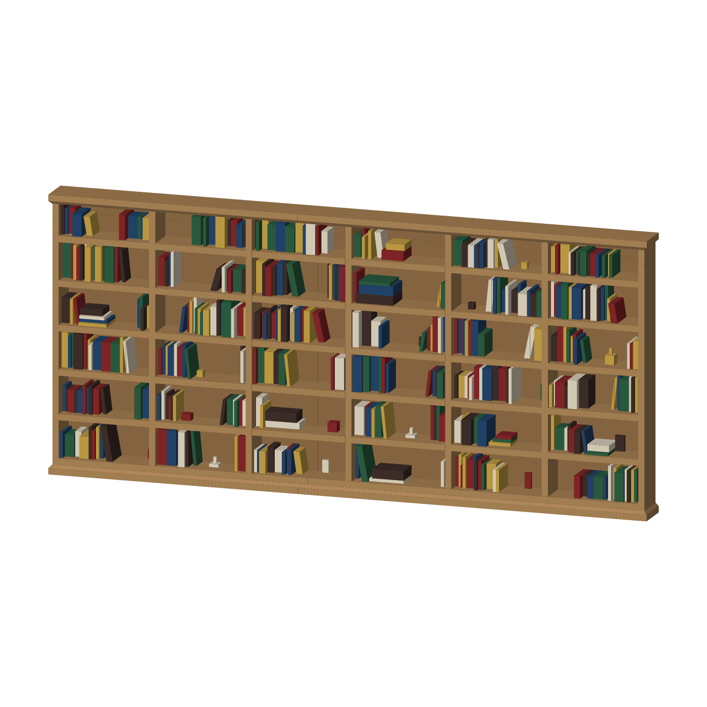

A wall six bays wide. The shelves are about two thirds full.

Some shelves also hold a book leaning on the end of a run, a pile of two
to four books lying flat, or an ornament (a vase, a box or a picture
frame). Their widths are taken out of the run. Added on top of it, as they
first were, they made a shelf that was asked to be a fifth full two fifths
full. A lying book is never longer or deeper than the one under it, and a
leaning book is never taller than the book it leans on.

A leaning book is a sheared box: a ramp under the face that overhangs, a
box, and a ramp over the face that has leant away. That is three bricks,
or two when the book leans as far as it is thick. A box turned to the true
angle would have its corners off the lattice.

No brick is tested against another after it is placed. Every book is given
its own stretch of the shelf's width, and stands on the shelf or on the
book under it. The tests in
[core/src/furniture/tests.rs](../core/src/furniture/tests.rs) check the
result instead: no two bricks share room, every book has a brick under
each cell of its foot, and every book lies inside its opening.

#### Colours and limits

The bricks carry eight colour numbers: 0 for the wood, 1 for the back
panel, and 2 to 7 for the books and ornaments. A book never takes the
number of a book it touches at its side, because two neighbours of one
colour read as one thick book.

A form may be 2,000 microbricks each way, which at the closest spacing
would be 400,000 openings. A bookcase of more than 12,000 openings, or
with room for more than 60,000 books, is refused before anything is laid,
and the message names what to change. The largest bookcase the dots can
drag out, 800 wide and 800 tall, is 25,819 bricks and is laid in
about 2 ms. **Brick size** and the brick budget do not apply to
furniture. Its boards are whole microbricks thick, and on a coarser grid a
board 2 thick would become 3 thick or vanish.

#### The other kinds, and what they share

A bookcase was the first kind. There are twenty-six more: cupboards,
tables, seating, lights, a bed, plants in pots and pictures.
Each is a function from the box and the settings to bricks, in a file of
its own under [core/src/furniture/](../core/src/furniture/), and each is
laid out directly as the bookcase is. Only a plant growing in a pot is
fitted (see below).

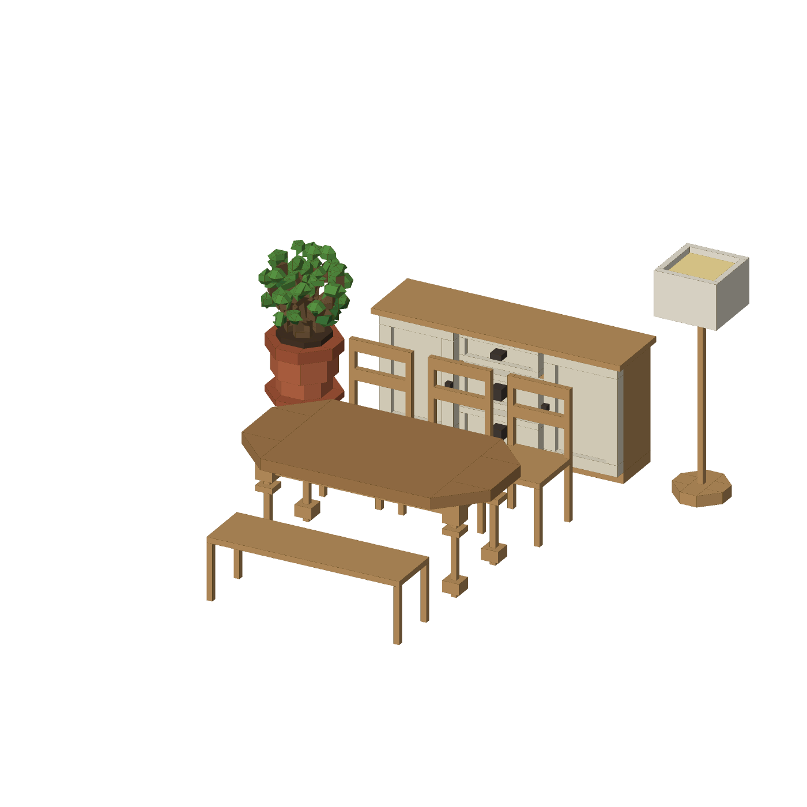

A table, its chairs, a bench, a sideboard and a lamp of one style and one seed.

The kinds are built from a few shared parts
([parts.rs](../core/src/furniture/parts.rs)). A round top is an octagon:
three boxes and a sloped brick at each corner, seven bricks at any size.
The outline fitter of section 7.2 would give a rounder edge. It was not
used, because it is a fit to be run and measured for every top, and
furniture is laid without one. A tapered leg keeps its outer corner upright and
narrows on its two inner faces, by a ramp on each and a hip between them.
A turned leg is square blocks of two widths: a foot, a ball, a shaft, a
collar, a neck and a head. A lampshade or a tall planter is a ring of
four ramps and four hips round a core. A door or a drawer front stands
one microbrick in front of a cupboard's body with a microbrick left
between it and the next, which is the dark line between two doors. The
body itself is one solid block, because nothing inside a closed cupboard
can be seen.

No kind refuses a small size. Below the least size at which it has
parts (three to six microbricks, by kind) a piece is one block, as a
bookcase is.

#### Styles and sets

A piece has a style and a seed
([style.rs](../core/src/furniture/style.rs)). A style is a set of choices
that go together, and it is not a number added to every size. Modern has
square sections, flush fronts and no mouldings. Farmhouse has turned
legs, panelled doors with knobs and plank tops. Classical has tapered or
turned legs, panelled doors, a cornice and a skirting, and upholstery.
Rustic has heavy sections, trestles and stretchers. Industrial has thin
metal frames carrying slabs of wood.

The seed picks among what a style allows: which leg, which chair back,
which handle, which lampshade. It picks without knowing the kind. The
function that turns a style and a seed into choices, `Set::of`, is given
no kind, so a dining table and a chair of one style and one seed are
given the same legs, the same weight and the same wood. (A chair at its
usual size has legs one microbrick thick, too thin to be turned or
tapered, and there they are square.) Had each kind drawn its own
numbers from the seed, a table and its chairs would have matched only by
chance. A kind's own setting (a table's legs, a chair's back) overrules
the style for that piece alone.

Colour numbers follow the same idea. For every kind but the bookcase, the
plants and the pictures, a number names what a thing is made of: 0 the
wood, 1 a second wood or the paint of doors, 2 metal, 3 upholstery, 4 a
second cloth, 5 the light of a lamp, 6 pale linen, 7 a top of another
stuff. A table's top and a cupboard's door are therefore the same wood in
the same number, and one set of colours paints a whole room.

#### Lights and metal in the game

A lamp's bulb and a candle's flame are bricks of colour 5. In the file
the editor copies ([editor/src/brz.rs](../editor/src/brz.rs)) each is
written in the game's glowing material, and the bricks a piece names as
its lights also carry a point light, as the lights of a dressed pine do.
A lamp names one brick, however many bricks of it glow, and a chandelier
one for each candle, eight at most. Bricks of colour 2 are written in the
game's metal. The piece is built again when the file is written, turned
and flipped as it stands, and each brick is looked up by where it is, so
a lamp laid on its side is still lit.

#### Plants in pots

A potted plant, a hanging basket and a window box are a container with a
plant in it ([pots.rs](../core/src/furniture/pots.rs)). The container is
laid by rule and is exact: a round pot is stacked octagons with a rim and
a saucer. The plant is one of the Plant form's own (section 7.10),
reached through the functions that form already offers, and it is fitted
cell by cell as any plant is. It is the one part of any furniture with a
discrepancy.

The plant keeps its own proportions. It is grown at the height the box
has room for above the soil, with its spread in the proportion its kind
starts at, and grown again smaller if that is wider than the box.
Stretched to fill the box instead, a tulip in a wide pot had a cup as
wide as the pot. The plant gives way to the pot: its distance function is
cut by the box of every brick of the pot, so no brick of the plant shares
room with one of the pot's.

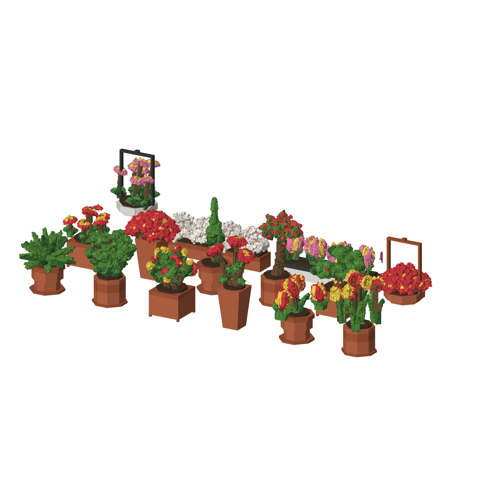

A potted plant is about 1,300 bricks at its usual size and takes
about 90 ms (a window box of four plants takes about 1.2 s), where a table takes a few thousandths of a millisecond. A
plant is grown no taller than 120 microbricks however tall the box is.

#### A trellis

A trellis in a planter is exact all through
([trellis.rs](../core/src/furniture/trellis.rs)). The lattice is two
layers, as a joiner nails one: uprights against the wall and rails across
in front of them. A diamond lattice is laths at 45 degrees, each a ramp
and its opposite in every cell it crosses, which is a lath's true width;
stepped out of whole cells it was a stair. An arched top is a square
lattice whose uprights shorten towards the sides.

The climber is laid by rule too, and does not use the Plant form. That
form has no climber, and its nearest thing, a hedge laid along lines, is a
mass of leaf several microbricks thick: along slats one microbrick wide
it buried them. Here a stem goes up an upright, now and then turns along
a rail to the next upright, and stops at a height that **Coverage** sets.
Leaves are single bricks one or two microbricks long, set beside a stem's
cells or in front of them, thickly near the soil and thinly at the stem's
end. A clematis has flowers of one colour among them, a rose of two, and
wisteria has trusses hanging from its stems. Every cell is taken once,
and every leaf is against a stem or another leaf.

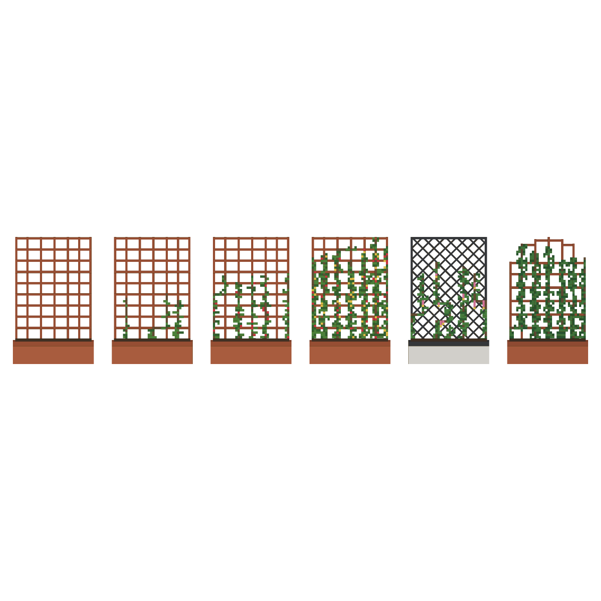

#### Pictures

A framed painting or portrait is a frame and a mosaic one microbrick deep
([pictures.rs](../core/src/furniture/pictures.rs)). The picture is drawn
a microbrick to a pixel by a function of the seed, cut into runs of one
colour row by row, and the runs are joined into the largest bricks by the
code that joins a mosaic's tiles (`pattern::joined`). A sunset 46 by 34,
which is 1,564 pixels, is about 150 bricks.

Every shape in a picture is decided with additions, multiplications,
comparisons and square roots, each of which gives the same answer to the
last bit on any machine. A sine does not, so hills are triangle waves,
and a sky grades by a square. The same seed is therefore the same picture
everywhere.

A painting is a sunset over water, a landscape of four ranges of hills
with firs, or an abstract of divided rectangles, bands or arcs. A
portrait is a cartoon head and shoulders. Everything in it is placed in
whole microbricks by how far a cell is to either side of the middle line,
so a face is its own mirror image exactly, which is most of what makes a
few dozen pixels read as a face. The mouth always turns up at its ends:
at this size a straight mouth reads as displeased. A picture uses up to
29 colour numbers, and one set of colours holds four skins, five colours
of hair and four of clothes, among which the seed picks.

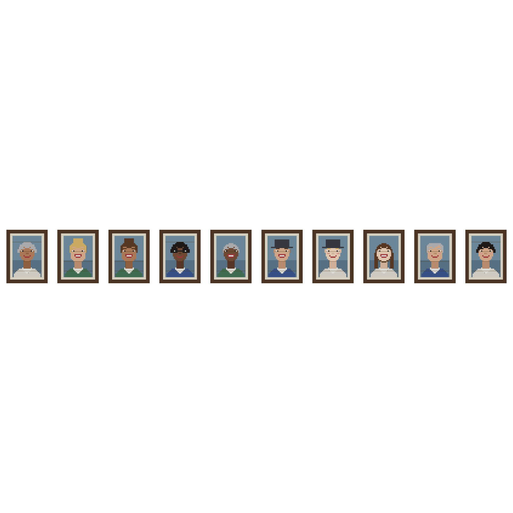 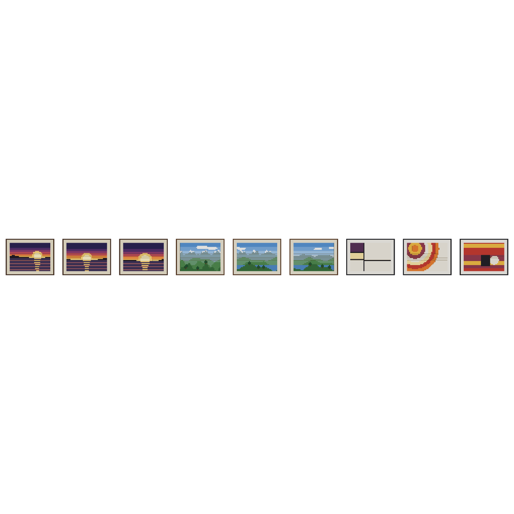

## 8. Changing a form: added points, mirror, turning, grids

### Added points

A point added at $`a`$ and dragged by an amount $`b`$ moves the form near
$`a`$ and leaves the rest alone. A point of the form at distance $`d`$ from
$`a`$ moves by $`b\,w(d)`$, where

```math
w(d) = \tfrac{1}{2}\left(1 + \cos\frac{\pi d}{\rho}\right)\ \text{for } d < \rho, \qquad w(d) = 0 \text{ otherwise}
```

and $`\rho`$ is the reach. The weight $`w`$ is 1 at the point itself,
falls smoothly to 0 at the reach, and stays 0 beyond. The cosine makes the
fall gentle at both ends, so the bump joins the rest of the form with no
corner. For example, with a reach of 8 cells and a pull of 6 cells, the
form moves 6 cells at the point, $`6 \times \tfrac12(1 + \cos 90^\circ) = 3`$
cells at 4 cells away, and not at all 8 cells away. This is the loop in
`pulled` in `spec.rs`:

```rust
    for (at, by) in pulls {
        let held = (0..fine.len()).min_by(|a, b| fine[*a].distance_squared(*at).total_cmp(&fine[*b].distance_squared(*at))).unwrap();
        for i in 0..fine.len() {
            let mut d = (along[i] - along[held]).abs();
            if closed {
                d = d.min(whole - d);
            }
            if d < reach {
                moved[i] += *by * (0.5 * (1.0 + (PI * d / reach).cos()));
            }
        }
    }
```

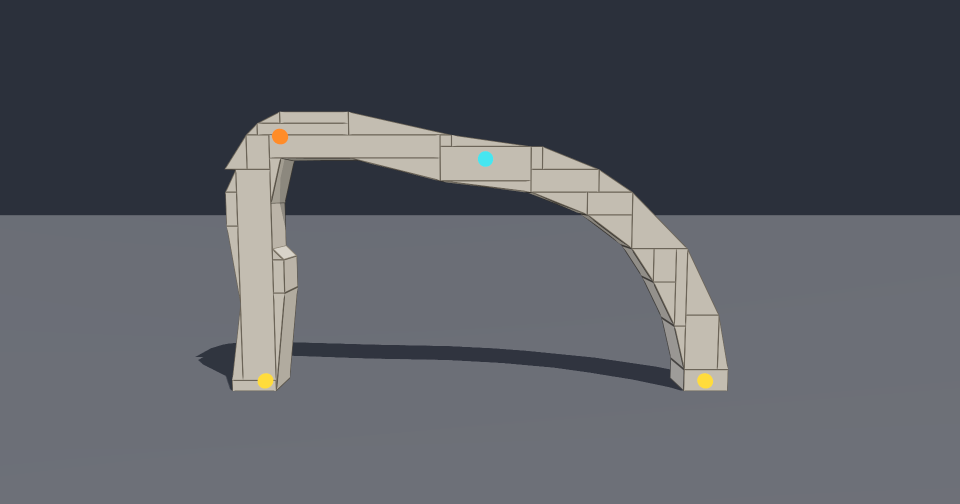

On a curve, $`d`$ is measured along the curve (`along`), not straight
across. So a pull on one side of a narrow loop leaves the other side alone,
even though the two are close in space. The polyline is first cut into
pieces of half a cell, since a straight run is one long segment that could
only move by its ends. A revolve's profile is pulled the same way.

On a sphere or pyramid, $`d`$ is straight-line distance, and the pull acts
on the distance function instead of on a curve. To answer the pulled form
at a point $`p`$, the program needs the point that ended up at $`p`$. That
point is $`p - t\,b`$, where the share $`t`$ satisfies
$`t = w(\lvert p - t\,b - a\rvert)`$. The share $`t`$ appears on both sides,
so there is no formula for it. It lies between 0 and 1, and the program
finds it by bisection: it halves the range 14 times (`Field::Warp` in
`sdf.rs`). Taking $`w`$ at $`p`$ itself, the easy approximation, is badly
wrong when the pull is as long as its reach; a sphere pulled six cells
bulged only three.

#### Keeping the layout

A sphere, pyramid or pipe with a point added keeps its own bricks wherever
the pull does not reach (`patched` and `lifted_tube` in `spec.rs`). A cell
counts as unchanged if the form's distance function is as it was at the
cell's centre and one cell to each side. Bricks made only of unchanged
cells are kept. The changed cells are refitted (by 7.1 for solids, by 7.7
for tubes) and no others, so no cell is filled twice or left out. Without
this, one bump on a ring 70 across sent the whole ring to the cell-by-cell
fitter, and a fifth of its faces became steps.

### Mirror

Mirroring along an axis about the plane $`x_k = c`$ keeps the form's low
side and replaces the high side with its mirror image. Here $`x_k`$ is the
coordinate along that axis. For a curve, this is done to the polyline: the
part with $`x_k \le c`$ is kept and followed by its reflection (`mirrored`
in `spec.rs`). For a solid, it is done to the distance function, which is
asked about the point

```math
x_k' = c - \lvert x_k - c\rvert
```

instead of the point itself. A point on the low side is left as it is, and
a point on the high side is reflected onto the low side. For example, with
the mirror at $`c = 10`$, a point at $`x = 13`$ is answered as if it were at
$`10 - 3 = 7`$.

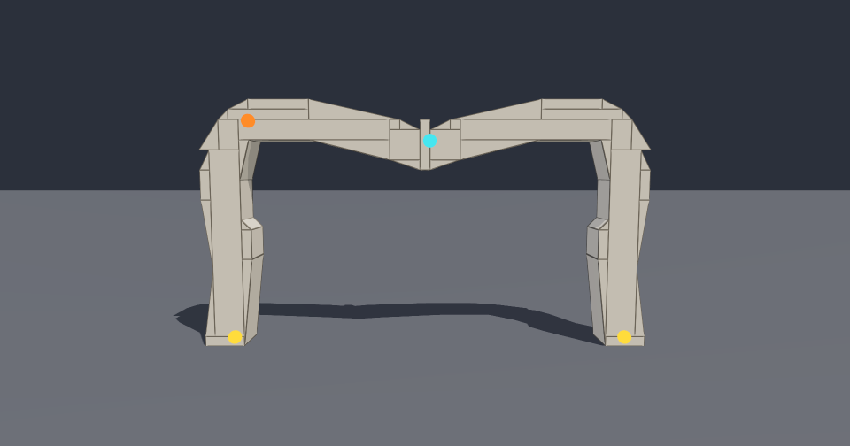

Because the mirror is applied to the form before fitting, a lopsided arch
becomes a symmetric arch and is fitted as one. Added points on the high
side are moved to the low side first, so a point added on either side
counts (`folded_pulls`).

### Flip and quarter turns

Flip and quarter turns act on the finished bricks, not on the form. Flipping
along an axis reflects each brick's position and swaps the bits of its
corner mask along that axis, which is the reordering of switches from
section 2. This is from `build_at` in `spec.rs`:

```rust
            b.min[k] = twice as i32 - b.min[k] - b.ext[k];
            // each corner of the box changes ends along this axis
            b.mask = (0..8u8).fold(0u8, |m, c| m | (b.mask >> c & 1) << (c ^ (1 << k)));
```

`c ^ (1 << k)` is corner `c` with its coordinate along axis `k` changed from
0 to 1 or back. A quarter turn reorders each brick's position, size and
corner mask about a lattice point at the middle of the form (`Turn` in
`spec.rs`). The form is therefore the same bricks whichever way it faces,
and forms that can only be fitted upright, such as a pyramid or a spun
profile, can lie on their sides.

### Grids at an angle

The game keeps bricks on grids, and a grid other than the world's can stand
at any angle. Each form carries a grid number, a rotation $`q`$ and a
translation $`t`$, shared by every form on that grid. The rotation is
stored as a quaternion, which is four numbers that together describe one
turn in space. A point
$`p`$ of a form is shown at

```math
p_{\text{world}} = t + R(q)\,p
```

where $`R(q)`$ means "turned by $`q`$". The point is turned with its grid,
then moved to where the grid is. In the editor this is `out_of_grid` in
[editor/src/state.rs](../editor/src/state.rs):

```rust
/// Where a point of a form's grid is in the world: turned by the grid's
/// angle, then moved to where the grid is.
pub fn out_of_grid(spec: &Spec, p: DVec3) -> DVec3 {
    DVec3::from_array(spec.grid_at) + turned_way(spec.grid, p, false)
}
```

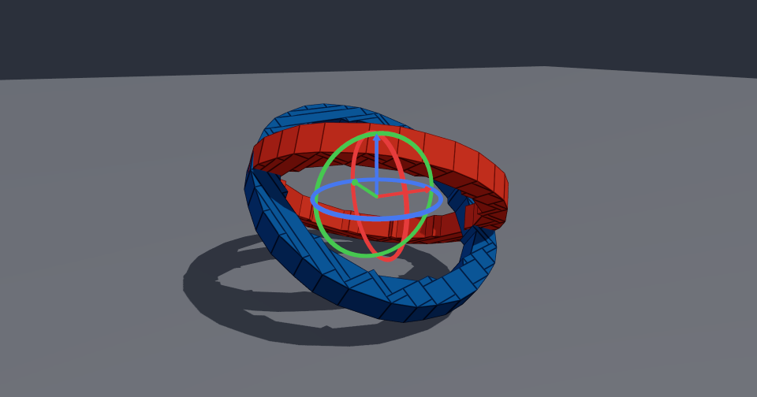

Nothing in the fitting reads these values. A form on a tilted grid is
fitted exactly as if it were level, which is why it stays as smooth as it
was. The rotation only decides where the finished bricks are drawn and how
they are written to the copied file. In the file, a tilted grid becomes a
frozen grid of its own holding all its forms
([editor/src/brz.rs](../editor/src/brz.rs)).

Turning a grid with one of its rings combines $`q`$ with a turn about that
ring's axis, in whole degrees, and adjusts $`t`$ so that the middle of
everything on the grid stays where it is.

### Forms joined on purpose

Forms on one grid are normally kept clear of each other. A form dragged
with Ctrl held is moved into the others instead and marked as joined
(`merge` in [editor/src/state.rs](../editor/src/state.rs)). The mark is the
form's **blend**, a length kept in its settings (`Spec::blend`), so undo, a
save and the clipboard all keep it. Joined forms overlap, and the game
refuses a brick whose box overlaps another's, so the overlap has to be
resolved before the bricks are drawn, copied or saved. That is done by
`union` in [core/src/blend.rs](../core/src/blend.rs), which the editor calls
with every form in the workspace when it gathers their bricks
(`State::painted`).

Each form is still fitted by itself first, by the fitter that suits it. A
join then does two things. Where the forms' surfaces meet, it fits the two
as one solid with fresh bricks. Everywhere else each form keeps its own
bricks, because a sphere or a flat outline laid out by its own fitter is
smoother than anything fitted cell by cell, and only one of two overlapping
blocks has to give way.

#### The joined solid

A form is a distance function (section 5), negative inside. The union of two
solids is the smaller of their two distances at each place. A smooth union
replaces "the smaller" with a
[smooth minimum](https://iquilezles.org/articles/smin/), which dips below
both distances where they are nearly equal. For distances $`a`$ and $`b`$
and a blend $`k`$,

```math
h = \max\left(k - \lvert a - b\rvert,\ 0\right), \qquad \mathrm{smin}(a, b) = \min(a, b) - \frac{h^2}{4k}
```

Where the two distances differ by $`k`$ or more, $`h`$ is zero and the
result is the plain union. Where they are equal it is lower by $`k / 4`$,
which fills the crease with a fillet. The fillet leaves each form's surface
where the other form is $`k`$ away, so the blend is how far the rounding
reaches along each form, in microbricks. A blend of 0 is the plain union
with a sharp crease.

The blend between two forms is the larger of their two, since either may be
the one that was moved. With more than two forms in one join, each form's
distance is lowered by the largest of its fillets with the others, and the
least of the results is taken. The usual way, folding the smooth minimum
over the forms one after another, gives a solid that depends on the order
of the forms, and the editor reorders its list whenever another form is
chosen to edit.

The blend stops at 6. A form's distance is exact only out to 8 cells from
its surface and is reported as "far" beyond (`FAR_MARGIN` in
[core/src/sdf.rs](../core/src/sdf.rs)). The fillet's
surface lies where the further form is at most $`1.25k`$ away, which is 7.5
cells at a blend of 6. A larger blend would have its rim cut short wherever
a curve's distance gave out.

Raising that margin to 16 cells, which a blend of 12 needs, was measured
and left out, because every curve pays for it whether it is joined or not.
A curve's distance is found by looking through the pieces of its path
filed near the place asked about, and a wider margin files each piece in
more places, so there are more to look through at every one.

| Form | Built, margin 8 | Built, margin 16 | One distance, margin 8 | One distance, margin 16 |
|---|---|---|---|---|
| a round tube along a spline of 14 points | 48 ms | 373 ms | 117 ns | 580 ns |
| a ring of radius 40 | 19 ms | 35 ms | 53 ns | 118 ns |
| an arch 60 wide | 4.6 ms | 6.8 ms | 62 ns | 116 ns |
| an arch askew to the grid | 13 ms | 22 ms | 74 ns | 125 ns |

#### Taking a form away

A joined form marked to be cut out (`Spec::carve`) is subtracted from the
forms it is joined to, where an unmarked one is added: a window through a
wall, a hole through a sphere. The solid left of $`a`$ once $`b`$ is taken
out of it is where $`a`$ is inside and $`b`$ is outside, which is the
larger of $`a`$ and $`-b`$. Its smooth form is the smooth minimum turned
over, and rounds the rim of the hole as a fillet rounds a crease:

```math
\mathrm{smax}(a, -b) = -\mathrm{smin}(-a, b) = \max(a, -b) + \frac{h^2}{4k}, \qquad h = \max\left(k - \lvert a + b\rvert,\ 0\right)
```

Three things differ from a form that adds.

| What differs | Why |
|---|---|
| None of the form's own bricks are built. The editor draws them as red glass. | The form is a hole. With nothing drawn there would be nothing to see of it or take hold of. |
| The zone follows the whole wall of the hole, however deep inside the other form it runs. | A joined form's surface inside another is buried, but a hole's wall shows. The wall is fitted cell by cell, because the hollow side of a sloped brick is not a brick: the game takes a brick's box whole. |
| It is taken out of every form of the join, joined or not, and the rounding of the rim is its own blend alone. | The rim of a window is rounded as the window says, whatever the wall was joined with. |

Clear of the zone, where whole blocks of the two forms overlap, the other
forms give up the room they share with the cutting form's bricks exactly as
a joined form gives way ("What is still cut" below). The cutting form's
bricks are dropped only after that.

#### The zone

The joined solid differs from the two forms fitted separately only near
where their surfaces meet. The cells there are the **zone**, and only the
zone is fitted afresh. A cell is in it if, at its middle, the two forms'
distances $`a`$ and $`b`$ satisfy three conditions:

| Condition | What it says |
|---|---|
| $`\lvert a - b\rvert < \max(2,\ k - \sqrt{0.4k} + 1.74)`$ | the two surfaces are near one another: near enough for each form's own sloped bricks to overlap the other's, or for a fillet at least a tenth of a cell thick somewhere in the cell |
| $`\min(a, b) > -2.5`$ | the cell is not deep inside either form |
| $`\mathrm{smin}(a, b) < 1`$ | the joined solid's surface is no more than a cell away |

The first bound drops the thin rim of a fillet. A fillet thins to nothing
at its edge, and its last tenth of a cell is less than a brick can show, so
the forms keep their own bricks there and the zone at a blend of 6 is a
third narrower. Blocks of 4 by 4 by 4 cells are tested first by their
middles and passed over whole where no cell in them can meet the bounds,
since a distance changes by at most 1 from one cell to the next.

A box round the seam was the alternative. It needs no test for each cell,
but the seam of a sphere sunk into a floor is a ring, and a box round a
ring takes in the whole disc inside it and refits surface that has not
changed.

For a hole, with $`a`$ the form it is in and $`b`$ the form taken away, the
bounds are one-sided, because the hole's wall runs as deep into $`a`$ as
the hole does.

| Condition | What it says |
|---|---|
| $`-b > a - \max(2,\ k - \sqrt{0.4k} + 1.74)`$ | the hole matters here: its inside is the nearer of the two surfaces, or near enough to it |
| $`\max(a, -b) < 1`$ | what is left is no more than a cell away, by the plain measure and not the rounded one, so that a rim rounded by a large blend is all in the zone |
| $`\mathrm{smax}(a, -b) > -1.5`$ | the cell is not deep inside what is left |

The zone is fitted by the volume fitter's method (section 7): the best
brick for each cell, tetrahedra with fewer than two backed faces removed,
ramps stretched where that fits closer, and ramps joined along their
ridges. Two passes are added to it, which the next two sections describe.
One step is done differently, because it was most of a join's
time. The volume fitter asks the solid for its distance at each of a
cell's 64 samples. Here each form's distance is asked at the cell's eight
corners, once for all the cells that share a corner, and worked out at the
samples
[between the corners](https://en.wikipedia.org/wiki/Trilinear_interpolation).
The forms are then combined exactly at every sample, so the crease of the
join stays sharp. A form whose own distance is not smooth across a cell (an
edge of its own crosses it) is detected by comparing three true values in
the cell with what the corners give, and is asked at every sample there as
before.

#### Evening out the seam

The best brick for a cell is the one that disagrees least with the solid
inside that cell, and takes no account of the cells beside it. On a
surface that slopes gently, or runs askew to all three axes, the best brick
changes from cell to cell: a ramp, nothing, a ramp, a tetrahedron. Each is
right by volume and together they are a row of teeth. What shows is the
upright sides of the teeth, which are faces of bricks standing where the
solid has no face.

So each cell is chosen a second time, by a cost with two parts
(`even_out` in [core/src/blend/even.rs](../core/src/blend/even.rs)):

```math
\text{cost} = \text{disagreement in the cell} + \lambda \cdot \text{steps on the cell's six faces}
```

A step is counted on the face between two cells: the part of the face that
one cell's brick comes up to and the other's does not. Bricks that follow a
sloping surface exactly have none, because both come up to the same part
of the face they share. A tooth has three. A step is not counted where the
solid has one itself, which is where its surface lies flat in the face, so
the top of a cube is not pulled away from the plane it lies in. With
disagreement in sixty-fourths of a cell and steps in sixteenths of a face,
$`\lambda`$ is 1.

One cell's choice depends on its neighbours' bricks, so the choice is
repeated until nothing changes
([iterated conditional modes](https://en.wikipedia.org/wiki/Iterated_conditional_modes)).
The cells are taken as the two colours of a chessboard in turn. A cell's
six neighbours are all of the other colour, so the cells of one colour can
be chosen in any order, or on any number of threads, with the same result,
and each choice lowers the total cost, so the passes end. Choosing every
cell at once was the alternative. Two neighbours can then each change to
suit the other as it was, and change back on the next pass.

#### Stretched bricks in the seam

A unit ramp, tetrahedron or cut cube slopes at 45 degrees and at no other
angle. The game stretches a brick along each axis separately, and a
stretched brick slopes at whatever its three lengths make: a tetrahedron 4
by 2 by 1 cells rises 1 in 4 one way and 1 in 2 the other. A sphere's own
fitter lays its facets out from the sphere's centre with such bricks. A
fillet has no centre, so its layout is taken from the solid, one cell at a
time (`stretch` in
[core/src/blend/stretch.rs](../core/src/blend/stretch.rs)).

Where the surface crosses a cell, the change in the solid's distance across
the cell is the surface's slope there, its gradient $`(g_x, g_y, g_z)`$. A
stretched brick lies along a surface of that slope when its lengths are in
the inverse proportions of the gradient's parts:

```math
l_x : l_y : l_z = \frac{1}{\lvert g_x\rvert} : \frac{1}{\lvert g_y\rvert} : \frac{1}{\lvert g_z\rvert}
```

A part of the gradient too small for any length up to 6 cells to match
counts as none. With one such part the brick is a ramp, level along that
axis. With none it is a tetrahedron or a cut cube, whichever fits. Each
brick is tried at up to five sizes, in the one place where the cell is the
first that its sloped face crosses. It is kept as a candidate only if it
disagrees with the solid less than the unit bricks in its box do, so the
join never gets further from the solid. Candidates are taken largest saving
first, and no two overlap. The volume fitter's ramps stretched one way are
then tried over what is left, since they are tried in every place and
find runs the gradient at one cell does not.

Trying every stretched brick in every position needs no gradient, and was
set aside as a thousand times the work for the same bricks: a brick that
does not lie along the gradient cannot fit.

The two passes were measured on nine joins: a sphere on a cube, a sphere in
a sphere and a sphere cut out of a cube, each at blends of 0, 2 and 6. The
figures are sums over the nine, within the blend's reach of the seam
(`seam` in [core/src/blend/tests.rs](../core/src/blend/tests.rs)).

| | Disagreement with the solid, cells | Steps, cell faces | Unit sloped bricks | Of those, standing alone |
|---|---|---|---|---|
| before | 515 | 2,173 | 1,634 | 45 |
| evened out only | 514 | 1,876 | 1,738 | 6 |
| stretched only | 473 | 1,969 | 1,104 | 15 |
| both | 466 | 1,818 | 1,136 | 1 |

Together they take a tenth off the disagreement, a sixth off the steps and
nearly a third off the unit sloped bricks, and leave one tooth standing
alone where there were 45. The seam is still rougher than a sphere's own
facets, and "Where it falls short" below says why.

#### Brick size

Forms built at one brick size larger than a microbrick, and standing a
whole number of bricks of that size apart, are joined at that size: every
brick the join fits is a multiple of it. The whole join is done on a
lattice that many cells coarse (`common_size` in
[core/src/blend.rs](../core/src/blend.rs)). A form's bricks and place are
divided by the size on the way in, its distance is asked at a place
multiplied by the size and then divided by it, the blend is divided by it,
and the fitted bricks are multiplied by it on the way out. A solid measured
in a larger unit is the same solid, so nothing in between changes. Forms of
different sizes, or of one size out of step, share no lattice coarser than
the cells', and are joined at single microbricks: sound, with a band of
fine bricks round the seam.

#### The seam

The zone's bricks and the forms' own must meet with no gap and no shared
room. Three rules see to it.

| Rule | Why |
|---|---|
| Every form in the join gives up the cells of the zone. A block is cut down to the cells outside it. | The zone is whole cells of the lattice the forms share, so what is left of a block and what the zone puts beside it share a face exactly. |
| A sloped brick that lies partly in the zone is swallowed: the zone grows to take all of it, or whole slices of it along the one axis a ramp is the same all the way along. This repeats until no sloped brick lies across the zone's edge. | A slope cannot be cut across. Left out instead, as it was before the zone existed, it was a notch a cell or two deep all round the seam. |
| A cell of the zone that is fitted as a whole cube, where one of the forms already had a block, goes back to that block. | The block is then not cut there. Two cubes joined have no zone left at all and are cut into a few blocks, as before. |

At the zone's edge the joined solid is the nearer form alone, to within the
tenth of a cell that the first bound allows. What meets there is two fits
of one solid, the form's own and the cell by cell one, and they agree to
within a sliver. The same holds round a point added to a sphere ("Added
points" above), which keeps the sphere's own bricks in the same way.

Each brick of the zone belongs to the form whose own distance is the least
at the brick's middle, and is coloured as that form's bricks are.

#### What is still cut

Deep inside, blocks of one form overlap blocks of another, and one of them
gives way: a block is cut down to the cells that share no room, and a
sloped brick that shares any is left out, which inside the other form is
not seen. Forms that are not joined give way to nobody but a form that is
cut out, which every form on its grid gives way to. Joined forms give
way to those that are not and to one another in an order fixed by where
they stand, so the result is the same whichever form is being edited.

Three kinds of form are joined by this cutting alone, with no zone and no
effect from the blend.

| Form | Why it is not fitted as one with the others |
|---|---|
| a form standing an odd unit (half a microbrick) off the other along any axis | Its cells straddle the other's, and no brick is half a microbrick wide to fill the difference, so no set of bricks can meet both forms' own without a gap or an overlap. |
| a form laid as a pattern (a mosaic, stepping stones) | Its bricks are not its distance function: refitting it would fill the gaps between its stones and lose its colours. |
| a plant | Its bricks are leaves and branches coloured one by one, for the same reason. |

The first of these no longer arises from the editor. Whoever places a
joined form moves it by half a microbrick along each axis it is off on
(`settled` in [core/src/blend.rs](../core/src/blend.rs)): a drag with Ctrl
goes a whole microbrick at a time, and a join made any other way (by
Claude, by pasting, from an older save) is settled when the workspace is
next built, with a note over the view. Half a microbrick is less than can
be placed by eye, and the alternative, a lattice twice as fine, needs a
brick half a microbrick across, which the game does not have. A form is
lined up with the form it shares most room with, so one joined to two
forms that are themselves half a microbrick apart still lines up with one
only, and is cut where it meets the other. Two forms of one brick size are
settled to whole bricks of that size in the same way.

Forms on different grids are never joined: grids pass through one another.

#### How long it takes, and why not on the graphics card

A join is put together again whenever one of its forms, its place or its
blend changes, which while a form is dragged is every frame. Measured on a
desktop with 16 logical cores as the least of many runs, while other
programs were building on it, so the figures are a little high:

| Join | Blend 0 | Blend 2 | Blend 6 |
|---|---|---|---|
| a sphere of radius 20 in a cube 17 a side, one thread | 5.1 ms | 6.5 ms | 13.0 ms |
| the same, all cores | 5.5 ms | 5.5 ms | 10.8 ms |
| two spheres of radius 20, one thread | 10.9 ms | 13.7 ms | 17.5 ms |
| the same, all cores | 9.6 ms | 10.8 ms | 13.4 ms |

Evening out the seam and laying stretched bricks are 1 to 4 ms of each
figure. With both switched off in the same run, the same joins took 3.9,
5.1 and 10.1 ms, and 8.1, 9.4 and 15.9 ms, on one thread.

Testing the blocks, sampling the zone's cells and measuring the stretched
bricks are shared among threads
(see [performance.md](performance.md), "Threads"), and the bricks are the
same on any number of them. The editor keeps the last join and reuses it
when only a colour or a pick has changed.

Doing the sampling on the graphics card was considered and set aside.
Choosing a brick for each cell is a small part of the work. Removing
spikes, stretching ramps and merging bricks all branch and depend on the
order things are taken in, so they would stay on the processor, with the
samples read back from the card on every change. Graphics cards also round
differently from one another, so two machines could get different bricks
from the same forms, and saves, reports and tests rely on a build being the
same everywhere. And the editor draws through WebGL2, which has no compute
shaders, while the fitting library runs with no graphics at all for its
tests and tools, so a processor path would have to exist and match exactly
in any case.

#### Where it falls short

The seam is still rougher than a sphere's or a turned form's own layout,
and the band of refitted bricks shows against them. The measure that says
why is the same two figures for a sphere alone, counted for each cell of
its surface.

| A sphere of radius 20 | Disagreement, cells | Steps, cell faces |
|---|---|---|
| its own fitter | 0.18 | 0.08 |
| fitted cell by cell | 0.11 | 0.40 |

A sphere's own facets are further from the sphere than a cell by cell fit
is, and have a fifth of its steps. They are smooth because they meet edge
to edge, and they are placed to do that at the cost of closeness. A join's
bricks are each chosen for closeness, one at a time, and two of them of
different slopes do not meet along an edge. Three ways of trading closeness
for smoothness without a layout were tried on the nine joins above, and
none lowered the steps.

| Tried | What happened |
|---|---|
| a stretched brick allowed to disagree a little more than the unit bricks it replaces | more bricks were laid, and both the disagreement and the steps rose, by 3 to 40% as the allowance grew |
| a larger weight on steps when evening out | at 2 and 4 the steps fell 2 to 5% more and the disagreement rose 1 to 4% |
| each cell given the brick whose corners are the corners the solid holds, which meet face to face by construction | a gentle slope becomes terraces, whose flat treads are steps of another kind: no fewer in all |

What a smooth seam needs is a layout: the bricks of a patch of surface
chosen together so that neighbours share edges, as a sphere's are. For a
surface that is a height above a plane over the patch, corner heights
snapped to whole cells on a grid of rectangles would give one: a
tetrahedron, a cut cube, a ramp, a hip or an inner corner covers a
rectangle whose corners differ by at most one layer, unless two opposite
corners are the high ones. It is not built, and that much of it is
reasoning and not measurement
([future-work.md](future-work.md), "Blending forms into one").

Two smaller shortfalls remain. The band is wider than the seam wherever a
form's own bricks are large, since a sloped brick the zone touches is
swallowed whole. Cutting such a brick into the shorter bricks of the same
slope was built and measured, and taken out again: only a brick whose
lengths share a factor can be cut (none of a sphere of radius 12, 45% of
one of radius 20), and on two spheres of radius 20 it left 4.6% fewer cells
to refit, for more bricks and five teeth where there was one. And a hole's
wall is fitted cell by cell all the way through, so a round hole is
rougher inside than the form that made it is outside.

A joined form is not pushed clear when a form it sits in is reshaped, and
moving it without Ctrl sets it clear again.

## 9. Fit against brick count

### Simplify

**Simplify** applies to outlines (7.2). It is added to the corner price
$`\lambda`$, measured in cells of area. Several short sides then give way to
one long side wherever that costs less disagreement than the corners it
saves. The price is judged in the outline alone and not multiplied by the
form's depth, so making a form deeper never changes how its outline is
fitted.

Volumes have no such price. One was tried and removed. A tetrahedron or cut
cube corrects at most a sixth of a cell, so any price large enough to
matter stripped every tetrahedron and cut cube and left a pit wherever
three slopes meet. In the plane, a price swaps several short triangles for one long one and the
outline stays continuous; on a surface made of one-cell bricks there is
nothing longer to swap to.

### Brick size

**Brick size** $`g`$ fits the form shrunk by $`g`$ and scales the bricks
back up, so every brick is a multiple of $`g`$ cells (`build_at` in
`spec.rs`). A sphere of radius 50 at brick size 2 is fitted as a sphere of
radius 25, and every brick is then doubled. A surface takes about
$`1/g^2`$ as many bricks, because each brick covers $`g \times g`$ times as
much of it, and it is followed $`g`$ times as coarsely.


A sphere of radius 28 at brick size 1 and at brick size 4.

**Automatic** tries sizes 8, 6, 4, 3, 2 and 1 in that order and keeps the
finest that is within the brick budget. It keeps a wall at least two bricks
thick and a round solid at least four bricks to its radius. Past those limits the brick count would fall only because the form
was no longer being built. The search goes from coarse to fine because a fit
$`g`$ times coarser has about $`g^3`$ fewer cells to look at, so every size
tried on the way costs less than the one finally kept.

A tile pattern and a plant are fitted at brick size 1 whatever the budget.
Their detail is a cell or two across, and at a coarser size it is gone
(7.9, 7.10). A larger brick can still be chosen by name. The one
exception is a plant too large to be built at brick size 1 at all, which
is fitted at the finest size that can be built (7.10).

### Where a form fits cleanly

A form fits well only where its surfaces land on the grid. A round arch
whose rise makes its radius 8.3 has a wall 2 cells thick running from 7.3 to
9.3 cells out. Bricks can only put it at 7 to 9, a third of a cell off all
the way round. At radius 8 the same wall sits on lattice lines and the
discrepancy halves. **Snap to best fit nearby** searches for such values
(`snap_best` in [editor/src/state.rs](../editor/src/state.rs)). It tries
each of the form's points a whole cell either way (and half a cell too when
the dots snap to half cells), and each size half a cell and a whole cell
either way. It keeps a change only if it improves the discrepancy by at
least 3%, so that it does not wander for the sake of noise. It repeats the
round up to three times, or once for a form that takes long to build, and
stops early when a round improves nothing.

## 10. Measuring the result

### Discrepancy

Every cell near the surface is sampled at 64 points, both for the form
(from its distance function) and for the bricks (from each brick's shape),
and the samples that disagree are counted
([core/src/report.rs](../core/src/report.rs), `measure`). This is
independent of whichever fitter made the bricks.

A regular grid of samples lines up with a 45° face, which would bias the
count. In a ramp's cell, a quarter of the samples lie exactly on its
sloped face. Counted all inside, the ramp would measure 62% of its box, and
counted all outside, 38%, where its true volume is 50%. So, for the bricks,
the middle half of those samples count as inside, which makes a ramp
measure exactly half (`inside_sampled` in `shapes.rs`). "Middle" is measured
from the ramp's own corners, so a ramp and its mirror image are counted as
mirror images. For the form, a sample exactly on its surface agrees with
whatever the bricks do there. Without that rule, a pyramid built exactly
from its own slopes measured 5% wrong.

### Surface survey

Volume cannot tell a slope from a staircase, as section 1 showed, so the
surface is measured separately ([core/src/surface.rs](../core/src/surface.rs)).
Every exposed face of every brick is sampled. At each sample, the direction
the face points is compared with the direction the form's surface points
there. The surface's direction is given by the **gradient** of the distance
function, written $`\nabla f`$: the direction in which $`f`$ grows fastest,
which on the contour-map picture is straight uphill, out of the form. The
angle between the two directions is

```math
\theta = \arccos\left(\hat{n}_{\text{face}} \cdot \frac{\nabla f}{\lvert\nabla f\rvert}\right)
```

Here $`\hat{n}_{\text{face}}`$ is an arrow of length one pointing straight
out of the brick's face, and dividing $`\nabla f`$ by its length makes it an
arrow of length one too. The dot product of two such arrows is the cosine of
the angle between them, and $`\arccos`$ turns it back into the angle. A
face that points exactly the way the surface does is 0° off.

The report gives the share of the outside within 10, 20, 30 and 45 degrees
of the surface, and the **stepped** share: level and upright faces that are
30° or more off the surface. Those are the treads and risers of a
staircase. Faces of a faceted curve are within about 20° of it, and a riser
on even a gentle slope is 60° or more off, so 30° separates the two
cleanly. The report also draws cuts through the bricks and the form
together.

## 11. Symmetry

A form that is its own mirror image should get bricks that are too. Two
things can break that symmetry: ties between candidate bricks, and the
direction in which a search runs.

Where two candidate bricks score exactly the same, they are almost always
mirror images on a plane of symmetry, such as the two ramps that could cap
a cell cut straight across. If the program took "whichever comes first", the two halves of a symmetric form would get
different bricks. So a tie goes to the best candidate that nothing ties
with (`least_unshared` in `shapes.rs`):

```rust
pub(crate) fn least_unshared(scores: &[(u32, u32)], plain: usize) -> usize {
    let shared = |s: &(u32, u32)| scores.iter().filter(|o| *o == s).count() > 1;
    let lowest = scores.iter().min().expect("no candidates");
    if !shared(lowest) {
        return scores.iter().position(|s| s == lowest).unwrap();
    }
    (0..scores.len())
        .filter(|&i| !shared(&scores[i]))
        .min_by_key(|&i| scores[i])
        .unwrap_or_else(|| {
            (0..plain.clamp(1, scores.len()))
                .min_by_key(|&i| scores[i])
                .unwrap()
        })
}
```

If the lowest score is unique it wins. Otherwise the lowest score that no
other candidate shares wins. If every score is shared, the choice falls back
to the first `plain` candidates, which are nothing and the full cube, since
those look the same from every side.

The outline search of 7.2 runs along the outline in one direction, so any
rule that does not read the same backwards would favour one side. Its costs are therefore written to be the same in both
directions. Each stretch is also solved from both ends, and if the two
answers differ, it is cut at its middle and each half is solved again.
Midpoints are rounded to the nearer lattice point on either side.

As a last guarantee, a mirrored form is checked, along each axis, for
whether it is its own mirror image about the middle of its bricks. Where it is, the bricks on the low side are
kept and the high side is replaced with their mirror images (`symmetrise`
in `spec.rs`). Tests build rings, arches and spheres and check that the
bricks are mirror images.

## 12. Limits

Curves tilted off the grid are fitted cell by cell, so their surfaces can
show stray pieces and steps. The outline methods need a curve lying flat
across the grid. For an arch standing at an angle to its grid, the editor
offers to turn the arch's grid instead (`State::line_up` in
[editor/src/state.rs](../editor/src/state.rs)). Bricks on a grid at an
angle are fitted as if the grid were level, so the arch is then an ordinary
flat outline.

A thin pipe's outline has few directions. No sloped side of a pipe's
outline may be deeper than its chamfer, so a tube under 6 cells across,
whose chamfer is one cell, can only use slopes of 1 in $`n`$.

A pipe has one chamfer, so its section is eight-sided whatever its size.
Building thick tori as spun profiles was tried and measured rougher.

A lifted tube or band is rougher than a flat one, more so the steeper it
climbs. Where a tube is thinner than it climbs across one cell, that cell
falls back to a plain block. Where a stretch built in upright columns
meets one built lying down, the two surfaces do not meet to the cell, and
the join shows as a seam.

A lifted band keeps its fitted outline only where it climbs gently. Where
a three-cornered brick of the outline is given up, and everywhere in a
stretch built lying down, the band's edge is whole cells with their
notches filled, which follows a slope of one in one and no other, so a
band climbing two or three cells per cell shows a staircase along its
edges. A three-cornered brick the band climbs along its long side is
sloped on top or underneath but not both, and is a little too thick or too
thin at one end. A band lying down whose curve does not run square to its
columns is built slanted, as 7.7 describes. A band two cells deep is
thinner than any of this can follow well: about a tenth of the outside of
such a ring pulled up steeply is still stepped faces.

A sphere's radius should end on the lattice. With the centre in the middle
of a cell, a radius of 12.5 or 13.5 ends on a lattice plane, and 13 does
not.

A hollow sphere needs a wall of about 2.5 cells or more to be laid out. A
wall of 2 above about radius 40 is fitted cell by cell and needs many
bricks. Laid-out shells with thin walls come out slightly thicker or
thinner than asked.

Where the two faces of a spun profile end on one circle, at the crest of a
lip or the bottom of a groove, the two rings share one outline, fitted for
the shallower of them. The deeper ring stands up to a cell proud just
inside the crease. Two faces that reach one circle going the same way, a
cusp, share nothing, and there the bricks that will not fit are still built
as whole cells. So are the bricks of a rim one cell wide. A wall of a spun
profile so thin that the boxes of its two faces cross is a staircase along
one face.

Thin forms read as a high discrepancy percentage. A band a few cells thick
is nearly all surface, and the disagreement is all at the surface.

Tilted flat curves cannot be filled. Only a curve lying flat across the
grid has an outline the two-dimensional fitter can fill.

A tree, bush or flower is fitted cell by cell, the roughest method, so
its trunk and limbs are stepped where a sphere's surface would be smooth,
and its discrepancy is high (7.10). A sunflower's seeds are too few for
its spirals to be counted. A hydrangea's head has a few dozen florets
where the plant's has hundreds. A bare tree's twigs are as thick as its
branch ends. Its smallest parts are two cells thick, so a
tree under about 40 cells tall has room for an outline and little more.
The leaves of an oak are balls of clusters and not leaves, and a pine's
needles are the shoots that carry them. A tree is not its own mirror
image and takes no added points.

Stepping stones need a flat band, a filled outline or a cube. Laid with
the gap at 0 they share their edges, but slivers remain at the rim of the
region and along some nearly level edges (7.8). A tile pattern is laid only
where a form is flat: it is not wrapped onto a curved surface, and the
curved part of a patterned form stays plain (7.9). Depth is one cell and
one kind to a style: bricks are bevelled, planks three tiles broad or more
are grooved, and cobblestone's mortar is sunk. A rug shows its full detail
only on a large floor (7.9).

### Why no machine learning

The quantity being minimised, the discrepancy, is exact and cheap to
compute. The one-cell case has a provable best answer found by trying every
option. The results are repeatable and symmetric. A trained model could at
best imitate that, and could not guarantee either property.
