# How a form becomes bricks

Brickloft takes a smooth form, such as an arch, a dome or a ring, and chooses the
Brickadia microbricks that build it. This page explains how, for a reader
who knows what a brick and a grid are.

- [1. The problem](#1-the-problem)
- [2. The grid and the bricks](#2-the-grid-and-the-bricks)
- [3. From a form to bricks: the pipeline](#3-from-a-form-to-bricks-the-pipeline)
- [4. Curves](#4-curves)
- [5. Solids as distance functions](#5-solids-as-distance-functions)
- [6. What is being minimised](#6-what-is-being-minimised)
- [7. The fitters](#7-the-fitters)
- [8. Changing a form: added points, mirror, turning, grids](#8-changing-a-form-added-points-mirror-turning-grids)
- [9. Fit against brick count](#9-fit-against-brick-count)
- [10. Measuring the result](#10-measuring-the-result)
- [11. Symmetry](#11-symmetry)
- [12. Limits](#12-limits)

## 1. The problem

A form, such as an arch, a sphere or a torus, is a smooth solid. Bricks are
boxes and wedges whose corners sit on a grid. The program has to choose
bricks that come as close to the form as bricks can, and that show a slope
wherever the form slopes, instead of the treads and risers of a staircase.
Where the form is its own mirror image, the bricks should be too. There
should also be few of them, because every brick costs the player time and
the game memory.

These four aims pull against each other, and the clearest case is closeness
against slopes. Picture the side of a hill drawn in bricks. One way is a
staircase of cubes; another is a row of wedges laid end to end.

```
  a staircase of cubes          one long ramp
          ##                              /
        ####                           /##
      ######                        /#####
    ########                     /########
```


The same arch fitted with sloped bricks, on the left, and with cubes alone,
on the right.

Both can hold the same amount of material, so a measure of volume alone
cannot tell them apart. Worse, the fit that is closest by volume is usually
a staircase, because many small bricks can follow a curve a little more
tightly than a few long wedges. Brickloft therefore gives up a little closeness
to get slopes that meet end to end, and it measures closeness and slopes
separately so that the trade can be seen.

## 2. The grid and the bricks

### The grid

The smallest microbrick is a cube one fifth of a stud on each side. The
game measures positions in units, and this cube is 2 units on a side. Brickloft
calls this cube a **cell**, and every length in Brickloft is counted in cells.

A brick's position in the game must be a whole number of units, which is a
half cell. So before anything is computed, every point, radius and
thickness of a form is rounded to the nearest half cell (`Spec::snapped` in
[core/src/spec.rs](../core/src/spec.rs)). A form
placed between units could only be approximated by bricks that are all
slightly off it, and the error would drift in and out along a curve. On the
half-cell grid, a form's straight edges and its symmetries line up with the
bricks', and those parts come out exact.

Cells are numbered by three whole numbers. Cell $`(i, j, k)`$ is the cube
$`[i, i+1] \times [j, j+1] \times [k, k+1]`$, which means the cube whose
$`x`$ runs from $`i`$ to $`i+1`$, whose $`y`$ runs from $`j`$ to $`j+1`$,
and whose $`z`$ runs from $`k`$ to $`k+1`$. The corners of cells, the points
whose coordinates are all whole numbers, are called **lattice points**. The
middles of cells are the points whose coordinates all end in a half.

### The nine brick shapes

A brick is a **box** that is a whole number of cells long in each direction,
filled with one of nine **shapes**. Every shape is one of the game's own
microbricks ([core/src/shapes.rs](../core/src/shapes.rs),
the enum `Kind`). To describe a shape, take its box as the unit cube, where
$`x`$, $`y`$ and $`z`$ each run from 0 to 1. The column "Solid" gives the
rule a point of that cube must meet to be inside the shape. Each picture shows
the shape in yellow inside the outline of its box. The ramp is drawn lying
down, with $`z`$ in place of $`y`$ in its rule, so that its slope faces up. The pictures are drawn
from the mesh the editor itself displays, by
[editor/examples/shape_pictures.rs](../editor/examples/shape_pictures.rs).

| | Shape | Game brick | Solid | Corners held | Share of box | Poses |
|---|---|---|---|---|---|---|
| 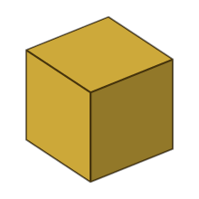 | Cube | Micro-Brick | all of it | 8 | 1 | 1 |
| 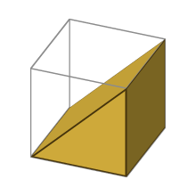 | Ramp | Micro-Wedge | $`x + y \le 1`$ | 6 | 1/2 | 12 |
| 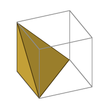 | Tetrahedron | Micro-Wedge Triangle Corner | $`x + y + z \le 1`$ | 4 | 1/6 | 8 |
| 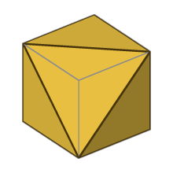 | Cut cube | Micro-Wedge Outer Corner | $`x + y + z \le 2`$ | 7 | 5/6 | 8 |
|  | Hip | Micro-Wedge Corner | $`\max(x, y) \le 1 - z`$ | 5 | 1/3 | 24 |
| 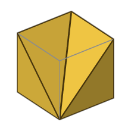 | Inner corner | Micro-Wedge Inner Corner | $`\min(x, y) + z \le 1`$ | 7 | 2/3 | 24 |
|  | Half outer corner | Micro-Wedge 1/2 Outer Corner | $`x + y \le 1,\ z \le x + y`$ | 5 | 1/3 | 24 |
| 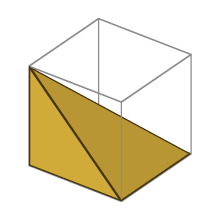 | Half inner corner | Micro-Wedge 1/2 Inner Corner | $`x + y \le 1,\ z \le y`$ | 4 | 1/6 | 12 |
|  | its mirror image | Micro-Wedge 1/2 Inner Corner Inv. | $`x + y \le 1,\ z \le x`$ | 4 | 1/6 | 12 |

Each rule is a test on the point's coordinates. The ramp's rule $`x + y \le 1`$
says that a point is inside when its distance from one side plus its
distance from the next side is at most one box width. That cuts the box in
half along a diagonal plane, which is a wedge. The tetrahedron's rule adds a
third distance, so only the corner near the origin passes: a small
three-sided pyramid with a sixth of the box. The hip is a quarter of a
square pyramid. It is the piece at the corner of a hipped roof, where two
slopes meet along a ridge, and its rule says the point must be under both
slopes.

"Poses" is the number of different ways the shape can sit in its box when
the box is turned in any of the 24 ways a cube can be turned. A cube looks
the same every way, so it has one pose. A ramp has 12 because its sloped
face can face any of the cube's 12 edges. Across all nine shapes there are
125 poses.

### A shape is a set of corners

The program describes a shape by which of its box's eight corners it
touches. Every shape except one is exactly the **convex hull** of the
corners it holds. The convex hull of some points is the solid you get by
stretching shrink-wrap around them: the smallest solid with no dents that
contains them all. So once you know which corners a shape holds, you know
the whole shape.

Eight corners, each either held or not, fit in one 8-bit number. Think of a
row of eight switches, one per corner, each on or off. This number is the
shape's **corner mask**. Corner $`(x, y, z)`$, where each of $`x, y, z`$ is
0 or 1, is switch number $`x + 2y + 4z`$. For example, the tetrahedron at
the origin holds corners 0, 1, 2 and 4, which are $`(0,0,0)`$, $`(1,0,0)`$,
$`(0,1,0)`$ and $`(0,0,1)`$. Switches 0, 1, 2 and 4 on give the binary
number 00010111, which is 0x17 in the hexadecimal notation programmers use.
These are the first lines of `Kind::canonical` in `shapes.rs`:

```rust
        match self {
            Kind::Cube => 0xff,
            Kind::Ramp => 0x77, // missing the edge x=1,y=1: solid where x + y <= 1
            Kind::Tet => 0x17,  // corner 0 and its neighbours: x + y + z <= 1
            Kind::Cut => 0x7f,  // missing corner 7: x + y + z <= 2
```

The cube has every switch on (0xff). The ramp lacks corners 3 and 7, which
are $`(1,1,0)`$ and $`(1,1,1)`$, the two ends of one edge.

Stretching a box to any size stretches its shape with it, and the corner
mask does not change, so one mask describes a ramp one cell long or twenty.
Turning or mirroring a brick moves its corners to other corners, so the
program turns or mirrors a brick by reordering the eight switches, without
any geometry. The program can tell a shape from its mask with one table
lookup (`shape_info` in `shapes.rs`), and a mask that is no shape at all is
caught the same way. Two bricks whose boxes share a face, and whose masks
agree on that face's four corners, meet exactly, with no gap and no
overlap. The fitters therefore only have to get the corners right, and the
faces between bricks follow.

To test whether a point is inside a shape, the program measures the point's
distance from a special corner of the shape (the tetrahedron's right-angle
corner, the cut cube's missing corner) and applies the shape's rule. This is
part of `inside_shape` in `shapes.rs`; `a`, `b` and `d` are the point's
three coordinates measured from that corner:

```rust
    let c = info.corner;
    let a = if c & 1 != 0 { 1.0 - u } else { u };
    let b = if c & 2 != 0 { 1.0 - v } else { v };
    let d = if c & 4 != 0 { 1.0 - w } else { w };
    // ...
    match info.kind {
        Kind::Cube => true,
        Kind::Tet => a + b + d < 1.0,
        Kind::Cut => a + b + d > 1.0,
```

The tests are strict (`<` and `>`), so a point lying exactly on a sloped
face counts as outside. A regular grid of samples puts many samples exactly
on a 45° face, so this rule decides how much of a ramp the measurement of
section 10 counts.

### The inner corner


The inner corner is the one shape that is not the convex hull of its
corners. It is a box with a hip taken out of it: a valley where two slopes
meet in an inside corner, as in the corner of a room under a sloping roof.
It touches seven corners, the same seven a cut cube touches, so the corners
alone cannot tell the two apart. Its corner mask is therefore written
differently. It is the three corners that the missing hip does not touch.
No other shape has a mask of only three corners, so the mask is still
unique. Turning or mirroring still works by moving the switches, because the
missing hip turns with the brick. Only code that reads a mask as "these
corners are solid" has to check for this case first (`corners` in
`shapes.rs`).

### How the shapes fit together

Several pairs of shapes fill a box exactly between them. A tetrahedron and a cut cube fill a box between them, split by the
plane $`x + y + z = \text{const}`$, a plane tilted equally towards all three
axes. A plane tilted on all three axes therefore passes through the grid
cutting alternate layers of cells into tetrahedra and cut cubes. A ramp and
the ramp facing it fill a box. So do a hip and an inner corner. Two half
inner corners make a hip, and a ramp standing upright plus a half outer
corner make a cut cube. When a fitter takes one shape out of a box, it can often name
the brick that fills the rest (`rest_of_box` in
[core/src/fit_round.rs](../core/src/fit_round.rs)).

### Naming a brick for the game

The game does not know about corner masks. It names a brick by its asset
(which of the nine bricks), its size, and one of 24 orientations. The
module [core/src/orient.rs](../core/src/orient.rs) (`Solver::place`)
translates. For each corner mask it finds the orientation that turns the
game's unturned brick into that pose, preferring orientations that keep the
brick upright, and reorders the box's three sizes to match the turn. The
game's assets are the same nine shapes in their unturned pose, so every one
of the 125 poses can be reached.

## 3. From a form to bricks: the pipeline

Every form passes through the same stages, from the settings the player
chose to the finished bricks. The main function is `build` in
[core/src/spec.rs](../core/src/spec.rs).

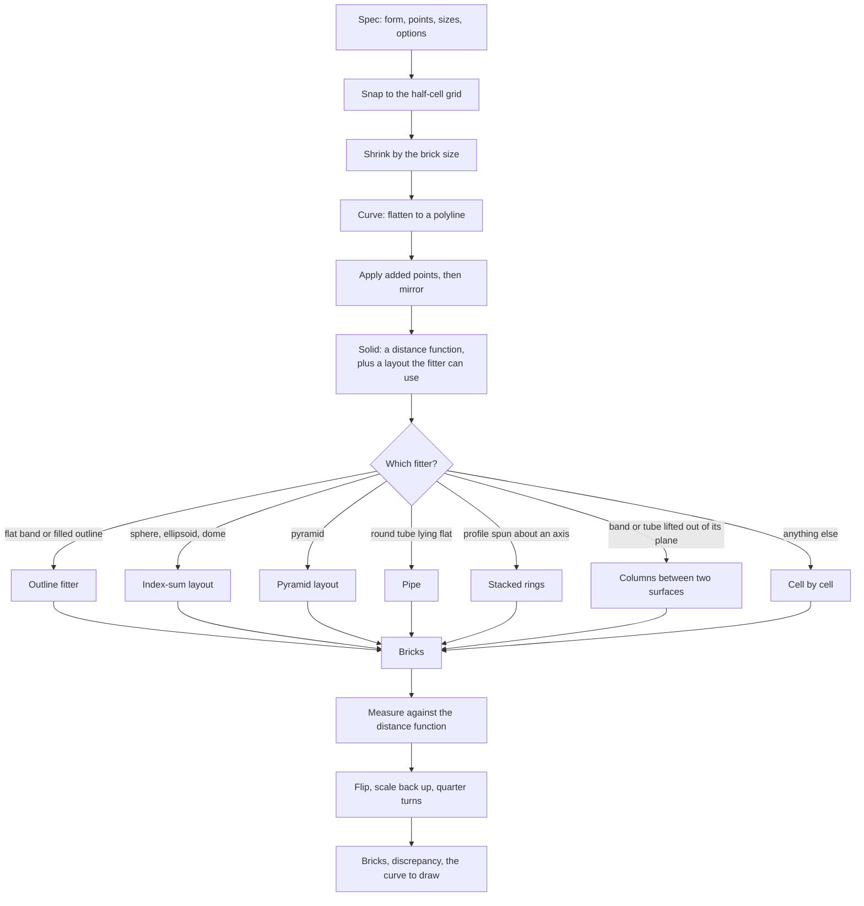

For every form the program computes a **distance function**, a precise
description of the solid that can be asked about any point (section 5). It
also computes a **layout**, which is whatever structure the right fitter
needs: an outline in two dimensions, a list of cut positions, or a profile.
The bricks are made from the layout. The distance function is used
afterwards to measure them, so the measurement does not depend on which
fitter made the bricks, and no fitter measures its own work.

Some forms cannot be laid out. A sphere whose centre is off the half-cell
grid, or a hollow shell whose wall is too thin for its layout, are
examples. Those forms fall through to the cell-by-cell fitter, which needs
only the distance function and works for any solid at all. It is the safety
net, and it is also the roughest method, which is why each common form has a
fitter of its own.

## 4. Curves

Arches, circles, splines and Bézier curves all start as a curve, and every
curve is turned into a **polyline**: a chain of short straight segments
([core/src/curves.rs](../core/src/curves.rs), `flatten`). The segments are
made short enough that the chain never strays more than 0.02 of a cell from
the true curve, which is far below anything a brick can show. The program
splits each piece in half, and keeps splitting, until the middle of the
true curve is within that distance of the middle of the straight segment.
Everything after this point works on polylines. As a result, adding a new
kind of curve never touches a fitter.

### Circle through three points

An arch with a third point added becomes the circular arc through all three
points. To find that circle's centre, write $`a = P_1 - P_0`$ and
$`b = P_2 - P_0`$ for the two arrows from the first point to the others, and
$`n = a \times b`$ for their cross product, which is an arrow standing
square to the plane of the three points. The centre is

```math
c = P_0 + \frac{\lvert a\rvert^2\,(b \times n) + \lvert b\rvert^2\,(n \times a)}{2\,\lvert n\rvert^2}
```

Here $`\lvert a\rvert`$ is the length of the arrow $`a`$. In words, the
centre is the first point moved by a blend of two directions lying in the
plane, each weighted by the squared length of the other arrow, so that the
result is the same distance from all three points. `circle3` in `curves.rs`
has it as one line:

```rust
    let center =
        p0 + (b.cross(n) * a.length_squared() + n.cross(a) * b.length_squared()) / (2.0 * n2);
```

Three points in a straight line have $`n = 0`$, since two arrows in the same
line have no plane between them. No circle passes through them, and the
program says so instead of dividing by zero.

### Arches

A round arch is given by its two feet a span $`L`$ apart and its rise
$`s`$, the height of its crown above the feet. The circular arc through the
feet and the crown has radius

```math
R = \frac{L^2/4 + s^2}{2s}
```

This comes from a right-angled triangle formed by the centre, one foot and
the point under the crown. As a check, a span of 16 with a rise of 8 gives
$`R = (64 + 64)/16 = 8`$, a semicircle, and in general the arch is a
semicircle when $`s = L/2`$. A lower rise of 4 on the same span gives
$`R = (64 + 16)/8 = 10`$, a flatter arc of a larger circle.

The other arch kinds are formulas between the same feet (`arch` in
`curves.rs`). A pointed arch is two arcs meeting at a point at the top,
each centred on the line between the feet. A triangular arch is two straight
sides. An elliptical arch is half an ellipse. A parabolic arch is
$`z = s\,(1 - (2x/L)^2)`$, where $`x`$ is the distance from the middle: at
the middle $`z = s`$, and at the feet, where $`x = \pm L/2`$, $`z = 0`$. A
catenary arch is the shape of a hanging chain turned upside down,
$`z = s - a\,(\cosh(x/a) - 1)`$. The number $`a`$ sets how sharply the chain
curves, and no formula gives it directly from the rise, so the program finds
it by repeated halving. It tries a value, checks whether that arch is too
tall or too short, and narrows the range, 200 times.

### Spline

A spline is a smooth curve through any number of points. Brickloft uses a
centripetal Catmull-Rom spline (`catmull_rom` in `curves.rs`). It passes
through every point, and between two points it bends according to the
points on either side. The word "centripetal" refers to how the curve's
progress is spaced between points. The spacing grows with the square root
of the distance between neighbouring points, $`\lvert P_{i+1} - P_i\rvert^{1/2}`$.
This spacing is the one choice known never to make a cusp (a sharp point) or
a small loop between two points, which the other common spacings can do when
points are unevenly spread.

### Bézier

A Bézier curve does not pass through its points. Each point pulls the curve
towards itself, and the curve passes near them as a blend. Brickloft uses the
rational form, with a weight $`w_i`$ for each point $`P_i`$
(`rational_bezier` in `curves.rs`):

```math
C(t) = \frac{\sum_i w_i\,B_i(t)\,P_i}{\sum_i w_i\,B_i(t)}
```

As $`t`$ runs from 0 to 1, $`C(t)`$ traces the curve. The $`B_i(t)`$ are the
Bernstein polynomials, a standard set of blending amounts that are never
negative and always add up to one, so the curve is a weighted average of
the points. Each point's share is multiplied by its weight, and the bottom
line divides by the total so that the shares still add up to one. A larger
weight therefore pulls the curve closer to its point.

With weights, a Bézier curve can draw an exact circular arc. With three
points, the middle weight decides what kind of curve comes out. Below 1 it
is part of an ellipse, exactly 1 is a parabola, above 1 a hyperbola, and
$`\cos(\theta/2)`$ gives an exact circular arc of angle $`\theta`$. For
example, a quarter circle has $`\theta = 90^\circ`$, so the middle weight is
$`\cos 45^\circ \approx 0.707`$. A Bézier curve without weights cannot draw a
circle exactly, only approximately.

## 5. Solids as distance functions

### What a distance function is

A fitter needs to ask one question many millions of times: is this point
inside the form? Brickloft answers it with a **distance function**
([core/src/sdf.rs](../core/src/sdf.rs), the enum `Field`). It is a rule
$`f(p)`$ that takes a point $`p`$ and gives one number. The number is
negative inside the form and positive outside, and near the surface it
equals the distance to the surface, in cells. At the surface it is zero.

The numbers work like heights on a contour map that has the form's surface
as sea level. A point under the sea has a negative height and a point on land a positive
one, and the height tells you how far you are from the shore. For a sphere
of radius 10 centred at the origin, $`f(p)`$ is the point's distance from
the centre minus 10: a point 3 from the centre gives $`-7`$ (inside, 7 cells
from the surface), and a point 12 from the centre gives $`2`$ (outside, 2
cells away).

### The solids

The forms are built from five basic solids, each with a short rule for
$`f`$.

| Solid | $`f(p)`$ |
|---|---|
| Round tube of radius $`r`$ along a curve | $`\mathrm{dist}(p, \text{curve}) - r`$ |
| Flat band along a curve in a plane | $`\max\big(\mathrm{dist}_{\text{in plane}} - \tfrac{t}{2},\ \lvert\text{height above plane}\rvert - \tfrac{d}{2}\big)`$ |
| Ellipsoid with radii $`r_x, r_y, r_z`$ | $`\big(\sqrt{\sum (p_k/r_k)^2} - 1\big)\cdot \min_k r_k`$ |
| Outline spun about an upright axis | the outline's 2D function at $`\big(\sqrt{x^2+y^2},\ z\big)`$ |
| Pyramid | the largest of the distances out of its four slopes, its base and its top |

A round tube is every
point within $`r`$ of its curve, so the function is the distance to the
curve less $`r`$. A point is inside a flat band of width $`t`$ and depth
$`d`$ only if it is both within $`t/2`$ of the curve in its plane and within
$`d/2`$ of that plane. The larger of the two numbers is negative only when both are,
so taking the maximum means "inside both". For an ellipsoid, $`p_k/r_k`$
measures each coordinate in units of that axis's radius, and the square
root is 1 exactly on the surface. It is exact for a sphere and a close
estimate near the surface of any ellipsoid. A form spun about an upright
axis, such as a vase, is described by its outline in a half-plane: how far
out from the axis, and how high. Any point in space is answered by finding
its distance from the axis, $`\sqrt{x^2 + y^2}`$, and asking the outline. A
pyramid is inside all four of its slopes, above its base and below its top,
so again the largest of the six numbers decides.

### Combining solids

Solids combine by taking the smaller or larger of two numbers.

| Combination | $`f`$ |
|---|---|
| Both of $`A`$ and $`B`$ together | $`\min(f_A, f_B)`$ |
| $`A`$ cut to where $`B`$ is | $`\max(f_A, f_B)`$ |
| $`A`$ with $`B`$ taken out | $`\max(f_A, -f_B)`$ |

A point is in "both together" if it is in either, and the smaller number is
negative when either is. A point is in "$`A`$ cut to $`B`$" only if it is in
both, which is the larger number again. Taking $`B`$ out uses $`-f_B`$,
which turns $`B`$ inside out, because it is negative outside $`B`$. In
`Field::eval` in `sdf.rs` each combination is one line:

```rust
            Field::Either(a, b) => a.eval(p).min(b.eval(p)),
            // ...
            Field::Without(a, b) => a.eval(p).max(-b.eval(p)),
```

With these, a dome is an ellipsoid cut by a flat floor, a segment is an
ellipsoid cut between two heights, and a hollow shell is an ellipsoid with
a smaller one taken out. None of these needs its own case in the code.

### Why whole regions can be skipped

Every fitter relies on the fact that $`f`$ never claims the surface is
further away than it is. If $`f(p) = 5`$, there is certainly no surface
within 5 cells of $`p`$. That lets the fitters and the measurement test one
point in the middle of a large region and skip the whole region when the
number is large enough ([performance.md](performance.md) explains how much
time this saves). Operations that stretch space, such as squashing a round
tube into an oval or pulling a point out of a sphere, could break the
property, because stretching moves the surface further from where the
formula thinks it is. They therefore scale their result down by the largest
stretch they can cause, which keeps the number an underestimate.

## 6. What is being minimised

Write $`F`$ for the form and $`B`$ for the solid made by all the bricks
together. The **discrepancy** is the volume where they disagree:

```math
E = \mathrm{vol}(F \setminus B) + \mathrm{vol}(B \setminus F)
```

Read $`F \setminus B`$ as "the part of $`F`$ that is not in $`B`$". The
first term is material that should be there and is not, and the second is
material that is there and should not be. The program reports $`E`$ as a
share of the form's volume. For a flat form, the same idea is measured in
area.

Suppose the form fills exactly half of one cell, cut by a diagonal plane.
An empty cell then misses half a
cell of form, so $`E = 0.5`$. A cube adds half a cell too much, so
$`E = 0.5`$. The ramp that matches the cut has $`E = 0`$.

Each brick has its box to itself, because the game refuses bricks whose
boxes overlap (section 7.7 has the one exception). $`E`$
is then a sum over boxes, and each box can be judged on its own. That makes
the simplest case exactly solvable. If every brick is one cell, each cell
can hold nothing or one shape, the choices in different cells do not affect
each other, and trying every choice in every cell finds the true smallest
$`E`$ for one-cell bricks.

However, that best answer is a staircase wherever the surface is not at
45°, and its sloped bricks do not line up with one another. Each fitter
below therefore adds structure so that slopes are long and neighbouring
bricks share whole faces, and pays for it with a slightly larger $`E`$. For
a sphere of radius 12, the trade is 3 to 4% discrepancy with no stepped
faces, against 2 to 3% with a third of the surface stepped. The second
number is closer and looks worse, which is why the program measures the
surface separately (section 10).

## 7. The fitters

### 7.1 Cell by cell

The cell-by-cell fitter ([core/src/fit_volume.rs](../core/src/fit_volume.rs),
`fit_volume`) is the general method. It is used when no layout applies, and
it works for any solid that has a distance function. It classifies each
cell, chooses a shape for it, removes spikes, stretches ramps and merges
cubes, in that order.

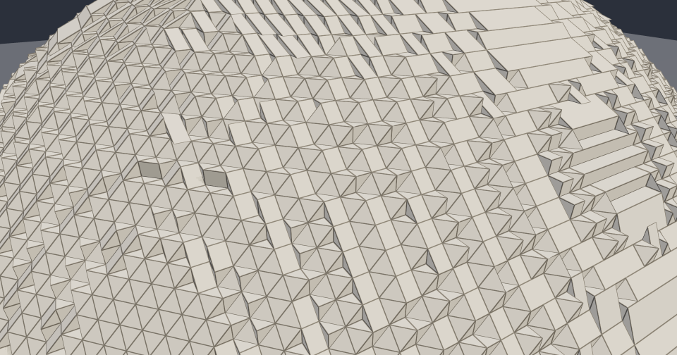

A hollow sphere with a wall 2 thick, fitted cell by cell. Each cell has the
brick that suits it best, and neighbouring slopes do not line up.

#### Classifying each cell

The program tests 64 points in each cell, a
$`4 \times 4 \times 4`$ grid of **samples**. Each sample is either inside
the form or not, which is one switch, so the 64 answers fit in one 64-bit
number, a row of 64 switches. This is `cell_bits`:

```rust
    let bits = (0..K * K * K).fold(0u64, |bits, s| {
        let p = DVec3::new(
            (s % K) as f64 + 0.5,
            (s / K % K) as f64 + 0.5,
            (s / (K * K)) as f64 + 0.5,
        ) / K as f64;
        // strictly inside, to agree with the planar fitter on samples
        // lying exactly on the surface
        bits | ((f(cell + p) < 0.0) as u64) << s
    });
```

`K` is 4. Sample number `s` sits at the middle of one of the 64 small cubes
the cell is divided into, and its switch is on when the distance function
is negative there.

#### Choosing a shape for each cell

Each candidate shape has its own 64-bit
number, worked out once: which samples it covers. The disagreement between
the cell and a candidate is the number of samples where the two rows of
switches differ, which a processor finds in two instructions. The
exclusive-or (written `^`) of two numbers has a switch on wherever the two
differ, and `count_ones` counts the switches that are on.

```rust
                            let mut scores = [(0u32, 0u32); 30];
                            for (score, (mask, pattern)) in scores.iter_mut().zip(patterns) {
                                *score =
                                    ((bits ^ pattern).count_ones(), (corners ^ mask).count_ones());
                            }
                            let (mask, pattern) =
                                patterns[least_unshared(&scores[..patterns.len()], 2)];
```

The cell gets the candidate that disagrees least. When two candidates
disagree equally, the second number decides, which is how many of the
cell's eight corners the candidate gets wrong. There are 30 candidates: nothing, a cube,
12 ramps, 8 tetrahedra and 8 cut cubes. Hips and the other newer shapes are
left out on purpose. They belong on a ridge or a valley that a layout
places, and offering them to every cell of a curved surface would nearly
double the work for a brick that suits almost none of them.

#### Removing spikes

Where a gently curving surface clips the corner of an
otherwise empty cell, the best brick for that cell by volume is a
tetrahedron, and it stands alone on the surface like a thorn. A tetrahedron
looks right only in an inside corner, with at least two of its three flat
faces against neighbouring bricks. So any tetrahedron with fewer than two
backed faces is removed (`drop_spikes`). The volume this leaves unbuilt is
at most a sixth of a cell. The check is repeated, up to four times, because
removing one spike can leave a neighbouring tetrahedron without its backing.

#### Stretching ramps

A one-cell ramp always slopes at 45°. A gentler surface,
such as the top of a dome, would therefore come out as a row of teeth, each
tooth the best brick for its own cell. One ramp two to six cells long and
one cell high (or one cell long and two to six high) follows such a slope
far better. A second pass (`stretch_ramps`) tries such ramps through every
cell the surface crosses and replaces the cells' bricks wherever a stretched
ramp disagrees less with the form than they did. The biggest improvements
are taken first. A stretched ramp may not reach into a cell the form does
not touch, because its thin end would poke through flat faces, such as the
underside of a dome's rim.

#### Merging

Cubes next to each other are then joined into larger boxes,
first along $`x`$, then the run along $`y`$, then the slab along $`z`$
(`merge`). Ramps of the same pose are joined end to end along their length,
up to the longest brick allowed. Merging changes the brick count and never
the shape, because two cubes side by side are exactly one longer box.

The result is the closest of all the methods by volume and the roughest to
look at, because no cell knows what its neighbours hold, so nothing makes
one cell's slope continue into the next.

### 7.2 Flat outlines

A flat band, a ring or a filled outline is a two-dimensional shape pushed
straight through the grid, like a biscuit cutter pushed through dough. So it
is fitted in two dimensions and then extended through the depth
([core/src/fit_planar.rs](../core/src/fit_planar.rs), `fit_planar`). In two
dimensions the bricks become flat **pieces**: rectangles, which become
cubes, and right-angled triangles, which become ramps standing through the
depth.


This fitter is smooth because it fits an outline first and fills it
afterwards. The fitted outline is a polygon whose corners are lattice
points. Each side of the polygon is level, upright or sloped. A sloped side
is the long side of exactly one right-angled triangle whose other two sides
lie along the grid, so each sloped side becomes one triangle piece.
Neighbouring sides share a corner by construction, so slopes always meet
end to end and there is no place for a stray step. The fitter's work is
therefore to choose which lattice points are the corners.

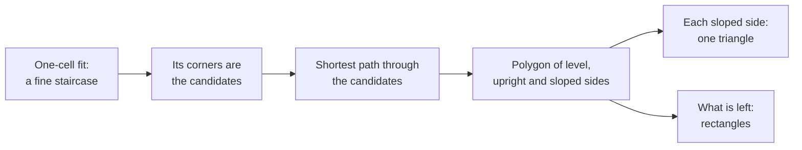

#### Finding candidate corners

The form is first fitted with one-cell pieces, as in 7.1, but in two
dimensions and with a finer $`8 \times 8`$ grid of samples per cell. Each
cell gets an empty square, a full square or one of four half-square
triangles, whichever disagrees least with the form. A cell exactly half
full, where empty and full are equally wrong, is settled by its neighbours:
it is filled if at least two of the cells beside it hold something. The
boundary of this one-cell fit is a fine staircase with 45° corners that hugs
the true outline, and the lattice points along it are the candidates.

#### Cutting the outline into stretches

The staircase is then cut where it truly turns back, at its highest,
lowest, leftmost and rightmost places (`turning_points`). A turn counts
only if the outline comes back by two cells or more, because a wobble of
one cell is just the one-cell fit rounding. Between two cuts, the outline
runs one way in $`x`$ and one way in $`y`$, like one quarter of a circle.
The cuts matter because a triangle's long side can only stand in for a
stretch that runs one way, so every stretch can be solved separately.

#### Choosing corners by a shortest-path search

Along each stretch, the corners are chosen by a **shortest-path search**
(`Search::cheapest`). Think of planning a journey along a road with many
possible overnight stops. Each day's travel has a cost, and you want the
cheapest whole journey. You do not need to try every combination of stops.
For each stop in turn, the cheapest way to arrive there is the cheapest way
to reach some earlier stop plus the cost of the last day, and the earlier
stops have already been worked out. This method, which builds the best
answer from the best answers to smaller problems, is called dynamic
programming. It finds the exact best journey in a fraction of the time it
would take to try them all.

Here the stops are the candidate corners, and a "day" is one side of the
polygon. Going from candidate $`i`$ to a later candidate $`j`$ in one side
costs

```math
\text{cost}(i \to j) = \underbrace{e(i, j)}_{\text{area between the side and the true outline}} + \underbrace{\lambda}_{\text{price of a corner}}
```

The first term, $`e(i, j)`$, is the disagreement the side brings. In the
program it is how much the side's triangle gets wrong, less what the
one-cell pieces it replaces got wrong. The second term, $`\lambda`$, is a fixed price
for each corner of the polygon. The search finds the chain of sides with the
least total cost. $`\lambda`$ is 0.1 of a cell plus the **Simplify**
setting. Even at Simplify 0 the price favours slopes, because a step is two
corners where a slope is one, so a slope wins whenever it fits as well as
the step. The
base price is kept small because a tenth of a cell is about the least
disagreement that can be seen at all.

For example, take a stretch where the true outline climbs 1 cell over 3
cells across, and suppose the one-cell fit there is a level tread 2 cells
long followed by a 45° chamfer. That is two sides, and pays the corner
price twice. One side from start to end is a single triangle 3 by 1, and
pays it once. If the triangle gets the area about as right as the two
sides did, it costs $`\lambda`$ less, so it is chosen.

#### Turning one way

Chosen on area alone, a slope that the lattice has no single side for is
made by alternating the two nearest slopes: 1 in 1, 1 in 2, 1 in 1, 1 in 2.
This is fractionally closer by area, but it turns left, right, left, right.
Seen from above, the result is a curve with a ripple in it. So the search
also charges three quarters of a cell every time the outline changes the
direction it is turning in. A curve really bending one way pays nothing, and
an S-bend pays once. Because of this charge, the state of the search is a
corner together with the way the outline last turned, and the sides come out
in order of slope. These lines of `Search::cheapest` add the charge:

```rust
                        let now = match turn {
                            0 => was,
                            1 => 1,
                            _ => 2,
                        };
                        let wiggle = if was != 0 && now != was { WIGGLE } else { 0 };
                        let total = earlier.cost[was] + cost + wiggle;
```

`turn` is 0 for straight on, 1 for one way and anything else for the other.
`was` is the way the outline last turned (0 if it has not turned yet), and
`WIGGLE` is the three quarters of a cell, counted in samples.

#### Thin walls, rings and filling

Where the two faces of a thin wall want the same cell, the larger triangle
has it, and the stretch on the other face is solved again around what was
taken. This is repeated up to four rounds. The longer stretches, which are
the outer faces of curves, are solved first.

A ring is moved half a cell where needed so that its edge runs along
lattice lines where it crosses an axis (`off_lattice` in `spec.rs`). Left
half a cell off, that straight part of its edge fits best by area as a row
of small triangles, each half a cell, which looks like the teeth of a saw.
An open band, such as an arch, is run on half a cell past its end points
where those sit at cell centres. Cut off exactly at the end points, the band
would cover half of each end cell, and half a cell is the one amount no
brick can build.

The finished polygon is filled with the triangles of its sloped sides and,
for everything else inside it, rectangles found by a sweep across the rows
(`scan_fill`). The discrepancy is then measured from the finished pieces
sample by sample.

An earlier version chose each triangle separately on its own merit. It
measured slightly closer and left a step wherever two triangles' ends did
not happen to meet, and patching those afterwards never fully worked. That
is why continuity is now built into the structure, as one outline, instead
of repaired afterwards.

### 7.3 Spheres, ellipsoids and domes

A sphere is laid out whole, by one rule, with no cell-by-cell choosing
([core/src/fit_round.rs](../core/src/fit_round.rs), `fit_round`). The rule
works because the equation of a sphere is a sum of one term for each axis.

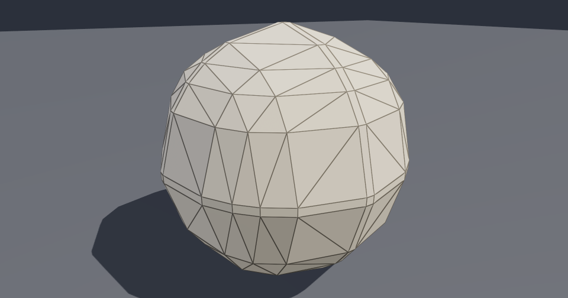

#### Turning the sphere's equation into a count

The sphere of radius $`r`$ is

```math
\frac{x^2}{r^2} + \frac{y^2}{r^2} + \frac{z^2}{r^2} \le 1
```

In words, a point is inside when the squares of its three distances from
the centre, each measured in units of the radius, add up to at most 1. This
is a sum of three separate terms, one per axis. Now cut each axis at chosen
distances $`t_0 < t_1 < \dots < t_K`$ from the centre, numbered 0 to $`K`$,
and choose them so that

```math
\left(\frac{t_i}{r}\right)^2 = \frac{i}{K} \quad\text{that is}\quad t_i = r\sqrt{i/K}
```

Each cut $`i`$ is placed so that its term in the sphere's sum is exactly
$`i/K`$. So a lattice point at cut numbers $`(i, j, k)`$ along the three
axes has $`x^2/r^2 + y^2/r^2 + z^2/r^2 = (i + j + k)/K`$. It is inside the
sphere exactly when

```math
i + j + k \le K
```

The curved test has become a sum of three whole numbers compared with
$`K`$. In `fit_round`, the corners of each box are tested this way:

```rust
                let within = |limit: usize| {
                    (0..8u8).fold(0u8, |m, corner| {
                        let sum: usize = (0..3)
                            .map(|k| lines[k][at[k] + (corner >> k & 1) as usize].1)
                            .sum();
                        m | ((sum <= limit) as u8) << corner
                    })
                };
```

For each of the eight corners of a box, it adds the three cut numbers and
switches that corner on if the sum is at most the limit. The result is a
corner mask, which is the brick for that box.

#### Why every box holds exactly one brick

The cuts divide space into boxes. Moving from a box's inner corner (the one
nearest the centre) to any neighbouring corner raises one cut number by one.
So a box's eight corners have index sums $`s, s+1, s+1, s+1, s+2, s+2, s+2, s+3`$,
where $`s`$ is the sum at its inner corner. Which of them are inside depends
only on how $`s`$ compares with $`K`$:

| $`s`$ compared with $`K`$ | Corners inside | Brick |
|---|---|---|
| $`s + 3 \le K`$ | all 8 | cube |
| $`s + 2 = K`$ | 7 | cut cube |
| $`s + 1 = K`$ | 4 | tetrahedron |
| $`s = K`$ | 1 | none (a point) |

Every row is one of the shapes, so every box is nothing, a whole box, or
one stretched brick. Where the centre is in the middle of a cell, the two
cuts either side of the middle are both numbered 0, and a box between them
has corners whose sums do not rise along that axis. The same count then
gives a ramp. Neighbouring boxes share their corners, so every brick meets
its neighbours face to face. The surface has no steps and no gaps by
construction, and with the ideal cuts every corner on the surface lies on
the sphere.

#### A worked example

Take a sphere of radius $`r = 4`$ centred on a lattice point, and
$`K = 2`$. The ideal cuts are $`t_0 = 0`$, $`t_1 = 4\sqrt{1/2} \approx 2.83`$
and $`t_2 = 4`$. The cuts must be whole numbers of cells, so they become 0,
3 and 4. Here is the quarter of the slice $`z = 0`$, with each lattice point
marked with its index sum $`i + j`$ (the $`z`$ number is 0) and whether
that sum is at most $`K = 2`$:

```
             x = 0     x = 3     x = 4
  y = 4      2 in      3 out     4 out
  y = 3      1 in      2 in      3 out
  y = 0      0 in      1 in      2 in
```

Now take the boxes of the bottom layer, from $`z = 0`$ to $`z = 3`$:

| Box, in cells | Sum at inner corner $`s`$ | Rule | Brick |
|---|---|---|---|
| $`x`$ 0 to 3, $`y`$ 0 to 3 | 0 | $`s + 2 = K`$ | cut cube, 3 by 3 by 3 |
| $`x`$ 3 to 4, $`y`$ 0 to 3 | 1 | $`s + 1 = K`$ | tetrahedron, 1 by 3 by 3 |
| $`x`$ 0 to 3, $`y`$ 3 to 4 | 1 | $`s + 1 = K`$ | tetrahedron, 3 by 1 by 3 |
| $`x`$ 3 to 4, $`y`$ 3 to 4 | 2 | $`s = K`$ | nothing |

In the layer above, from $`z = 3`$ to $`z = 4`$, only the box over the
centre has $`s = 1`$ and holds a tetrahedron. So one eighth of this sphere
is four bricks: one cut cube and three tetrahedra. The corner at
$`(4, 0, 0)`$ lies exactly on the sphere. The corner at $`(3, 3, 0)`$ is
$`\sqrt{18} \approx 4.24`$ from the centre instead of 4, because the cut
2.83 had to be rounded to 3. That rounding is the only error left, so the
cuts are placed to keep it small.

#### Putting the cuts on the lattice

The ideal cuts $`r\sqrt{i/K}`$ are not whole numbers, and rounding each one
on its own gives uneven gaps such as 2, 1, 2, 1, which make a surface that
folds in and out along every ring. So the cuts are chosen together by
dynamic programming (`cuts` in `fit_round.rs`), the same kind of search as
in 7.2, under two rules. Every gap must be at least one cell, and gaps must
never grow going outwards. The second rule keeps the solid convex, without
dents. The search works from the outside in, because the outer gaps are the
narrow ones and those are the ones the lattice constrains.

#### Choosing K

$`K`$ is the number of rings of facets. More rings means finer facets, but
each cut is then nearer its neighbours than rounding can place it. The
program tries every $`K`$ the lattice has room for, each with the corners
aimed at the true surface and also slightly outside it (0.15 and 0.3 of a
cell). It scores each against the true solid without building anything,
from the cut positions alone. The best four are then improved by moving one
cut a cell at a time while the score improves, and the best result is kept.
About one ring per two to three cells of radius is typical.

#### Ellipsoids, domes and shells

An ellipsoid uses the same method with a different radius on each axis. A
dome or a segment is cut off flat at one of the cuts along $`z`$, so its
flat face is a layer of whole boxes. A hollow shell is the same solid with
a smaller one taken out, so the corners with $`i + j + k \le K - m`$ are
hollow. The wall is then $`m`$ numbered layers thick, and $`m`$ is at
least 2. With $`m = 1`$, a box could have both the outer and the inner surface
passing through it, and one box can hold only one brick. A shell needs a
wall of about 2.5 cells or more for the lattice to have room. Thinner walls
fall back to the cell-by-cell fitter of 7.1.

### 7.4 Pyramids

A pyramid uses the same box layout with a different rule
([core/src/fit_pyramid.rs](../core/src/fit_pyramid.rs), `fit_pyramid`).
Number the cuts across the base from the middle outwards, and the levels
from the base upwards, with $`L`$ levels in all. A corner is inside the
pyramid when

```math
\max(i_x, i_y) + i_z \le L
```

Here $`i_x`$ and $`i_y`$ are the corner's cut numbers across, and $`i_z`$ its
level. The larger of the two numbers across says how far out the corner is,
measured in the square rings a pyramid's level is made of. Adding the level
says that each step up shrinks the allowed ring by one. In code:

```rust
                let under = |lower: usize| {
                    (0..8u8).fold(0u8, |m, corner| {
                        let number = |k: usize| lines[k][[x, y, z][k] + (corner >> k & 1) as usize].1;
                        m | ((number(0).max(number(1)) + number(2) + lower <= levels as usize) as u8) << corner
                    })
                };
```

With this rule the boxes hold ramps on the four slopes and hips on the four
ridges. The bricks are exactly the pyramid's four slopes. For example, centre a pyramid on a lattice
point with $`L = 1`$. Each quarter is one box from the middle to the edge
and from the base to the apex. Its corners at the base have
$`\max(i_x, i_y) + 0 \le 1`$, so all four are inside; at the top, only the
corner over the middle has $`0 + 1 \le 1`$. Four base corners and one apex
corner are a hip. So that pyramid is four hips and nothing else. The number
of levels $`L`$ is as small as keeps every brick within the longest
allowed.

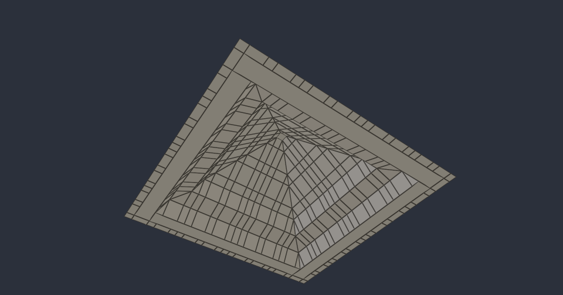

A hollow pyramid seen from underneath.

A pyramid that is not filled is hollow, a tent open underneath. It has a
smaller pyramid, $`\max(i_x, i_y) + i_z \le L - 2`$, taken out of it. The
inner one is two levels lower for the same reason a shell's wall is two
layers thick, which is that no box then has both the outer and the inner
slope passing through it. The bricks on the inside are what the smaller pyramid's bricks
would leave of their boxes. A ramp leaves a ramp, and a hip leaves an inner
corner, which runs up each inside ridge. $`L`$ is chosen to divide the
height and both half-widths evenly, so that the slopes stay flat. The wall
then comes out near the thickness asked for, but not exactly.

### 7.5 Round tubes and tori

A round tube along a curve lying flat, and a torus, are built as a pipe
whose cross-section is an octagon ([core/src/fit_stack.rs](../core/src/fit_stack.rs),
`pipe`). An octagon is the roundest section bricks allow, because ramps
make 45° faces. It has a flat top, a wall each side, and a sloped chamfer
between them, all running along the curve.

```
       ______
      /      \      the chamfer: c cells in, c cells up
     |        |     the wall
     |        |
      \______/
     <---w---->
```


For a section $`w`$ cells across, the sloping sides are as long as the flat
ones when each chamfer is

```math
c = w\left(1 - \tfrac{1}{\sqrt{2}}\right)
```

rounded to whole cells. This comes from the regular octagon: its slanted
side, $`c\sqrt{2}`$ long, equals its flat side, $`w - 2c`$. For a tube 8
across, $`c = 8 \times 0.293 \approx 2.3`$, so the chamfer is 2 cells. In
`spec.rs` it is one line, which also stops the chamfer short of the middle:

```rust
    let chamfer_of = |count: i32| ((count as f64 * (1.0 - std::f64::consts::FRAC_1_SQRT_2)).round() as i32).min((count - 1) / 2);
```

The program also chooses between the whole number of cells just below and
just above the asked thickness, whichever makes an octagon nearer the
circle in area. A tube 6.5 across is far closer to an octagon 6 across (28
cells in section, against the circle's 33) than to one 7 across (41).

The pipe is built wall first, then the chamfers.

1. The band of the tube's full width is fitted as an outline, as in 7.2.
2. The chamfer is cut back from that outline towards the narrower top. Each
   level or upright side of the outline gets a ramp; the triangle of each
   sloped side becomes a tetrahedron; and where two sides meet there is a
   corner brick. An inside corner between two ramps is an inner corner.
   Each of these bricks spans all the chamfer's layers at once.
3. The same is done at the underside.

These bricks share whole faces and start exactly on the wall, so the
chamfer is one continuous surface. Internally the chamfer is worked out as
the air above it growing inwards from the air around the wall (`grow`), and
each block of air becomes the brick that fills the rest of its box. Because
it is the air that grows, where bricks from two sides of a tight curve
would cross and one must be left out, what remains is solid standing a
little proud, not a hole.

The wall's outline is fitted knowing that the top will be cut back from it
(`fit_planar_towards` in `fit_planar.rs`). A sloped side is charged for
landing the top's outline off the true surface. A level or upright side
shorter than the chamfer is charged for the corner bricks it has no room
for. And no sloped side may be deeper than the chamfer.

The chamfer was first built the other way, outwards from the narrow top
band. Where that band ran diagonally it could only be fitted as a staircase,
its chamfer bricks collided and were dropped, and the wall was left with
holes. A ring of radius 19 had 29% of its faces stepped that way and has 1%
now.

A torus is a circle built as a round tube, and needs nothing of its own.
Stretched within its plane, the circle becomes an ellipse; stretched across
its plane, the tube becomes that many times as deep as it is wide, an oval
in section. Filled, every layer takes in everything the circle encloses,
which makes a disc with a rounded rim. The **Protruded** option builds the
tube differently, as flat bands of different widths stacked side by side.
That is smooth along the curve and stepped across it.

### 7.6 Profiles spun about an axis

A vase, a bell or a bowl is a profile spun about an upright axis, like a
pot on a potter's wheel ([core/src/fit_lathe.rs](../core/src/fit_lathe.rs),
`fit_lathe`). Its section, the outline in the half-plane of (distance from
the axis, height), is fitted as an outline, as in 7.2. Each side of that
outline becomes a ring when spun:


| A side of the section | becomes |
|---|---|
| upright | a wall standing on a circle |
| level | a flat face |
| sloped | a ring whose circle shrinks as it rises |

Each circle is itself fitted as an outline. A sloped ring is then exactly
the chamfer of a pipe from 7.5: the outline of its wide end is cut back to
its narrow end. Each ring's wide outline is fitted for that ring, knowing
how far in its narrow end is, because the depth of the chamfer's bricks is
set by the outline's own triangles. Reusing one outline for the next ring
was tried first, and made a cone bulge between its four axes.

Sloped sides of the section are kept to one cell across or one cell up, so
that the bricks of a wall's two faces keep to their own cells. That can be
done two ways, during the fitting or after it. Neither is better for every
form, since a straight cone suits one and a thin curved wall the other. So both
are built, both are measured, and the one with the lower discrepancy is
kept. While a form is being dragged, only the first is built, for speed.

#### Creases

A hollow form has two faces, the outer face and the wall of its hollow, and
in two kinds of place they end on the same circle. One is the crest of a
lip, where the solid between the faces comes to an edge. The other is the
bottom of a groove, where the air between them does. Both are called a
crease here.

Since each ring's outline is fitted for that ring, the two rings that end on
a crease's circle had two outlines of it, which differ by slivers. Along one
face that is only a ledge a fraction of a cell wide. At a crease the bricks
of the two rings lie against each other all the way round, and a sliver puts
the boxes of one ring in the cells of the other, so none of them fit. They
were built as whole cells, a ring of steps round every crease.

The two rings of a crease are now built on one outline of its circle
(`Crease` in `fit_lathe.rs`).

1. The ring that narrows away from the crease is cut back from that outline,
   as any ring is. The ring that widens away from it is grown outwards from
   the same outline, which the chamfer's code (`grow`) does equally well. A
   wall that ends in a crease stands on the outline.
2. Under a level or upright side of the outline, the two rings' ramps lie
   back to back in separate boxes. Under a sloped side they need the same
   box, because that side crosses its box on the diagonal and each ring's
   face comes to the diagonal from its own side. The two bricks share the
   box, one on each side of the diagonal, as the two halves of a folded cell
   do in a lifted band (7.7). In a groove they are two tetrahedra. On a
   ridge they are two half outer corners, which together make a roof with
   its ridge along the diagonal.
3. Two bricks share a box only if they go through the same layers. Where
   the two sides of the section that meet in a crease differ in height, the
   taller is cut at the height of the shorter (`level_creases`). Part of it
   becomes a wall, since a sloped side taller than its neighbour is only
   one cell across.

The shared outline is fitted for the shallower of the two rings, so that
both can use every sloped side of it. The deeper ring then stands up to a
cell proud just inside the crease, as a reused outline always does.

On a bell with an upturned lip, built as a shell 3.5 cells thick, the
stepped share of the surface fell from 11.8% to 5.6%, and the ring of whole
cubes round the lip's crest is gone.

A wall whose bricks will not fit, because the wall is so thin that the
boxes of its two faces cross, is built cell by cell along that face: a
staircase within half a cell of it. Its bricks' whole boxes were built solid
before, and stood as far out as a box is deep.

### 7.7 Bands and tubes lifted out of their plane

When a point added to a flat curve pulls it up out of its plane, the
curve's outline seen from above is unchanged, and only its height varies
along it. These forms are built by [core/src/fit_ribbon.rs](../core/src/fit_ribbon.rs).


A torus with one point pulled up by 10. The part still lying flat keeps its
pipe, and the lifted part is built one cell of ground at a time.

#### A lifted tube

A lifted tube is treated as two surfaces over the ground it covers: its top
and its underside. It keeps the eight-sided section of the flat pipe in
7.5, moved straight up with the curve. Take a point of the ground at
distance $`d`$ from the curve, where the curve is at height $`\ell`$ and
climbing with slope $`m`$ (the height gained per cell travelled). Write
$`r`$ for half the tube's width, $`H`$ for half its height and $`c`$ for
its chamfer. The tube's top and underside there are at

```math
z_{\pm} = \ell \pm \big(H - \min(\max(d - (r - c),\ 0),\ c)\big)\sqrt{1 + m^2}
```

The bracket is the half-height of the octagon at distance $`d`$ from its
middle. It is $`H`$ across the level top, falls one for one across the
chamfer, and is $`H - c`$ at the wall. The square root is there because
the tube's section stands square to its curve. Where the curve climbs, a
vertical line crosses the section at a slant, so the tube is taller
measured straight up. For example, with $`H = 4`$ directly over the curve
($`d = 0`$) on a level stretch, the top is 4 above the curve. On a slope of
1 in 1 ($`m = 1`$) it is $`4\sqrt{2} \approx 5.7`$ above. This is `span`
inside `lifted_tube` in `spec.rs`:

```rust
    let span = |u: f64, v: f64| {
        let (off, lift, slope) = near(u, v);
        let tall = (half_tall - (off - (radius - chamfer)).clamp(0.0, chamfer)) * (1.0 + slope * slope).sqrt();
        (centre + lift - tall, centre + lift + tall)
    };
```

A round section was used first. Its top falls away ever more steeply
towards its sides, and a surface steeper than one cell up per cell across
cannot be made of bricks one cell square, so the sides came out as tall
slivers standing proud of one another. With the octagon, the steep part is
an upright wall. The stretch by $`\sqrt{1 + m^2}`$ is limited, so that the
tube never reaches further than $`H`$ past the lowest and highest points of
the curve over that ground. Without the limit, a curve that turns straight
up for a short way made $`m`$ very large there and the tube a tall blade. A
curve pulled into a loop passes over the same ground twice at two heights,
and each pass is built as its own tube. Whole cells would give that wall the outline of a
staircase wherever the tube runs at an angle to the grid, so each notch of
the staircase is filled with half a cell, a ramp standing on end.

Upright columns still fail where the curve itself climbs more steeply than
one cell up per cell along, because the top and the underside are then
steeper than a brick one cell square can follow, and the tube came out as a
comb of tall fins. A curve cannot run steeply along all three axes at once,
so such a stretch is built in columns lying on their sides, along the axis
the curve runs least along there (`steep_stretches` in `spec.rs`). Seen
along that axis, the steep stretch is a gently sloped tube again. Where a
stretch built one way gives way to a stretch built the other, both are cut
off square at a lattice plane the curve crosses once, and each keeps to its
own side. A last pass leaves out any brick that shares room with one
already placed, since the two ways of building do not agree to the cell at
a tight turn.

Bricks are laid a cell at a time and then joined: a row of like bricks end
to end becomes one brick (`in_rows` in `fit_ribbon.rs`), so a slope that is
level across a tube five cells wide is one ramp five wide.

On a tube 11 across pulled up by 25 cells, the stepped share of the outside
fell from 6.7% with a round section in upright columns to 3.5% now, and the
brick count from 4,387 to 3,592.

Each surface is built one cell of ground at a time, from its heights at the
cell's four corners rounded to whole cells (`columns` and `parts_of` in
`fit_ribbon.rs`). Corner heights that differ by any whole amount are joined
by one brick as tall as needed:

| The four corners | Brick or bricks |
|---|---|
| all level | none |
| two next to each other higher | a ramp |
| one higher | a hip, or a tetrahedron on half the cell if the surface is hollow there |
| three higher | an inner corner, or a cut cube if the surface bulges there |
| two opposite higher (a saddle) | two half outer corners along the ridge, or two tetrahedra along the valley |
| three heights, one opposite pair level | each half of the cell rises from the level pair to its own corner: a tetrahedron where that corner is higher, a half outer corner where it is lower |

Where the table offers two answers, the true surface's height over the
middle of the cell decides which one fits. The underside is the same table
applied upside down, and everything between the two surfaces is whole
cubes.

A cell whose four corners are at three or four heights with neither
opposite pair level cannot be joined by single bricks. A tube running at an
angle to the grid has many such cells, since its top falls one way across
it and climbs another way along it. The nearer opposite pair is then set
level at the height between them, which makes the cell two half squares.
Its edge no longer quite meets its neighbours' at those two corners. The
mismatch is a lip of half the height difference, where a plain block would
be a step of all of it.

Away from the lift, the tube keeps its ordinary pipe from 7.5. The ground is
shared out a cell at a time. Cells under the lifted part are rebuilt from
top to bottom, and so are cells under any sloped pipe brick that reaches
into them, since such a brick cannot be cut.

#### A lifted flat band

A lifted flat band is built the same way as a lifted tube: its flat bricks
are kept where the curve is still in its plane, and the rest is columns
between an underside and a top (`lifted_band` in `spec.rs`). Only the
section differs. A band's section is a rectangle, $`t`$ thick across the
curve in the plane it lay in and $`D`$ deep the other way, and it stands
square to the curve as the tube's octagon does. Where the curve climbs with
slope $`m`$, the top and underside of an upright column are at

```math
z_{\pm} = \ell \pm \tfrac{D}{2}\sqrt{1 + m^2}
```

The band's two faces in its plane stay exactly upright however the curve
climbs, so in upright columns they are walls, and the ground the columns
stand on is the flat band's own outline. That outline has already been
fitted, with long three-cornered bricks, by the outline fitter of 7.2. So
the ground is taken from the flat band's bricks: one cell for each cell of a
block, and half a box for each three-cornered brick, which is then given
one sloped brick on top and one underneath, as long as the brick itself. A
three-cornered brick is kept only where the band's top climbs no more than
a cell and a half from one of its corners to another (`LONG_RISE`). One
brick cannot follow a top that bends along it. Where a brick is given up,
its ground is whole cells with their notches filled, as for a tube.

Where the curve climbs steeply the columns are laid on their sides, as a
tube's are. A rectangle has two pairs of faces, and for columns along any
axis the pair that faces more nearly along the columns is their top and
underside, and the other pair is the walls they stop at (`band_over` in
`spec.rs`). The walls are taken to run straight along the columns. That is
exact when the curve runs square to the columns as seen from above. When
it does not, the rectangle is built as a slanted four-sided figure with the
same top, underside and width through its middle.

The band was first built from the flat band's own bricks, each moved up or
down to the curve's height where it stood, with a sloped brick on top and
the matching brick underneath where the curve climbed. That kept the
fitted outline everywhere, and failed in two ways. A long three-cornered
brick of the outline cannot be bent, so where the curve climbed along one
it was moved whole and stood out of the band as a slab. And where the
curve climbed more than a cell per cell, a cell's corners were further
apart than the band was deep, and the cell became a plain block. The form
was also measured as the flat band's rectangle slid straight up and down,
which is thinner the steeper it climbs.

| Form | Stepped before | Stepped now |
|---|---|---|
| ring of radius 8, 2 thick and 2 deep, pulled up by 7.5 and 3.5 | 23.9% | 11.2% |
| the same ring 3.5 thick | 16.3% | 8.9% |
| ring of radius 20, 4 thick and 3 deep, pulled up by 5 | 3.5% | 2.3% |
| ring of radius 16, 4 thick and 4 deep, pulled up by 16 | 13.9% | 8.6% |
| round arch of span 32, 3 thick and 4 deep, its crown pulled out by 8 | 10.9% | 5.7% |

In these lifted forms, and nowhere else, two bricks may share a box, as
the two halves of a cell folded along its diagonal.

### 7.8 Stepping stones

A flat band or a filled outline can be laid as separate stones in place of
solid brick ([core/src/pattern.rs](../core/src/pattern.rs)). The stones
follow whatever region the form gives: the band along a curved path, a
ring, a disc. With a gap between them they are a path of stepping stones.
With the gap at 0 they are fitted together, as in a stone wall or a paved
floor.


#### Scattering the stones

Points are scattered over the region, one for each stone, by throwing
darts. A dart is a random place in the region, and it is kept only if it is
no nearer than a least distance to every point already kept. This is
called Poisson disc sampling. It spreads the points evenly, the way stones
are, without the rows and columns a grid would show. The least distance is
the **Stone size** made smaller by the **Uneven** setting, so uneven stones
are allowed to crowd.

The random places come from a small number generator started from the
form's **Seed**. One seed therefore always gives the same path of stones,
and the next seed a different one.

#### The shape of a stone

A stone is the ground nearer its own point than any other point. This
division of ground among points is a Voronoi diagram. The edge between two
stones is the line half way between their points, so a stone is a polygon.

Take a stone grown from the point $`s`$ and a neighbour grown from $`t`$.
How far a place $`p`$ is on the stone's own side of the line half way
between them is

```math
e_t(p) = \frac{\lvert p - t\rvert^2 - \lvert p - s\rvert^2}{2\,\lvert t - s\rvert}
```

This is positive on the stone's side, zero on the line and negative past
it. For example, with $`s`$ at the origin and $`t`$ 8 cells away along x,
the place 1 cell along x gives $`(49 - 1)/16 = 3`$, which is its distance
from the line at $`x = 4`$.

A place is inside the stone when it is on the stone's side of every such
line by at least half the gap $`g`$, and that far inside the region's edge
too. Writing $`e_0(p)`$ for the distance inside the region's edge, the test
is

```math
\min_t\, e_t(p) \ge \tfrac{g}{2}
```

With the gap at 0 the test is $`\min_t e_t(p) \ge 0`$, and two neighbouring
stones meet along the line between them.

That gives a polygon with sharp corners. A stone's corners are rounded, so
the smallest of the distances is replaced by a smooth version of the
smallest,

```math
m(p) = -\frac{1}{k}\,\ln \sum_t e^{-k\,e_t(p)}
```

Where one distance is much smaller than the others, the sum is almost its
one largest term and $`m`$ equals that distance, so the edges stay where
they were. Where two distances are nearly equal, at a corner, $`m`$ falls a
little below both, which draws the corner in and rounds it. The number
$`k`$ sets how tight the rounding is, and is 2.5 per cell, which rounds a
corner over about half a cell. A rounder setting was tried first. It fell
short of the true smallest along the whole of every edge, since a small
stone has several lines within a cell or two of any place on its edge, and
the stones came out a cell and a half short all round.

The smooth smallest differs from the plain smallest only near a corner,
where two distances are within a cell or so of each other. `Stone::eval`
therefore finds the plain smallest first. Where that puts a place well
inside the stone or well outside, the answer is taken from it, and the
exponentials are worked out only for the places that are left. Taking the
exponential of every distance at every place was most of the time a path of
stones took: 170 ms for a path that takes 20 ms as solid brick.

```rust
        // how far the smooth least can fall below the plain least, with room to spare
        let near = 2.0 / self.sharp;
        let mut least = f64::INFINITY;
        for (towards, far) in &self.lines {
            least = least.min(far - towards.dot(p));
        }
        if least < self.half_gap - near {
            return self.half_gap - least; // well past a neighbour's line: outside
        }
        let edge = -region(p);
        let least = least.min(edge);
        if least < self.half_gap - near || least > self.half_gap + near {
            return self.half_gap - least;
        }
        let mut sum = (-self.sharp * edge).exp();
        for (towards, far) in &self.lines {
            sum += (-self.sharp * (far - towards.dot(p))).exp();
        }
        self.half_gap + sum.ln() / self.sharp
```

Each line is kept as a direction towards the neighbour and the line's
distance along it, so `far - towards.dot(p)` is $`e_t(p)`$.

#### Fitting the stones

Each stone is fitted by itself with the outline fitter of 7.2, so every
edge of every stone gets the sloped bricks an outline of its own gets. The
stones were first fitted all at once, as one solid of many parts. Two
stones either side of a narrow gap then wanted cells of the same box for
the triangles of their facing edges. The fitter gave the box to one stone,
and the other's edge was finished in steps, which left it with a corner
missing its wedge.

Fitted apart, the sloped bricks of two facing edges may lie in boxes that
share cells. Both bricks are kept when their solid halves do not meet,
because the gap then runs between them. Whether they meet is tested at nine
places in every cell the two boxes share.

A fit may stray half a cell from its stone, so two fits can meet where the
stones themselves do not. A stone whose bricks would meet a stone already
laid is fitted again drawn in by half a cell, and then by a whole cell if
they still meet. A brick that meets one even then is left out.

With the gap at 0, neighbouring stones share their edges, so a stone is
drawn in wherever its bricks would overlap a stone laid before it. Fitted
stones therefore keep seams between them. Most are hairline and some are
up to about a cell wide, as the second picture above shows. They are the
cost of fitting each stone by itself (see
[future-work.md](future-work.md)).

#### A number for each stone

Every stone has a number, counted from 0 in the order the stones are laid
and starting again after 7, and each brick of a stone carries its stone's
number. The colouring **As the pattern has it** turns the numbers into
colours by the rule in
[Colours by feature](#colours-by-feature), so the bricks of one stone are
always one colour and up to eight colours are shared among the stones.

The number is given when the stone is laid. An earlier colouring worked the
stones out afterwards from the finished bricks alone (`pieces` in
`pattern.rs`), by sampling each brick's solid part and joining samples that
lie side by side. That function remains, and the tests use it to check
that a path's bricks fall into separate stones.

#### Why not wave function collapse

The patterns were asked for under the name of
[wave function collapse](https://github.com/mxgmn/WaveFunctionCollapse),
which fills a grid with tiles that agree with their neighbours. It does not
suit stones, for two reasons. Its rules reach only a few cells, and nothing
that local says how large a stone has grown, since the tiles that make a
stone's inside can be laid without end. Its output is also the grid's own
squares, where a stone wants an outline at any angle. Scattered points give
stones of a chosen size by construction and outlines the fitter can follow.
The tile patterns of 7.9 do not use it either, for the reasons given
[there](#why-not-wave-function-collapse-for-the-tile-patterns).

### 7.9 Tile patterns

A flat band or a filled outline can also be laid as a pattern of coloured
tiles: medallions, a rug, planks or masonry
(`lay_mosaic` in [core/src/pattern.rs](../core/src/pattern.rs)). A tile is
one cell. It is one colour, or it is cut along a diagonal into two
triangles of two colours.

Every style is drawn by a rule. The rule is a function that gives a number
for any place on the floor: 0 for the ground, and 1 to 7 for the parts of
the pattern. The tiles are decided from that function, and the numbers are
turned into colours afterwards (see
[Colours by feature](#colours-by-feature)). A rule can be asked about any
place at any size, so one rule draws a floor ten tiles across and a floor
two hundred across.

#### From a region to coloured bricks

The region is first fitted as the one solid it is, by the outline fitter of
7.2, so a patterned floor has the same smooth edge as a plain one. The
pattern then only colours the result, in four steps.

1. The region is cut into tiles of one cell. A tile is decided by the
   pattern only if the fit made its cell a whole cell. Where the edge cuts
   into a cell there is a sloped brick, which is one colour and is dealt
   with last (see [The edge](#the-edge-bricks-of-five-cells-at-most)). A
   tile within the **Border** setting of the edge is plain ground.
2. The style's rule decides every tile (see the next section).
3. A tile cut into two triangles becomes two sloped bricks of one cell
   each. The two fill one box between them, as the two halves of a sloped
   pair do anywhere else.
4. The remaining whole cells are sorted by colour and joined into bricks.
   Cells of one colour side by side in a row become one run, and a run is
   joined onto the brick above it when that brick is the same run in the
   same colour. Tiles of one colour side by side are therefore one brick
   and not a brick each.

Step 4 gives rectangles that are not always the largest possible. Finding
the largest would give fewer bricks still, and is a harder problem than a
floor's worth of bricks is worth.

The colours were first fitted one at a time, each colour's tiles as a
solid of its own. The outline fitter prefers a slope to a staircase, so it
turned the stepped edge between two colours of small tiles into a slope,
and it did so on both sides, which put bricks of two colours in one place.
Sorting whole cells cannot do that.

A tile could once be set larger than one cell, and wider than it was deep.
That drew the same pattern coarser or stretched and did nothing else a
player wanted, so a tile is now always one cell.

A form with a tile pattern is also built at the finest brick
size whatever the brick budget (section 9). The budget keeps a solid form
from being more bricks than it needs, and a pattern needs every one of its
bricks. A rug 240 cells by 160 is some twenty thousand bricks, and kept
within a budget of 2,500 it was built three times coarser. A larger brick
size can still be chosen by name.

The medallions and the rug are their own mirror images, and their tiles
are set out from the middle of the floor. Set out on the
grid's own lines, a floor that did not lie evenly on them had a part row of
tiles down one side and none down the other, and the pattern sat to one
side. The middle is placed on a corner of the grid and not in the middle of
a tile, because a figure about a corner is made of whole and half tiles. A
floor an odd number of tiles across therefore has one row left over, which
stays plain. Planks and masonry have no middle and are set out on the
grid's lines.

#### How a tile is decided from four samples

A tile's two diagonals cut it into four quarters, towards its top, right,
bottom and left sides. The rule is asked for the number at one place in
each quarter, and the four answers decide the tile (`tile_at`):

| The four samples | The tile |
|---|---|
| all four alike | one colour |
| top and left alike, bottom and right alike, the two pairs different | cut from bottom left to top right, one colour each side |
| top and right alike, bottom and left alike, the two pairs different | cut from top left to bottom right, one colour each side |
| anything else | one colour, the colour at the tile's middle |

```rust
    // the quarters towards the tile's top, right, bottom and left sides
    let [top, right, bottom, left] = [(0.5, 1.0 / 6.0), (5.0 / 6.0, 0.5), (0.5, 5.0 / 6.0), (1.0 / 6.0, 0.5)].map(|(dx, dy)| colour(x + dx, y + dy));
    if top == left && bottom == right && top != bottom {
        [top, ON_CUT, ON_CUT, bottom] // cut from bottom left to top right
    } else if top == right && bottom == left && top != bottom {
        [ON_CUT, top, bottom, ON_CUT] // cut from top left to bottom right
    } else if top == right && right == bottom && bottom == left {
        [top; 4]
    } else {
        [colour(x + 0.5, y + 0.5); 4]
    }
```

A tile is kept as the colour at each of its four corners. The two corners
a cut runs through belong to neither triangle and are marked `ON_CUT`.

An edge between two colours that runs along the grid or along its
diagonals is therefore drawn exactly, and an edge at any other angle is
drawn as the nearest run of whole and cut tiles. The diagonals are the only
slopes on offer because a tile is one cell, and one cell is cut in two only
corner to corner. This is why the rules below are built from lines along
the grid and at 45 degrees wherever they can be.

#### Medallions: bands of a distance measure

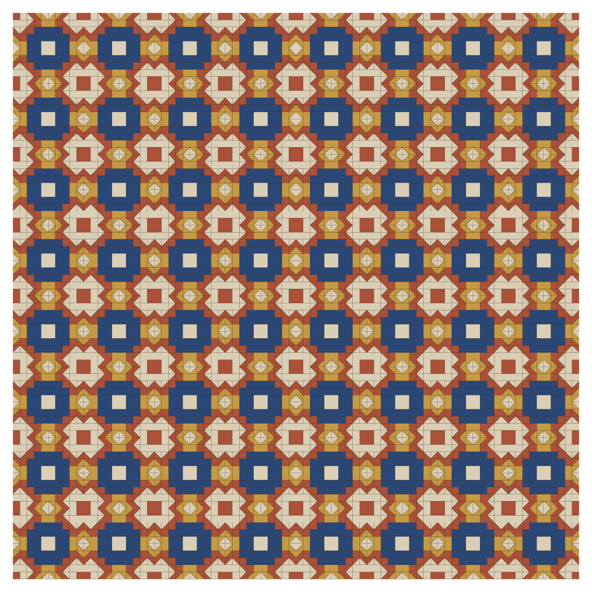

Medallions repeats a few ringed figures over the whole floor. Each figure
is a lozenge, a square or an octagon, and each is described by a measure of
how far a place is from it. For a figure with its middle at
$`(c_x, c_y)`$, write $`a = \lvert u - c_x\rvert`$ and
$`b = \lvert v - c_y\rvert`$ for how far the place $`(u, v)`$ is from the
middle across and along. The measure is

```math
f(u, v) = \max\left(a - w,\ \ b - h,\ \ a + b - s\right)
```

The three limits are half the figure's width $`w`$, half its height $`h`$,
and the most that $`a + b`$ may be, $`s`$. A limit that is left out is no
limit. The third alone gives a lozenge, the first two a rectangle, and all
three an octagon. The measure is 0 on the figure's outline, negative
inside it, and grows steadily with distance outside it. For example, a
lozenge with $`s = 3`$ at the origin gives the place $`(4, 1)`$ the measure
$`4 + 1 - 3 = 2`$, two tiles outside it.

One number is worked out for every place, the least of all the figures'
measures there, and the floor is cut into bands one tile wide by its whole
part:

```math
d(p) = \min_i f_i(p), \qquad n(p) = \lfloor d(p) \rfloor
```

The seed draws a short run of bands that are on and off by turns: one to
three pairs of on and off, one or two bands wide each, starting with a band
that is on. Band $`n`$ is on when entry $`n \bmod m`$ of the run is on, where $`m`$
is the run's length, and the run repeats inwards as well as outwards. A
place in a band that is on takes the number of the figure nearest it. A
place in a band that is off is ground.

Because the first band is on, every figure has its outline. Because the run
repeats, every figure is ringed inside and out by bands of its own shape.
Taking the least of the measures is how two distance functions are joined
into one solid in section 5, so where the bands of two figures meet they
join into one outline round both. That joining gives the pattern its
crowded, interlocked look without any rule about which figure may sit
beside which.

The measures are made of $`a`$, $`b`$ and $`a + b`$, which change by whole
tiles along the grid's lines and along its diagonals. A band's edge
therefore runs along the grid or at 45 degrees, the two directions a tile
shows exactly, and nearly every tile is a whole tile or a cut one. The few
tiles where several figures' bands meet take the colour at their middle.

The repeat is $`P`$ tiles each way, with $`P`$ an even number from 8 to 16
as the seed has it, or less on a floor too small for that. A place is folded onto one eighth of a repeat before it is
measured: each coordinate is taken as its distance from the nearest
multiple of $`P`$, and the larger of the two is put first. Four figures are
placed in that eighth, at the middle of the repeat, at its corner, at the
middle of its side and at one place between. Folding makes every repeat its
own mirror image eight ways from four figures.

#### The rug: a medallion carpet


The rug is set out as a medallion carpet of Tabriz or Kashan is, with each
part on a ground of its own colour (`rug_garden`). One quarter of it is
drawn and the other three are its mirror images. From the edge inwards it
has these parts.

| Part | What it is |
|---|---|
| Guard | a line, a chain of small lozenges, a line. A lozenge is two tiles across and made of four tiles cut on the diagonal, so the chain is exact on the grid and meets itself at a corner. |
| Main border | on a dark ground, one stem swinging from side to side as a sine curve, a flower in every hollow of the stem on one side and the other by turns, and a small knot wherever the stem crosses the middle |
| Second guard | as the first, and then the field |
| Medallion | at the middle of the field, up to four layers one inside the next. Each layer has a ring of pointed lobes with round ones between them, an outline, a ground of its own and a bud in every pointed lobe. A flower is at the heart, and a pointed pendant and two lozenges hang from the medallion at each end of the rug's longer way. |
| Corner pieces | a quarter of such a figure in each corner of the field |
| Field | scrolls: a stem coiling in to a flower, with leaves along it. Small flowers fill what is left. |

##### A layered figure

A layer of the medallion is the places within a round body or within one
of the lobes that stand out from it. A round lobe is a disc. A pointed
lobe is what two equal discs have in common, set a little to each side of
the lobe's axis: two bows meeting in a point, the shape of a pointed arch
(the [vesica piscis](https://en.wikipedia.org/wiki/Vesica_piscis)).

The lobes of a layer are all alike, so a place is first turned into one
lobe's slice of the figure and asked about once. For a place $`p`$ at the
distance $`r`$ from the middle, how far it is inside the layer's outline
is

```math
d(p) = \max\Big(R_0 - r,\ \ \rho_1 - \lvert p - c_1\rvert,\ \ \rho_2 - \lvert p - c_2\rvert\Big)
```

Here $`R_0`$ is the size of the round body, $`c_1`$ and $`\rho_1`$ are
the middle and size of the disc that bounds the pointed lobe on the far
side of its axis from $`p`$, and $`c_2`$ and $`\rho_2`$ are those of the
round lobe. Each term is how far inside one disc the place is, and the
greatest of them is how far inside the three together. For example, a
place 2 tiles inside the body and outside both lobes has $`d = 2`$.

The outline is the band $`0 \le d < 1`$, the first tile in, and a second
line is drawn further in where the layer is broad enough. Both follow every
lobe, because both are bands of the one number $`d`$. This is the banding
of a distance measure that the medallions use, applied to discs.

The first rug's medallion was a single rose curve, and its layers were the
same flower drawn smaller. It read as a child's drawing of a flower. A
woven medallion has lobes of two kinds by turns, with each layer turned
half a lobe from the last so that the points of one show between the
points of the next, and the layered figure is built to give that.

##### The field: packing circles

The field is filled by the loop of Wong, Zongker and Salesin
("[Computer-generated floral ornament](https://doi.org/10.1145/280814.280948)",
SIGGRAPH 1998), which grows ornament into whatever space is empty. Find the
largest empty circle left in the field, put a motif in it, and repeat until
what is left is too small. The room at every tile is kept in a grid: how
large a circle about that tile would touch the border, the medallion, a
corner piece or a circle placed so far. Each new circle only lowers the
room near it, so the grid is updated and never rebuilt.

Two changes were made to the loop. The largest circle is not always taken:
each tile's room is first lessened by a share of its own, up to a fifth,
because with the strict rule every seed filled a field the same way. A
circle is also limited in size, because without a limit the first one
filled the whole of the field beside the medallion.

A circle found this way touches something, most often an earlier circle.
Its stem then starts from that circle's stem and coils the opposite way,
so the two run together where they meet, like two gears. This is how
Hamekasi and Samavati join the scrolls of such patterns
("[Designing Persian floral patterns using circle packing](https://doi.org/10.5220/0003850101350142)",
GRAPP 2012). A stem is an
[Archimedean spiral](https://en.wikipedia.org/wiki/Archimedean_spiral),
which closes in by the same amount on every turn, so its coils stay evenly
spaced.

The first rug threw darts for its flowers and joined each to its nearest
neighbour with a straight stem. Darts leave holes and crowds, and straight
stems make a net where a rug has a vine.

##### Small things are drawn on the grid

A flower's size is how far it reaches from its middle. A flower of a size
under five tiles is a lozenge and a square on one middle. Together they make an eight-pointed star whose edges are the grid's
lines and diagonals, so it is drawn in whole tiles and tiles cut in two,
exactly. A round outline that small comes out as a blot of steps. A flower
under two and a half tiles is a lozenge alone.

A larger flower is a
[rose curve](https://en.wikipedia.org/wiki/Rose_(mathematics)) with a
constant added, so that its petals do not reach the middle. Going round
the middle by the angle $`\theta`$, a flower of size $`R`$ with $`n`$
petals has its edge at the distance

```math
r(\theta) = R\left(0.58 + 0.42\,\left\lvert \cos\frac{n\theta}{2} \right\rvert^{0.6}\right)
```

The edge is $`R`$ from the middle at the tip of a petal and $`0.58R`$ at
the notch between two. The power 0.6 makes a petal round at its tip and
the notch sharp. Without it the outline is a wavy circle.

##### Tones, not parts

The rug's seven numbers are tones and not parts: 1 is every line (the
outlines, the guard lines, the stems), 2 the dark ground, 3 the pale
ground, 4 the petals, 5 the leaves, 6 the shaded half of a leaf and the
ground of the corners, and 7 the hearts of flowers. Every part is made of
several tones, and the same few come back all over the rug, which is what
makes it read as one design. A flower is three tones: its petals, a smaller
flower within them and a heart. The first rug gave each part one number,
and each part came out one flat colour.

The cost is that the rug needs its colours. With two colours every tone
but the field's ground is the second colour, and the border, the medallion
and the corners become solid blocks. The rug starts in sets of eight
colours for this reason.

##### What the size of the floor decides

A figure given as a rule is drawn afresh at whatever size the rug is, and
that is the reason the flowers are not small pictures stamped over the
field. A picture is one size, and a flower drawn in tiles for a rug forty
tiles across is a blot on one two hundred across.

The rule also decides how much there is room to show, and a small rug
shows little. A layer under five or six tiles broad is all outline, so the
medallion has one layer where its points reach under 10 tiles from the
middle, two from 10, three from 22 and four from 34. It may have twelve
lobes only from a reach of 24, and has eight below it. The guards are
single lines, with no lozenges, on a floor under 48 tiles on its shorter
side.

Worked through for a rug half as long again as it is broad, the medallion
has three layers on a floor of about 90 tiles on its shorter side and four
from about 130. A square rug needs more, because the medallion is kept to
0.55 of the field's longer way. A rug is therefore best laid 100 tiles or
more across. The picture above is 240 tiles by 160 and shows all four
layers.

The rug is its own mirror image tile for tile. A place and its mirror
image reach the rule by different sums that can differ by a hair, so both
are first put on the same sixth of a tile, where the four samples of a tile
are taken.

A place asks about the frame and the two figures by a few sums each, and
about the scrolls only of its own square of four tiles by four, which are
two or three. Asking every scroll at every place would be hundreds of
them. The code's own measure is about 30 ms for a rug 250 tiles square.

#### Planks


Planks is a floor of boards laid end to end in rows, with no gap. The
**Size** setting is how broad a board is, in tiles. At the usual size, 2,
a board is 2 tiles broad and 8 to 24 long, and other sizes are in
proportion. The first board of a row is an offcut of any length, as a
carpenter starts a row with what was left of the last, so the joins of one
row fall where they will against the next. Every board has one of eight
numbers, never the number of the board before it in its row.

Wave function collapse can lay a floor of planks too, from a sample of
boards. A board's length is then whatever the sample's windows allow, which
is a few fixed lengths, and the lengths are the whole look of a floor of
planks. Drawing each length from the seed gives any length in the range.

#### Masonry: bricks and stones from one measure

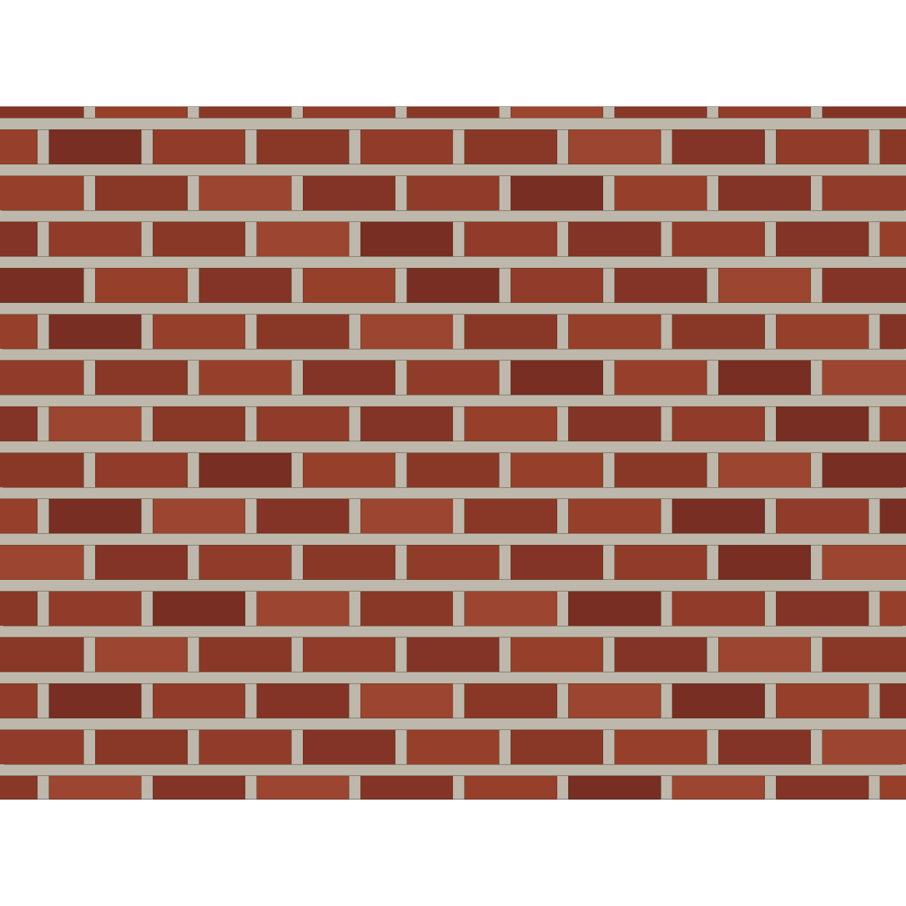  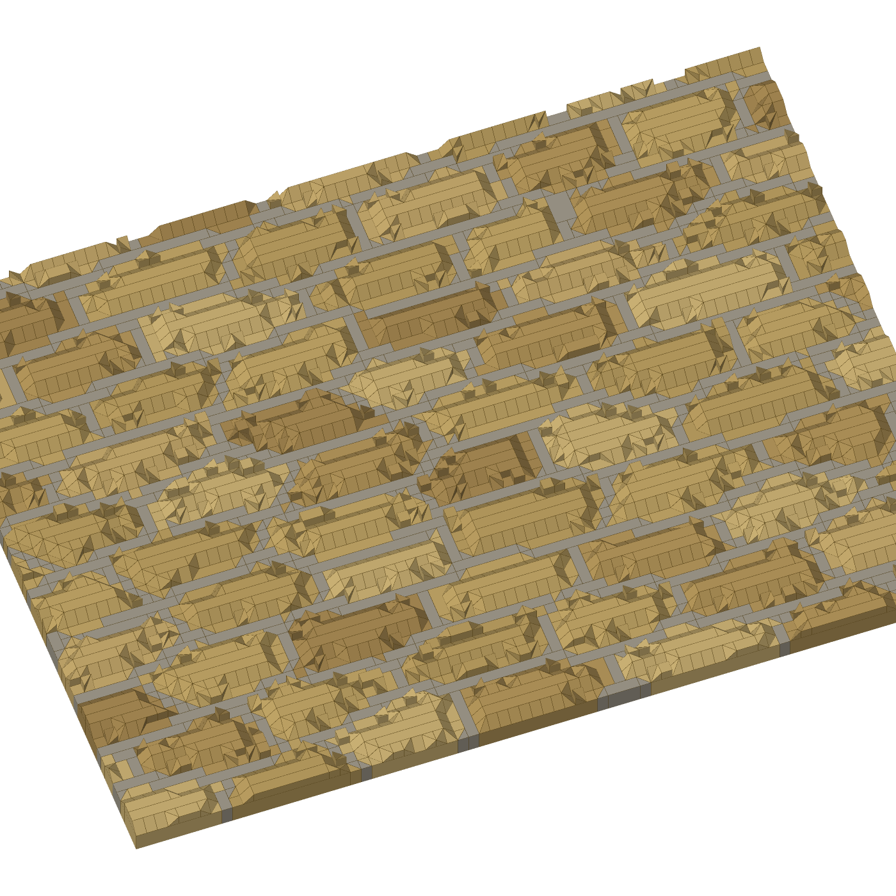

Masonry is a wall or a floor of pieces in courses: bricks all alike, or
stones of uneven size and shape (`Masonry` in `pattern.rs`). Bricks and
stones were two patterns at first. The difference between them is one of
degree, how alike the pieces are, so there is now one pattern and a
setting for that, **Uneven**.

Every piece has a point, and a piece is the ground nearer its own point
than any other's. This is the Voronoi diagram of the stepping stones in
7.8. What **Uneven** changes is where the points stand and how "nearer" is
measured. Write $`L`$ for a brick's length and $`D`$ for a course's depth,
each with its mortar, and $`u`$ for **Uneven** as a number from 0 to 1.
For a place $`p`$ and a piece's point $`c`$, the distances along and up
are taken in units of half a brick,

```math
a = \frac{\lvert p_x - c_x\rvert}{L/2}, \qquad b = \frac{\lvert p_y - c_y\rvert}{D/2}
```

and how far the place is from the point is

```math
f(p, c) = (1 - u)\,\max(a, b) + u\,\sqrt{a^2 + b^2}
```

At $`u = 0`$ the points stand in rows, a brick's length apart, and $`f`$
is the greater of along and up (the
[Chebyshev distance](https://en.wikipedia.org/wiki/Chebyshev_distance)).
Measured so, the ground nearest a point is a rectangle $`L`$ by $`D`$, and
the wall is bricks exactly. As $`u`$ rises two things change together.
Each point is moved from its place, by up to $`0.35u`$ of a brick each
way, so the pieces differ in size. The measure goes over by degrees to the
plain distance, so the pieces' edges leave the grid's lines and the pieces
become stones of any shape. At the usual **Size** of 2 a brick is 8 tiles
long and 3 deep, before its mortar.

Slabs were first rectangles of many sizes, laid course by course from a
list. That gave uneven sizes and nothing else. There was no way from a
list of rectangles to a stone that is not square, and it left a second
pattern beside the bricks with most of the same settings.

##### Mortar, numbers and stagger

How far inside its own outline a place is comes from the same measure.
With $`f_1`$ for the distance to the piece's own point and $`f_2`$ for the
distance to the next nearest point,

```math
h(p) = \tfrac{1}{2}\,(f_2 - f_1)\,w - \tfrac{m}{2}
```

Half the difference is how far the place is from the line between the two
pieces, in the unit across that line, and $`w`$ takes it back into tiles:
$`w`$ is $`L/2`$ when the other piece is in the same course and $`D/2`$
when it is in the course above or below. $`m`$ is the mortar's width, 1
tile or 0. For example, with bricks 9 tiles long with their mortar, a
place 1 tile from the line between two bricks has $`a = 3.5/4.5`$ to its
own point and $`5.5/4.5`$ to the other, so
$`h = \tfrac{1}{2}\cdot\tfrac{2}{4.5}\cdot 4.5 - 0.5 = 0.5`$.

A place with $`h \le 0`$ is mortar, which is the ground, 0. That is the
half tile either side of the line between two pieces, so the mortar is one
tile wide. With **Mortar between** off the pieces touch. Every piece has
one of six numbers, odd and even by turns along a course, so two pieces
side by side differ in shade even with no mortar between them.

Each course is moved along from the one before. **Stagger** sets one share
of a brick's length for every course: a half is the usual bond, and
nothing stacks the bricks in columns. **Uneven stagger** moves every course
by an amount of its own, so the upright joints fall anywhere, as in a wall
laid without a bond in mind. **Courses upright** swaps the two directions,
so the courses run up the floor and the stagger is from side to side.

##### The bevel

The bevel uses $`h`$ as a height. The top **Bevel** cells of a piece are
not laid full. At its outline the piece stands that many cells short, and
it rises one cell for every cell in from the outline, so its top slopes
down to its edge all round. The mortar lies at the foot of the slope. A
bevel can be no more than the form's **Depth** less one, so a wall one
cell deep has none.

The slope is laid cell by cell. For each cell of a piece, and each of the
top layers, the piece is asked at the cell's eight corners whether it
reaches that high there. Counting the top layers from 0, a corner at the
bottom of layer $`k`$ is reached when $`h \ge k`$ and a corner at its top
when $`h \ge k + 1`$. The corners that are reached name the brick, as
they do everywhere else in the program (section 2).

| Corners reached | What is laid |
|---|---|
| all eight | a whole cell, joined with its neighbours along the row |
| the four below and two above | a sloped brick, along a side of the piece |
| the four below and one above | a hipped brick, at a corner of the piece |
| none | nothing |
| a set that is no brick's shape | a whole cell or nothing, by whether the middle of the cell is reached |

This is how the fitter of solid forms chooses a cell's brick (7.1). It is
done by hand here, for a few layers, and the solid fitter is not called.
A wall of stones is thousands of small solids, and that fitter is made
for one large one.

Bricks bevel cleanly, because their edges run along the grid and every
corner is a right angle. Stones do not. Where two edges of a stone meet at
an odd angle, the corners a cell reaches are no brick's shape, and the
cell is laid whole or left out. The third picture above shows the result:
the slopes along a stone's sides are clean and its corners are jagged.

The first bevel belonged to the slabs and cut the four corners off each
slab flat, in the plane of the wall. Masonry has no such cut, and a file
that asks for it is read with a bevel of 0.

#### Colours by feature

 

A pattern numbers its parts and not its colours. 0 is the ground, and each
number from 1 to 7 is one feature of the pattern: one of the four figures
of a medallions repeat, one of a rug's tones, one shade of brick. The
player chooses how many colours there are, up to eight, and `colour_of`
decides which colour a number takes. With $`s`$ for a brick's number and
$`N`$ for the number of colours, counting the colours from 0,

```math
c(s, N) = \begin{cases} 0 & \text{if } s = 0 \text{ or } N \le 1 \\ 1 + \big((s - 1) \bmod (N - 1)\big) & \text{otherwise} \end{cases}
```

The ground has the first colour to itself. The features share the other
colours out in turn, and go round again when there are more features than
colours. For example, with $`N = 4`$ the features 1 to 7 take the colours
1, 2, 3, 1, 2, 3, 1.

Two colours therefore give the whole pattern in one colour on the other,
and every colour added picks one more feature out, until each has its own.
The two pictures above are one floor of medallions, which has four
features, with two colours and with five.

The first rule went round all the colours, the ground's among them. With
fewer colours than features it painted some feature the colour of the
ground, and that feature vanished from the pattern. Keeping the first
colour for the ground prevents that at any number of colours.

Planks and stepping stones have no ground. A board or a stone numbered 0
takes the first colour by the same formula, and the other numbers share the
rest. The colour sets these two start in are shades of one material, so the
first colour is one more shade among them. In masonry the ground is the
mortar.

#### The edge: the form's own

A pattern colours a form and does not reshape it. The floor is fitted
exactly as it is with no pattern, so its outline and its figures for
closeness are the same either way.

Along a slanting edge that fit lays sloped bricks up to twenty cells long.
A sloped brick is one colour, and each takes the pattern's colour at the
middle of its solid half. The floor was once fitted with no brick longer
than five cells, so that the edge's bricks were small enough to carry the
pattern. That changed the form: on a band 20 cells wide curving through a
third of a turn, 1.5% of its area was amiss with bricks of five cells
against 0.6% with the fit's own. A form whose outline moved when a pattern
was chosen was the worse fault, and the limit was taken out.

A sloped brick whose two sides share a divisor is also taken apart into
that many smaller sloped bricks of the same slope, over a staircase of
whole cells. A triangle 4 cells by 2 becomes two of 2 by 1 and two whole
cells, and one of 5 by 3 has no smaller and stays as it is. The surface is
the same either way, since the small bricks' sloped sides are the large
one's laid end to end, and the whole cells take the pattern like any
others.

Each sloped brick that remains is then coloured by the pattern. It takes
the number the pattern has at the middle of its solid half, a third of the
way in from its square corner, unless that place is within the border.
Left plain, the edge of a pattern with no border was a row of bare
triangles.

#### Why not wave function collapse for the tile patterns

Wave function collapse was built and used for the first tile patterns, and
then replaced. The solver is in
[core/src/wfc.rs](../core/src/wfc.rs). It learns which tiles may sit side by
side from a small sample picture, whose every small window becomes a tile,
and fills the floor so that neighbouring tiles agree. The first styles were
small samples of chevrons, stars, a weave and other motifs, and the solver
strewed each sample's motifs over the floor.

The method knows only what may sit beside what, a few tiles across, and the
faults of its floors follow from that.

- The floors were even and aimless. A sampled floor looks the same
  everywhere, where a drawn one has a middle and is its own mirror image.
- A rug could not be made. Tried for a rug's field, the method gave the
  rug its scattered small motifs, which is a plain rug. What makes a rug
  look like one is a few large figures that govern the whole of it, and a
  rule a few tiles across places no such figure.
- Lengths cannot vary freely. A board in a floor of planks has one of the
  few lengths the sample's windows allow.

The drawn rules work the other way. They start from the large figures and
work down to the tile, so the middle, the symmetry and the sizes are
decided first. The sampled styles and their samples were removed. `wfc.rs` is kept, with its tests, and no pattern calls it at
present. A pattern made only of small repeated motifs, with no figure
larger than a few tiles, is the case it still suits (see
[future-work.md](future-work.md)).

### 7.10 Trees

A tree is one solid, fitted cell by cell (section 7.1) and coloured part
by part ([core/src/tree.rs](../core/src/tree.rs)). The solid is the union
of several thousand simple parts: tapered round branches, the eight-sided
lengths of a palm's trunk, and balls of leaves. There are three kinds, a
pine, a palm and an oak, and each is grown by a method of its own, because
the three differ in how they grow and a single rule general enough for all
three describes none of them closely.

 


#### Why three methods

The standard model of a tree is Weber and Penn's
([Creation and rendering of realistic trees](https://courses.cs.duke.edu/fall02/cps124/resources/p119-weber.pdf),
1995): one recursive rule in which every level of branching has some forty
numbers. It was the starting point here, and two of its devices are used
as they stand: a branch angle that changes with height, and a pull upwards
on the ends of branches. The whole model was not taken. Its numbers
describe a tree's statistics, and at this size a tree is recognised by its
structure. A spruce is its separate tiers, a palm is one crown on one
stem, and an oak is a few heavy limbs. Each of those is easier to build
directly than to coax out of forty numbers per level.

Builders of brick trees work the same way. A brick spruce is built as
stacked rings of leaves, each drooping over the one below, and
[its builder notes](https://fullplatebuilds.com/2018/04/14/spruce-tutorial/)
that the lowest ring sets the shape of the whole tree. A brick palm is a
segmented trunk with about twenty fronds, the lowest of them hanging
([palm tutorial](https://fullplatebuilds.com/2018/11/21/palm-tree-tutorial/)).
Voxel generators that are public use rules of the same kind: tier by tier
for a spruce, and balls of leaves at the ends of branches for an oak.

#### The pine

The pine is a spruce or fir, the Christmas tree. It is built tier by tier
from four facts about a spruce's boughs
([Norway spruce](https://en.wikipedia.org/wiki/Picea_abies);
[its crown architecture, measured](https://bioresources.cnr.ncsu.edu/resources/crown-architecture-and-structural-development-of-young-norway-spruce-trees-picea-abies-karst-a-basis-for-more-realistic-growth-modelling/)).

The boughs come in tiers with air between them, one tier for each year's
growth, four to seven boughs to a tier. Each tier is turned by a random
angle from the one below. The tiers are closer together towards the top.
With $`u`$ running from 0 at the lowest tier to 1 at the highest, a tier
stands at the share

```math
h(u) = 0.55\,u + 0.45\left(1 - (1 - u)^{1.7}\right)
```

of the way from the lowest bough to the leader.

The boughs shorten to the top, which makes the cone, and the lowest tiers
are drawn in a little, as they are on a tree whose lowest boughs are
shaded. A tier's boughs are the length

```math
L(u) = R\,\frac{s(u)}{\max s}, \qquad s(u) = \left(0.9\,(1 - u)^{0.9} + 0.1\right)\left(0.84 + 0.16\,\min(1,\ u / 0.12)\right)
```

where $`R`$ is the spread asked for. One bough of each tier has the full
length and the others 84 to 100% of it.

The angle changes with height. A bough leaves the stem at the angle
$`e_0`$ above level, sags on the way out by an amount $`g`$ that the
**Droop** setting $`d`$ scales, and turns up again at its tip by $`t`$.
At the share $`x`$ of the way along it, it climbs at

```math
e(x) = e_0 - 2g\,x + (2g + t)\,x^3, \qquad e_0 = -0.2 + 0.95\,u^{1.4} - 0.22\,d\,(1 - u)
```

radians, with $`g = 0.55\,d\,(1 - 0.7u)`$ and $`t = 0.5 - 0.2u`$. The
lowest boughs therefore leave the stem pointing 20 degrees down, hang
lower still half way out and end level, and the highest climb at 40
degrees. The S of each bough is what separates a spruce from a cone.

A bough is a flat spray. It carries a pair of side shoots every 2.3
cells, angled forward and hanging a little, longest a quarter of the way
out. Long side shoots carry short shoots of their own. Near the stem the
bough is bare wood, more of it the lower the bough.

The needles are not built one by one. A side shoot with its needles is a
round cone a little over two cells thick. That is the thinnest a part can
be and still be built at any angle: a thinner one fills less than half of
some of the cells it passes through, and the fitter leaves those cells
empty.

Between the tiers a full tree has a few shorter boughs, and the leader
stands above the top tier with two small whorls of climbing shoots.


#### The palm

The palm is a coconut palm
([*Cocos nucifera*](https://www3.ctahr.hawaii.edu/gsp/doc/Forestry/Little_Skolmen_CFT/CFT_Cocos_nucifera.pdf)).
It has one level of structure, a stem and a crown, and both are placed by
rule.

The trunk leans from its foot and curves back to upright, as a palm does
that has grown towards the light. At the share $`t`$ of its height
$`H`$, its middle stands

```math
x(t) = \frac{a\,H}{2.7}\left(1 - (1 - t)^{2.7}\right)
```

to one side of its foot, where $`a`$ is the slope at the foot, set by
**Lean** up to 0.85. The slope is $`a\,(1 - t)^{1.7}`$, which is steepest
at the foot and zero at the top. The trunk is swollen at the foot to about
1.7 times its width higher up, and hardly tapers above that.

The trunk is eight-sided. Its section is taken level and not square to the
lean, so four of its eight faces lie on the grid's own planes at any lean
and the other four are 45 degree ramps. The distance from a point to a
length of trunk whose middle is at $`c`$ and whose faces are $`r`$ from
it is

```math
f = \sigma\left(\max\left(|q_x|,\ |q_y|,\ \frac{|q_x| + |q_y|}{\sqrt 2}\right) - r\right), \qquad q = p - c
```

with $`c`$ and $`r`$ taken at the point's own height. The factor
$`\sigma = 1 / \sqrt{1 + m^2 + w^2}`$, for a length that leans at the
slope $`m`$ and widens at the rate $`w`$, keeps $`f`$ from exceeding the
true distance (section 5). The trunk is a stack of such lengths, each a
few cells tall and a little wider at its top than the next is at its
foot. That step is a ring, and its top cell is a darker colour: the scar a
fallen frond leaves.

The fronds are set round the top of the trunk by the golden angle, each
137.5 degrees from the last, which is how a coconut palm sets them and the
turn that never puts one leaf directly over another
([Vogel's model](https://en.wikipedia.org/wiki/Golden_angle)). The
frond numbered $`i`$ of $`n`$ has the age $`\alpha = i / (n - 1)`$. It
leaves the crown at the angle $`\theta_0`$ from upright and has turned
over by a further $`\beta`$ at its tip:

```math
\theta(x) = \theta_0 + \beta\,x^{1.7}, \qquad \theta_0 = 0.12 + 1.32\,\alpha^{0.85}, \qquad \beta = 0.75 + 0.95\,\alpha
```

in radians, at the share $`x`$ of the way along it. The youngest fronds
stand nearly upright and arch a little. The oldest leave the crown below
level and hang. The bend grows towards the tip, so every frond's tip
droops.

A frond is pinnate. Its rib carries a pair of leaflets every three cells
from a fifth of the way along. The leaflets are shortest at the two ends
of the rib, are held out to the side on a young frond and hang on an old
one, and each bends down half way along its length.

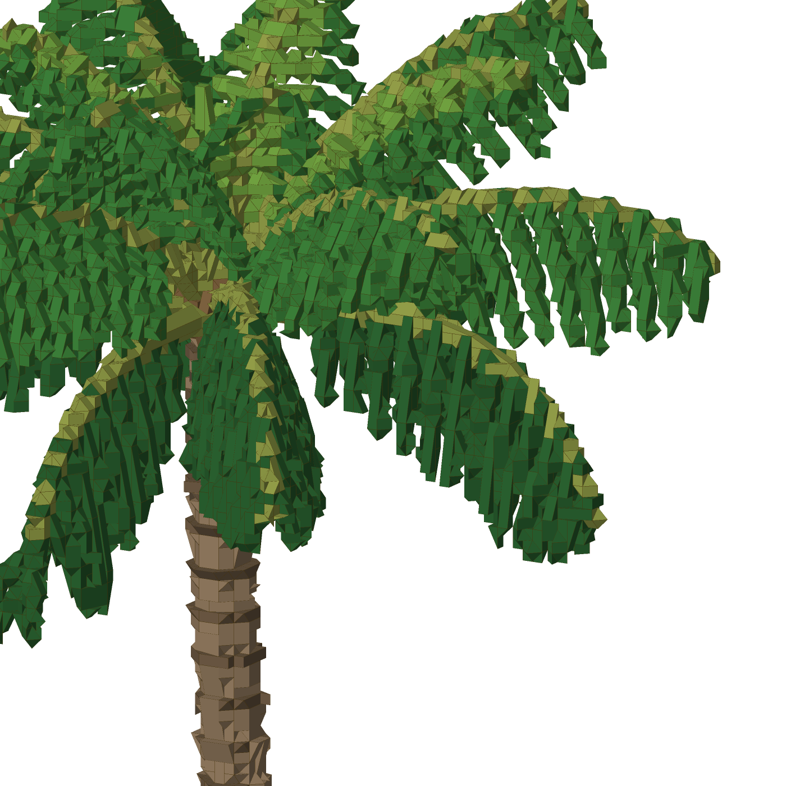

#### The oak

The oak is an open-grown English or white oak: a short thick trunk that
divides low down into a few heavy limbs, and a crown as wide as the tree
is tall ([white oak](https://en.wikipedia.org/wiki/Quercus_alba)). Above
the trunk it has no leading stem, so it is the one tree here grown by a
recursive rule. The rule is one fork, applied until the branches are
twigs.

A limb of radius $`r`$ runs a length of about $`6.2\,r^{0.62}`$ and
divides in two. The two share its cross-section by Leonardo da Vinci's
rule: a share $`q`$, drawn between 0.52 and 0.86, carries on and the rest
turns aside, so

```math
r_1 = r\sqrt{q}, \qquad r_2 = r\sqrt{1 - q}, \qquad r_1^2 + r_2^2 = r^2
```

Measured trees keep the rule with an exponent between 1.8 and 2.3
([Eloy 2011](https://arxiv.org/abs/1105.2591)), and 2 is used. A share
near 0.5 is an even fork and a share near 0.86 is a small side branch off
a limb that carries on, so one rule gives both. The side branch turns
aside by 35 to 65 degrees and the limb turns the other way by less, in
proportion to what it gave up. Each fork is turned by the golden angle
about the limb from the fork before, which fills the crown in all round.
The trunk divides the same way into two to seven limbs.

Between forks a limb's direction $`v`$ is changed twice by

```math
v \leftarrow \frac{v + 0.44\,k\,\xi + \left(0.36\,w\,o - 0.1\,w\,z + 0.15\,(1 - w)^2\,z\right)}{\lVert\,\cdot\,\rVert}
```

where $`\xi`$ is a random direction and $`k`$ the **Gnarl** setting,
$`w = r / r_\text{trunk}`$ is how heavy the limb is, $`o`$ points level
away from the trunk and $`z`$ points up. A heavy limb is drawn outwards
and sags. A thin one turns up to the light. The result is limbs that
strike out wide, then climb at their ends.

A branch thinner than one cell is not built. It ends in leaves.

The crown has to fill a dome of the height and spread asked for, and no
rule gives the reach of a crooked limb before it is grown. The branches
are therefore grown twice from the same random numbers. The first growth
is at no particular size and only measures how far the branches reach.
The second is at the size that puts six sevenths of the branch ends
within nine tenths of the dome's width, and it is held in: a branch
nearer the outline than 0.7 of the way from the dome's heart is turned
back along it. A last small stretch brings the furthest end exactly to
the dome. Growing once and stretching the result was tried first. One
long limb then set the size of the whole crown, and the rest of it
huddled round the trunk.

The leaves are at the ends of the branches and nowhere else, so the crown
is separate masses with sky between them and the limbs show from below. A
branch that ends is carried on for three lengths as a spray too thin to
build, and at each length there is a tuft: one flattened ball of leaves
and two smaller ones beside it. A ball of leaves is itself built as a
smaller ball with many small balls, each two or three cells across,
standing out of it all over. The small balls are clusters of leaves and
the gaps between them are the hollows.


The first leaves were smooth balls with smooth noise added to their
distance, which is the usual way to roughen a surface. It looked much the
same and took four times as long. Noise steepens a distance function, so
every value had to be more than halved to stay an underestimate (section
5), and the fitter then sampled a shell of cells twice as deep, working
the noise out at each sample. A union of balls is an exact distance and
needs no such allowance.

[Space colonisation](https://algorithmicbotany.org/papers/colonization.egwnp2007.pdf)
(Runions, Lane and Prusinkiewicz 2007) was the other candidate for the
oak. It scatters points through the crown and grows branches towards
them, and it gives fine irregular broadleaf crowns. It was not taken for
two reasons. Its branches are one node spacing thick everywhere, and a
tree in bricks needs a few heavy limbs several cells thick, which a rule
that divides a limb's cross-section gives by construction. And each point
influences every branch near it, so changing one setting grows a
different tree. Here a seed is one skeleton, and the height, spread and
foliage can be changed while the tree stays recognisably itself.

#### One colour for each part

Every part carries a number: the trunk, leaves, leaves in shade, new
growth, limbs, and so on. A brick takes the number of the part its middle
lies deepest in, and the colouring **As the pattern has it** paints it
(section 7.9, Colours by feature).

Some numbers are decided from the tree as a whole. On a pine, needles
with open air a cell and a half above them are the top of a bough. They
have a number of their own, which the natural sets of colours paint a
paler green and the snowy sets paint white. On an oak, leaves with open
air above them are light and leaves with open air below them are dark,
with the boundary made uneven by smooth noise. The oak's leaves were first
lit by where each brick lay in its own ball of leaves. Every ball was then
light on top and dark underneath, and a mass read as the balls it was
made of.

The fitter merges cubes into the largest boxes it can and knows nothing
of colour, so one box may run from a bough's bark out into its needles.
After the fit, every cell of every box is asked its number. A box of one
number is kept, and the cells of the others are merged again number by
number. No brick is of two colours.

#### Finding the parts near a sample

A fit of a tree asks for the distance at some ten million samples, and a
pine has five thousand parts. Comparing every sample with every part
would take minutes. The parts are filed in a uniform grid of buckets one
cell wide. A bucket lists the parts that come within 0.9 of a cell of it,
which is as far as the fitter looks from a cell's corner before it calls
the cell empty or full (section 7.1). A sample reads its own bucket's
list, which holds six parts on a pine, and takes the least of their
distances.

Two details make that sound and quick. An empty bucket has to answer with
a distance too, and the answer must not exceed the truth, because the
fitter skips a whole block of cells whose middle is far enough from the
surface. A second grid four times coarser records how many coarse buckets
lie between each bucket and the nearest part, and an empty bucket answers
with that gap. And a sample well inside one part stops looking: its depth
in that part is no deeper than its true depth, which is all the fitter
asks of a point inside.

The bucket size was measured. Buckets four cells wide, the size a curve's
segments are filed in, listed about fifty of a pine's side shoots each,
and the default pine took 2.9 seconds. Buckets one cell wide take it in
1.0. A hierarchy of boxes round the parts would serve no better: the
parts are small and spread evenly through the crown, which is the case a
uniform grid suits, and a sample finds its bucket by three
multiplications.

#### Why the processor and not the graphics card

Nine tenths of a tree's build time is the distance function, which is
arithmetic a graphics card does well, so a version on the card was
considered. The editor draws through OpenGL 3.3 and WebGL2, which have no
compute shaders. The field would be drawn slice by slice into a texture
by a fragment shader, with the parts and the bucket grid passed in as
textures, and read back
([WebGL best practices](https://developer.mozilla.org/en-US/docs/Web/API/WebGL_API/WebGL_best_practices)).
It was not built, for three reasons.

The first decides it. Which brick a cell gets depends on which of its 64
samples are inside the tree, and some samples always lie within rounding
error of the surface. The shading languages at these versions do not fix
how a sum, a division or a square root is rounded: the rule that does
arrived with
[GLSL 4.00](https://developer.download.nvidia.com/opengl/specs/GL_ARB_shader_precision.txt),
and even it allows a multiply and an add to be fused and a square root to
be three units out in its last place. Two cards could therefore give
different bricks for one seed, and neither need agree with the processor.
A seed that names one tree on every machine is worth more than the
speed.

The core library also has to build a tree with no graphics card at all,
for tests, reports and the picture examples, so the processor's version
would exist in any case and would have to be the one the card's was held
to.

And the fitter does not ask for its samples in one batch. It asks for a
block's middle, then perhaps its corners, then perhaps 64 samples in some
of its cells, each answer deciding the next question. A card would have
to answer every possible question in advance, most of which are never
asked, or the fitter would have to be rewritten in rounds.

The speed is to be had on the processor. The blocks of a fit are
independent of one another, so they can be divided among threads, and the
answer is the same bricks whatever the number of threads.

#### What is measured

At the usual sizes, on one thread:

| Tree | Size | Parts | Bricks | Time |
|---|---|---|---|---|
| Pine | 140 tall, 72 across | 5,495 | 33,643 | 1.0 s |
| Palm | 120 tall, fronds 44 long | 1,149 | 16,753 | 0.4 s |
| Oak | 110 tall, 124 across | 3,283 | 40,092 | 0.9 s |

At 100 tall the three take 0.58, 0.27 and 0.55 seconds. The time is nearly
all distance samples: 9.2 million of them for the pine, at about 100
nanoseconds each. Growing the tree and filing its parts takes 50
milliseconds and colouring the bricks 20.

The discrepancy of a tree is high, 15% for the pine, and it does not mean
what it means for a sphere. A spray of side shoots two cells thick has
most of its volume within half a cell of its surface, where no brick can
follow it exactly.

A tree is always fitted at brick size 1 when the brick size is automatic,
whatever the budget, as a tile pattern is (section 9). At a coarser size
the shoots and leaflets are thinner than a brick and vanish, and what is
left is a trunk in a cloud.

## 8. Changing a form: added points, mirror, turning, grids

### Added points

A point added at $`a`$ and dragged by an amount $`b`$ moves the form near
$`a`$ and leaves the rest alone. A point of the form at distance $`d`$ from
$`a`$ moves by $`b\,w(d)`$, where

```math
w(d) = \tfrac{1}{2}\left(1 + \cos\frac{\pi d}{\rho}\right)\ \text{for } d < \rho, \qquad w(d) = 0 \text{ otherwise}
```

and $`\rho`$ is the reach. The weight $`w`$ is 1 at the point itself,
falls smoothly to 0 at the reach, and stays 0 beyond. The cosine makes the
fall gentle at both ends, so the bump joins the rest of the form with no
corner. For example, with a reach of 8 cells and a pull of 6 cells, the
form moves 6 cells at the point, $`6 \times \tfrac12(1 + \cos 90^\circ) = 3`$
cells at 4 cells away, and not at all 8 cells away. This is the loop in
`pulled` in `spec.rs`:

```rust
    for (at, by) in pulls {
        let held = (0..fine.len()).min_by(|a, b| fine[*a].distance_squared(*at).total_cmp(&fine[*b].distance_squared(*at))).unwrap();
        for i in 0..fine.len() {
            let mut d = (along[i] - along[held]).abs();
            if closed {
                d = d.min(whole - d);
            }
            if d < reach {
                moved[i] += *by * (0.5 * (1.0 + (PI * d / reach).cos()));
            }
        }
    }
```


On a curve, $`d`$ is measured along the curve (`along`), not straight
across. So a pull on one side of a narrow loop leaves the other side alone,
even though the two are close in space. The polyline is first cut into
pieces of half a cell, since a straight run is one long segment that could
only move by its ends. A revolve's profile is pulled the same way.

On a sphere or pyramid, $`d`$ is straight-line distance, and the pull acts
on the distance function instead of on a curve. To answer the pulled form
at a point $`p`$, the program needs the point that ended up at $`p`$. That
point is $`p - t\,b`$, where the share $`t`$ satisfies
$`t = w(\lvert p - t\,b - a\rvert)`$. The share $`t`$ appears on both sides,
so there is no formula for it. It lies between 0 and 1, and the program
finds it by bisection: it halves the range 14 times (`Field::Warp` in
`sdf.rs`). Taking $`w`$ at $`p`$ itself, the easy approximation, is badly
wrong when the pull is as long as its reach; a sphere pulled six cells
bulged only three.

#### Keeping the layout

A sphere, pyramid or pipe with a point added keeps its own bricks wherever
the pull does not reach (`patched` and `lifted_tube` in `spec.rs`). A cell
counts as unchanged if the form's distance function is as it was at the
cell's centre and one cell to each side. Bricks made only of unchanged
cells are kept. The changed cells are refitted (by 7.1 for solids, by 7.7
for tubes) and no others, so no cell is filled twice or left out. Without
this, one bump on a ring 70 across sent the whole ring to the cell-by-cell
fitter, and a fifth of its faces became steps.

### Mirror

Mirroring along an axis about the plane $`x_k = c`$ keeps the form's low
side and replaces the high side with its mirror image. Here $`x_k`$ is the
coordinate along that axis. For a curve, this is done to the polyline: the
part with $`x_k \le c`$ is kept and followed by its reflection (`mirrored`
in `spec.rs`). For a solid, it is done to the distance function, which is
asked about the point

```math
x_k' = c - \lvert x_k - c\rvert
```

instead of the point itself. A point on the low side is left as it is, and
a point on the high side is reflected onto the low side. For example, with
the mirror at $`c = 10`$, a point at $`x = 13`$ is answered as if it were at
$`10 - 3 = 7`$.


Because the mirror is applied to the form before fitting, a lopsided arch
becomes a symmetric arch and is fitted as one. Added points on the high
side are moved to the low side first, so a point added on either side
counts (`folded_pulls`).

### Flip and quarter turns

Flip and quarter turns act on the finished bricks, not on the form. Flipping
along an axis reflects each brick's position and swaps the bits of its
corner mask along that axis, which is the reordering of switches from
section 2. This is from `build_at` in `spec.rs`:

```rust
            b.min[k] = twice as i32 - b.min[k] - b.ext[k];
            // each corner of the box changes ends along this axis
            b.mask = (0..8u8).fold(0u8, |m, c| m | (b.mask >> c & 1) << (c ^ (1 << k)));
```

`c ^ (1 << k)` is corner `c` with its coordinate along axis `k` changed from
0 to 1 or back. A quarter turn reorders each brick's position, size and
corner mask about a lattice point at the middle of the form (`Turn` in
`spec.rs`). The form is therefore the same bricks whichever way it faces,
and forms that can only be fitted upright, such as a pyramid or a spun
profile, can lie on their sides.

### Grids at an angle

The game keeps bricks on grids, and a grid other than the world's can stand
at any angle. Each form carries a grid number, a rotation $`q`$ and a
translation $`t`$, shared by every form on that grid. The rotation is
stored as a quaternion, which is four numbers that together describe one
turn in space. A point
$`p`$ of a form is shown at

```math
p_{\text{world}} = t + R(q)\,p
```

where $`R(q)`$ means "turned by $`q`$". The point is turned with its grid,
then moved to where the grid is. In the editor this is `out_of_grid` in
[editor/src/state.rs](../editor/src/state.rs):

```rust
/// Where a point of a form's grid is in the world: turned by the grid's
/// angle, then moved to where the grid is.
pub fn out_of_grid(spec: &Spec, p: DVec3) -> DVec3 {
    DVec3::from_array(spec.grid_at) + turned_way(spec.grid, p, false)
}
```


Nothing in the fitting reads these values. A form on a tilted grid is
fitted exactly as if it were level, which is why it stays as smooth as it
was. The rotation only decides where the finished bricks are drawn and how
they are written to the copied file. In the file, a tilted grid becomes a
frozen grid of its own holding all its forms
([editor/src/brz.rs](../editor/src/brz.rs)).

Turning a grid with one of its rings combines $`q`$ with a turn about that
ring's axis, in whole degrees, and adjusts $`t`$ so that the middle of
everything on the grid stays where it is.

### Forms joined on purpose

Forms on one grid are normally kept clear of each other. A form dragged
with Ctrl held is moved into the others instead and marked as joined
(`merge` and `joined` in [editor/src/state.rs](../editor/src/state.rs)).
The two forms then overlap, and the game refuses a brick whose box overlaps
another's, so the joined form gives up the room they share. This is done
when the bricks are gathered for drawing, copying and saving
(`State::painted`),
and the forms' own fits are left as they are.

Each brick of the joined form is treated one of three ways.

| The brick | What becomes of it |
|---|---|
| shares no room with another form | kept whole |
| a plain block that shares some room | cut down to the cells that share none, as rows of cells |
| a sloped brick that shares any room | left out |

A sloped brick is left out because a slope cannot be cut down to cells.
The join therefore has a notch a cell or two deep wherever the joined
form's sloped surface meets the other form. A joined form gives room up to
every form on its grid that is not joined, and to the joined forms before
it in the list, so of any two overlapping forms exactly one is cut.

Fitting the two forms afresh as one solid would leave no notch, and is the
blending described in [future-work.md](future-work.md). It was not used
here for two reasons. It is a different build, with different bricks
everywhere near the join and not only where the forms overlap. It would
also make every form on a grid one form to edit, where cutting bricks
leaves each form its own dots and settings.

A joined form is not pushed clear when a form it sits in is reshaped, and
moving it without Ctrl sets it clear again. The mark is held by the
workspace alone. Undo rebuilds the forms from their settings, and a save
holds only settings, colours and places, so neither brings the mark back.

## 9. Fit against brick count

### Simplify

**Simplify** applies to outlines (7.2). It is added to the corner price
$`\lambda`$, measured in cells of area. Several short sides then give way to
one long side wherever that costs less disagreement than the corners it
saves. The price is judged in the outline alone and not multiplied by the
form's depth, so making a form deeper never changes how its outline is
fitted.

Volumes have no such price. One was tried and removed. A tetrahedron or cut
cube corrects at most a sixth of a cell, so any price large enough to
matter stripped every tetrahedron and cut cube and left a pit wherever
three slopes meet. In the plane, a price swaps several short triangles for one long one and the
outline stays continuous; on a surface made of one-cell bricks there is
nothing longer to swap to.

### Brick size

**Brick size** $`g`$ fits the form shrunk by $`g`$ and scales the bricks
back up, so every brick is a multiple of $`g`$ cells (`build_at` in
`spec.rs`). A sphere of radius 50 at brick size 2 is fitted as a sphere of
radius 25, and every brick is then doubled. A surface takes about
$`1/g^2`$ as many bricks, because each brick covers $`g \times g`$ times as
much of it, and it is followed $`g`$ times as coarsely.

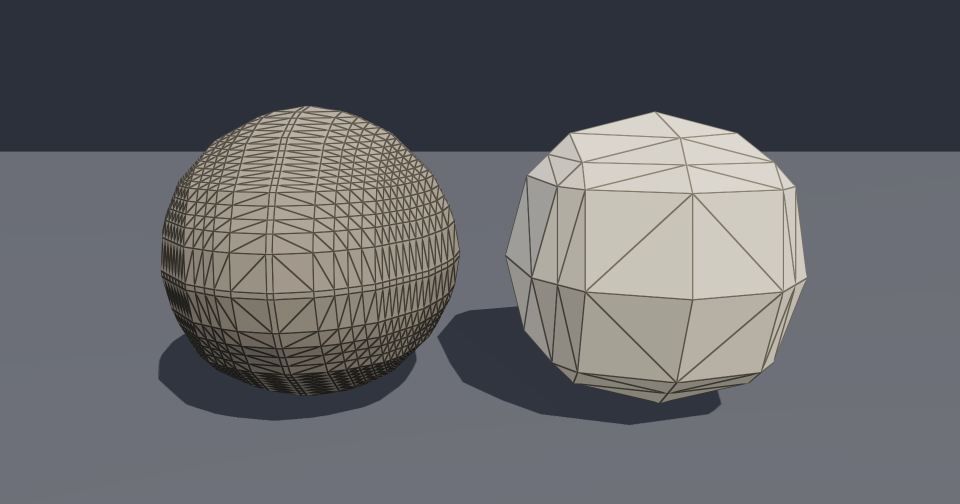

A sphere of radius 28 at brick size 1 and at brick size 4.

**Automatic** tries sizes 8, 6, 4, 3, 2 and 1 in that order and keeps the
finest that is within the brick budget. It keeps a wall at least two bricks
thick and a round solid at least four bricks to its radius. Past those limits the brick count would fall only because the form
was no longer being built. The search goes from coarse to fine because a fit
$`g`$ times coarser has about $`g^3`$ fewer cells to look at, so every size
tried on the way costs less than the one finally kept.

A tile pattern and a tree are fitted at brick size 1 whatever the budget.
Their detail is a cell or two across, and at a coarser size it is gone
(7.9, 7.10). A larger brick can still be chosen by name.

### Where a form fits cleanly

A form fits well only where its surfaces land on the grid. A round arch
whose rise makes its radius 8.3 has a wall 2 cells thick running from 7.3 to
9.3 cells out. Bricks can only put it at 7 to 9, a third of a cell off all
the way round. At radius 8 the same wall sits on lattice lines and the
discrepancy halves. **Snap to best fit nearby** searches for such values
(`snap_best` in [editor/src/state.rs](../editor/src/state.rs)). It tries
each of the form's points a whole cell either way (and half a cell too when
the dots snap to half cells), and each size half a cell and a whole cell
either way. It keeps a change only if it improves the discrepancy by at
least 3%, so that it does not wander for the sake of noise. It repeats the
round up to three times, or once for a form that takes long to build, and
stops early when a round improves nothing.

## 10. Measuring the result

### Discrepancy

Every cell near the surface is sampled at 64 points, both for the form
(from its distance function) and for the bricks (from each brick's shape),
and the samples that disagree are counted
([core/src/report.rs](../core/src/report.rs), `measure`). This is
independent of whichever fitter made the bricks.

A regular grid of samples lines up with a 45° face, which would bias the
count. In a ramp's cell, a quarter of the samples lie exactly on its
sloped face. Counted all inside, the ramp would measure 62% of its box, and
counted all outside, 38%, where its true volume is 50%. So, for the bricks,
the middle half of those samples count as inside, which makes a ramp
measure exactly half (`inside_sampled` in `shapes.rs`). "Middle" is measured
from the ramp's own corners, so a ramp and its mirror image are counted as
mirror images. For the form, a sample exactly on its surface agrees with
whatever the bricks do there. Without that rule, a pyramid built exactly
from its own slopes measured 5% wrong.

### Surface survey

Volume cannot tell a slope from a staircase, as section 1 showed, so the
surface is measured separately ([core/src/surface.rs](../core/src/surface.rs)).
Every exposed face of every brick is sampled. At each sample, the direction
the face points is compared with the direction the form's surface points
there. The surface's direction is given by the **gradient** of the distance
function, written $`\nabla f`$: the direction in which $`f`$ grows fastest,
which on the contour-map picture is straight uphill, out of the form. The
angle between the two directions is

```math
\theta = \arccos\left(\hat{n}_{\text{face}} \cdot \frac{\nabla f}{\lvert\nabla f\rvert}\right)
```

Here $`\hat{n}_{\text{face}}`$ is an arrow of length one pointing straight
out of the brick's face, and dividing $`\nabla f`$ by its length makes it an
arrow of length one too. The dot product of two such arrows is the cosine of
the angle between them, and $`\arccos`$ turns it back into the angle. A
face that points exactly the way the surface does is 0° off.

The report gives the share of the outside within 10, 20, 30 and 45 degrees
of the surface, and the **stepped** share: level and upright faces that are
30° or more off the surface. Those are the treads and risers of a
staircase. Faces of a faceted curve are within about 20° of it, and a riser
on even a gentle slope is 60° or more off, so 30° separates the two
cleanly. The report also draws cuts through the bricks and the form
together.

## 11. Symmetry

A form that is its own mirror image should get bricks that are too. Two
things can break that symmetry: ties between candidate bricks, and the
direction in which a search runs.

Where two candidate bricks score exactly the same, they are almost always
mirror images on a plane of symmetry, such as the two ramps that could cap
a cell cut straight across. If the program took "whichever comes first", the two halves of a symmetric form would get
different bricks. So a tie goes to the best candidate that nothing ties
with (`least_unshared` in `shapes.rs`):

```rust
pub(crate) fn least_unshared(scores: &[(u32, u32)], plain: usize) -> usize {
    let shared = |s: &(u32, u32)| scores.iter().filter(|o| *o == s).count() > 1;
    let lowest = scores.iter().min().expect("no candidates");
    if !shared(lowest) {
        return scores.iter().position(|s| s == lowest).unwrap();
    }
    (0..scores.len())
        .filter(|&i| !shared(&scores[i]))
        .min_by_key(|&i| scores[i])
        .unwrap_or_else(|| {
            (0..plain.clamp(1, scores.len()))
                .min_by_key(|&i| scores[i])
                .unwrap()
        })
}
```

If the lowest score is unique it wins. Otherwise the lowest score that no
other candidate shares wins. If every score is shared, the choice falls back
to the first `plain` candidates, which are nothing and the full cube, since
those look the same from every side.

The outline search of 7.2 runs along the outline in one direction, so any
rule that does not read the same backwards would favour one side. Its costs are therefore written to be the same in both
directions. Each stretch is also solved from both ends, and if the two
answers differ, it is cut at its middle and each half is solved again.
Midpoints are rounded to the nearer lattice point on either side.

As a last guarantee, a mirrored form is checked, along each axis, for
whether it is its own mirror image about the middle of its bricks. Where it is, the bricks on the low side are
kept and the high side is replaced with their mirror images (`symmetrise`
in `spec.rs`). Tests build rings, arches and spheres and check that the
bricks are mirror images.

## 12. Limits

Curves tilted off the grid are fitted cell by cell, so their surfaces can
show stray pieces and steps. The outline methods need a curve lying flat
across the grid. For an arch standing at an angle to its grid, the editor
offers to turn the arch's grid instead (`State::line_up` in
[editor/src/state.rs](../editor/src/state.rs)). Bricks on a grid at an
angle are fitted as if the grid were level, so the arch is then an ordinary
flat outline.

A thin pipe's outline has few directions. No sloped side of a pipe's
outline may be deeper than its chamfer, so a tube under 6 cells across,
whose chamfer is one cell, can only use slopes of 1 in $`n`$.

A pipe has one chamfer, so its section is eight-sided whatever its size.
Building thick tori as spun profiles was tried and measured rougher.

A lifted tube or band is rougher than a flat one, more so the steeper it
climbs. Where a tube is thinner than it climbs across one cell, that cell
falls back to a plain block. Where a stretch built in upright columns
meets one built lying down, the two surfaces do not meet to the cell, and
the join shows as a seam.

A lifted band keeps its fitted outline only where it climbs gently. Where
a three-cornered brick of the outline is given up, and everywhere in a
stretch built lying down, the band's edge is whole cells with their
notches filled, which follows a slope of one in one and no other, so a
band climbing two or three cells per cell shows a staircase along its
edges. A three-cornered brick the band climbs along its long side is
sloped on top or underneath but not both, and is a little too thick or too
thin at one end. A band lying down whose curve does not run square to its
columns is built slanted, as 7.7 describes. A band two cells deep is
thinner than any of this can follow well: about a tenth of the outside of
such a ring pulled up steeply is still stepped faces.

A sphere's radius should end on the lattice. With the centre in the middle
of a cell, a radius of 12.5 or 13.5 ends on a lattice plane, and 13 does
not.

A hollow sphere needs a wall of about 2.5 cells or more to be laid out. A
wall of 2 above about radius 40 is fitted cell by cell and needs many
bricks. Laid-out shells with thin walls come out slightly thicker or
thinner than asked.

Where the two faces of a spun profile end on one circle, at the crest of a
lip or the bottom of a groove, the two rings share one outline, fitted for
the shallower of them. The deeper ring stands up to a cell proud just
inside the crease. Two faces that reach one circle going the same way, a
cusp, share nothing, and there the bricks that will not fit are still built
as whole cells. So are the bricks of a rim one cell wide. A wall of a spun
profile so thin that the boxes of its two faces cross is a staircase along
one face.

Thin forms read as a high discrepancy percentage. A band a few cells thick
is nearly all surface, and the disagreement is all at the surface.

Tilted flat curves cannot be filled. Only a curve lying flat across the
grid has an outline the two-dimensional fitter can fill.

A tree is fitted cell by cell, the roughest method, so its trunk and
limbs are stepped where a sphere's surface would be smooth, and its
discrepancy is high (7.10). Its smallest parts are two cells thick, so a
tree under about 40 cells tall has room for an outline and little more.
The leaves of an oak are balls of clusters and not leaves, and a pine's
needles are the shoots that carry them. A tree is not its own mirror
image and takes no added points.

A pattern needs a flat band or a filled outline. Stones fitted together
with the gap at 0 keep seams between them, because each stone is fitted by
itself (7.8). The bevelled tops of masonry are clean on bricks and jagged
at the corners of uneven stones, where two edges meet at an angle no brick
has (7.9). A rug shows its full detail only on a large floor (7.9).

### Why no machine learning

The quantity being minimised, the discrepancy, is exact and cheap to
compute. The one-cell case has a provable best answer found by trying every
option. The results are repeatable and symmetric. A trained model could at
best imitate that, and could not guarantee either property.
