# Features

Everything the editor does, and how to do it. For how the bricks are chosen,
see [algorithm.md](algorithm.md).

Sizes are in **microbricks** throughout. One microbrick is a fifth of a stud
and two of the game's positional units, so half steps are single units.

## The window


A 3D view of the bricks, with a panel down the left side. The form being
edited is drawn in its colours with its **dots**; other forms are drawn a
little darker. Each control in the panel has a small **?** beside it. Rest
the pointer on the **?**, or on the control itself, to read what the
control does.

| Dot | What it is |
|---|---|
| Yellow | one of the form's own points |
| Light blue | a size: a radius, or an arch's height |
| Orange | a point you added (see [Added points](#added-points)) |

At the form being edited are three **arrows**, and round the middle of its
grid three **rings**, red for x, green for y and blue for z (see [Grids](#grids)). They
are drawn a tenth the size of what is on the grid. The **Show** boxes at the
top of the panel switch the rulers, the rings, the arrows and the form's dots on
and off, each on its own. Anything hidden cannot be taken hold of either.

**Let Claude drive the editor**, also at the top of the panel, lets Claude
build and change forms while you watch (see [mcp.md](mcp.md)). It is off
until you tick it.

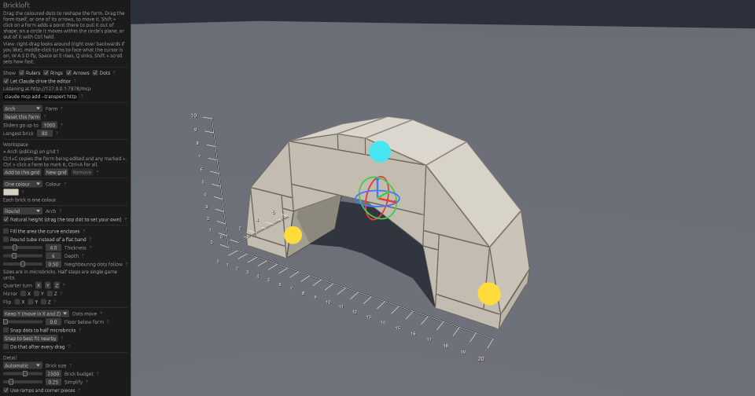

## Forms

| Form | Points | Options |
|---|---|---|
| **Arch** | two feet, and a height | Kind: round, pointed, triangular, elliptical, parabolic, catenary. Alt + click adds a point that pulls it out of shape (see [Added points](#added-points)). |
| **Circle** | a centre, and a radius | **Facing**: which axis it faces (Z is lying flat). Stretch within its plane makes an ellipse. |
| **Spline** | any number, passed through | **Closed loop** joins its end to its start. |
| **Bézier** | any number, pulled towards | A weight per point: how hard it pulls. |
| **Sphere** | a centre, and a radius | Solid or a hollow shell; stretch along each axis for an ellipsoid; keep the whole, a dome, or a segment between two heights. |
| **Revolve** | a profile, spun about the upright through its first point | Solid, or a shell along the profile. |
| **Pyramid** | the middle of its base | Half its base, stretch along x and y, height; solid or a hollow tent. |
| **Cube** | its middle, and a dot on each of its six sides | A size along each of x, y and z, in whole microbricks; solid or hollow (see [The cube](#the-cube)). |
| **Plant** | the foot of its trunk or stem | Kind: a pine, palm, oak or beech tree; a boxwood bush, a hedge or a hydrangea; a peony, a sunflower, a tulip, petunias, daisies or daffodils, or a bed of them mixed; a single flower (a rose, a water lily or a gerbera); a Scots pine, a date palm, a birch, a willow or a cherry in blossom; a cypress or a yucca; reeds; grass. Height, spread, three settings of its own and a seed (see [Plants](#plants)). |
| **Furniture** | its middle, and a dot on each of its six sides | Kind: a bookcase, cupboards, tables, seating, lights, a bed, plants in pots and pictures. Width, depth and height in whole microbricks; a style and a seed; and a few settings of each kind's own (see [Furniture](#furniture)). |
| **Maze** | the middle of its floor, a dot on its rim and one at the top of its walls | Kind: theta (rings) or grid (squares). Rings, ring gap, how the rings are divided, wall thickness and height, where the way in is, a floor, the way through marked, a seed; walls plain, patterned or hedge (see [Mazes](#mazes)). |
| **Imported** | its foot, and a dot at the end of its longest side | A mesh from a `.glb`, `.obj` or `.ply` file. Size, which way is up in the file, smoothed or in blocks, filled or a shell, loose pieces dropped, and its own colours (see [Meshes from files](#meshes-from-files)). |
| **Rule program** | the middle of its floor | A program from a list, or one imported from a file; the grid's size, the size of a cell, a seed, plain cells or wedges; and Play, Pause, Step and Restart to watch it grow (see [Rule programs](#rule-programs)). |

### The cube

A cube is a box of whole bricks, so it is built with no discrepancy and
from very few bricks: one if it is solid and no longer than the longest
brick. It starts 17 microbricks each way. Drag the dot on a side to move
that side in or out by whole microbricks. The opposite side stays where it
is, so a floor already laid against a wall stays against it. The yellow dot
in the middle moves the whole cube. **Size along X / Y / Z** in the panel
sets each length about the middle instead.

Made short along one axis, a cube is a rectangular floor or wall.
A texture from the **Texture** list (see [Patterns](#patterns)) is laid through the cube's
shortest length, so it shows on the largest face: the top of a floor, or
the face of a wall. When two lengths are equally short, the pattern goes
through the height before the depth, and through the depth before the
width. A cube 6 microbricks or more through its shortest length has a
tile pattern on its four sides too.

Unticking **Solid** makes the cube hollow, with walls as thick as **Wall
thickness** on all six sides. A hollow cube that is too short to have room
inside between two walls is open through its shortest length instead. That
gives a frame, such as the border of a rug or the surround of a window.

### Curves as bricks

An arch, circle, spline or Bézier is a curve, and is built one of three ways:

- **Flat band:** as thick as **Thickness** in the curve's plane and as deep
  as **Depth** across it. The default.
- **Round tube, Rounded:** a pipe, eight-sided in section, with its edges
  sloped. A circle built this way is a torus.
- **Round tube, Protruded:** flat bands of different widths side by side,
  smooth along the curve and stepped across it.

**Fill the area the curve encloses** fills a closed flat curve: a ring
becomes a disc, and a round-tube ring a disc with a rounded rim.

## Shaping a form

- **Drag a dot** to move a point or change a size. Dots snap to the grid.
- **Dots move** (in the panel) chooses the plane a dragged point moves in:
  facing the camera, or with x, y or z held still.
- **Ctrl + scroll** makes a circle, sphere, pyramid, cube, plant or piece
  of furniture larger or smaller. A cube keeps its proportions as nearly
  as whole microbricks allow, and so does furniture.
- **Stretch** scales a form along each axis, up to 1000 times.
- **Flip** mirrors the finished bricks along x, y or z: a dome becomes a bowl.
- **Quarter turn X / Y / Z** turns the form a quarter turn within its grid.
  It is the same bricks facing another way, so a pyramid can lie on its side.
- **Neighbouring dots follow** sets how much of a dragged dot's movement the
  dots near it share, from 0 (it moves alone) to 1.
- **Snap to best fit nearby** tries each dot a whole microbrick either way
  (and half a microbrick too when **Snap dots to half microbricks** is on),
  and each size half a microbrick and a whole one either way, and keeps
  whatever fits closest, with a progress bar in the top right. **Do that after every drag** does it automatically.
- **Reset this form** puts its dots, sizes, stretch, flips and mirrors back
  to how the form starts.

### Added points

**Alt + click** on any form adds an orange point there. Dragging it pulls
that part of the form out of shape; the form around it follows by less the
further off it is, out to **Reach of added points**.

- On a curve the point takes hold of the curve, and the reach is measured
  along it. On a circle it moves within the circle's plane; hold **Ctrl** to
  move it straight out of the plane instead.
- On a revolve it pulls the profile, so the form is wider or narrower all
  the way round at that height.
- On a sphere or pyramid it takes hold of the surface where you clicked.

The form keeps its own points and sizes, so a pulled circle is still a
circle whose radius can be changed. **Alt + right-click** an orange point
to take it off, or use **Remove the last added point**. Up to 12 per form.

### Mirror

**Mirror X / Y / Z** makes the form its own mirror image along that axis,
about the middle of its points. The low side is kept and the high side
becomes its image. An arch with one foot higher than the other gets two
feet alike. A point added on either side appears on both.

## The workspace

Several forms can be worked on together. The editor opens with one cube.

- **Click a form** in the view, or its line in the list, to edit it.
- **Drag a form by its bricks** to move it. It moves one unit at a time and
  stays the same bricks wherever it stands.
- Forms on the same grid are kept clear of each other: one dragged into
  another stops beside it or comes to rest on top of it, and one reshaped
  until it reaches another pushes that one away.
- **Ctrl + drag a form** to move it into another form on
  its grid and join the two into one build (see [Joining forms](#joining-forms)).
- **Delete** removes the form being edited. **Ctrl+Z** and **Ctrl+Y** undo
  and redo.

### Joining forms

The form being edited, dragged with **Ctrl** held, goes where it is
dragged, into other forms if that is where, so a tower can be sunk into a
wall or a dome set into a roof. The moved form is then joined to the others
on its grid: the forms become one build, with no two bricks overlapping,
which the game would refuse.

Where the two surfaces meet, the bricks are fitted afresh to the two forms
as one solid, so the seam has no notch in it. Away from the seam each form
keeps its own bricks. Deep inside, where blocks of one form overlap blocks
of another, the joined form's are cut back to the cells that are free.

A joined form has a **Blend** slider, from 0 to 6 microbricks.

| Blend | The seam |
|---|---|
| 0 | a sharp crease, as if the forms were carved from one piece |
| above 0 | a rounded fillet that reaches that many microbricks along each form from where they meet |

The join is fitted a microbrick at a time and then laid with stretched
ramps and corner pieces wherever one lies closer to the joined surface, so
most single wedges standing alone are gone. It is still rougher than a
sphere's own facets, because its bricks are chosen one at a time and do not
meet edge to edge as a sphere's do
([algorithm.md](algorithm.md), "Where it falls short").

A joined form stands a whole number of microbricks from the form it joins,
because the two can be fitted as one only if their bricks line up. A drag
with Ctrl therefore moves a whole microbrick at a time, and a form joined
half a microbrick off in any other way is moved by that half, with a note
over the view. Forms built at one **Brick size** above 1 are lined up to
whole bricks of that size, and are then joined in bricks of that size.

Two kinds of form are joined by cutting alone, with a notch a microbrick
or two deep where a sloped brick had to be left out, and the blend does
nothing to them: a form laid as a pattern, and a plant. The panel says so
under the slider.

#### Cutting a form out of another

A joined form has a tick box, **Cut out of what it joins**. Ticked, the
form is taken away from the forms it is joined to and none of its own
bricks are built: a cube through a wall is a window, and a bar through a
sphere is a hole. The form is drawn as red glass, fainter when it is not
the form being edited, so that it can still be seen, clicked and dragged.
**Blend** then rounds the rim of the hole. A form that is cut out cuts
every form on its grid that it reaches, joined or not, patterns and plants
included.

| Blend | The hole |
|---|---|
| 0 | sharp edges, as if cut with a knife |
| above 0 | a rim rounded for that many microbricks along the hole and along the form it is in |

The walls of a hole are fitted a microbrick at a time, so a round hole is
rougher inside than the same form is outside. A square one through a wall
is blocks and nothing else.

A joined form stays where it is when a form it sits in is reshaped, where
an unjoined one would be pushed clear. Dragging it again without Ctrl sets
it clear of the others. The join, its blend and whether it is cut out are
part of the form, so undo, a save and a copy all keep them.

Ctrl can also be pressed after the drag has begun.

### Grids

The game keeps bricks on grids. The world has one, and any other grid can
stand at any angle and pass through the others. Every form in the workspace
is on a numbered grid, shown in the list.

| Button | What it does |
|---|---|
| **Add to this grid** | a new cube on the same grid, in the plain colour: kept clear of the others on it, and turned and moved with them |
| **New grid** | a new cube on a grid of its own |
| **Duplicate** (or **Ctrl+D**) | a copy of the form being edited on its grid, in the same colours, set down beside it |

A new form always starts as a cube, whatever was being edited. Choose
another kind from **Form**, or drag the cube's sides to make a floor or a
wall.

An arch whose two feet differ along both X and Y stands at an angle to its
grid. It cannot be fitted smoothly there, and the panel says so. **Turn its
grid to line it up** gives the arch a grid of its own, turned so that the
arch runs straight along it, and leaves its feet where they are. The arch
is then fitted as smoothly as any other. An arch from one of the reports
this was written for went from 199 bricks to 31.

The rings stand at the middle of everything on the grid being edited. The
arrows stand at the middle of the forms they move: the form being edited and
any on its grid picked with it (Shift + click).

- **Drag an arrow** to move those forms along that axis, a unit at a time.
  They stop short of the forms left behind, unless Ctrl is held to join
  them. On a grid at an angle they move along the grid's own axis of that
  colour, which is not quite the way the arrow points.
- With every form on the grid picked, or one form alone on it, the arrow
  moves the whole grid. A level grid moves a unit at a time; a grid at an
  angle moves freely.
- **Drag a ring** round to turn the whole grid about that axis, by any
  angle, in whole degrees.
- **Level the grid** puts a turned grid back on the world's.

A level grid is the world's own and is copied as ordinary bricks. A grid at
an angle is copied as a grid of its own, frozen in place.

### Copy and paste

| Key | What it does |
|---|---|
| **Ctrl+C** | copies the form being edited, and any others marked `+`, as a Brickadia prefab (`brickloft-build.brz`) on the clipboard |
| **Shift + click** another form | picks it as well as the one being edited (it is marked `+`), or lets it go |
| **Ctrl+A** | marks every form |
| **Ctrl+V** | adds the forms of a copied prefab back to the workspace, as forms that can still be reshaped, on the grid being worked on |
| **Ctrl+D** | duplicates the form being edited, as **Duplicate** does, without using the clipboard |

The prefab carries each form's bricks, colours, place and grid, and, in its
description, the settings each form was made from. That is how a paste back
into the editor gives forms and not a fixed lump of bricks. A `.brz` made
elsewhere is refused with a message saying why: bricks alone cannot be
turned back into a form.

A short notice at the top of the view confirms a copy or paste and fades.
A failure shows a message that has to be closed (Enter or Escape will do).

### Saved forms

**Save** under **Saved forms** keeps the whole workspace: every form, with
its colours (up to 32), where it stands and the grid it is on. Saves are kept in
folders (`arches`, `domes`, or your own) under `Documents/brickloft/forms`
in your home folder, the same on Windows, macOS and Linux.

A save is a Brickadia prefab file (`.brz`), the same file Ctrl+C makes, so
the game can load it as it stands. The file holds the bricks and, in its
description, the forms they were fitted to, which is why it opens again as
forms that can still be reshaped.

**Open** puts a save in place of the whole workspace, and Ctrl+Z brings the
workspace back. **Add** adds the save's forms beside the form being edited
and on its grid, as a paste does. Dragging a save from the list onto the
view adds it too. **Go to folder** opens the chosen folder in your file
manager, where each save is a `.brz` file. **Delete** removes a save from disk after asking you to
confirm (Enter deletes, Escape cancels), since Ctrl+Z cannot bring a deleted file back. Saves made by earlier versions, which were text files of
one form's settings, are still listed and opened.

## Patterns

**Texture**, the tinted box under the settings every form shares, lays a
cube or any curve as a pattern in
place of plain brick. The list starts at **none**, and a form has one
pattern at most. A cube made short one way gives a rectangular floor or
wall, a filled circle a round one, and a curved band a path. How each
pattern is made, and why that way, is in [algorithm.md](algorithm.md),
sections 7.8 and 7.9.

| Texture | What it lays |
|---|---|
| **stepping stones** | separate stones of any shape with gaps between them. With **Gap** at 0 the stones are fitted together, as in a paved floor. |
| **medallions** | a few ringed figures repeated over the whole floor |
| **rug** | a Persian carpet: nested borders, a lobed medallion with pendants, corner pieces, and scrolling stems with flowers and leaves |
| **planks** | a floor of boards |
| **bricks** | courses of bricks, every one a rectangle, with or without mortar, and with their tops bevelled if you like |
| **cobblestone** | stones of any shape fitted together, with or without mortar |

 

 

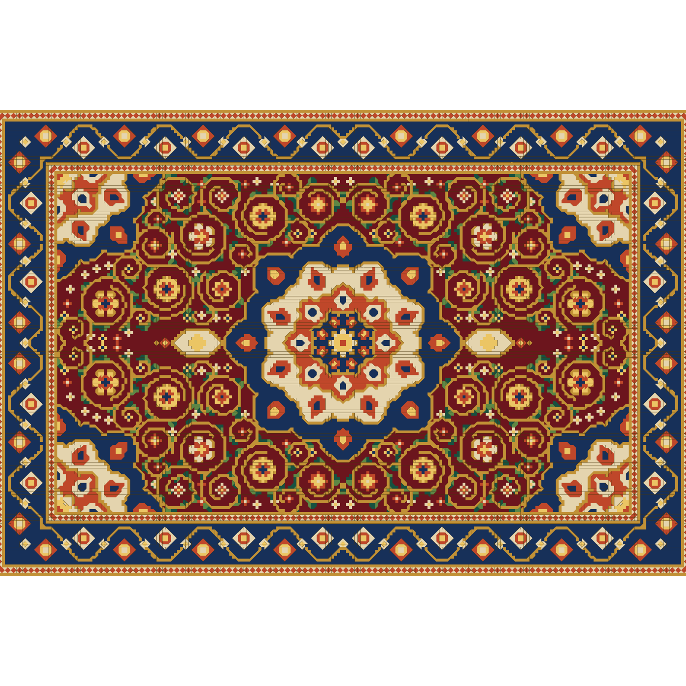

  

### Where a pattern is laid

Stepping stones need a flat form: a floor or wall made from a cube, a
flat band or a filled outline. They follow the curve, so a spline drawn across the ground
becomes a winding stone path as wide as the band's **Thickness**. Stones
fitted together with the gap at 0 share their edges: the two stones either
side of an edge are laid to the same straight line, with sharp corners
where three meet. Slivers can remain at the rim of the floor and along an
edge that is nearly level.

The other five patterns are made of tiles one microbrick across. A tile is
one colour, or it is cut along a diagonal into two triangles of two
colours. A tile pattern colours a form and never reshapes it. The form is
fitted exactly as it would be with no pattern, and its bricks then take
the pattern's colours. The sloped bricks along the form's edge stay where
they are, and each takes the pattern's colour at its middle.

| The form | Where the tiles go |
|---|---|
| flat: a cube, a flat band, a filled outline | through the form, so the pattern shows on both of its faces |
| flat in part: a disc with a rounded rim, a round tube broad enough to have a flat top | on the flat part. The rest keeps its bricks, in the pattern's first colour. |
| a box 6 microbricks or more through its shortest length | on its four sides as well, one microbrick deep |

 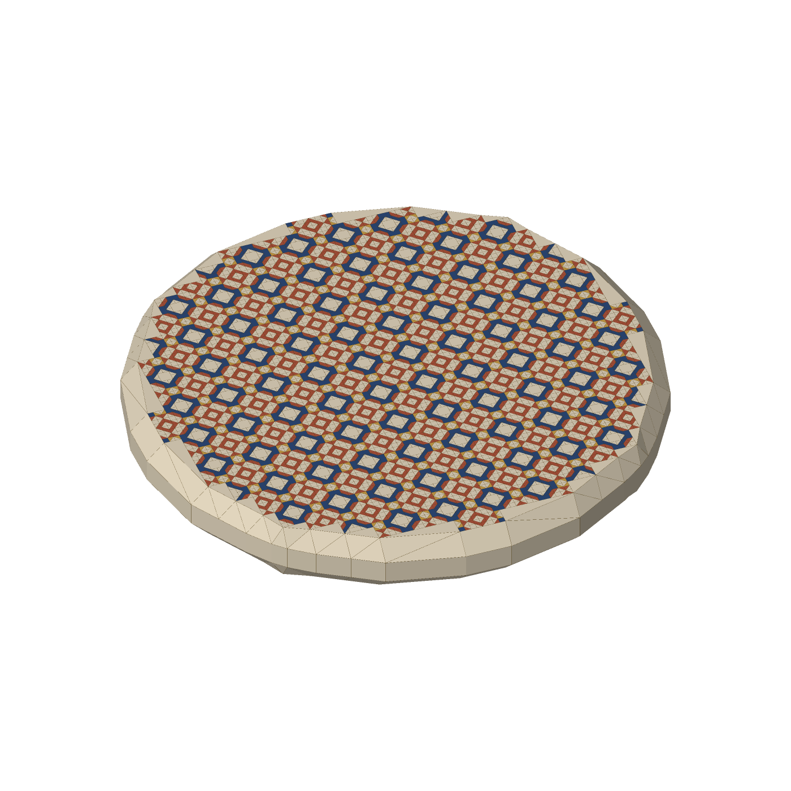

A side takes the pattern only where it is a flat face. The rim of a disc
is a curve built of short flat steps, so it stays plain.

Medallions and the rug are their own mirror images and are set out from
the middle of the floor.

A tile pattern is laid at single microbricks whatever the **Brick
budget** says, because a tile is one brick and a pattern's detail is its
brick count. A rug 240 by 160 is some twenty thousand bricks, and held to
a budget of 2,500 it was built three times coarser, with every flower a
blot. Make the form larger for more detail, or set a **Brick size** by
name for less.

A rug wants a large floor. Its parts are drawn afresh for the size it is
given, and it shows all of them from about 100 microbricks across. The
picture above is 240 by 160. Under 48 microbricks on its shorter side it is
set out as a small rug: single lines for guards, a border of whole
lozenges with a star in each corner, the corners of the field cut off on
the diagonal, and a medallion of one or two layers. Nothing on it is cut
short.

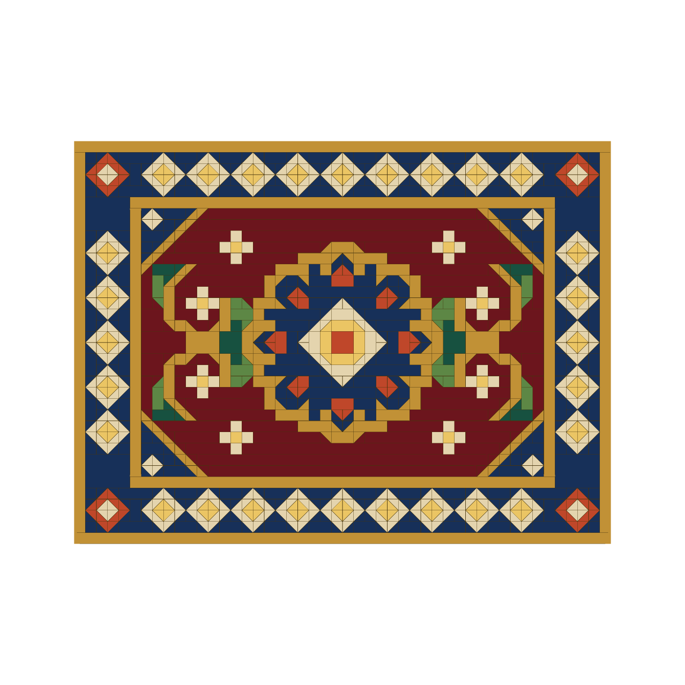

### The settings of a pattern

Each pattern shows the settings it has a use for.

| Setting | Patterns | What it does |
|---|---|---|
| **Stone size** | stepping stones | about how far apart the middles of neighbouring stones are, from 3 microbricks. A stone is a little under this across. |
| **Gap** | stepping stones | how wide the space between stones is, 0 to 8 microbricks. 0 fits them together. |
| **Uneven** | stepping stones | 0 for stones as alike as scattered stones can be, 1 for small ones crowded among large |
| **Size** | planks, bricks, cobblestone | how large the boards, bricks or cobbles are, 1 to 8. 2 is the usual size, 1 half of it and 4 twice. |
| **Uneven along** | bricks, cobblestone | how unlike one another the pieces are along the courses, 0 to 100%. For bricks it moves the joints, so the bricks differ in length and stay rectangles. For cobblestone it moves each stone from side to side. |
| **Uneven across** | bricks, cobblestone | the same across the courses. For bricks it moves the lines between courses, so the courses differ in depth. For cobblestone it moves each stone up and down. |
| **Mortar between** | bricks, cobblestone | a microbrick of mortar between one piece and the next. Without it the pieces touch and are told apart by their shades alone, so give the pattern several colours. |
| **Bevelled** | bricks | slopes the top microbrick of every brick down to its edge, all round it |
| **Grooved** | planks of **Size** 3 or more | slopes the last microbrick of every row of boards down to the next row, so each row stands one microbrick proud of the one beside it |
| **Mortar sunk** | cobblestone with mortar | lays the mortar one microbrick below the stones |
| **Uneven stagger** | bricks | moves each course along by an amount of its own, so the upright joints fall anywhere. Untick it to set one **Stagger** for every course. |
| **Stagger** | bricks | how far each course is moved along from the one before, 0 to 50% of a brick's length. 50% is the usual half-brick bond and 0% stacks the bricks in columns. |
| **Courses upright** | bricks | runs the courses up the floor instead of across it, so the bricks stand on end |
| **Border** | medallions, rug | how many microbricks of plain ground are left round the edge, 0 to 6 |
| **Seed** | all | which one of the pattern: each whole number is a different one. **Another** takes the next number and the next of the pattern's sets of colours. |

Bricks start all alike, with both **Uneven** settings at 0% and an uneven
stagger. Cobblestone starts at 60% both ways, because cobbles all alike
are a grid of squares. At the usual **Size** of 2 a course of bricks is 3
microbricks deep, which leaves the lines between courses one microbrick
to move, so **Uneven across** changes nothing below about 60%. A larger
**Size** gives it room.

**Bevelled** is real depth. The top microbrick of each brick is built of
a sloped brick along each side and a hipped one at each corner, with the
mortar at the foot of the slope. The sloped pieces along a side are joined
into one long brick, so the top of a brick is nine bricks: four slopes,
four corners and a block between them. The bevel needs a form 2 microbricks or more deep and does nothing to a
shallower one. It is cut into one face only, the top of a floor, and the
sides of a box are laid flat. Cobblestone has no bevel, because a
cobble's sides run at any angle and no brick slopes along them cleanly.

**Grooved** and **Mortar sunk** are the depth planks and cobblestone have.
Both are off to begin with, one microbrick deep, and cut into the top of a
form 2 microbricks or more deep. Grooved planks are whole microbricks and
one long ramp to each board. The setting is offered from **Size** 3,
because a narrower board would be half ramp and the floor would look
ribbed. Sunk mortar is whole microbricks only: the stones keep their top
microbrick and the mortar does not.

 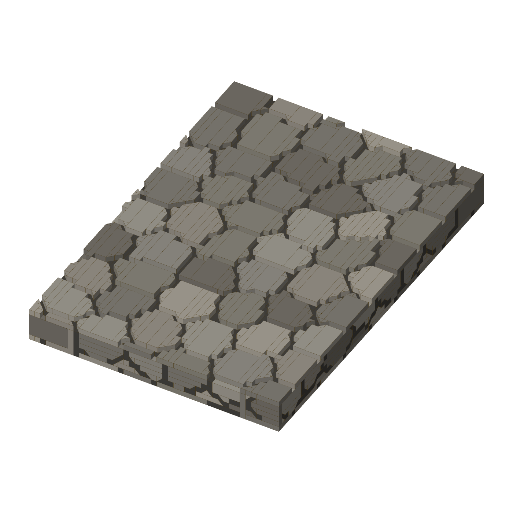

### The colours of a pattern

Choosing a pattern sets the form's colouring to **As the pattern has it**
and brings in colours the pattern starts with: a rug's reds and blues, a
floor of planks' browns. Colours you have set yourself for a pattern are
kept when you change to another pattern. **Another** always moves to the
pattern's next set of colours.

A pattern numbers its parts, and the colours are shared among the parts.
The first colour is the ground, or the mortar of bricks and cobblestone,
and it is used for nothing else. The other colours go to the pattern's parts in turn.
With two colours the whole pattern is one colour on the other. Each colour
you add with **+** picks one more part out, up to eight colours.

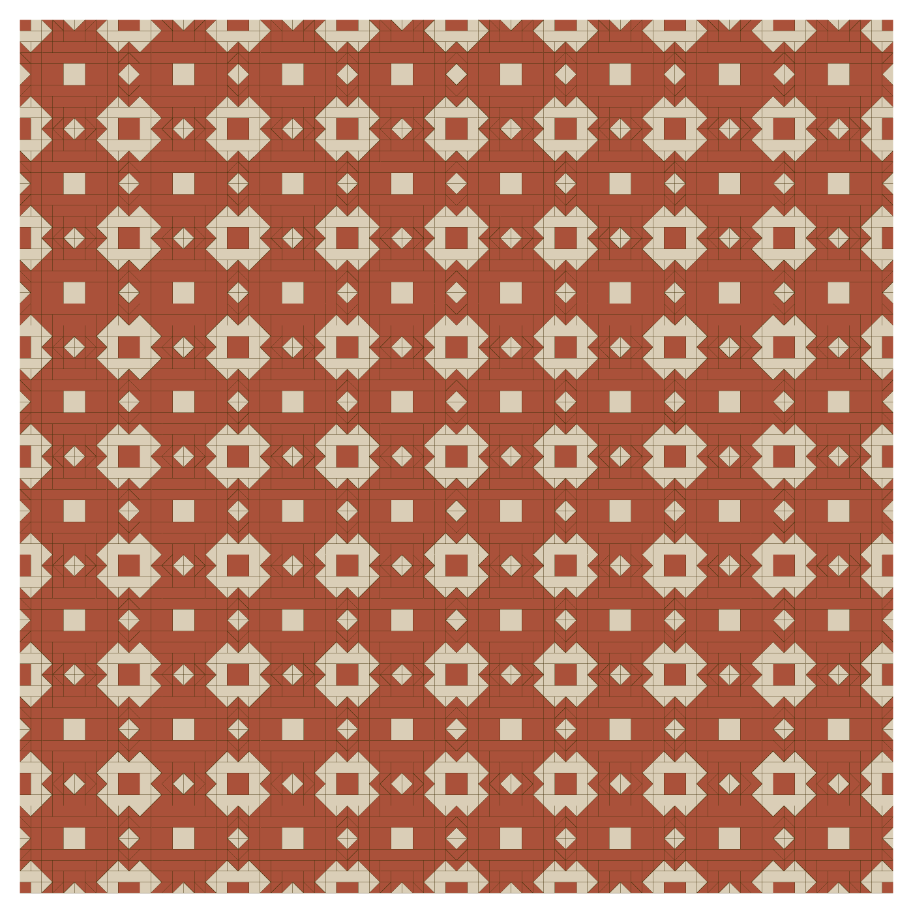 

The rug needs all eight of its colours. Its numbers are tones (lines, a
dark ground, a pale ground, petals, leaves, shade, hearts) that come back
in every part, so with two or three colours its border and medallion turn
into solid blocks.

Planks and stepping stones have no ground. Each board or stone takes one of
the colours, and the sets they start with are shades of one wood or one
stone.

An **arch** can be built as clipped hedge: choose **hedge** in its
**Texture** list. Its band is then the Plant form's hedge, with tufts of
leaves over every face, inside the opening as well as outside, light on
top and dark underneath, on stems at its two feet. **Density**,
**Looseness**, **Berries** and a seed appear under the list, and it comes
in the hedge's sets of colours. The opening keeps the plain arch's shape:
the leaves stand into it by one microbrick at the most. A hedge is at
least 6 microbricks thick, so a thinner or shallower arch is built 6 by
6, and the panel says so. **Filled** has no effect on an arch of hedge.
An arch 60 across is about 5,000 bricks.

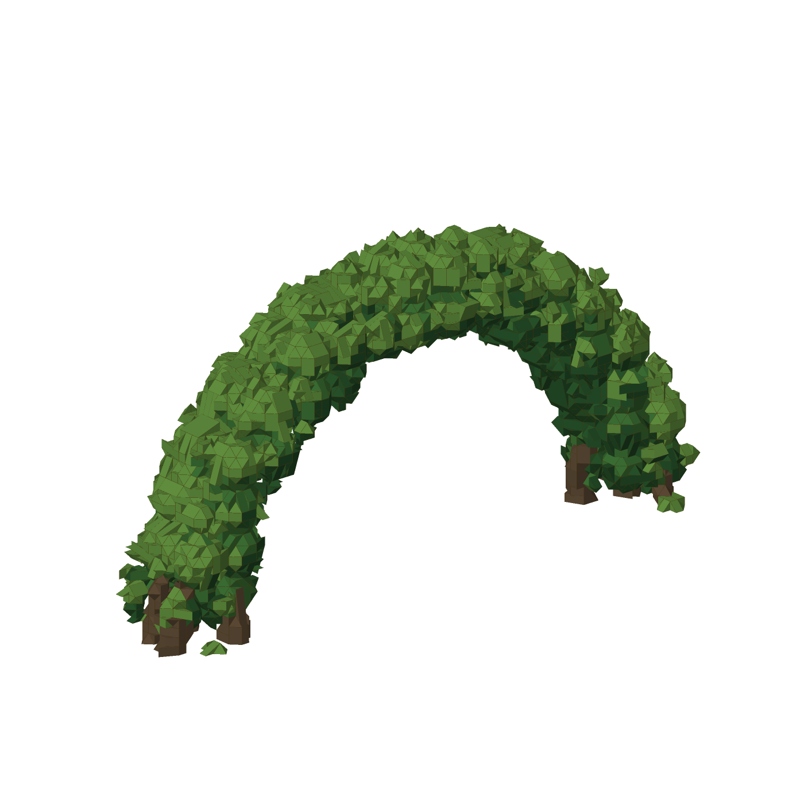 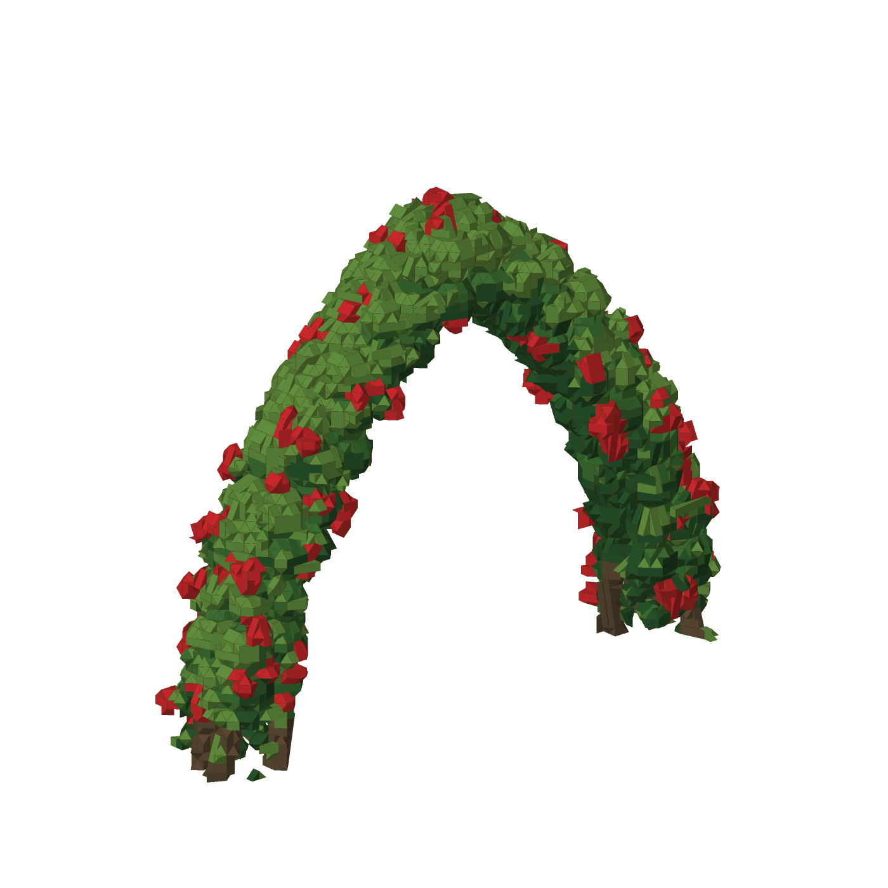

## Plants

**Plant** grows a tree, a bush or a flower: a pine, a palm or an oak; a
beech; a boxwood bush, a hedge or a hydrangea; peonies, sunflowers,
tulips or petunias; a stand of reeds. They are one form with a
**Kind** because they are set and coloured the same way: a height, a
spread, three settings and a seed. Each kind is grown by a method of its
own, from the facts of how that plant grows: how they are made is in
[algorithm.md](algorithm.md), section 7.10.

 

| Kind | What it is |
|---|---|
| **Pine** | a spruce, the Christmas tree: a straight stem with tiers of drooping boughs that shorten to one pointed leader, each bough a flat spray of side shoots |
| **Palm** | a coconut palm: a slender, ringed, eight-sided trunk, swollen at the foot, that leans and curves upright, and one crown of arching fronds with a row of leaflets down each side |
| **Oak** | an oak grown in the open: a short thick trunk, flared at the foot, dividing into heavy crooked limbs that spread wide and fork again and again, with leaves in separate masses at the ends of the branches |
| **Boxwood bush** | a dense rounded evergreen: a closed, lumpy mound of leaves on several short stems |
| **Beech tree** | a smooth grey trunk carrying on up through a tall, dense, oval crown of flat layers of leaves |
| **Hedge** | the boxwood clipped to a wall that follows a line you shape, a little narrower at the top, with stems showing at its foot |
| **Hydrangea** | a rounded bush of broad leaves carrying domed heads of small four-parted florets |
| **Peony** | a clump of leafy stems each with one bloom of many layered petals, which opens from a round bud to a full bowl |
| **Petunias** | a low mound of leaves covered in funnel-shaped flowers with darker throats, which can trail along the ground |
| **Reeds** | a stand of bulrushes with brown heads, or of plumed common reed, with long flopping leaves |
| **Sunflower** | a stout stem with heart-shaped leaves and a nodding head: a disc of seeds set by the golden angle, ringed with two rows of petals |
| **Tulip** | a cup of six petals in two rings on a bare stem, with strap-shaped leaves from the ground |
| **Single flower** | one large bloom with no plant under it, to set down as a centrepiece: a rose, a water lily or a gerbera, facing whichever way it is tilted and turned |

 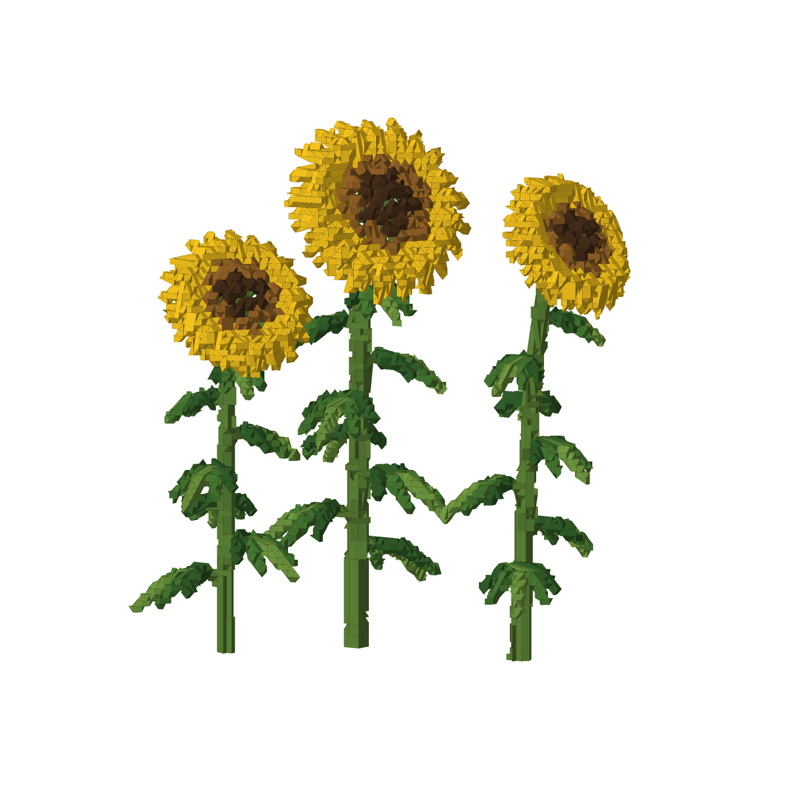

Every tree has a **Height** and a **Spread** (a palm's is its **Frond
length**), which the dot at its top and the dot at its side set too. Three
more settings mean something different for each kind.

| Kind | A number | How full, 0 to 100% | How bent, 0 to 100% | Extras |
|---|---|---|---|---|
| Pine | **Tiers of boughs**, 4 to 40 | **Fullness**: more boughs, wider sprays | **Droop** of the boughs | **A star and baubles** |
| Palm | **Fronds**, 5 to 40 | **Leaflet length** | **Lean** of the trunk | **Coconuts** |
| Oak | **Main limbs**, 2 to 7 | **Foliage**: larger masses of leaves, less sky | **Gnarl**: how crooked the limbs are | **Bare** |
| Boxwood | **Stems**, 2 to 12 | **Density** of the canopy | **Looseness** of its outline | **Berries** |
| Beech | **Main limbs**, 3 to 9 | **Foliage** | **Crookedness** | **Bare** |
| Hedge | **Plants along it**, 1 to 40 | **Density** | **Looseness**: clipped to grown out | **Berries** |
| Hydrangea | **Flower heads**, 1 to 24 | **Leaves** | **Looseness** | none |
| Peony | **Stems in the clump**, 1 to 9 | **Petals and leaves** | **How open the bloom is**: bud to full blown | none |
| Petunias | **Flowers**, 3 to 80 | **Leaves** | **How far it trails** | none |
| Reeds | **Stems**, 1 to 120 | **Leaves** | **Sway** | **Feathery plumes** |
| Grass | **Water stands this far below it**, 0 to 40 | **How thick it grows** | **Lean** of the blades | none |
| Birch, Willow, Scots pine | **Main limbs**, 3 to 9 | **Foliage** | **Crookedness** | **Bare** |
| Cherry | **Main limbs**, 3 to 9 | **Blossom** | **Crookedness** | **Bare**, and **Fallen petals on the ground** |
| Date palm | **Fronds**, 8 to 60 | **Leaflet length** | **Lean** | **Dates** |
| Cypress | none | **Density** | **Looseness** | none |
| Yucca | **Blades**, 8 to 80 | **Blade width** | **Bend of the blades** | **In flower** |
| Daisies, Daffodils | **Flowers in the clump**, 1 to 20 | **Leaves** | not used | none |
| Bed of mixed flowers | **Flowers**, 2 to 40 | **Leaves** | **Unevenness** | none |
| Sunflower | **Flowers in the clump**, 1 to 12 | **Petal and leaf size** | **Nod of the head** | none |
| Tulip | **Flowers in the clump**, 1 to 12 | **Leaf size** | **How open the cup is** | none |
| Single flower | none | **Petals** | **How open it is**: a closed bud to full blown | **Sepals under it** |

A pine is dressed as a Christmas tree with **Star**, **Baubles** (how
many, 0 for none), **Tinsel** (a garland wound round it, as tight to
the stem or as far out among the boughs as **How far out the tinsel
hangs** says) and **Lights**
(none, a string of lights, or candles on the ends of its boughs; 40 at
most). In the game the star, baubles and tinsel are the metallic
material and each light is a glowing brick with a small warm point light
on it. **Lights shine in the game** unticked keeps the glowing bricks
without the lights, which cost the game something to draw. The editor's
view shows metal and lights as plain coloured bricks. A pine saved with
the old **A star and baubles** ticked opens with all of them on.

Every tree (pine, palm, date palm, oak, beech, birch, willow, Scots pine,
cypress, cherry) also has **Trunk width**, from 50% to 200% of what is
usual for its kind and height. The limbs are thicker or thinner with the
trunk. Bushes and flowers do not have it: their stems are already the
thinnest bricks can show.

A flower's **Spread** is half the width of its head, cup or bloom, and a
clump is as many flowers as you ask for, each its own height.

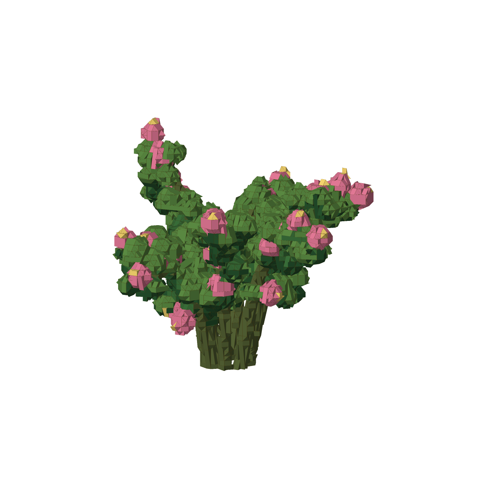 

A **Single flower** is one bloom, 48 microbricks across when full blown,
with settings of its own.

| Setting | What it does |
|---|---|
| **Flower** | A rose (a high-centred double rose: a furled heart, cupped petals in two tones, outer petals with rolled lips), a water lily (a star of pointed petals round yellow stamens) or a gerbera (two rows of rays round a disc). |
| **Petals** | How many: 10 to 30 for a rose, 14 to 36 for a water lily, 13, 21 or 34 rays in each row of a gerbera. |
| **How open it is** | From a closed bud, its outer petals wrapped over the inner, through half open to full blown. |
| **Tilt** | 0 to 90 degrees from facing straight up. At 90 the bloom lies on its side. |
| **Turn** | 0 to 359 degrees: which way round it is tipped. With no tilt it turns the bloom about its own middle. |
| **Sepals under it** | The green under the bloom: a rose's five sepals, which lie against the bud and turn back as it opens, a water lily's four, or a gerbera's bracts. |
| **A short length of stem** | For a cut flower laid down. |
| **Fallen petals beside it** | Three to five loose petals on the floor, on the side the bloom faces. |

**Spread** is half the bloom's width when full blown, and a bud of the
same spread is a third as wide. **Height** is how deep the bloom is. The
tilt and turn are grown into the bloom, so its bricks stay on the grid,
and it is set down on whatever part of it is lowest: it never sinks
below the floor of its point. Use them to lay a rose on a table at a
slant. The form's own quarter turns and a turned grid still apply on top
of them. Its colour sets are red, pink, white, yellow and cream edged
with red, and choosing a flower changes to the set that flower starts in
(a red rose, a white water lily, a yellow gerbera) unless you have
picked another. With **Leaves can be walked through in the game**
ticked, its petals and sepals are walked through and its stem is solid.

 

A hedge, a stand of reeds and a patch of grass lie along a line. They
start with three yellow dots in a row: drag an end to lengthen it and the
middle one aside to bend it. **Sharp corners at its dots** runs it
straight from dot to dot with a corner at each, and reeds inside a closed
line fill it. Alt + click on a hedge or reeds adds a point
that bends it further, and **Closed loop** joins a line of three or more
points into a ring. The thickness is its own setting, with a dot out to
one side of the line, and changing it leaves the length alone.

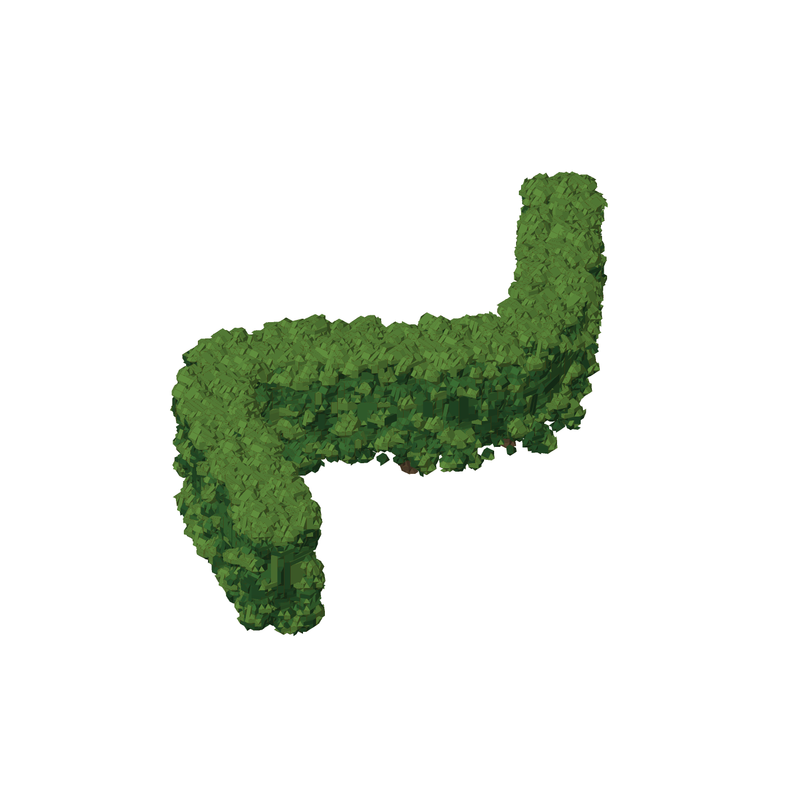 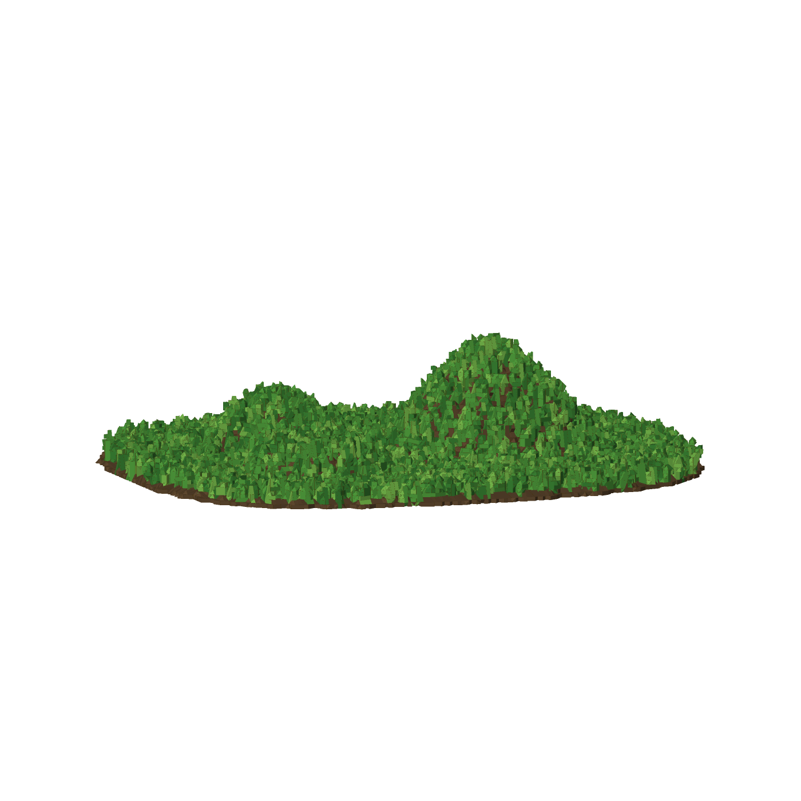

**Grass** is a thin surface: blades over a skin of soil. Open, it is a
strip **Reach to each side** wide along its line; closed, it fills its
outline. Its **Height** is the length of its blades. Its ground is shaped
with a brush:

- Choose **Push up**, **Push down** or **Flatten**, a **Range** and an
  **Intensity**, then Alt + click on the grass. Each click is one touch.
- A touch leaves an orange dot. Drag it up or down to change how far it
  pushes, or the level it flattens to. Alt + right-click takes it off.
- The panel's sliders change the touch made or dragged last. **Next**
  steps through the touches, and **New touches only** leaves them alone.
- Flatten brings the ground to the height it has where you click.
- Keep the button down after Alt + click and hold Ctrl to paint a stroke:
  the same touch is made again every 0.4 of its range as you move.
- A patch takes 240 touches.
- **Push down** goes below the lawn's own level. A hollow deeper than
  **Water stands this far below it** is a pond: the grass thins at its
  bank, then sand, then the pond's bed with a few stones, and water to
  the level. **Reeds round the water** sets how thickly reeds stand at
  its margin. Set the water to 0 for a dry hollow. A patch with a pond
  reaches below the floor it was laid on by the pond's depth, so raise it
  or set it on ground that deep.
- **Pond levels** at 2 lets water stand at two heights. Push up a hill,
  push a hollow down into its top, and dig another hollow beside the
  hill: the hollow on the hill holds a pond of its own, as far below its
  rim as the lower pond is below the lawn, and a stream steps down from
  it to the lower pond in flat reaches. Which pond is the high one
  follows the ground, and no height is typed. All high ponds share the
  height of the lowest of them. A high pond with no lower water it can
  run down to has no stream. A stream is frozen with the ponds.
- The view draws water see-through, so the basin shows under it.

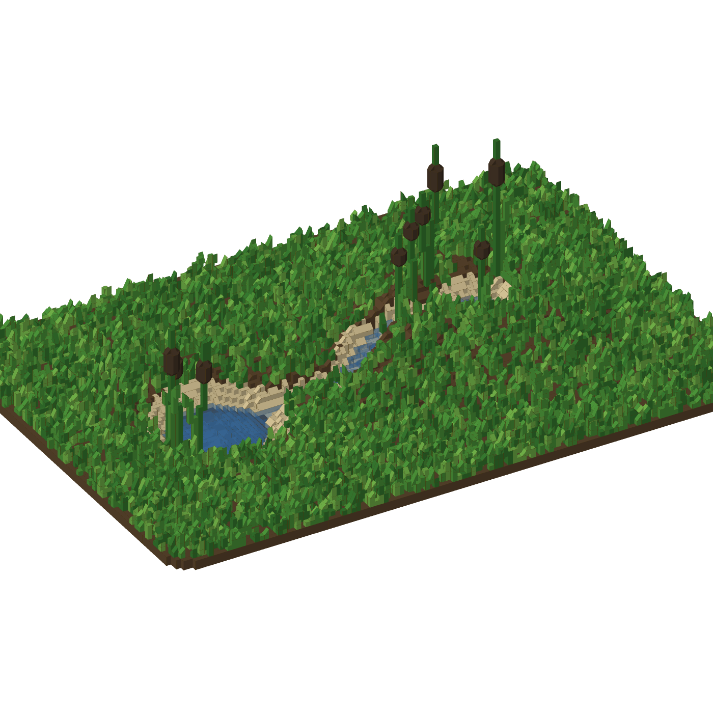

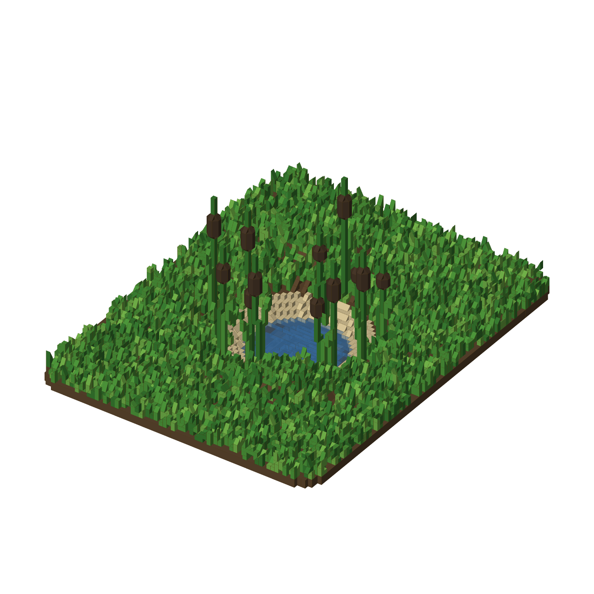

**Frozen pond** writes the water as ice: collision on, and less
see-through. Choosing the **Winter** colours ticks it and any other set
unticks it; grass also has an **Autumn** set. On every other plant,
**Leaves can be walked through in the game** writes its greenery (leaves,
needles, fronds, petals, berries, baubles) with collision off and leaves
its wood solid; it is unticked to begin with.

**Blades can be walked through in the game** writes the blades with their
collision off, so a player walks through the grass and stands on the
soil. Untick it for solid blades. Grass that has been turned or flipped is
written solid.

**Bare** shows an oak or a beech without its leaves, with twigs carried
on from every branch end. It is the same tree as in leaf. **Berries** on
a boxwood or hedge take the seventh colour of its set.

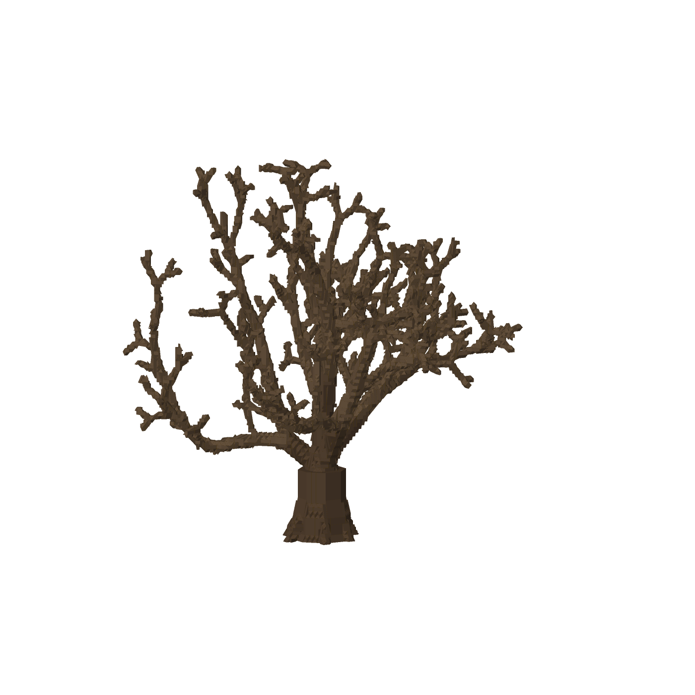 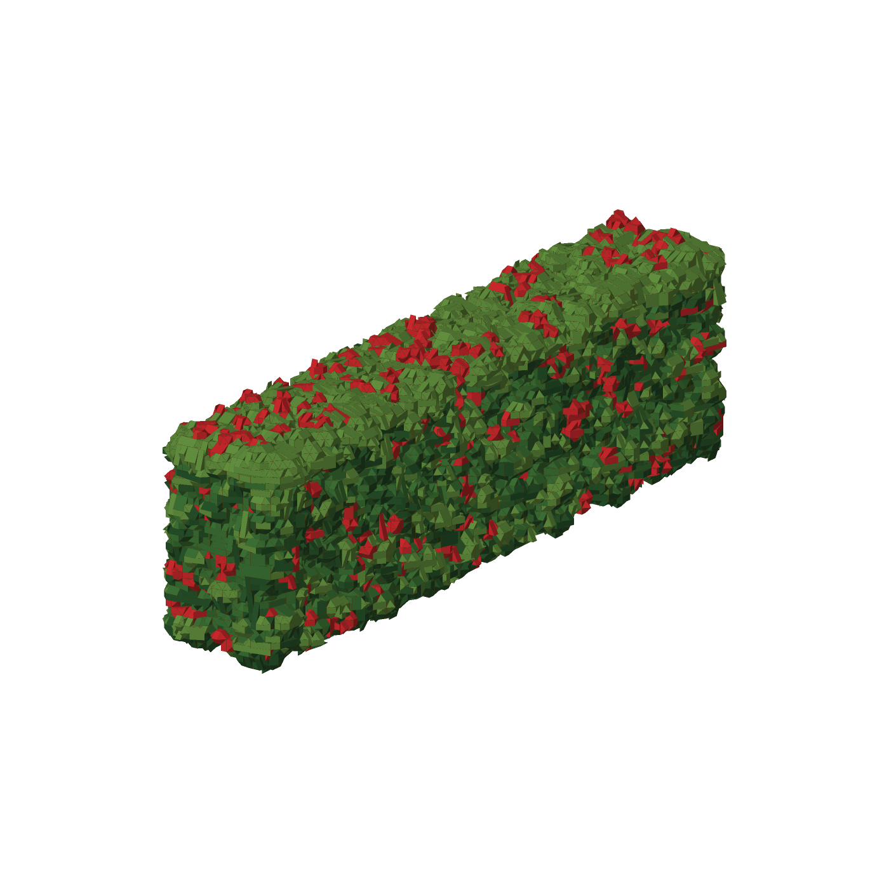

**Seed** is which plant of its kind: any whole number, each a different
one, and the same number is always the same plant. **Another** takes the
next number. The height, spread and other settings change the tree a seed
gives without making it a different tree.

**Colours** offers each kind's sets of colours: for a pine spruce green,
under snow, blue spruce and in frost; for a palm three; for an oak summer,
early autumn, late autumn and spring; for a peony pink, deep red, white, coral and blush; for a single flower red, pink, white, yellow and cream edged with red; for a hydrangea blue,
pink, white and blue running to pink; for a tulip six, one of them flamed. A tree is coloured **As the pattern
has it**, with a colour for each of its parts: the trunk, leaves, leaves
in shade, new growth, limbs, the top of a pine's boughs or the rib of a
frond or a flower's petals, and two for the extras, the blooms or the
seeds and heart of a flower. Change any of the eight under
[Colour](#colour) to make a set of your own. Under snow, the white is the
colour for the tops of the boughs.

A plant starts large, a pine 140 microbricks tall and a sunflower 90,
because its shoots, leaflets and petals are two microbricks thick at any
size and a small one has room for little else. At that size a tree is
17,000 to 40,000 bricks and a bush or a clump of flowers 6,000 to 9,000. A
tree builds in about a fifth of a second on a desktop's cores and in up to
a second on one core or in the browser. **Brick size**
left on **Automatic** builds a plant at 1 microbrick, whatever the
budget. A plant too large to be built at 1 microbrick is built at the
finest brick size that fits, so the **Height** slider never stops
short. A tree can be turned, flipped, moved, joined to other forms and
put on a grid of its own like any form. It cannot be mirrored and takes no
added points.

## Furniture

**Furniture** builds a piece of furniture from boards and boxes: a
bookcase, described first, and twenty-six other kinds, described under
[The other kinds](#the-other-kinds). A bookcase is laid out from its size and not
fitted to a shape, so it has no discrepancy at any size and is built at
once. How it is made is in [algorithm.md](algorithm.md), section 7.12.

 

A bookcase has a dot on each of its six sides, as a cube has, and a
**Width**, a **Depth** and a **Height** in whole microbricks. Dragging a
side or moving a slider builds it again: a taller bookcase gains shelves, a
wider one gains uprights, and the books are set out again on the shelves
that changed size. The width and depth sliders change it about its middle
and the height slider at its top, so it stays on the floor. Its front is on
the low Y side, and a quarter turn about Z faces it another way.

| Setting | What it does |
|---|---|
| **Board thickness** | How thick the sides, top, shelves and uprights are, 1 to 8 microbricks. Boards are made thinner on a small bookcase: no thicker than a twelfth of its width or height. |
| **Shelves** | How many shelves stand between the bottom and the top. At the left end of the slider, **by spacing**: as many as the height has room for. |
| **Shelf spacing** | The clear height wanted between one shelf and the next. The openings are equal to within a microbrick and as near this as the height allows. |
| **Uprights where it is wide**, **Widest bay** | Divides a bookcase that is wider inside than the widest bay into equal bays. |
| **Plinth height** | Lifts the bottom board off the floor on a recessed kick board. At 0 it stands on the floor. |
| **Back panel** | A panel one microbrick thick, in the second wood colour. |
| **Cornice and skirting** | A chamfered moulding under an overhanging top and another round the foot, made of sloped bricks. The carcass is set in by their depth, so the size is the size of the whole piece. |
| **Books** | How full the shelves are, from bare to packed. |
| **Seed**, **Another** | Which arrangement of books: any whole number, each a different one. |

Books stand in runs against the sides of each bay, with the room left over
in one place. Some shelves have a book leaning on the end of a run, a pile
lying flat, or an ornament. Each book is one brick, and a leaning one is
two or three. No book overlaps another, floats, or passes through a board.
A shelf keeps its books while the bookcase is resized, as long as the
shelf's own size does not change.


**Colours** offers four sets: oak with mixed spines, dark walnut with
leather, white with pastels, and black with brights. A bookcase is
coloured **As the pattern has it**. The first colour is the wood, the
second the back panel, and the other six are shared among the books, so
that no two books side by side have the same one. Change any of the eight
under [Colour](#colour) to make a set of your own.

A bookcase starts 36 microbricks wide, 10 deep and 60 tall, which is
87 bricks. A low shelf 20 wide and 20 tall is 27,
and a wall 400 wide and 240 tall is 3,877, laid in about 0.3
ms. A bookcase of more than 12,000 openings or 60,000 books is refused,
and the panel says what to change. **Brick size**, the brick budget,
**Mirror** and added points do not apply to furniture. It can be turned,
flipped, moved and put on a grid of its own like any form, and it is joined
to another form by cutting alone.

### The other kinds

**Kind** lists every piece in groups. Each is laid out afresh at every
size, by the same dots and sliders as the bookcase, and each has two or
three settings of its own under its own names.

| Group | Kinds | Their own settings |
|---|---|---|
| Storage | bookcase, cupboard, chest of drawers, sideboard, kitchen cabinet | how many doors, drawers or units; knobs, bars or no handles; a plinth or feet; a drawer row |
| Tables | dining table, coffee table, side table, desk | square, tapered or turned legs, a trestle or a pedestal; a rectangular or round top; stretchers, a shelf or a drawer; a desk's drawers |
| Seating | chair, armchair, stool, bench, sofa | a back of slats, a ladder, a panel or spindles; a cushion; arms; a sofa's seats; square or rolled arms; legs or a skirt |
| Lights | table lamp, floor lamp, pendant, chandelier, wall sconce, candlestick | a drum, cone or globe shade; two, four or eight lights on a chandelier; one or three candles; **Lights shine in the game** |
| Beds | bed | a panel, slatted or railed headboard; one or two pillows; a footboard |
| Plants in pots | potted plant, hanging basket, window box, trellis with a climber | the pot; which plant or climber; the pot's height; the lattice and how open it is; **Coverage** |
| Pictures | framed painting, framed portrait | the subject; what the sitter wears; a mount |

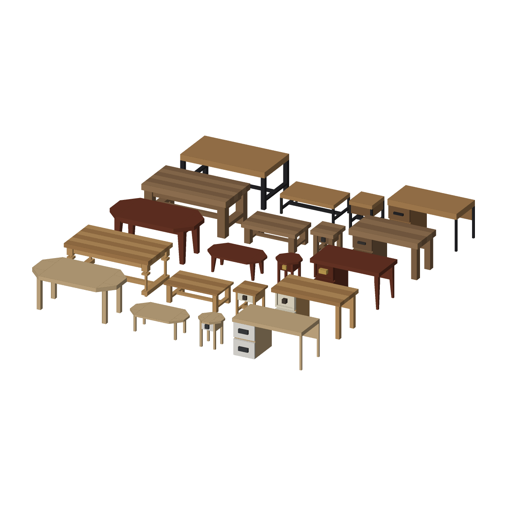

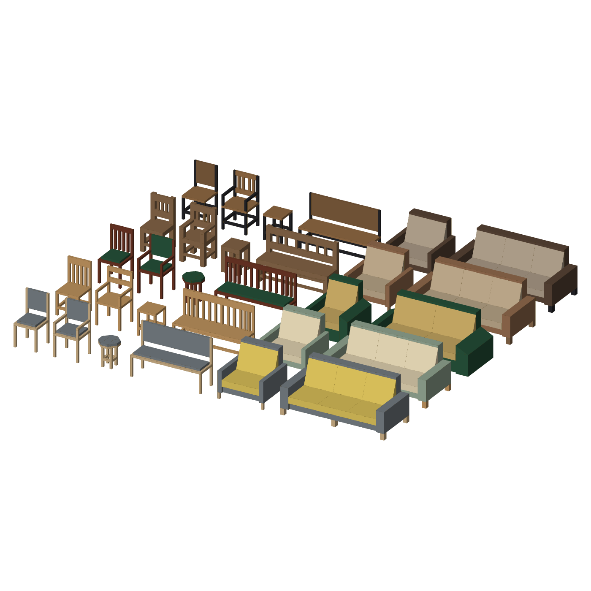

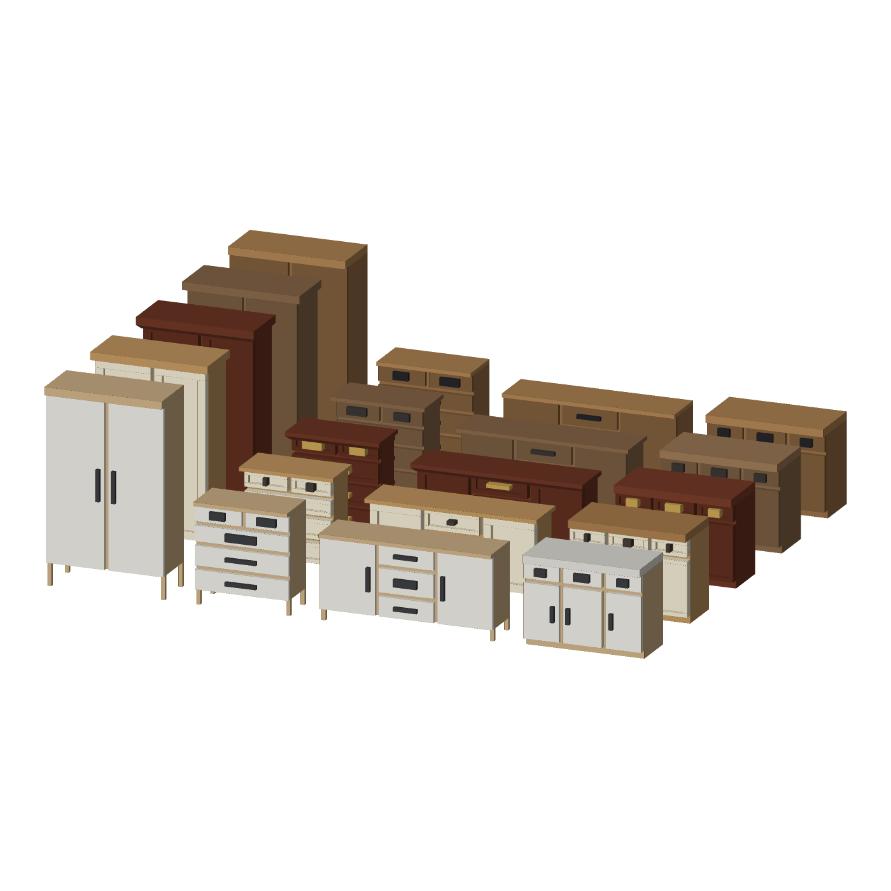 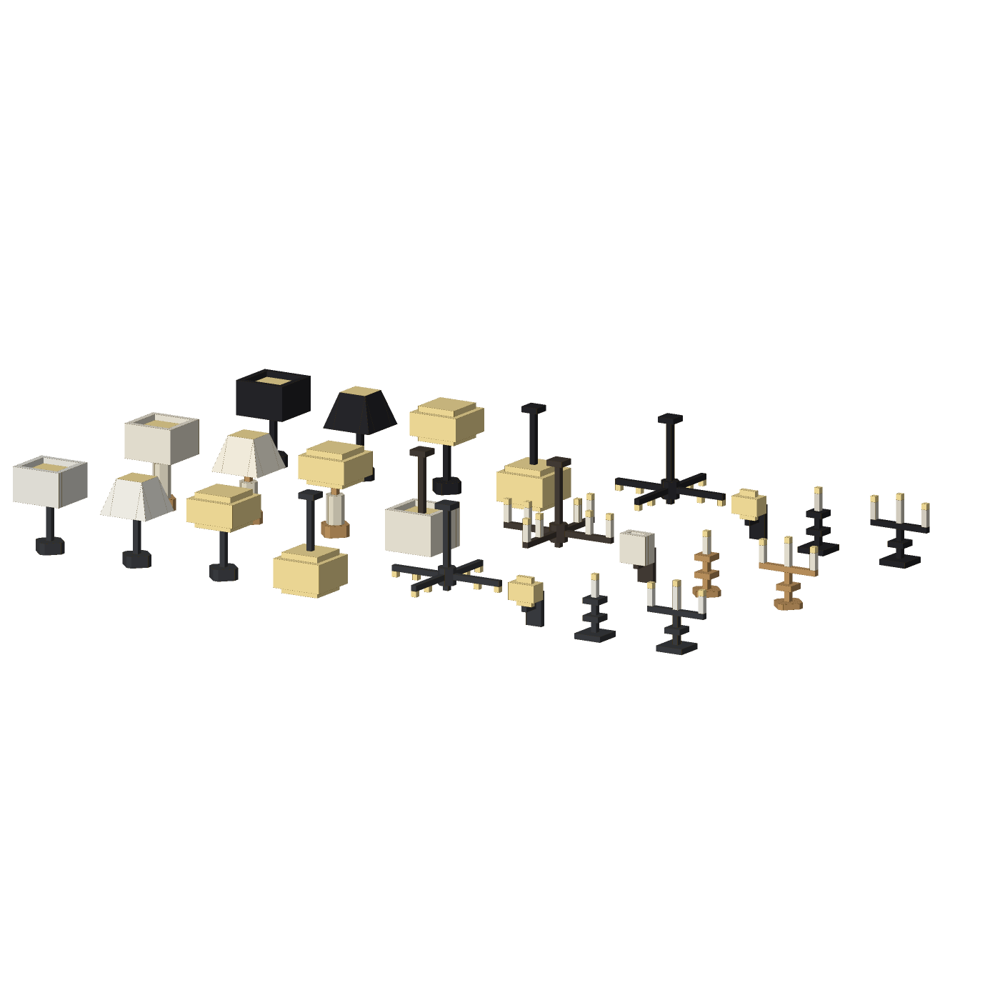

**Style** is modern, farmhouse, classical, rustic or industrial, or
**Random**, which lets the seed pick one. A style is a set of choices
that go together: a farmhouse piece has turned legs, panelled doors and a
plank top, and an industrial one a thin metal frame carrying a slab of
wood. **Seed** picks among what the style allows, and **Another** takes
the next seed. The seed picks the same way for every kind, so pieces of
one style and one seed are a set, in the same wood and of the same
weight. A leg is turned or tapered only where it is thick enough to be (three
microbricks and two), so beside a table with turned legs a chair at its
usual size, whose legs are one microbrick, has square ones. Changing a piece's kind keeps its style and
seed. **Make all the furniture match this** gives every other piece in
the workspace this one's style, seed and colours in one step.


Each style brings three sets of **Colours**. They are colours for what
things are made of: the wood, a second wood or the paint of doors, metal,
upholstery, a second cloth, the light of a lamp, pale linen, and a top of
another stuff. One set therefore paints every piece of a room.

A lamp's bulb or flame is written to the game as a glowing brick, and
with **Lights shine in the game** ticked it also carries a real light: one
to a lamp and one to each candle, eight at most. Handles, a lamp's stem
and an industrial frame are written in the game's metal.

A plant in a pot is a pot laid out like the rest with one of the Plant
form's plants growing in it: a yucca, a box ball, a hydrangea, peonies,
tulips, daffodils, daisies, petunias, a cypress, a palm or a cherry tree.
The plant is fitted as plants are, so these three kinds are slower and
heavier than the others: a potted plant is about 1,300 bricks and
takes about 90 ms (a window box of four plants takes about 1.2 s). **Leaves can be walked through in the game** writes
the leaves and flowers with their collision off.


A trellis stands in a planter against the back of its box, so it can be
set flat against a wall. Its lattice is square, diamond or arched, and a
climber grows up it from the soil: ivy, a clematis, a climbing rose or
wisteria. **Coverage** runs from a young plant with a few short stems to
one that has nearly reached the top. The lattice always shows through.


A picture hangs flat against the back of its box. A painting is a sunset
over water, a landscape or an abstract, and a portrait is a cartoon head
and shoulders whose skin, hair, clothes and smile the seed picks. Each
subject has its own sets of colours (a warm sunset and a cool dawn;
summer, autumn and winter). A picture is drawn a microbrick to a pixel,
so a larger frame holds a finer picture. A face reads from about 18
microbricks of picture width, and below that it is a head with two eyes
and a mouth.

 

Every kind but the three with fitted plants has no discrepancy. A dining
table is 8 to 37 bricks, a chair 9 to 16, a cupboard
10 to 28 and a sofa 10 to 16, depending on the style, and each
is laid in under a hundredth of a millisecond.

## Mazes

 

**Maze** builds a maze to walk through. It has one way in, on its rim,
and a room in the middle. Every part of it can be reached, there are no
loops, and there is exactly one way from the way in to the room. How it
is made is in [algorithm.md](algorithm.md), section 7.11.

| Setting | What it does |
|---|---|
| **Kind** | **Theta** is rings of corridors about a round room, with walls that are arcs and spokes. **Grid** is square cells about a square room. |
| **Rings** | How many rings, the room counted as the first, from 2 to 40. Changing it keeps the corridors' width, so the maze grows. |
| **Ring gap** | A corridor and one wall, in microbricks. Changing it keeps the rings and resizes the maze. A corridor is at least 3 between its walls. |
| **Cells in the first ring** | How many cells spokes cut the first ring into (theta only). |
| **Cells double** | How the number of cells grows outwards (theta only): **to keep cells square**, or every 1 to 8 rings. Every 2 is what the older brickmaze tool did. |
| **Wall thickness** | Whole microbricks. |
| **Wall height** | How tall the walls stand above the floor. |
| **Way in, round the rim** | Where the gap in the rim is, in degrees round from the X axis. |
| **Floor thickness** | A floor under the whole maze, or 0 for none. |
| **Mark the way through** | Lays a strip one microbrick high along the ground from the way in to the room, in its own colour. |
| **Seed**, **Another** | Which maze. The same seed and settings are always the same maze. |

Two dots size it in the view. The dot on the rim drags the radius, which
widens or narrows every corridor and keeps the rings. The dot over the
middle drags the walls' height. Ctrl + scroll resizes it too.

**Texture** sets what the walls are made of:

| Texture | The walls |
|---|---|
| **none** | plain fitted walls: long sloped bricks round every ring, a few hundred to a few thousand bricks |
| **hedge** | the Plant form's hedge grown along every wall, with its **Density**, **Looseness**, **Berries** and seed. At least 6 thick and 12 tall. |
| **bricks** | courses of bricks that run level along each wall and bend round the rings with it |
| **cobblestone**, **planks**, **medallions** | the same patterns as on a floor, wrapped along each wall |

 

A texture colours the walls and never moves them. On the curved face of
a ring wall each long sloped brick is one colour to a course, so upright
joints show there only where one sloped brick ends. The straight walls
along the axes, the wall tops and a grid maze carry the pattern exactly.
Rug and stepping stones are not offered for a maze.

Choosing a texture brings its colours unless you have set your own. With
plain walls there are three colours: the floor, the walls, and the strip
that marks the way through. With a texture or hedge there are eight: the
first is the floor and the mortar or stems, and the last is the strip.

A hedge maze and a textured maze are tens of thousands of bricks. A maze
is refused, with what to change, if its corridors would be under 3
microbricks wide, its walls over 40,000 microbricks long in all, or its
hedge more than can be built in a few seconds. It can be turned,
flipped, moved and put on a grid of its own. It cannot be mirrored and
takes no added points.

## Meshes from files

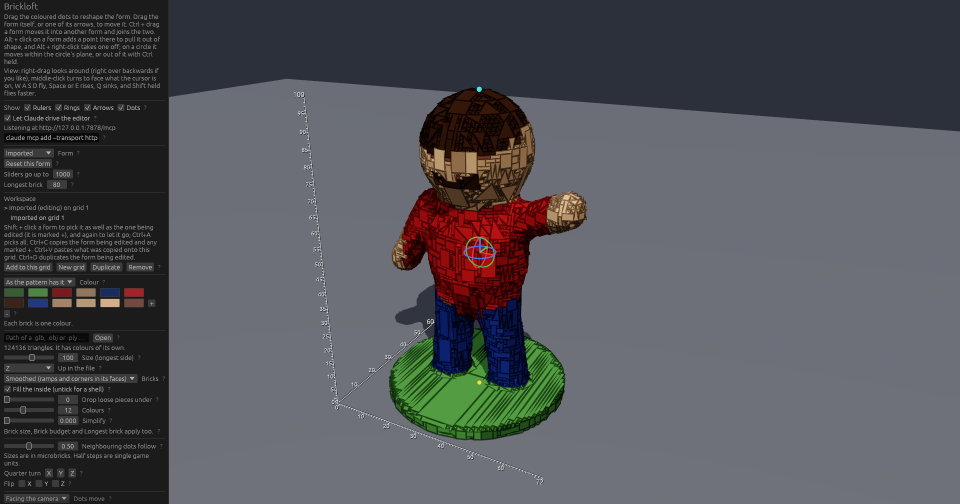

**Imported** builds a 3D model made in another program. Type or paste
the file's path into the box and press Enter, or drop the file on the
window. A file dropped while another form is being edited is added to
the workspace as a new form. How the bricks are chosen is in
[algorithm.md](algorithm.md), section 7.13.

Three kinds of file are read. What is read of each is its triangles and
its colours, and nothing else.

| File | Colours read from |
|---|---|
| Binary glTF (`.glb`) | its points' colours, its materials' base colours, and a PNG picture kept inside the file |
| Wavefront OBJ (`.obj`) | a colour written after each point (`v x y z r g b`) |
| PLY (`.ply`), text or little-endian binary | each vertex's `red`, `green` and `blue` |

A `.glb` file's JPEG or WebP picture is not read, and nor are an OBJ
file's separate material and picture files. The mesh then has its
points' colours, or none, and is coloured as any other form is. A file
may be up to 400 MB and 2 million triangles. A file that is damaged, or
that uses something not read (Draco or meshopt compression, a `.gltf`
with its data in other files), is refused with the reason, shown in red
where a form's problem is shown.

The file is copied into `Documents/brickloft/imports` under a name made
from its content. A saved form names that copy, so a save still opens
after the original file has been moved or deleted. A save opened on a
computer that has not the copy opens empty and says which file is
missing. Opening the same file there again brings the form back.

| Setting | What it does | What it costs |
|---|---|---|
| **Size (longest side)** | The length of the model's longest side in microbricks. The light blue dot sets it by dragging, and Ctrl + scroll changes it too. The model stays standing on its foot. | Twice the size is about four times the bricks and the time, and eight times the memory. The bricks follow the surface more closely, since they are the same size on a larger model. |
| **Up in the file** | Which of the file's axes points up: Y for glTF and most OBJ files, Z for most PLY files. | Changing it reads the file again. |
| **Bricks** | **Smoothed** lays ramps and corner pieces in the model's faces, stretched to the whole-number slope nearest each face. **Blocks** uses cubes alone. | On the figure 100 tall, Smoothed is 4,462 bricks at 1.8% discrepancy and Blocks is 1,355 at 4.2% with four times the area of steps. Blocks is two to four times as fast. |
| **Fill the inside** | Ticked, the inside is brick, in boxes as large as **Longest brick** allows. Unticked, it is empty behind a wall of the **Shell thickness**. | The inside costs few bricks either way. |
| **Drop loose pieces under** | Leaves out every piece of the build that touches no other piece and is smaller than this, for the scraps that float round a model made from a photograph. | A scrap that touches the body by one brick stays. |
| **Colours** | How many colours the model's own are reduced to, up to 32. 0 leaves them out. | More colours are more bricks, since a brick is one colour: the figure is 3,264 bricks in 4 colours and 3,940 in 32. |
| **Simplify** | What a brick is worth in microbricks of disagreement. Above 0, a stretched piece may stand further from the model for each brick it saves. | At 0.25 the figure is 3,247 bricks in place of 4,462, at 3.1% discrepancy in place of 1.8%. |

**Brick size**, **Brick budget** and **Longest brick** apply as they do
to every form. Bricks of 2 are about a quarter as many as bricks of 1 and
twice as coarse, so thin parts of the model are lost first. **Automatic**
fits the model at each size from the coarsest down until one goes over
the budget, which takes several times as long as naming a size.

The model's colours are listed under **Colour**, where each can be
changed, and choosing another colouring there (one colour, a blend,
stripes) paints the model that way in place of its own colours.

A model can be moved, turned by quarter turns, flipped, put on a grid of
its own and joined to other forms. It cannot be mirrored and takes no
added points. A model that takes more than a twentieth of a second to
fit is fitted behind the window, which goes on drawing the bricks it has
and says **Fitting the change...** until the new ones are ready.

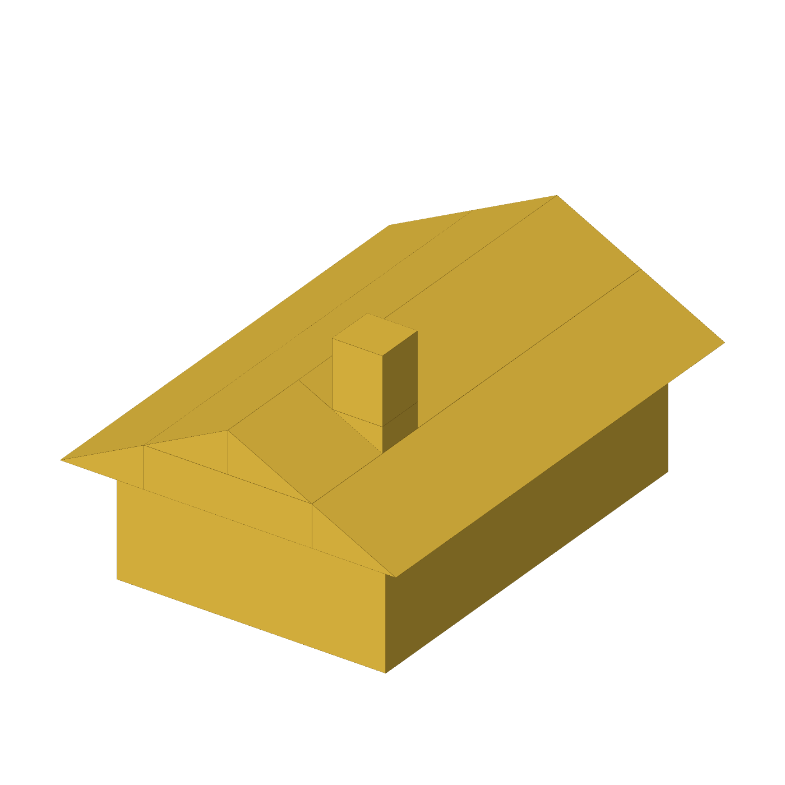 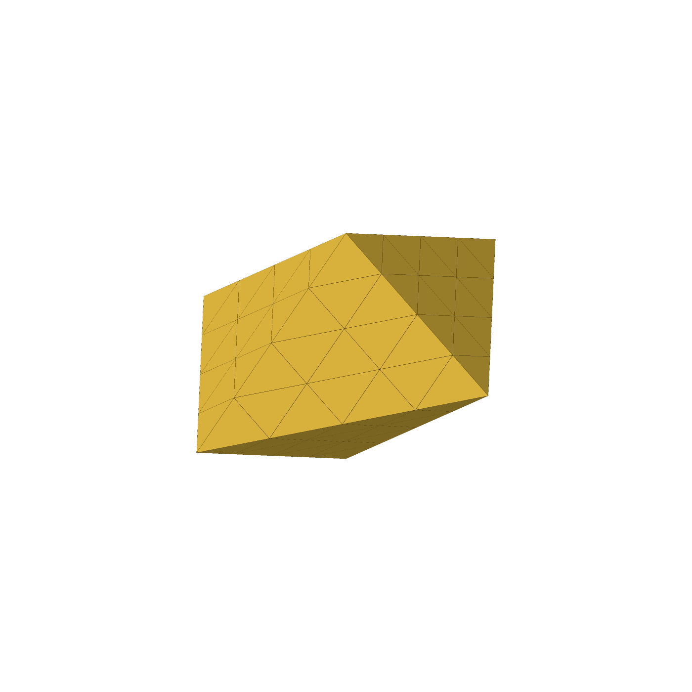

A model drawn in whole units and built at a size equal to its length in
those units comes out exact where its faces are flat. The house above
is 10 bricks and the gem 133, with no discrepancy.

## Rule programs

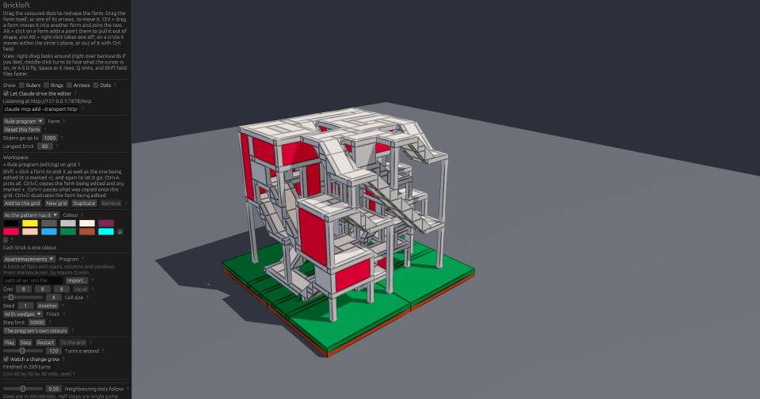

**Rule program** grows a building. It runs a small program that starts
from an empty grid of cells and changes it a little each turn by rewrite
rules, and you can watch it do so. When the program has finished, each
cell of its grid is built as a block of microbricks, and the result is a
form like any other: it can be moved, turned, coloured, joined to other
forms, saved and copied to the game.

The language of these programs and the seven programs on the list are
from [MarkovJunior](https://github.com/mxgmn/MarkovJunior) by Maxim
Gumin, under the MIT licence. CarmaTower is, in its author's words, "a
proceduralization of a voxel scene by Antoine Lendrevie". How a program
is run and how its grid becomes bricks is in
[algorithm.md](algorithm.md), section 7.14.

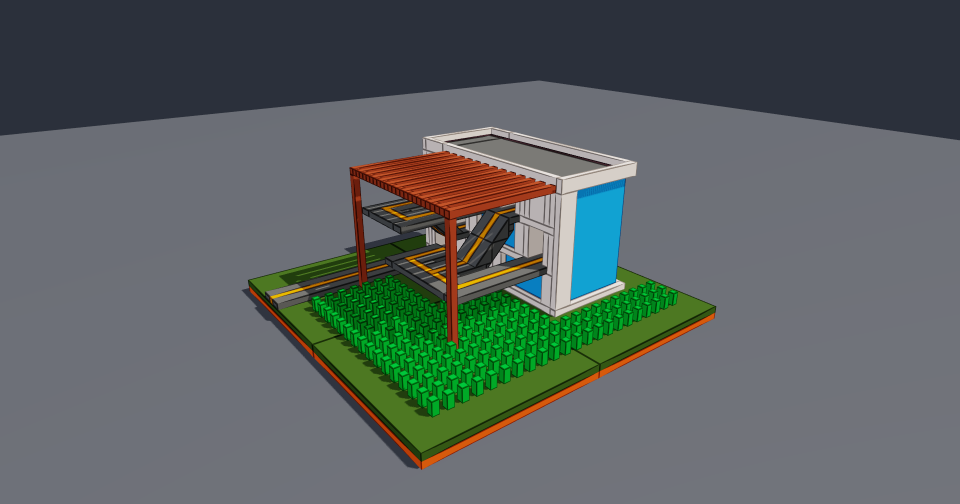 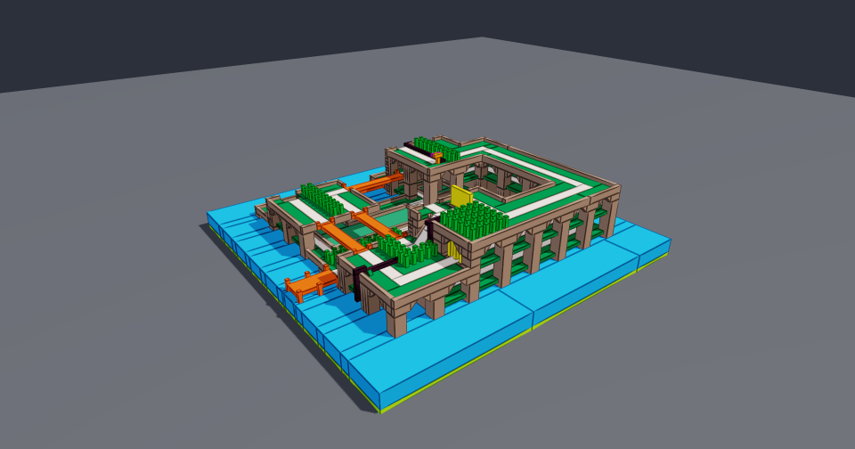 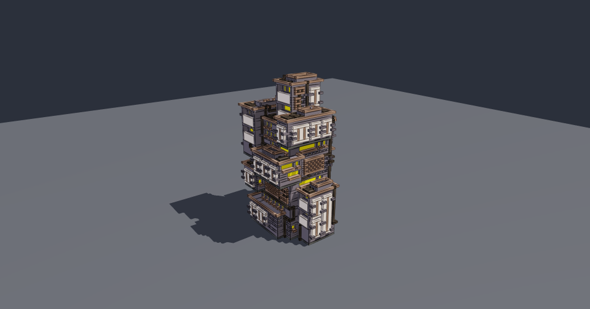 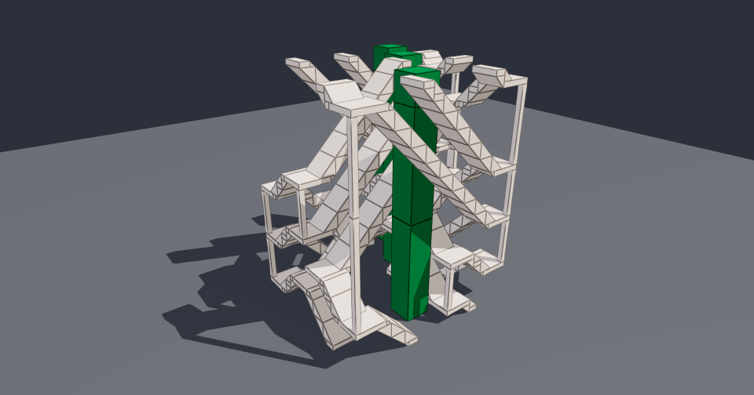

| Setting | What it does |
|---|---|
| **Program** | Which program runs. The four buildings come first: **Apartemazements** (a block of flats), **CarmaTower** (a tower), **ModernHouse** and **SeaVilla**. Then **PillarsOfEternity** and **Escher** (walkways and stairs) and **StrangeDungeon** (rooms and passages). Programs you have imported follow. Choosing one sets its usual grid and its own colours. |
| **Import...** | Brings in a program from an `.xml` file whose path you type, as dropping the file on the window does (see [Importing a program](#importing-a-program)). |
| **Grid** | How many cells the program's starting grid has along X, Y and Z, from 1 to 128 each. A larger grid is a larger building and a longer run. A program may build several cells for each cell of this grid: the four buildings build 5 or more. **Usual** puts back the size the program was written for. |
| **Cell size** | How many microbricks each cell of the finished grid is built across, from 1 to 20. It changes the size of the building and nothing else, and the program is not run again for it. |
| **Seed** | Which of the program's buildings this is. **Another** takes the next one. |
| **Finish** | **Plain cells** builds every cell as a cube. **With wedges** also fills the notch above each step of a staircase with a ramp, so that stairs are slopes a player walks up, and gives stepped roofs their corner pieces. |
| **Step limit** | The most turns a run may take, 50,000 unless you change it. |
| **The program's own colours** | Puts the form's colours back to the program's own, one for each letter its grids use. Each can be changed in **Colour** above, as on any form. |

### Watching it run

| Control | What it does |
|---|---|
| **Play** / **Pause** | Play runs the program from where it stands. Pause stops it at the turn it has reached. Play on a run that has finished starts it again from the first turn. |
| **Step** | Takes one turn and stops. |
| **Restart** | Starts again from an empty grid with the same seed, and plays. |
| **To the end** | Runs on to the end without drawing the turns between. |
| **Turns a second** | How fast it plays, from 1 to 20,000. A program takes from about a hundred turns to a few thousand. |
| **Watch a change grow** | Ticked, a change of program, grid, seed or step limit is played from its first turn. Unticked, the change is shown finished. |

Under the controls the panel says which turn the run is at and which
node of the program has the next turn, with its line in the program's
file, for anyone reading the program alongside.

 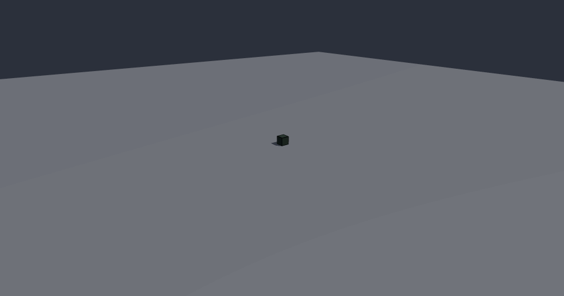

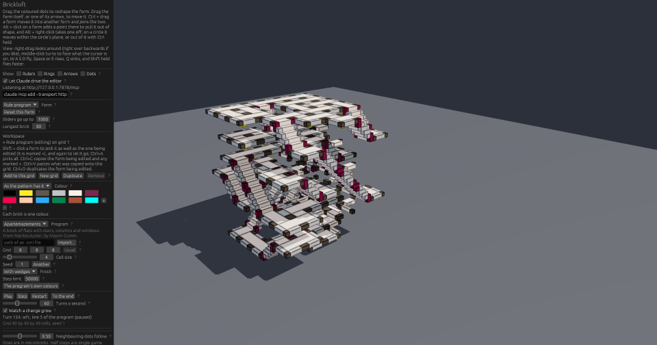

A paused run is a form like any other. The bricks on screen are what
**Copy to Clipboard** copies and what a save keeps, and the turn it was
paused at is part of what is saved, so a save of it opens at the same
turn. While a run is still under way it is built with the plain finish,
and the wedges appear when it ends.

A save keeps the program's name, the grid, the seed and the turn, and no
bricks. Opened on any computer, it runs the program again to that turn
and builds the same bricks, with no animation. Press **Restart** to
watch it grow. The form you are editing stays empty for the moment the
run takes, and the workspace's other rule programs fill in one after
another, while the window keeps answering.

One turn of some programs is long: the first turn of a wave function
collapse node can take a second or more. The turn is taken behind the
window, the panel says **Working on a long turn...**, and the building
appears when the turn is done.

### Seeds that are passed over

Some seeds cannot be finished. ModernHouse finds no way to fit its tiles
on about one seed in three, and SeaVilla gives up on about one in six.
The editor then goes on to the next seed by itself. If you are watching,
you see the run begin again, the **Seed** box shows the seed that is now
on screen, and a note under the controls says which seeds were passed
over and why the first could not be finished. If 16 seeds in a row
cannot be finished, the form says so and suggests another size.

### When a program is stopped

A program that loops, or a grid too large to finish, is stopped at the
step limit. What it had made stays on screen as the form's bricks, and
an amber message at the top of the panel says that it stopped early and
that raising **Step limit** lets it go on. A grid, a tileset or a file
over the size the editor allows is refused, and the message gives the
figure, the limit and what to change.

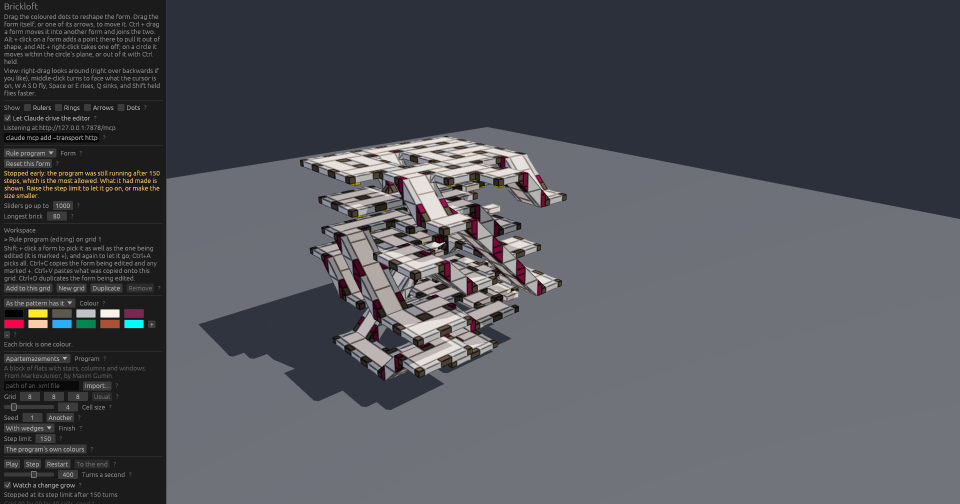

### Importing a program

Drop a program's `.xml` file on the window, or type or paste its path
into the box beside **Import...** and press the button or Enter. The
editor checks that the
program loads, copies it into `Documents/brickloft/programs/` with the
files it reads, adds it to the **Program** list, and makes the form you
are editing that program. A save that names an imported program opens
again on this computer. On a computer that does not have the program,
the form opens empty and says to import the file again.

A program often reads other files: a tileset (an `.xml` file and a
folder of `.vox` tiles) and rules kept as `.vox` files. They are looked
for in two places only, in this order: beside the program's file, and in
a folder called `resources` beside it. A file found in neither is taken
from the files that come with the editor, which are the original's own
tilesets and palette. So a program that uses one of the original's
tilesets needs only its own `.xml` file.

To import a program from a copy of the MarkovJunior repository, copy
the program's file out of `models/` into the repository's top folder,
so that it lies beside `resources/`, and import it from there:

```
MarkovJunior/
  MyProgram.xml        <- the program, copied here from models/
  models.xml           <- read for the program's usual size, if it lists one
  resources/
    palette.xml        <- its colours, if you have changed them
    tilesets/Paths.xml
    tilesets/Paths/Line.vox ...
    rules/MyProgram/Roof.vox ...
```

If `models.xml` lies beside the program and lists it, the grid starts at
the size given there (a flat program at a Z of 1). Otherwise it starts
at 16 each way, and a flat program needs its Z set to 1 by hand.

The editor runs most of the language: `one`, `all`, `prl`, `markov`,
`sequence`, `path`, `map`, `convolution`, `wfc` with a tileset, fields
and unions. It does not run `convchain`, `wfc` from a sample picture,
`observe`, or rules kept as `.png` pictures. A program that uses one of
these is refused, and the message names the part and its line. Many of
the original's flat programs use `.png` rules or `observe`.

To write a program of your own, read
[MarkovJunior's README](https://github.com/mxgmn/MarkovJunior#readme),
which explains the language with examples, and its
[syntax guide](https://github.com/mxgmn/MarkovJunior/blob/main/syntax.md).

### How the results differ from the original's

A seed here gives a different building from the same seed in
MarkovJunior, of the same kind. The original draws its random numbers
from .NET's library, and this editor draws them from a generator of its
own so that a seed gives the same bricks on every computer. The rules
are applied as the original applies them. The original also draws
cells only, and the wedges in a staircase are this editor's addition.

## Colour

Each form has its own colouring.

| Colouring | What it does | Colours |
|---|---|---|
| **One colour** | the whole form in one colour | 1 |
| **Blend** | a gradual change from the first colour to the last along a chosen axis | up to 4 |
| **Stripes** | bands of each colour in turn along a chosen axis | up to 4 |
| **As the pattern has it** | each brick the colour its pattern gives it (see [The colours of a pattern](#the-colours-of-a-pattern)), or the colour a model from a file has there (see [Meshes from files](#meshes-from-files)) | up to 8 for a pattern, up to 32 for a model |

Click a colour to change it. **+** adds a colour and **-** takes the last
one away. Right-click a colour and choose **Copy colour**, then right-click
another and choose **Paste colour**, to make the two the same. The copied
colour is kept inside the editor, so a form copied with Ctrl+C stays on the
clipboard. Each brick is one colour.

## Fit and brick count

| Setting | What it does |
|---|---|
| **Simplify** | how much closer a sloped brick must bring a flat outline, or a model from a file, to be worth a brick. 0 is the closest fit; higher is fewer bricks. |
| **Brick size** | fits the form with bricks a multiple of this size. **Automatic** picks the finest size within the **Brick budget**. |
| **Longest brick** | the longest edge one brick may have, 80 by default. |
| **Sliders go up to** | how far every size slider reaches (radius, height, thickness, depth, reach of added points), 1000 microbricks by default. Lower it for a finer slider. |
| **Use ramps and corner pieces** | off builds with cubes alone. |

The panel shows the brick count by kind, the brick size chosen, the
**discrepancy** and how long the fit took.

## The camera

The camera is flown.

| | |
|---|---|
| Right-drag | look around, as far as right over backwards |
| Middle-click | turn to face what the cursor is on |
| W A S D | move the way it looks, and sideways |
| Space or E, Q | rise, sink |
| Shift held | fly faster |

The rulers give the form's lengths in microbricks. **Floor below
form** lowers the floor so a form can be looked at from underneath.

## Screenshots

**Save screenshot**, or **F12**, saves a picture of the window as
`brickloft-1.png`, `-2` and so on in the folder `brickloft` inside your
pictures folder (`Pictures/brickloft` in your home folder on Windows,
macOS and Linux). On Windows the picture is also put on the clipboard,
ready to paste, which replaces a form copied there with Ctrl+C.
**Shift+F12** leaves the panel out and takes the view alone, and copies
it the same way. The browser
page cannot write files, so it has neither.

## Recording a GIF

**Record GIF**, or **F11**, starts recording the window as an animated GIF.
The button then reads **Stop recording**, and it or F11 again stops the
recording and saves it. **Shift+F11** records the view alone, without the
panel. The browser page cannot write files, so it has no recording.

While it records, a red dot in the top right corner of the view shows how
long the recording has run and how many pictures it has taken, and for the
first few seconds where the file is going. The dot is drawn after each
picture is taken, so it is never in the recording. A notice over the view,
such as the one Ctrl+D puts up, is part of the window and is recorded when
the panel is.

The file is saved beside the screenshots, in `Pictures/brickloft`, as
`brickloft-2026-11-16-143055.gif`: the date and time the recording began.
The time is universal time (UTC), so it differs from your clock by your
time zone's offset; its purpose is to sort recordings in the order they
were made. When the recording stops, a notice says where the file is, how
long it plays, how many pictures it holds and how large it is.

Two settings beside the button apply to the next recording:

| Setting | Choices | What it changes |
|---|---|---|
| Size | Full size, Half size, A third | Each pixel of the recording is the average of a square of 1, 4 or 9 of the window's pixels. Half size, the usual one, has a quarter of the pixels of full size and under half the file. |
| Rate | 10, 20 or 25 a second | How often a picture is taken. 20, the usual one, is every third frame of a display that shows 60. |

Pictures are taken by the clock and not by counting frames, and each is
shown for the time that passed before the next. A slow frame therefore
costs the recording a picture and never speeds it up: a recording plays for
as long as it took to make.

A recording holds only what changed. While nothing in the window changes
no picture is written and the last one stays on show, so five minutes of a
still view would be no larger than one picture. When something does
change, only the rectangle that holds the change is written. Ten seconds
of a form being edited came to about 150 KB at half size in a window of
1920 by 1009 pixels. Ten seconds of the camera flying round the same
forms, where most pixels change in every picture, came to 7 MB (16.5 MB at
full size, 4.2 MB at a third).

A GIF holds 256 colours. They are chosen to fit what is being recorded, so
a flat face stays one flat colour. If a picture brings colours the chosen
ones are far from, such as a form of a new colour, the colours are chosen
again from that picture on. A pixel that did not change is never written
again, so nothing that stands still can flicker.

A recording stops by itself, and says so, when it has run for 60 seconds or
its file has reached 64 MB. It also stops if the window changes size,
because a GIF has one size throughout. A minimised window is not drawn, so
the recording holds its last picture until the window is back. Closing the
editor while it records finishes the file first.

## Reports

**Save report** writes `brickloft-report-1.txt`, `-2` and so on to the folder
`brickloft` in the system's temporary folder, and says where. **Clear
reports** deletes every report there and nothing else. A report holds the form's settings, its bricks, the
cells where bricks and form disagree most, the share of its surface within
10, 20, 30 and 45 degrees of the true surface, and drawings of cuts through
bricks and form together. It can be rebuilt and re-measured from the command
line (see [development.md](development.md)), which is how fits are compared
before and after a change.

If the editor ever closes by itself, it first writes what went wrong to
`brickloft-crash.txt` in the same folder. Each crash adds a record: the
time, the program's version, the fault's message, the line of the program
it happened on and the calls that led there. The editor sends the file
nowhere. It is the thing to send with a report of a crash, since a window
has no console to show the message in. The file is started afresh once it
passes a megabyte.

## Every key and mouse action

| | |
|---|---|
| Click a form | edit it |
| Drag a form by its bricks | move it within its grid |
| Ctrl + drag a form | move it into another form and join the two |
| Drag a dot | reshape the form; on a cube, move one side |
| Drag an arrow | move the form being edited and any picked with it |
| Drag a ring | turn the whole grid |
| Alt + click a form | add a point to it |
| Alt + right-click an added point | take it off |
| Ctrl + drag an added point on a circle | move it out of the circle's plane |
| Shift + click another form | pick it as well as the one being edited |
| Ctrl+A | mark every form |
| Ctrl+C, Ctrl+V | copy, paste |
| Ctrl+D | duplicate the form being edited |
| Ctrl+Z, Ctrl+Y | undo, redo |
| Delete | remove the form being edited |
| Ctrl + scroll | resize a circle, sphere, pyramid, cube, plant, piece of furniture or model from a file |
| Drop a `.glb`, `.obj` or `.ply` file on the window | build it (see [Meshes from files](#meshes-from-files)) |
| Right-drag, middle-click | look around, face the cursor |
| W A S D, Space, E, Q | fly |
| Shift held | fly faster |
| F12, Shift+F12 | save a screenshot and copy it to the clipboard, with or without the panel |
| F11, Shift+F11 | start or stop recording a GIF, with or without the panel |
| Enter or Escape | close a message |
