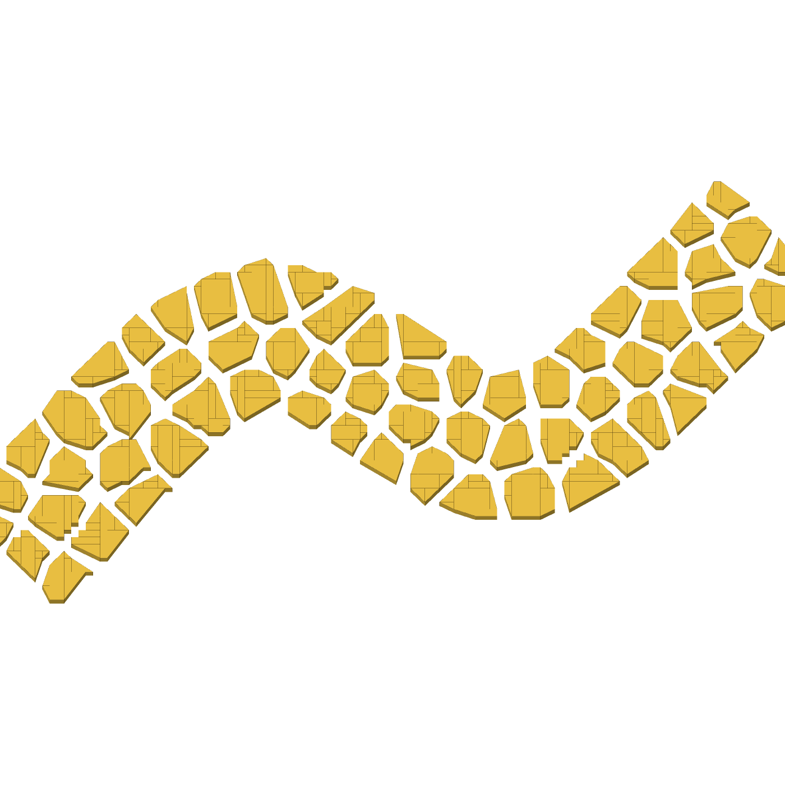
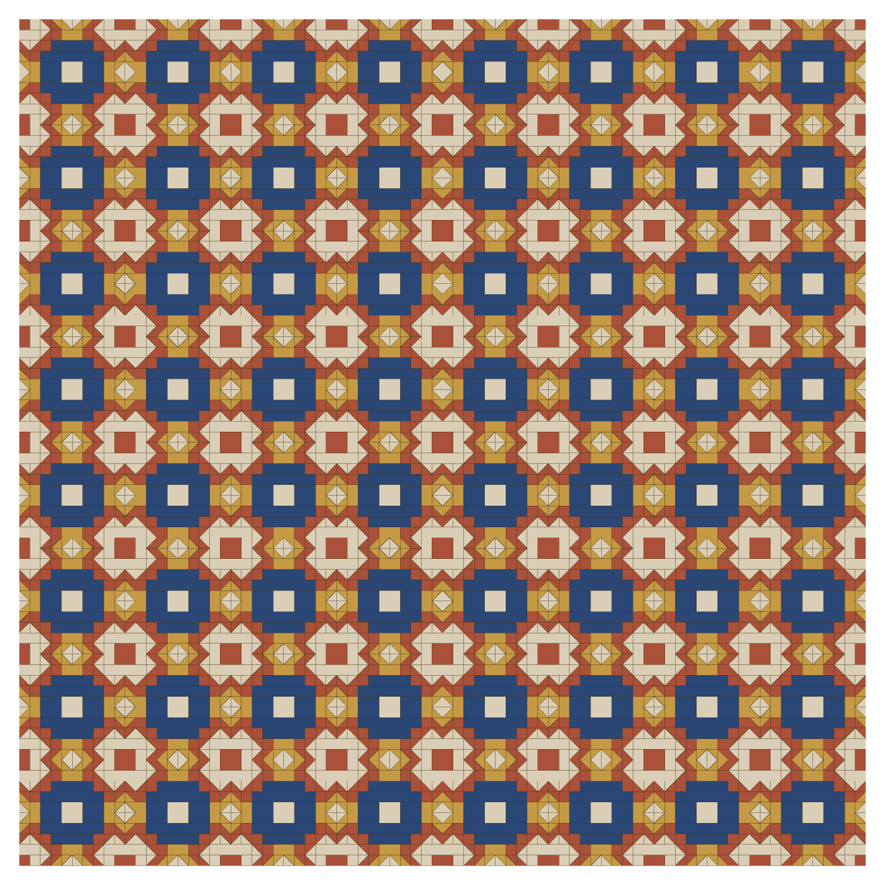
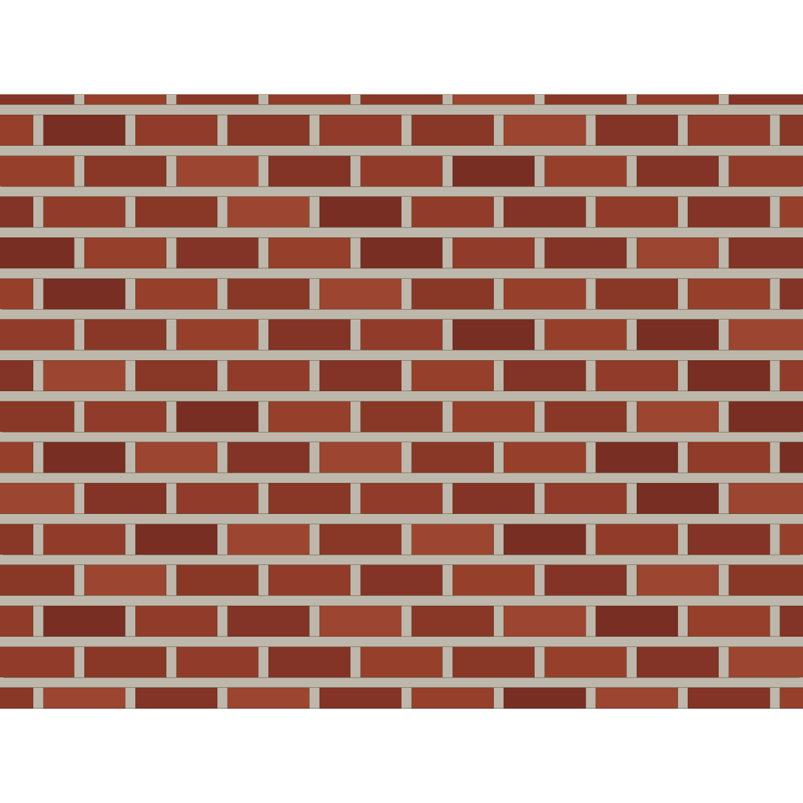
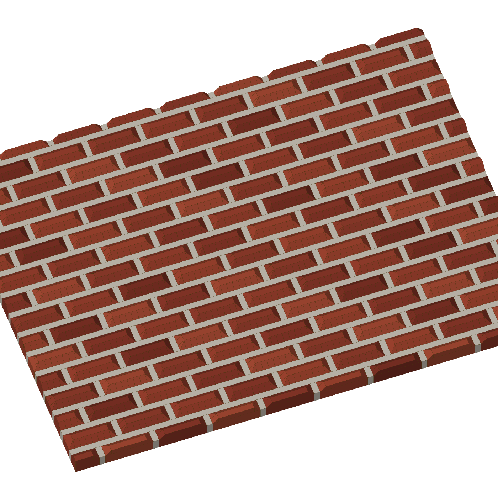
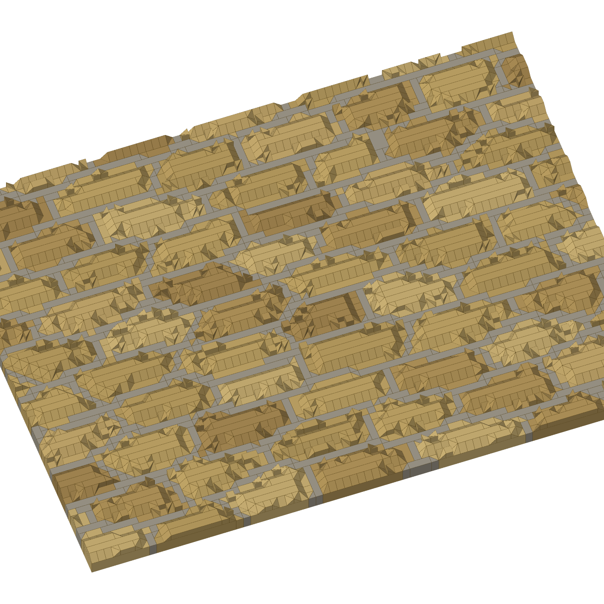
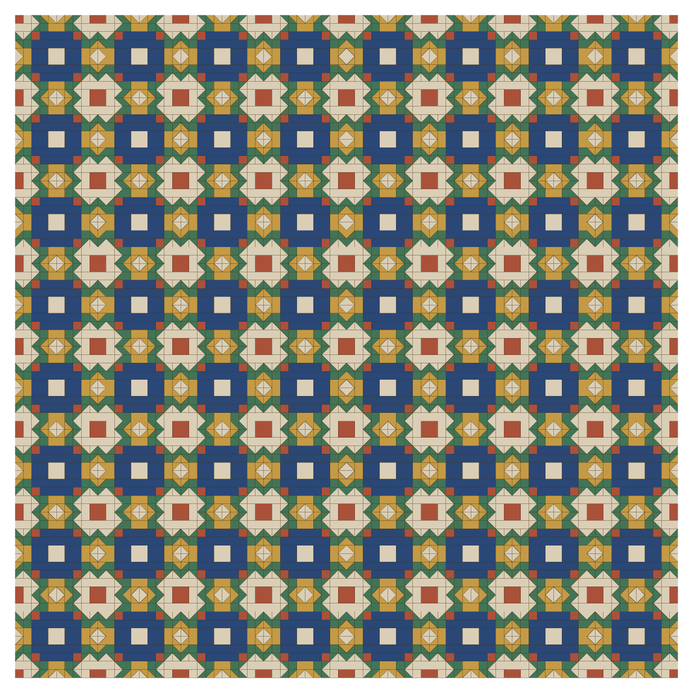

# Features

Everything the editor does, and how to do it. For how the bricks are chosen,
see [algorithm.md](algorithm.md).

Sizes are in **microbricks** throughout. One microbrick is a fifth of a stud
and two of the game's positional units, so half steps are single units.

## The window

A 3D view of the bricks, with a panel down the left side. The form being
edited is drawn in its colours with its **dots**; other forms are drawn a
little darker. Each control in the panel has a small **?** beside it. Rest
the pointer on the **?**, or on the control itself, to read what the
control does.

| Dot | What it is |
|---|---|
| Yellow | one of the form's own points |
| Light blue | a size: a radius, or an arch's height |
| Orange | a point you added (see [Added points](#added-points)) |

Round the middle of the grid being edited are three **arrows** and three
**rings**, red for x, green for y and blue for z (see [Grids](#grids)). They
are drawn a tenth the size of what is on the grid. The **Show** boxes at the
top of the panel switch the rulers, the rings, the arrows and the form's dots on
and off, each on its own. Anything hidden cannot be taken hold of either.

**Let Claude drive the editor**, also at the top of the panel, lets Claude
build and change forms while you watch (see [mcp.md](mcp.md)). It is off
until you tick it.

## Forms

| Form | Points | Options |
|---|---|---|
| **Arch** | two feet, and a height | Kind: round, pointed, triangular, elliptical, parabolic, catenary. Shift + click adds a point that pulls it out of shape (see [Added points](#added-points)). |
| **Circle** | a centre, and a radius | **Facing**: which axis it faces (Z is lying flat). Stretch within its plane makes an ellipse. |
| **Spline** | any number, passed through | **Closed loop** joins its end to its start. |
| **Bézier** | any number, pulled towards | A weight per point: how hard it pulls. |
| **Sphere** | a centre, and a radius | Solid or a hollow shell; stretch along each axis for an ellipsoid; keep the whole, a dome, or a segment between two heights. |
| **Revolve** | a profile, spun about the upright through its first point | Solid, or a shell along the profile. |
| **Pyramid** | the middle of its base | Half its base, stretch along x and y, height; solid or a hollow tent. |
| **Tree** | the foot of its trunk | Kind: pine, palm or oak. Height, spread, three settings of its own and a seed (see [Trees](#trees)). |

### Curves as bricks

An arch, circle, spline or Bézier is a curve, and is built one of three ways:

- **Flat band:** as thick as **Thickness** in the curve's plane and as deep
  as **Depth** across it. The default.
- **Round tube, Rounded:** a pipe, eight-sided in section, with its edges
  sloped. A circle built this way is a torus.
- **Round tube, Protruded:** flat bands of different widths side by side,
  smooth along the curve and stepped across it.

**Fill the area the curve encloses** fills a closed flat curve: a ring
becomes a disc, and a round-tube ring a disc with a rounded rim.

## Shaping a form

- **Drag a dot** to move a point or change a size. Dots snap to the grid.
- **Dots move** (in the panel) chooses the plane a dragged point moves in:
  facing the camera, or with x, y or z held still.
- **Ctrl + scroll** makes a circle, sphere, pyramid or tree a microbrick larger or
  smaller.
- **Stretch** scales a form along each axis, up to 1000 times.
- **Flip** mirrors the finished bricks along x, y or z: a dome becomes a bowl.
- **Quarter turn X / Y / Z** turns the form a quarter turn within its grid.
  It is the same bricks facing another way, so a pyramid can lie on its side.
- **Neighbouring dots follow** sets how much of a dragged dot's movement the
  dots near it share, from 0 (it moves alone) to 1.
- **Snap to best fit nearby** tries each dot a whole microbrick either way
  (and half a microbrick too when **Snap dots to half microbricks** is on),
  and each size half a microbrick and a whole one either way, and keeps
  whatever fits closest, with a progress bar in the top right. **Do that after every drag** does it automatically.
- **Reset this form** puts its dots, sizes, stretch, flips and mirrors back
  to how the form starts.

### Added points

**Shift + click** on any form adds an orange point there. Dragging it pulls
that part of the form out of shape; the form around it follows by less the
further off it is, out to **Reach of added points**.

- On a curve the point takes hold of the curve, and the reach is measured
  along it. On a circle it moves within the circle's plane; hold **Ctrl** to
  move it straight out of the plane instead.
- On a revolve it pulls the profile, so the form is wider or narrower all
  the way round at that height.
- On a sphere or pyramid it takes hold of the surface where you clicked.

The form keeps its own points and sizes, so a pulled circle is still a
circle whose radius can be changed. **Shift + right-click** an orange point
to take it off, or use **Remove the last added point**. Up to 12 per form.

### Mirror

**Mirror X / Y / Z** makes the form its own mirror image along that axis,
about the middle of its points. The low side is kept and the high side
becomes its image. An arch with one foot higher than the other gets two
feet alike. A point added on either side appears on both.

## The workspace

Several forms can be worked on together.

- **Click a form** in the view, or its line in the list, to edit it.
- **Drag a form by its bricks** to move it. It moves one unit at a time and
  stays the same bricks wherever it stands.
- Forms on the same grid are kept clear of each other: one dragged into
  another stops beside it or comes to rest on top of it, and one reshaped
  until it reaches another pushes that one away.
- **Ctrl + drag the form being edited** to move it into another form on
  its grid and join the two into one build (see [Joining forms](#joining-forms)).
- **Delete** removes the form being edited. **Ctrl+Z** and **Ctrl+Y** undo
  and redo.

### Joining forms

The form being edited, dragged with **Ctrl** held, goes where it is
dragged, into other forms if that is where, so a tower can be sunk into a wall or a dome set
into a roof. The moved form is then joined to the others on its grid. It
gives up the room it shares with them, so that no two bricks overlap, which
the game would refuse. The other forms keep all their bricks.

Where the moved form's plain blocks reach into another form they are cut
back to the cells that are free. A sloped brick that shares any room is
left out whole, since a slope cannot be cut down to cells, so the join can
show a notch a cell or two deep where the moved form's sloped surface meets
the other form.

A joined form stays where it is when a form it sits in is reshaped, where
an unjoined one would be pushed clear. Dragging it again without Ctrl
sets it clear of the others. Being joined is not remembered by undo or by a
save. After Ctrl+Z, or when a save is opened again, drag the form with
Ctrl once more to join it.

Ctrl + click on a form that is not being edited marks it for copying, so
click the form first to edit it and then drag it with Ctrl. Ctrl can also
be pressed after the drag has begun.

### Grids

The game keeps bricks on grids. The world has one, and any other grid can
stand at any angle and pass through the others. Every form in the workspace
is on a numbered grid, shown in the list.

| Button | What it does |
|---|---|
| **Add to this grid** | another copy of this form on the same grid: kept clear of the others on it, and turned and moved with them |
| **New grid** | another copy on a grid of its own |

An arch whose two feet differ along both X and Y stands at an angle to its
grid. It cannot be fitted smoothly there, and the panel says so. **Turn its
grid to line it up** gives the arch a grid of its own, turned so that the
arch runs straight along it, and leaves its feet where they are. The arch
is then fitted as smoothly as any other. An arch from one of the reports
this was written for went from 199 bricks to 31.

The arrows and rings stand at the middle of everything on the grid being
edited, sized to it.

- **Drag an arrow** to move the whole grid along that axis. A level grid
  moves a unit at a time; a grid at an angle moves freely.
- **Drag a ring** round to turn the whole grid about that axis, by any
  angle, in whole degrees.
- **Level the grid** puts a turned grid back on the world's.

A level grid is the world's own and is copied as ordinary bricks. A grid at
an angle is copied as a grid of its own, frozen in place.

### Copy and paste

| Key | What it does |
|---|---|
| **Ctrl+C** | copies the form being edited, and any others marked `+`, as a Brickadia prefab (`brickloft-build.brz`) on the clipboard |
| **Ctrl + click** another form | marks it `+` to be copied too, or unmarks it |
| **Ctrl+A** | marks every form |
| **Ctrl+V** | adds the forms of a copied prefab back to the workspace, as forms that can still be reshaped, on the grid being worked on |

The prefab carries each form's bricks, colours, place and grid, and, in its
description, the settings each form was made from. That is how a paste back
into the editor gives forms and not a fixed lump of bricks. A `.brz` made
elsewhere is refused with a message saying why: bricks alone cannot be
turned back into a form.

A short notice at the top of the view confirms a copy or paste and fades.
A failure shows a message that has to be closed (Enter or Escape will do).

### Saved forms

**Save** under **Saved forms** keeps the whole workspace: every form, with
its colours, where it stands and the grid it is on. Saves are kept in
folders (`arches`, `domes`, or your own) under `Documents/brickloft/forms`
in your home folder, the same on Windows, macOS and Linux.

A save is a Brickadia prefab file (`.brz`), the same file Ctrl+C makes, so
the game can load it as it stands. The file holds the bricks and, in its
description, the forms they were fitted to, which is why it opens again as
forms that can still be reshaped.

**Open** puts a save in place of the whole workspace, and Ctrl+Z brings the
workspace back. **Add** adds the save's forms beside the form being edited
and on its grid, as a paste does. Dragging a save from the list onto the
view adds it too. **Go to folder** opens the chosen folder in your file
manager, where each save is a `.brz` file. **Delete** removes a save from disk after asking you to
confirm (Enter deletes, Escape cancels), since Ctrl+Z cannot bring a deleted file back. Saves made by earlier versions, which were text files of
one form's settings, are still listed and opened.

## Patterns

**Pattern**, on any curve built as a flat band, lays the band or the filled
outline as a pattern in place of solid brick. The list starts at **none**,
and a form has one pattern at most. A straight spline with a large
**Thickness** gives a rectangular floor or wall, a filled circle a round
one, and a curved band a path. How each pattern is made, and why that way,
is in [algorithm.md](algorithm.md), sections 7.8 and 7.9.

| Pattern | What it lays |
|---|---|
| **stepping stones** | separate stones of any shape with gaps between them. With **Gap** at 0 the stones are fitted together, as in a paved floor. |
| **medallions** | a few ringed figures repeated over the whole floor |
| **rug** | a Persian carpet: nested borders, a lobed medallion with pendants, corner pieces, and scrolling stems with flowers and leaves |
| **planks** | a floor of boards |
| **masonry** | a wall or floor of bricks all alike, or of stones as uneven as you ask, in courses, with or without mortar, and with their tops bevelled if you like |

 

 

  

Stepping stones follow the curve, so a spline drawn across the ground
becomes a winding stone path as wide as the band's **Thickness**. Stones
fitted together with the gap at 0 still show narrow seams, because each
stone is fitted with bricks by itself.

The other four patterns are made of tiles one microbrick across. A tile is
one colour, or it is cut along a diagonal into two triangles of two
colours. Medallions and the rug are their own mirror images and are set
out from the middle of the floor. The floor's edge keeps the sloped bricks
any flat form has, at most five microbricks long, and they take the
pattern's colours.

These four are laid at single microbricks whatever the **Brick budget**
says, because a tile is one brick and a pattern's detail is its brick
count. A rug 240 by 160 is some twenty thousand bricks, and held to a
budget of 2,500 it was built three times coarser, with every flower a
blot. Make the form larger for more detail, or set a **Brick size** by
name for less.

A rug wants a large floor. Its parts are drawn afresh for the size it is
given, and a small rug has little room to show them: a medallion of one or
two layers and plain lines for its guards. Lay it 100 microbricks or more
across. The picture above is 240 by 160.

Each pattern shows the settings it has a use for.

| Setting | Patterns | What it does |
|---|---|---|
| **Stone size** | stepping stones | about how far apart the middles of neighbouring stones are. A stone is a little under this across. |
| **Gap** | stepping stones | how wide the space between stones is. 0 fits them together. |
| **Uneven** | stepping stones | 0 for stones as alike as scattered stones can be, 1 for small ones crowded among large |
| **Size** | planks, masonry | how large the boards, bricks or stones are. 2 is the usual size, 1 half of it and 4 twice. |
| **Uneven** | masonry | how far the pieces are from bricks all alike. At 0% every one is the same rectangle. As it rises they differ more in size and their edges leave the straight, until at 100% they are stones of any shape. |
| **Mortar between** | masonry | a microbrick of mortar between one piece and the next. Without it the pieces touch and are told apart by their shades alone, so give the pattern several colours. |
| **Bevel** | masonry | how many microbricks of each piece's top slope down to its edge, all round it. 0 leaves the tops flat. |
| **Uneven stagger** | masonry | moves each course along by an amount of its own, so the upright joints fall anywhere. Untick it to set one **Stagger** for every course. |
| **Stagger** | masonry | how far each course is moved along from the one before, as a share of a brick's length. 50% is the usual half-brick bond and 0% stacks the bricks in columns. |
| **Courses upright** | masonry | runs the courses up the floor instead of across it, so the bricks stand on end |
| **Border** | medallions, rug | how many microbricks of plain ground are left round the edge |
| **Seed** | all | which one of the pattern: each whole number is a different one. **Another** takes the next number and the next of the pattern's sets of colours. |

A bevel is real depth: the top of each brick or stone is built of sloped
bricks along its sides and hipped ones at its corners. It needs room, so
it can be no more than the form's **Depth** less one. Give the form a
**Depth** of 2 or more. Bricks bevel cleanly. Uneven stones have clean
slopes along their sides and jagged ones at some corners, where two edges
meet at an angle no brick has.

### The colours of a pattern

Choosing a pattern sets the form's colouring to **As the pattern has it**
and brings in colours the pattern starts with: a rug's reds and blues, a
floor of planks' browns. Colours you have set yourself for a pattern are
kept when you change to another pattern. **Another** always moves to the
pattern's next set of colours.

A pattern numbers its parts, and the colours are shared among the parts.
The first colour is the ground, or the mortar of masonry, and it is used
for nothing else. The other colours go to the pattern's parts in turn.
With two colours the whole pattern is one colour on the other. Each colour
you add with **+** picks one more part out, up to eight colours.

 

The rug needs all eight of its colours. Its numbers are tones (lines, a
dark ground, a pale ground, petals, leaves, shade, hearts) that come back
in every part, so with two or three colours its border and medallion turn
into solid blocks.

Planks and stepping stones have no ground. Each board or stone takes one of
the colours, and the sets they start with are shades of one wood or one
stone.

## Trees

**Tree** grows a pine, a palm or an oak. Each kind is grown by a method of
its own, from the facts of how that tree grows: how they are made is in
[algorithm.md](algorithm.md), section 7.10.

 

| Kind | What it is |
|---|---|
| **Pine** | a spruce, the Christmas tree: a straight stem with tiers of drooping boughs that shorten to one pointed leader, each bough a flat spray of side shoots |
| **Palm** | a coconut palm: a slender, ringed, eight-sided trunk, swollen at the foot, that leans and curves upright, and one crown of arching fronds with a row of leaflets down each side |
| **Oak** | an oak grown in the open: a short thick trunk, flared at the foot, dividing into heavy crooked limbs that spread wide and fork again and again, with leaves in separate masses at the ends of the branches |

Every tree has a **Height** and a **Spread** (a palm's is its **Frond
length**), which the dot at its top and the dot at its side set too. Three
more settings mean something different for each kind.

| Setting | Pine | Palm | Oak |
|---|---|---|---|
| a number | **Tiers of boughs**, 4 to 40 | **Fronds**, 5 to 40 | **Main limbs**, 2 to 7 |
| how full, 0 to 100% | **Fullness**: more boughs, wider sprays | **Leaflet length** | **Foliage**: larger masses of leaves, less sky |
| how bent, 0 to 100% | **Droop** of the boughs | **Lean** of the trunk | **Gnarl**: how crooked the limbs are |
| extras | **A star and baubles** | **Coconuts** | none |

**Seed** is which tree of its kind: any whole number, each a different
tree, and the same number is always the same tree. **Another** takes the
next number. The height, spread and other settings change the tree a seed
gives without making it a different tree.

**Colours** offers each kind's sets of colours: for a pine spruce green,
under snow, blue spruce and in frost; for a palm three; for an oak summer,
early autumn, late autumn and spring. A tree is coloured **As the pattern
has it**, with a colour for each of its parts: the trunk, leaves, leaves
in shade, new growth, limbs, the top of a pine's boughs or the rib of a
frond, and two for the extras. Change any of the eight under
[Colour](#colour) to make a set of your own. Under snow, the white is the
colour for the tops of the boughs.

A tree starts large, a pine 140 microbricks tall, because its shoots and
leaflets are two microbricks thick at any size and a small tree has room
for little else. At that size a tree is 17,000 to 40,000 bricks and takes
up to a second to build, so a slider moves it in steps. **Brick size**
left on **Automatic** always builds a tree at 1 microbrick, whatever the
budget. A tree can be turned, flipped, moved, joined to other forms and
put on a grid of its own like any form. It cannot be mirrored and takes no
added points.

## Colour

Each form has its own colouring.

| Colouring | What it does | Colours |
|---|---|---|
| **One colour** | the whole form in one colour | 1 |
| **Blend** | a gradual change from the first colour to the last along a chosen axis | up to 4 |
| **Stripes** | bands of each colour in turn along a chosen axis | up to 4 |
| **As the pattern has it** | each brick the colour its pattern gives it (see [The colours of a pattern](#the-colours-of-a-pattern)) | up to 8 |

Click a colour to change it. **+** adds a colour and **-** takes the last
one away. Right-click a colour and choose **Copy colour**, then right-click
another and choose **Paste colour**, to make the two the same. The copied
colour is kept inside the editor, so a form copied with Ctrl+C stays on the
clipboard. Each brick is one colour.

Earlier versions had two more colourings, a speckled blend and a colour for
each separate piece. A save that used them opens as a blend and as the
pattern's colours.

## Fit and brick count

| Setting | What it does |
|---|---|
| **Simplify** | how much closer a sloped brick must bring a flat outline to be worth a brick. 0 is the closest fit; higher is fewer bricks. |
| **Brick size** | fits the form with bricks a multiple of this size. **Automatic** picks the finest size within the **Brick budget**. |
| **Longest brick** | the longest edge one brick may have, 80 by default. |
| **Sliders go up to** | how far every size slider reaches (radius, height, thickness, depth, reach of added points), 1000 microbricks by default. Lower it for a finer slider. |
| **Use ramps and corner pieces** | off builds with cubes alone. |

The panel shows the brick count by kind, the brick size chosen, the
**discrepancy** and how long the fit took.

## The camera

The camera is flown.

| | |
|---|---|
| Right-drag | look around, as far as right over backwards |
| Middle-click | turn to face what the cursor is on |
| W A S D | move the way it looks, and sideways |
| Space or E, Q | rise, sink |
| Shift + scroll | faster or slower |

The rulers give the form's lengths in microbricks. **Floor below
form** lowers the floor so a form can be looked at from underneath.

## Screenshots

**Save screenshot**, or **F12**, saves a picture of the window as
`brickloft-1.png`, `-2` and so on in the folder `brickloft` inside your
pictures folder (`Pictures/brickloft` in your home folder on Windows,
macOS and Linux). On Windows the picture is also put on the clipboard,
ready to paste, which replaces a form copied there with Ctrl+C.
**Shift+F12** leaves the panel out and takes the view alone. The browser
page cannot write files, so it has neither.

## Reports

**Save report** writes `brickloft-report-1.txt`, `-2` and so on to the folder
`brickloft` in the system's temporary folder, and says where. **Clear
reports** deletes every report there and nothing else. A report holds the form's settings, its bricks, the
cells where bricks and form disagree most, the share of its surface within
10, 20, 30 and 45 degrees of the true surface, and drawings of cuts through
bricks and form together. It can be rebuilt and re-measured from the command
line (see [development.md](development.md)), which is how fits are compared
before and after a change.

If the editor ever closes by itself, it first writes what went wrong to
`brickloft-crash.txt` in the same folder. Each crash adds a record: the
time, the program's version, the fault's message, the line of the program
it happened on and the calls that led there. The editor sends the file
nowhere. It is the thing to send with a report of a crash, since a window
has no console to show the message in. The file is started afresh once it
passes a megabyte.

## Every key and mouse action

| | |
|---|---|
| Click a form | edit it |
| Drag a form by its bricks | move it within its grid |
| Ctrl + drag the form being edited | move it into another form and join the two |
| Drag a dot | reshape the form |
| Drag an arrow, a ring | move, turn the whole grid |
| Shift + click a form | add a point to it |
| Shift + right-click an added point | take it off |
| Ctrl + drag an added point on a circle | move it out of the circle's plane |
| Ctrl + click another form | mark it to be copied too |
| Ctrl+A | mark every form |
| Ctrl+C, Ctrl+V | copy, paste |
| Ctrl+Z, Ctrl+Y | undo, redo |
| Delete | remove the form being edited |
| Ctrl + scroll | resize a circle, sphere, pyramid or tree |
| Right-drag, middle-click | look around, face the cursor |
| W A S D, Space, E, Q | fly |
| Shift + scroll | camera speed |
| F12, Shift+F12 | save a screenshot, with or without the panel |
| Enter or Escape | close a message |
