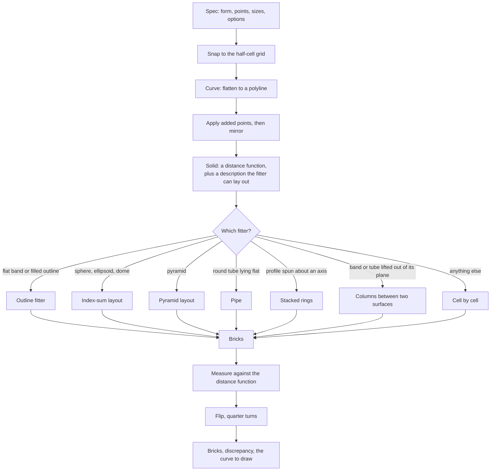
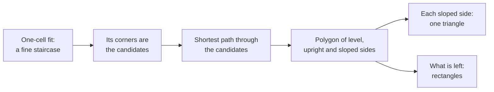

# How a form becomes bricks

This document explains the principles arcs works by and the algorithm used
for each kind of form. File names in brackets say where each part lives in
`core/src/`.

- [1. The problem](#1-the-problem)
- [2. The grid and the bricks](#2-the-grid-and-the-bricks)
- [3. From a form to bricks: the pipeline](#3-from-a-form-to-bricks-the-pipeline)
- [4. Curves](#4-curves-curvesrs)
- [5. Solids as distance functions](#5-solids-as-distance-functions-sdfrs)
- [6. What is being minimised](#6-what-is-being-minimised)
- [7. The fitters](#7-the-fitters)
- [8. Changing a form: added points, mirror, turning, grids](#8-changing-a-form-added-points-mirror-turning-grids)
- [9. Fit against brick count](#9-fit-against-brick-count)
- [10. Measuring the result](#10-measuring-the-result-reportrs-surfacers)
- [11. Symmetry](#11-symmetry)
- [12. Limits](#12-limits)

## 1. The problem

A form (an arch, a sphere, a torus) is a smooth solid. Bricks are boxes and
wedges whose corners sit on a grid. The task is to choose a set of bricks
that

1. is as close to the form as bricks allow,
2. shows slopes where the form slopes, not the treads and risers of a
   staircase,
3. is its own mirror image wherever the form is, and
4. uses few bricks.

These pull against each other. The closest possible fit by volume uses many
small bricks and is full of steps, because a step and a slope can enclose the
same volume. So closeness alone is not the goal, and most of what follows is
about getting slopes that meet end to end.

## 2. The grid and the bricks

### The grid

One **cell** is the smallest microbrick: a cube 2 of the game's positional
units on a side, a fifth of a stud. Brick positions are whole units, so every
point, radius and thickness is snapped to half cells before anything is
computed (`Spec::snapped` in `spec.rs`). A form placed between units could
only be approximated by bricks that are all slightly off it.

Cell $(i, j, k)$ is the cube $[i, i+1] \times [j, j+1] \times [k, k+1]$.
Whole numbers are cell corners (the **lattice**); halves are cell centres.

### The bricks (`shapes.rs`)

A brick is a box, any whole number of cells along each axis, holding one of
nine shapes. Take the box as the unit cube $0 \le x, y, z \le 1$:

| Shape | Game brick | Solid | Corners held | Share of box | Poses |
|---|---|---|---|---|---|
| Cube | Micro-Brick | all of it | 8 | 1 | 1 |
| Ramp | Micro-Wedge | $y + z \le 1$ | 6 | 1/2 | 12 |
| Tetrahedron | Micro-Wedge Triangle Corner | $x + y + z \le 1$ | 4 | 1/6 | 8 |
| Cut cube | Micro-Wedge Outer Corner | $x + y + z \le 2$ | 7 | 5/6 | 8 |
| Hip | Micro-Wedge Corner | $\max(x, y) \le 1 - z$ | 5 | 1/3 | 24 |
| Inner corner | Micro-Wedge Inner Corner | $\min(x, y) + z \le 1$ | 7 | 2/3 | 24 |
| Half outer corner | Micro-Wedge 1/2 Outer Corner | $x + y \le 1,\ z \le x + y$ | 5 | 1/3 | 24 |
| Half inner corner | Micro-Wedge 1/2 Inner Corner | $x + y \le 1,\ z \le y$ | 4 | 1/6 | 12 |
| its mirror image | Micro-Wedge 1/2 Inner Corner Inv. | $x + y \le 1,\ z \le x$ | 4 | 1/6 | 12 |

"Poses" is how many distinct ways the shape can sit in its box under the 24
rotations of a cube.

**A shape is a set of box corners.** Every shape but one is the convex hull
of the corners it holds, so a shape is stored as an 8-bit mask, one bit per
corner, bit $x + 2y + 4z$. Stretching the box stretches the shape and leaves
the mask alone. Rotating or mirroring a brick is a permutation of the bits.
Two bricks whose boxes share a face and whose masks agree on that face's
four corners meet exactly, with no gap and no overlap. That last property is
what the fitters build on: get the corners right and the faces follow.

The inner corner is the exception. It is a box with a hip removed, a valley
where two slopes meet, and it holds the same seven corners as a cut cube. Its
mask is therefore not its corners but the three corners that the removed hip
does not touch, which no other shape's mask can be. Bit permutations still
rotate it correctly, since the removed hip moves with it.

**How the shapes pair up.** A tetrahedron and a cut cube fill a box between
them, across the plane $x + y + z = \text{const}$. A plane tilted on all
three axes therefore passes through the grid cutting alternate layers of
cells into one and the other. A ramp and its opposite ramp fill a box; so do
a hip and an inner corner. Two half inner corners make a hip. An upright
wedge plus a half outer corner makes a cut cube.

**Orientation (`orient.rs`).** The game names a brick by asset, size and one
of 24 orientations. For each mask the solver finds the orientation that turns
the game's unturned brick into that pose, preferring upright ones, and
permutes the size to match.

## 3. From a form to bricks: the pipeline

Two things are computed for every form: a **distance function**, which says
exactly what the form is, and a **layout**, which is whatever structure the
right fitter needs (an outline, a list of cuts, a profile). The bricks come
from the layout. The distance function is used afterwards to measure them,
so the measurement does not depend on the fitter that produced the bricks.

When a layout cannot be made (a centre off the half-cell grid, a wall too
thin), the form falls through to the cell-by-cell fitter, which needs only
the distance function and works for anything.

## 4. Curves (`curves.rs`)

Every curve is flattened to a polyline that stays within 0.02 of a cell of
the true curve. Everything after this point works on polylines, so adding a
kind of curve never touches a fitter.

**Circle through three points.** With $a = P_1 - P_0$, $b = P_2 - P_0$ and
$n = a \times b$, the centre is

$$c = P_0 + \frac{\lvert a\rvert^2\,(b \times n) + \lvert b\rvert^2\,(n \times a)}{2\,\lvert n\rvert^2}$$

Three points in a line have $n = 0$ and no circle.

**Round arch.** Two feet a span $L$ apart and a rise $s$ give a circular arc
of radius

$$R = \frac{L^2/4 + s^2}{2s}$$

which is a semicircle when $s = L/2$. The other arches are closed forms
between the same feet: two arcs meeting at a point, a triangle, half an
ellipse, a parabola $z = s\,(1 - (2x/L)^2)$, and a catenary
$z = a\cosh(x/a)$ with $a$ solved numerically for the rise.

**Spline.** A centripetal Catmull-Rom spline. It passes through every point,
and its parameter spacing $\lvert P_{i+1} - P_i\rvert^{1/2}$ is the one
choice that cannot form cusps or loops within a span.

**Bézier.** Rational, with a weight $w_i$ per point:

$$C(t) = \frac{\sum_i w_i\,B_i(t)\,P_i}{\sum_i w_i\,B_i(t)}$$

where $B_i$ are the Bernstein polynomials. A weight pulls the curve towards
its point. With three points this gives every conic exactly: a middle weight
below 1 is an ellipse, 1 a parabola, above 1 a hyperbola, and
$\cos(\theta/2)$ the circular arc of angle $\theta$, which a plain Bézier
cannot represent.

## 5. Solids as distance functions (`sdf.rs`)

A form is a function $f(p)$ that is negative inside the form, positive
outside, and near the surface equal to the distance from it. Forms are built
from a few of these and combined:

| Solid | $f(p)$ |
|---|---|
| Round tube of radius $r$ along a curve | $\operatorname{dist}(p, \text{curve}) - r$ |
| Flat band along a curve in a plane | $\max\big(\operatorname{dist}_{\text{in plane}} - \tfrac{t}{2},\ \lvert\text{height above plane}\rvert - \tfrac{d}{2}\big)$ |
| Ellipsoid with radii $r_x, r_y, r_z$ | $\big(\sqrt{\sum (p_k/r_k)^2} - 1\big)\cdot \min_k r_k$ |
| Outline spun about an upright axis | the outline's 2D function at $\big(\sqrt{x^2+y^2},\ z\big)$ |
| Pyramid | the largest of the distances out of its four slopes, its base and its top |

| Combination | $f$ |
|---|---|
| Both of $A$ and $B$ together | $\min(f_A, f_B)$ |
| $A$ cut to where $B$ is | $\max(f_A, f_B)$ |
| $A$ with $B$ taken out | $\max(f_A, -f_B)$ |

A dome is an ellipsoid cut by a half-space; a segment is one cut by a slab; a
hollow shell is an ellipsoid with a smaller one taken out. None of these is
a separate case in the code.

One property is relied on everywhere: $f$ never claims the surface is
further away than it is. That lets the fitters and the measurement skip
large regions after a single evaluation (see
[performance.md](performance.md)). Operations that stretch space, such as
squashing a tube into an oval or pulling a point out of a sphere, divide
their result by the largest stretch to keep the property.

## 6. What is being minimised

Write $F$ for the form and $B$ for the union of the bricks. The
**discrepancy** is the volume where they disagree:

$$E = \operatorname{vol}(F \setminus B) + \operatorname{vol}(B \setminus F)$$

material that should be there and is not, plus material that is there and
should not be. In two dimensions it is an area.

For the laid-out fitters each brick has its box to itself, so $E$ is a sum
over boxes and each box can be judged alone. That makes the simplest case
exactly solvable: with one-cell bricks, each cell can hold nothing or one of
the shapes, the choices in different cells do not affect each other, and
trying every choice in every cell finds the true minimum of $E$.

That optimum is a staircase wherever the surface is not at 45°, and its
sloped pieces do not line up with one another. Each fitter below therefore
adds structure so that slopes are long and consecutive pieces share whole
faces, and pays for it with a slightly larger $E$. For a sphere of radius 12
the trade is 3 to 4% discrepancy with no stepped faces, against 2 to 3% with
a third of the surface stepped.

## 7. The fitters

### 7.1 Cell by cell (`fit_volume.rs`)

The general method, used when nothing better applies.

1. **Classify.** Each cell is sampled at $4 \times 4 \times 4 = 64$ points.
   Bit $s$ of a 64-bit word says whether sample $s$ is inside the form.
2. **Choose.** Each candidate shape has its own 64-bit word, worked out
   once. The disagreement between a cell and a candidate is the number of
   set bits in their exclusive-or. The cell gets the candidate that
   disagrees least. Candidates here are nothing, a cube, and the ramps,
   tetrahedra and cut cubes: 30 in all.
3. **Stretch ramps.** One-cell ramps are all at 45°, so a gentler slope such
   as the top of a dome would come out as a row of teeth. A second pass
   replaces runs of cells with a single ramp two to six cells long and one
   high (or the reverse) wherever that disagrees less than what is there.
4. **Remove spikes.** A lone tetrahedron standing proud of its neighbours is
   removed when that costs little.
5. **Merge.** Cubes are joined greedily into boxes along x, then y, then z,
   and ramps into longer ramps along their length, up to the longest brick
   allowed.

The result is the closest of the methods by volume and the roughest to look
at, because no cell knows what its neighbours hold.

### 7.2 Flat outlines (`fit_planar.rs`)

A flat band, ring or filled outline is a 2D shape pushed through the grid, so
it is fitted in two dimensions and extruded: rectangles become cubes and
triangles become ramps standing along the depth.

The fitted outline is a polygon whose corners are lattice points. A side is
level, upright, or sloped, and a sloped side is the hypotenuse of exactly one
right triangle whose legs lie along the grid. Consecutive sides share a
corner by construction, so slopes meet end to end. The question is which
lattice points to use as corners.

**Candidates.** The form is first fitted with one-cell pieces, as in 7.1 but
with $8 \times 8$ samples to a cell. The boundary of that result is a fine
staircase hugging the true outline, and its corners are the candidates.

**Choosing corners.** The staircase is cut into stretches where it truly
turns back. Along each stretch, corners are chosen by a shortest-path search
(dynamic programming). Going from candidate $i$ to a later candidate $j$ in
one side costs

$$\text{cost}(i \to j) = \underbrace{e(i, j)}_{\text{area between the side and the true outline}} + \underbrace{\lambda}_{\text{price of a corner}}$$

and the search finds the chain of sides of least total cost. The price
$\lambda$ is 0.1 of a cell plus the **Simplify** setting. Even at Simplify 0
it matters: a step is two corners where a slope is one, so a slope wins
whenever it fits as well.

**Turning one way.** Chosen on area alone, a slope the lattice has no single
side for is made by alternating the two nearest (1 in 1, 1 in 2, 1 in 1,
1 in 2), which is fractionally closer and turns left, right, left, right:
seen from above, a curve with a ripple in it. So the search also charges
three quarters of a cell each time the outline changes the direction it is
turning in. That makes the state of the search a side and the turn before
it, not a corner alone. With the charge, sides come out in order of slope.

**Thin walls.** Where the two faces of a thin wall want the same cell, the
larger triangle has it and the other face is fitted again around it.

**Ring placement.** A ring is shifted half a cell where needed so that its
edge runs along lattice lines where it crosses an axis. Left half a cell
off, that straight run fits best by area as a row of unit triangles, which
looks like the teeth of a saw.

An earlier version chose each triangle separately on its own merit. It
measured slightly closer and left a step wherever two triangles' ends did not
happen to meet; patching those afterwards never fully worked.

### 7.3 Spheres, ellipsoids, domes (`fit_round.rs`)

A sphere is laid out whole from one observation. The sphere of radius $r$ is

$$\frac{x^2}{r^2} + \frac{y^2}{r^2} + \frac{z^2}{r^2} \le 1$$

a sum of one term per axis. Cut each axis at distances
$t_0 < t_1 < \dots < t_K$ from the centre, chosen so that

$$\left(\frac{t_i}{r}\right)^2 = \frac{i}{K} \quad\text{that is}\quad t_i = r\sqrt{i/K}$$

Then the lattice point at cuts $(i, j, k)$ has
$x^2/r^2 + y^2/r^2 + z^2/r^2 = (i + j + k)/K$, so it is inside the sphere
exactly when

$$i + j + k \le K$$

The cuts divide space into boxes. A box's eight corners have index sums
$s, s+1, s+1, s+1, s+2, s+2, s+2, s+3$ where $s$ is the sum at its inner
corner, so the corners inside the sphere are always one of four sets:

| $s$ compared with $K$ | Corners inside | Brick |
|---|---|---|
| $s + 3 \le K$ | all 8 | cube |
| $s + 2 = K$ | 7 | cut cube |
| $s + 1 = K$ | 4 | tetrahedron |
| $s = K$ | 1 | none (a point) |

with ramps where a box touches the flat middle of an axis. Every box holds
nothing, a whole box, or one stretched brick, and neighbouring boxes share
corners, so every brick meets its neighbours face to face. The surface has
no steps and no gaps by construction, and every surface corner lies exactly
on the sphere.

**Putting the cuts on the lattice.** The ideal cuts $r\sqrt{i/K}$ are not
whole numbers. They are replaced by lattice values chosen together by
dynamic programming, working from the outside in, under two rules: every gap
is at least one cell, and gaps never grow outwards (which keeps the solid
convex). Outside in, because the outer gaps are the narrow ones and it is
those the lattice constrains.

**Choosing $K$.** More rings are finer facets, but each cut is then nearer
its neighbours than rounding can place it. Every $K$ the lattice has room
for is laid out and scored against the true solid, the best few are improved
by moving one cut a cell at a time while the score improves, and the best is
kept. About one ring per two to three cells of radius is typical.

**Ellipsoids** use the same method with a radius per axis. **Domes and
segments** are cut at one of the cuts along z. **Hollow shells** are the
same solid with a smaller one, $i + j + k \le K - m$, taken out; $m \ge 2$,
so that no box has both surfaces passing through it and each box is still
one brick. A shell needs a wall of about 2.5 cells or more for the lattice
to have room; thinner walls fall back to 7.1.

### 7.4 Pyramids (`fit_pyramid.rs`)

The same idea with a different rule. Number the cuts across from the middle
outwards and the levels from the base up, with $L$ levels in all. A corner
is inside the pyramid when

$$\max(i_x, i_y) + i_z \le L$$

The boxes then hold ramps on the four slopes and hips on the four ridges, and
the pyramid is exact: it is its four slopes, with no approximation. Centred
on a lattice point it is four hips and nothing else. $L$ is as small as
keeps every brick within the longest allowed.

**Hollow.** A pyramid that is not filled has a smaller one,
$\max(i_x, i_y) + i_z \le L - 2$, taken out, open underneath. Two levels,
for the same reason as a shell. The bricks on the inside are what the
smaller pyramid's bricks would leave of their boxes: a ramp leaves a ramp,
and a hip leaves an inner corner, which runs up each inside ridge. $L$ is
chosen to divide the height and both half-widths evenly, so that the slopes
stay flat; the wall then comes out near the thickness asked for, not exactly.

### 7.5 Round tubes and tori (`fit_stack.rs`)

A round tube along a curve lying flat, and a torus, are built as a pipe with
an eight-sided section. For a section $w$ cells across, the sloping sides
are as long as the flat ones when each chamfer is

$$c = w\left(1 - \tfrac{1}{\sqrt{2}}\right)$$

rounded to whole cells.

1. The band of the tube's **full width** is fitted as an outline, as in 7.2.
2. The **chamfer** is cut back from that outline towards the narrower top,
   layer by layer: a ramp in from each level or upright side, a tetrahedron
   on the triangle of each sloped side, and a corner piece where two sides
   meet. An inside corner between two ramps is an inner corner.
3. The same is done downwards for the underside.

Those pieces share whole faces and start exactly on the wall, so the chamfer
is one continuous surface.

The wall's outline is fitted knowing the top hangs off it: a sloped side is
charged for landing the top's outline off the true surface, a level or
upright side shorter than the chamfer is charged for the pieces it has no
room for, and no sloped side may be deeper than the chamfer.

The chamfer was first built the other way, outwards from the narrow top
band. Where that band ran diagonally it could only be fitted as a staircase,
its chamfer pieces collided and were dropped, and the wall was left with
holes. A ring of radius 19 was 29% steps and is now 1%.

A torus is a circle as a round tube. Stretched within its plane the circle
is an ellipse; stretched across it, the tube is that many times as deep as
it is wide. Filled, every layer takes in what the circle encloses.
**Protruded** instead builds flat bands of different widths side by side.

### 7.6 Profiles spun about an axis (`fit_lathe.rs`)

The profile's section, in the half-plane of (distance from the axis, height),
is fitted as an outline. Spun about the axis:

| A side of the section | becomes |
|---|---|
| upright | a wall standing on a circle |
| level | a flat face |
| sloped | a ring whose circle shrinks as it rises |

A sloped ring is exactly the chamfer of a pipe: the outline of its wide end
is cut back to its narrow end. Each ring's wide outline is fitted for that
ring, knowing how far in its narrow end is.

Sloped sides of the section are kept to one cell across or one cell up, so
that the pieces of a wall's two faces keep to their own cells. That is done
two ways, during the fitting or after it; both are built and the one with
the lower discrepancy is kept. A straight cone suits one and a thin curved
wall the other.

### 7.7 Bands and tubes lifted out of their plane (`fit_ribbon.rs`)

When a point added to a flat curve pulls it out of its plane, the curve's
outline seen from above is unchanged and only its height varies along it.

**A lifted tube** is two surfaces over the ground it covers: its top and its
underside. For a point of ground at distance $d$ from the curve, where the
curve is at height $\ell$ and climbing with slope $m$,

$$z_{\pm} = \ell \pm \sqrt{r^2 - d^2}\,\sqrt{1 + m^2}$$

The second square root is there because the tube's section stands square to
its curve, so measured straight up it is taller where the curve climbs.

Each surface is built a cell of ground at a time from the heights at the
cell's four corners, rounded to whole cells. Corner heights that differ by
any whole amount are joined by one brick as tall as needed:

| The four corners | Brick or bricks |
|---|---|
| all level | none |
| two next to each other higher | a ramp |
| one higher | a hip, or a tetrahedron on half the cell if the surface is hollow there |
| three higher | an inner corner, or a cut cube if the surface bulges there |
| two opposite higher (a saddle) | two half outer corners along the ridge, or two tetrahedra along the valley |
| three heights, one opposite pair level | a half outer corner below and a tetrahedron above, each on half the cell |

The underside is the same table applied upside down, and whatever lies
between the two surfaces is whole cubes.

Four corners at four heights with neither opposite pair level cannot be
joined by single bricks. A tube running at an angle to the grid has many
such cells, since its top falls one way across it and climbs another along
it. The nearer opposite pair is then set level at the height between them,
which makes the cell two half squares. Its edge no longer quite meets its
neighbours' at those two corners: a lip of half the difference, where a
plain block would be a step of all of it.

Away from the lift, the tube keeps its ordinary pipe (7.5). The ground is
divided a cell at a time: cells under the lifted part are rebuilt top to
bottom, as are cells under any sloped pipe brick that reaches into them,
since such a brick cannot be cut.

**A lifted flat band** keeps the flat band's own bricks, each raised to the
curve's height where it stands, with a sloped piece on top and the matching
piece underneath where one brick can make the slope.

This is the one place where two bricks may share a box: the two halves of a
cell folded along its diagonal.

## 8. Changing a form: added points, mirror, turning, grids

### Added points

A point added at $a$ and dragged by $b$ moves the form near $a$ and leaves
the rest. A point at distance $d$ from $a$ moves by $b\,w(d)$, where

$$w(d) = \tfrac{1}{2}\left(1 + \cos\frac{\pi d}{\rho}\right)\ \text{for } d < \rho, \qquad w(d) = 0 \text{ otherwise}$$

and $\rho$ is the reach. The cosine makes the bump join the rest with no
corner at either end.

- **On a curve** $d$ is measured along the curve, so a pull on one side of a
  narrow loop leaves the other side alone. The polyline is first cut into
  pieces of half a cell, since a straight run is one long piece that could
  only move by its ends. A revolve's profile is pulled the same way.
- **On a sphere or pyramid** $d$ is straight-line distance and the pull
  acts on the distance function. To evaluate the pulled form at $p$, the
  point that ended up at $p$ is needed: $p - t\,b$, where the share $t$
  satisfies $t = w(\lvert p - t\,b - a\rvert)$. $t$ lies between 0 and 1 and
  is found by bisection. Taking $w$ at $p$ itself, the easy approximation,
  is badly out when the pull is as long as its reach.

**Keeping the layout.** A sphere, pyramid or pipe with a point added keeps
its own bricks wherever the pull does not reach. A cell counts as unchanged
if the form's distance function is as it was at the cell's centre and one
cell to each side. Bricks made only of unchanged cells are kept; the changed
cells are refitted (7.1 for solids, 7.7 for tubes) and no others, so no cell
is filled twice or left out.

### Mirror

Mirroring along an axis about the plane $x_k = c$ keeps the form's low side
and replaces the high side with its image. For a curve this is done to the
polyline: the part with $x_k \le c$ is kept and followed by its reflection.
For a solid it is done to the distance function, evaluated at

$$x_k' = c - \lvert x_k - c\rvert$$

Because it is applied to the form before fitting, a lopsided arch becomes a
symmetric arch and is fitted as one. Added points on the high side are
reflected to the low side first, so a point added on either side counts.

### Flip and quarter turns

These act on the finished bricks. Flipping along an axis reflects each
brick's position and swaps the bits of its mask along that axis. A quarter
turn permutes each brick's position, size and mask bits about a lattice
point at the middle of the form. The form is therefore the same bricks
whichever way it faces, and forms that can only be fitted upright can lie on
their sides.

### Grids at an angle

The game keeps bricks on grids, and a grid other than the world's can stand
at any angle. Each form carries a grid number, a rotation $q$ (a
quaternion) and a translation $t$, shared by every form on that grid. A
point $p$ of a form is shown at

$$p_{\text{world}} = t + R(q)\,p$$

Nothing in the fitting reads these: a form on a tilted grid is fitted
exactly as if it were level, which is why it stays as smooth as it was. The
rotation only decides where the finished bricks are drawn and how they are
written to the copied file, where a tilted grid becomes a frozen grid of its
own holding all its forms.

Turning a grid by a ring multiplies $q$ and adjusts $t$ so that the middle
of everything on the grid stays where it is.

## 9. Fit against brick count

**Simplify** applies to outlines (7.2). It is added to the corner price
$\lambda$, in cells of area, so several short sides give way to one long one
wherever that costs less disagreement than the corners saved. The price is
judged in the outline alone and not multiplied by the form's depth, so
making a form deeper never changes how its outline is fitted.

Volumes have no such price. One was tried and removed: a tetrahedron or cut
cube corrects at most a sixth of a cell, so any useful price stripped every
corner piece and left a pit wherever three slopes meet.

**Brick size** $g$ fits the form shrunk by $g$ and scales the bricks back
up, so every brick is a multiple of $g$ cells. A surface then takes about
$1/g^2$ as many bricks and is followed $g$ times as coarsely. **Automatic**
tries sizes 8, 6, 4, 3, 2, 1 in that order and keeps the finest that is
within the brick budget, with limits: a wall stays at least two bricks
thick, a round solid at least four bricks to its radius. Coarse to fine,
because a fit $g$ times coarser has about $g^3$ fewer cells to look at, so
every size tried on the way costs less than the one finally kept.

**Where a form fits cleanly.** A form fits well only where its surfaces land
on the grid. A round arch whose rise makes its radius 8.3 has a 2-thick wall
from 7.3 to 9.3 cells out; bricks can only put it at 7 to 9, a third of a
cell off all the way round. At radius 8 the same wall sits on lattice lines
and the discrepancy halves. **Snap to best fit nearby** searches for such
values: it tries each point and size half a cell and a whole cell either
way, keeps whatever fits closest, and repeats until nothing improves.

## 10. Measuring the result (`report.rs`, `surface.rs`)

**Discrepancy.** Every cell near the surface is sampled at 64 points, both
for the form (from its distance function) and for the bricks (from each
brick's shape), and the samples that disagree are counted. This is
independent of whichever fitter made the bricks.

A regular sample grid lines up with a 45° face, so a quarter of a ramp's
samples lie exactly on its slope. Counted all in or all out, a ramp would
measure 62% or 38% of its box. The middle half of those samples count as
inside, which makes a ramp measure exactly half and keeps mirror images
identical.

**Surface survey.** Volume cannot tell a slope from a staircase, so the
surface is measured separately. Every exposed brick face is sampled, and at
each sample the direction the face points is compared with the direction
the form's surface points there, which is the gradient of the distance
function:

$$\theta = \arccos\left(\hat{n}_{\text{face}} \cdot \frac{\nabla f}{\lvert\nabla f\rvert}\right)$$

The report gives the share of the outside within 10, 20, 30 and 45 degrees,
and the **stepped** share: level and upright faces 30° or more off, which
are the treads and risers of a staircase. It also draws cuts through the
bricks and the form together.

## 11. Symmetry

A form that is its own mirror image should get bricks that are too. Two
things threaten that.

- **Ties.** Where two candidates score exactly the same, they are almost
  always mirror images on a plane of symmetry, and "whichever comes first"
  gives the two halves different bricks. A tie goes to the best candidate
  that nothing ties with.
- **Direction of travel.** The outline search runs along the outline, and a
  rule that is not the same read backwards favours one side. Its costs are
  written to be the same in both directions, and midpoints are rounded to
  the nearer lattice point on either side.

Tests build rings, arches and spheres and check that the bricks are mirror
images.

## 12. Limits

- **Curves tilted off the grid** are fitted cell by cell, so their surfaces
  can show stray pieces and steps.
- **A thin pipe's outline has few directions.** No sloped side of a pipe's
  outline may be deeper than its chamfer, so a tube under 6 across, whose
  chamfer is one cell, can only use slopes of 1 in n.
- **A pipe has one chamfer.** Its section is eight-sided whatever its size.
  Building thick tori as spun profiles was tried and measured rougher.
- **A lifted tube or band is rougher than a flat one**, more so the steeper
  it climbs, and where a tube is thinner than it climbs across a cell it
  falls back to plain blocks.
- **A sphere's radius should end on the lattice.** Centred in a cell, a
  radius of 12.5 or 13.5 ends on a lattice plane and 13 does not.
- **Thin shells.** A hollow sphere needs a wall of about 2.5 cells or more
  to be laid out; a wall of 2 above about radius 40 is fitted cell by cell
  and is brick-hungry. Laid-out shells with thin walls come out slightly
  thicker or thinner than asked.
- **A revolve's grooves.** Where two faces of a spun profile run into each
  other, at the bottom of a groove or the root of a lip, pieces that will
  not fit are built as whole cells.
- **Thin forms read as a high percentage.** A band a few cells thick is
  nearly all surface, and the disagreement is all at the surface.
- **Tilted flat curves cannot be filled.** Only a curve lying flat across
  the grid has an outline the 2D fitter can fill.

### Why no machine learning

The objective is exact and cheap to compute, the one-cell case has a
provable optimum by trying every option, and the results are deterministic
and symmetric. A model could at best imitate that.
