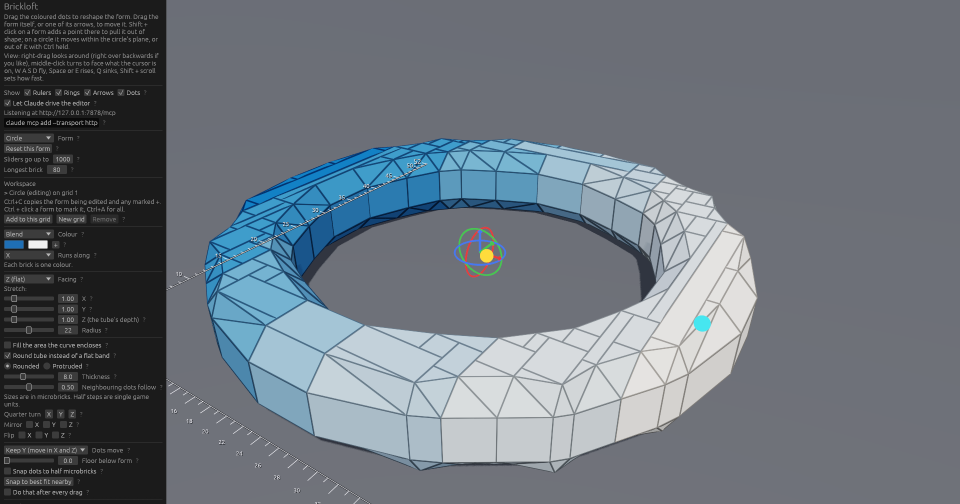

# Letting Claude drive the editor

The editor can be driven by Claude. With the connection switched on, Claude
adds forms to the workspace, changes their settings, colours and grids,
measures them, moves the camera and takes screenshots, and you watch each
change happen in the editor's window.



The connection uses the [Model Context Protocol](https://modelcontextprotocol.io)
(MCP), the standard way for an AI assistant to call tools that a program
offers. The editor is the MCP server and offers fifteen tools. Claude Code, or
any other MCP client, is the client that calls them.

- [What Claude can do](#what-claude-can-do)
- [Setting it up](#setting-it-up)
- [The tools](#the-tools)
- [Coordinates](#coordinates)
- [Security and privacy](#security-and-privacy)
- [How it works](#how-it-works)
- [Limits](#limits)

## What Claude can do

Claude works on the same workspace you do, through the same code. A form
Claude adds is fitted with bricks, drawn, and added to the undo history
exactly as if you had added it, so **Ctrl+Z** takes back a step Claude
made. Each call is named at the top of the view as it happens ("Claude: add
form"), so a change you did not make is never unexplained.

Claude sets values exactly where the mouse sets them approximately. It can
give a radius of 12.5 microbricks, turn a grid by 22.5 degrees about one
axis, or set two forms 4 microbricks apart, and it can read back each
form's brick count and discrepancy to check the result and correct it.
Because it can also move the camera and take a screenshot, it can look at
what it has built before deciding what to change.

Requests that work well:

- "Build a dome 30 microbricks across with a red to yellow blend."
- "Make the arch twice as wide and put a torus round its base."
- "Turn the ring 30 degrees about X on a grid of its own."
- "Fly the camera round the build and tell me which part looks roughest."

## Setting it up

The connection is off until you switch it on, and it is off again each time
the editor starts.

1. Start the editor and tick **Let Claude drive the editor** at the top of
   the panel. The panel then shows the address it is listening at,
   `http://127.0.0.1:7878/mcp`.
2. Tell your MCP client that address. For Claude Code, run this once in a
   terminal, from any folder:

   ```sh
   claude mcp add --transport http brickloft http://127.0.0.1:7878/mcp
   ```

   The panel shows the same command in a box to copy.
3. Start Claude Code and ask it to build something. It finds the editor's
   tools by itself.

The steps are the same on Windows, macOS and Linux. Nothing in them depends
on where the editor is installed, because the client reaches the editor by
its address and never by a file path.

To have the editor listening from the moment it opens, for a script that
starts the editor and Claude together, start it with `--claude`:

```sh
brickloft --claude
```

Other MCP clients take the same address. In a client configured by a JSON
file, the entry is a server of type `http` with the URL above.

## The tools

| Tool | What it does |
|---|---|
| `get_workspace` | Lists every form: its settings, colour, grid angle, position, the box its bricks fill, its brick count and its discrepancy. |
| `add_form` | Adds a form of a given kind with given settings, colour and position. The camera turns to face it. |
| `update_form` | Changes one form's settings, colour or position. Only what is given changes. |
| `remove_form` | Takes a form out of the workspace. |
| `select_form` | Makes a form the one being edited, so its dots and settings show, and turns the camera to face it. |
| `measure_between` | Gives the offset and distance between two forms' centres and the gap between their boxes along each axis. |
| `get_camera` | Gives the camera's position and the direction it looks in. |
| `move_camera` | Sends the camera to a place, or along a path of places, looking at a chosen point at each. |
| `take_screenshot` | Returns a picture of the editor's window as a PNG image, with the panel or without it. |
| `set_view` | Switches the rulers, rings, arrows and dots on and off, and lowers the floor. |
| `move_point` | Moves one of the points a form is drawn through (a yellow dot), leaving the others where they are. |
| `add_pull_point` | Adds a point that pulls the form out of shape at one place (an orange dot), as Shift + click and a drag do. |
| `move_pull_point` | Changes how far an added point pulls the form. |
| `remove_pull_point` | Takes an added point off, so the form goes back to its own shape there. |
| `line_up_arch` | Gives an arch that stands at an angle to its grid a grid of its own, turned to line it up, so that it is fitted smoothly. Its feet stay where they are. |

### Forms and their settings

A form is named by its **index**, its place in the list `get_workspace`
returns, with the form being edited at index 0. Adding, removing or
selecting a form changes the order, so every tool that changes the
workspace returns the whole list again.

Settings are given as names and values, and they are the same settings a
saved form holds. For example, this call adds a hollow dome:

```json
{
  "name": "add_form",
  "arguments": {
    "settings": { "form": "sphere", "radius": 15, "thick": 3, "fill": false, "cut": [0, "inf"] },
    "colour": { "mode": "blend", "colours": ["#c0392b", "#f1c40f"], "runs_along": "z" }
  }
}
```

The settings Claude can give:

| Setting | Meaning |
|---|---|
| `form` | `arch round`, `arch pointed`, `arch triangular`, `arch elliptical`, `arch parabolic`, `arch catenary`, `circle`, `spline`, `bezier`, `sphere`, `revolve` or `pyramid` |
| `points` | The form's own points as `[x, y, z]`: an arch's feet, a centre, or the points of a curve or profile. A form added without points starts where the editor would start one. |
| `radius`, `rise`, `thick`, `depth` | Sizes in microbricks |
| `fill`, `tube`, `closed` | Solid or shell, round tube or flat band, closed loop |
| `stretch`, `cut`, `plane`, `weights` | Stretch per axis, the part of a sphere to keep, the axis a circle faces, a Bézier curve's pulls |
| `mirror`, `flip`, `turned` | Mirroring per axis, flipping per axis, quarter turns |
| `pulls`, `pull_reach` | Points added to pull the form out of shape, and their reach |
| `stones` | `[size, gap, uneven, seed]` lays a flat band or filled outline as stepping stones; a `gap` of 0 fits the stones together; `none` for solid brick |
| `mosaic` | `[style, size, bevel, border, seed]` lays a flat band or filled outline as a pattern of tiles; `none` for no pattern (see below) |
| `on_grid`, `grid_degrees`, `grid_at` | Which grid the form is on, the grid's angle in degrees about x, y and z, and where the grid stands |
| `grain`, `budget`, `simplify`, `max_ext` | Brick size, brick budget, simplification and the longest brick |

A colour has a `mode` (`one`, `blend`, `stripes` or `pattern`), one to eight
`colours` written `#rrggbb`, the axis it `runs_along`, and a
`stripe_width`. The mode `pattern` gives each brick the colour its pattern
gives it: the first colour is the ground or the mortar, and the others are
shared among the pattern's parts.

The five values of `mosaic` are these. A form has `mosaic` or `stones`,
and if both are given the stones are laid.

| Value | Meaning |
|---|---|
| `style` | `medallions`, `rug`, `snowflake`, `planks`, `bricks` or `slabs` (see [features.md](features.md#patterns)) |
| `size` | how large the boards, bricks or slabs are: 2 is usual, and 1 to 16 is accepted |
| `bevel` | how many microbricks are cut off each corner of a slab, 0 to 8 |
| `border` | how many microbricks of plain ground are left round the edge, 0 to 8 |
| `seed` | any whole number, each a different pattern |

For example, this call lays a rug 80 microbricks square. A straight spline
lying flat is a rectangle as wide as its `thick`.

```json
{
  "name": "add_form",
  "arguments": {
    "settings": { "form": "spline", "points": [[-40.5, 0.5, 0.5], [39.5, 0.5, 0.5]], "thick": 80, "depth": 1, "mosaic": ["rug", 2, 1, 0, 3] },
    "colour": { "mode": "pattern", "colours": ["#70161e", "#d4a546", "#18325c", "#ecdcb4"] }
  }
}
```

A pattern shows its colours only in the mode `pattern`. A form added with
a pattern and no `colour` comes in that pattern's own colours, as it does
from the panel. A pattern takes up to eight colours.

A call that cannot be built is refused whole, with the reason, and changes
nothing. Claude then sees why (for example "the form is too large to
build") and can correct the request.

### The camera and screenshots

`move_camera` takes a path of one or more legs. Each leg has a `position`,
a `look_at` point and, optionally, the `seconds` it takes. A leg with a
time is flown smoothly and one without is a jump, so a single leg places
the camera and several legs fly it round a build.

`take_screenshot` returns the window as you see it, or the 3D view alone
when asked for it without the panel. With `set_view` Claude can first hide
the rulers, rings, arrows and dots, for a picture of the bricks alone; the
pictures in this documentation were taken that way. A notice that Claude's
own call put up is never in the picture. A screenshot asked for
while the camera is flying is taken when the camera arrives. The picture is
at most 1280 pixels wide unless Claude asks for another width, because a
picture is costly for a model to read and a window's full width is seldom
needed.

## Coordinates

All lengths are in microbricks, the smallest brick's width, which is a
fifth of a stud. A value may end in a half. The z axis points up.

`get_workspace` gives each form's position three ways:

- **`place`** is where the form stands within its grid.
- **`box_in_grid`** is the box its bricks fill within that grid: low
  corner, high corner and size. Two forms on the same grid can be set an
  exact distance apart from these.
- **`box_in_world`** is the same box's extent and centre in the world. It
  differs from `box_in_grid` when the grid has been turned or moved, and it
  is what the camera's coordinates are measured in.

`measure_between` gives the relative position of two forms directly: the
vector and distance between their centres in the world, and the gap between
their boxes along each axis, where a negative gap is an overlap.

## Security and privacy

The connection is built on the rule that nothing arriving over it is
trusted.

**It is off by default.** The editor listens only while the box is ticked
(or after `--claude`), and the setting is not remembered between runs.

**It listens on this computer only.** The listener is bound to
`127.0.0.1`, the address that means "this computer", so no other machine on
your network or the internet can connect to it.

**It refuses web pages.** A web page open in your browser could otherwise
try to send requests to a local port. Every request must be addressed to
this computer by name, and a request that a browser sent from a page
elsewhere is refused. This is the protection the MCP specification requires
of local servers against DNS rebinding.

**It has no password.** Any program already running on your computer under
your account can connect while the box is ticked. Such a program could
already read your files, so the connection gives it nothing beyond what the
tools below allow.

**The tools are narrow.** They read and change the forms in the workspace,
move the camera, and take a picture of the editor's own window. No tool
reads or writes a file, runs a command, reaches the network, or touches the
game. Saved forms, reports and the clipboard are out of reach.

**Every value is checked.** Settings are read by the same parser that reads
a saved form and built under the same limits as any form. A request's size,
the number of forms, points and colours, the camera's range and a flight's
length are all capped.

**What leaves your computer.** The editor itself sends nothing anywhere.
What Claude reads through the tools, which is the forms' settings and any
screenshots it takes, goes to Claude as part of your conversation, under
the terms of the client you use. A screenshot shows the editor's window
only, including the panel, and never the rest of your screen.

## How it works

The editor speaks MCP's Streamable HTTP transport. The client sends each
message as an HTTP POST to `/mcp`, and the editor answers with one JSON
message. The other MCP transport has the client start the server as a
hidden child program, which suits a tool with no window. The editor is a
window you already have open and want to watch, so the client has to reach
a program that is already running, and a local address does that.

A tool call arrives on a listener thread and is handed to the editor's
frame loop, which carries it out between drawing two frames and hands the
answer back. The workspace is therefore only ever changed from one place,
and a change made by Claude is fitted and drawn in the same frame as one
made by hand.

The code is in [editor/src/mcp.rs](../editor/src/mcp.rs), and the tools'
names, descriptions and schemas are in
[editor/src/mcp_tools.json](../editor/src/mcp_tools.json). The HTTP is
written on the standard library's sockets with no web server dependency,
since one request is one small message. The code is the same on Windows,
macOS and Linux and holds no file paths.

## Limits

- The connection is part of the desktop program only. A browser page
  cannot listen for connections, so the optional browser build has no such
  box.
- One port, 7878, is used. If another program has it, the box unticks
  itself and the panel says why.
- Claude cannot yet read a point cloud or copy the workspace to the
  clipboard. Both are planned (see [future-work.md](future-work.md)).
- The live tests so far were made with a script acting as the client. The
  tools were called against a running editor on Windows; macOS
  and Linux run the same code and have not been tried.
