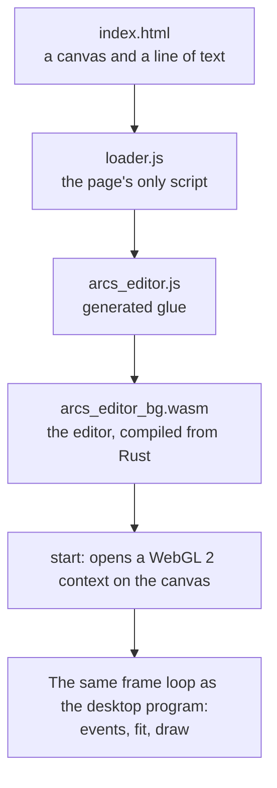

# The browser page

The editor can also be built as a web page. It is an optional extra: the
same program, running in a browser tab, for looking at forms and trying
settings where installing a program is not wanted.

**What it cannot do:** hand a form to the game. The desktop program copies a
Brickadia prefab to the clipboard as a file, and a web page is not allowed
to put a file on the clipboard. The page has no Copy to clipboard, and
Ctrl+C and Ctrl+V do nothing.

## Building and opening it

Two tools are needed beyond Rust, once:

```sh
rustup target add wasm32-unknown-unknown
cargo install wasm-bindgen-cli --version 0.2.129
```

The version of `wasm-bindgen-cli` must match the `wasm-bindgen` version
pinned in `editor/Cargo.toml` exactly, or the tool refuses the build.

Then:

```sh
sh build-editor.sh
```

This writes the page to `dist/`. A page that loads a module cannot be opened
straight from disk, so serve the folder with any local web server and open
it, for example:

```sh
python -m http.server --directory dist 8000
```

and go to `http://localhost:8000`. A browser with WebGL 2 is needed.

## How it works



**One program, two targets.** The editor is a Rust library
(`editor/src/lib.rs`). The desktop program is a few lines that call it
(`editor/src/main.rs`). For the browser the same library is compiled to
WebAssembly, a compact binary format browsers run at near native speed. The
fitting code in `core/` is identical in both: it has no dependence on a
window, a file system or a clock.

**What is in `dist/`:**

| File | What it is |
|---|---|
| `index.html` | The page: a `<canvas>` filling the window and a "Loading" line. |
| `style.css` | Three rules: no margins, canvas full size, the note centred. |
| `loader.js` | Nine lines. Loads the module, removes the note when it starts, and says plainly if it could not. |
| `arcs_editor_bg.wasm` | The editor. |
| `arcs_editor.js` | Glue written by `wasm-bindgen`: it loads the `.wasm` file and passes calls between it and the browser. |
| `icon.svg` | The tab's icon. |

**Starting.** `loader.js` imports `arcs_editor.js` and calls its `init`.
That fetches and compiles the `.wasm` file and then runs the function marked
`#[wasm_bindgen(start)]`, which is the editor's `run`. The rendering library
(`three-d`) finds the page's canvas and opens a WebGL 2 context on it, where
on the desktop it opens a window with OpenGL. From then on the code is the
same: read the frame's events, refit if anything changed, draw.

The rendering library keeps its frame loop going in the browser by throwing
one exception on purpose. `loader.js` recognises that message and treats it
as a normal start, not a failure.

**Where the two builds differ.** A handful of places are compiled one way
for the desktop and another for the browser:

| | Desktop | Browser |
|---|---|---|
| Window | made with an icon, maximised | the page's canvas |
| Time | the system's monotonic clock | `Date.now()`, since that clock is not available |
| Saved forms | text files under `arcs-forms/` | the browser's local storage, one entry per form |
| Save report | a numbered text file | the report's text on the clipboard |
| Copy and paste of bricks | a `.brz` file on the clipboard | not available |

**What the page talks to.** Nothing. It makes no network requests after
loading its own files, and the page is marked `no-referrer`. Saved forms stay
in that browser's storage for that address; they are not sent anywhere and
are not shared with the desktop program.

**No threads.** WebAssembly in a page runs on the page's one thread, so a
long fit would freeze the tab. This is why the best-fit search is cut into
slices of a few milliseconds a frame in both builds, and why the fitters
were made fast on one thread before anything else was tried.

## Size and speed

The `.wasm` file is a few megabytes. Fits run somewhat slower than in the
desktop program, by a factor that depends on the browser.
