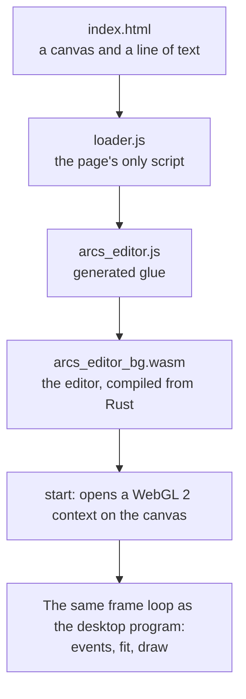

# The browser page

The editor can also be built as a web page. This is an optional extra. It
is the same program, running in a browser tab, for looking at forms and
trying settings on a computer where installing a program is not wanted. The
fitting, the measuring and the view are identical to the desktop program's.

The page cannot hand a form to the game. The desktop program gives a form to
Brickadia by putting a prefab file, `arcs-build.brz`, on the clipboard,
which the game then pastes. Browsers let a web page put text and pictures on
the clipboard and nothing else, so a page has no way to offer a file there
([editor/src/brz.rs](../editor/src/brz.rs) is compiled into the desktop
program only). The page therefore has no Copy to Clipboard button, and
Ctrl+C and Ctrl+V do nothing in its view. Use the desktop program to get a
form into the game.

## Building and opening it

The page is made with the same Rust compiler as the program, plus two
tools that need to be installed once:

```sh
rustup target add wasm32-unknown-unknown
cargo install wasm-bindgen-cli --version 0.2.129
```

The first command adds WebAssembly as a target the compiler can build for.
The second installs `wasm-bindgen`, the tool that connects the compiled
program to the page. Its version must match the version of the
`wasm-bindgen` library pinned in [editor/Cargo.toml](../editor/Cargo.toml)
exactly, or the tool refuses the build:

```toml
# pinned to the installed wasm-bindgen CLI: the two must match exactly or the
# CLI refuses the build
wasm-bindgen = "=0.2.129"
```

Then build the page by running [build-editor.sh](../build-editor.sh) from
the repository's root:

```sh
sh build-editor.sh
```

This writes the page to `dist/`. Browsers refuse, for safety, to load a
script module into a page opened straight from a file on disk, and the page
is built from such modules. So the folder has to be served by a web server,
even one running only on your own computer. Any will do, for example
Python's:

```sh
python -m http.server --directory dist 8000
```

Then go to `http://localhost:8000`. The browser must support WebGL 2, the
browser's interface to the graphics card, which current versions of the
main browsers do.

## How it works

### One program, two targets

A browser cannot run an ordinary program. It can run JavaScript, and it can
run **WebAssembly**: a compact format for compiled programs that every
current browser understands and runs at close to the speed of a native
program, inside the same safety limits as the rest of the page. Rust can be
compiled to WebAssembly as easily as to a Windows program, so arcs needs no
second version written in another language.

The editor is written as a Rust library ([editor/src/lib.rs](../editor/src/lib.rs)).
The desktop program, [editor/src/main.rs](../editor/src/main.rs), is a few
lines that call it. For the browser, the same library is compiled to
WebAssembly. The fitting code in `core/` is identical in both, because it
has no dependence on a window, a file system or a clock. It takes numbers
in and gives bricks out, so it runs anywhere Rust compiles to.



### What is in `dist/`

| File | What it is |
|---|---|
| `index.html` | The page: a `<canvas>` filling the window and a "Loading" line. |
| `style.css` | Three rules: no margins, canvas full size, the note centred. |
| `loader.js` | Nine lines. Loads the module, removes the note when it starts, and says plainly if it could not. |
| `arcs_editor_bg.wasm` | The editor, compiled to WebAssembly. |
| `arcs_editor.js` | Glue written by `wasm-bindgen`: it loads the `.wasm` file and passes calls between it and the browser. |
| `icon.svg` | The tab's icon. |

Only `index.html`, `style.css`, `loader.js` and `icon.svg` are written by
hand; they are copied from [editor/web/](../editor/web/). The other two are
produced by the build. A `<canvas>` is an area of the page that a program
can draw on freely, and the whole editor, its 3D view and its panel, is
drawn there.

### Starting

This is all of [editor/web/loader.js](../editor/web/loader.js), the only
script the page loads itself:

```js
// The only script on the page: it loads the editor, which is the Rust
// program compiled to WebAssembly, and says so plainly if that fails.
import init from "./arcs_editor.js";
const note = document.getElementById("note");
init().then(() => note.remove(), (error) => {
  // three-d runs its event loop by throwing this once on purpose
  if (String(error).includes("Using exceptions for control flow")) { note.remove(); return; }
  note.textContent = "The editor could not start: " + error + ". It needs a browser with WebGL 2.";
});
```

It imports `init` from the glue file and calls it. `init` fetches the
`.wasm` file, has the browser compile it, and then runs the one function
the Rust code marks as the start. If that works, the "Loading" note is
removed. If it fails, the note is replaced by the reason, so a browser
without WebGL 2 says so instead of showing a blank page.

The start function is in `lib.rs`, and the `#[cfg]` line means it exists
only in the WebAssembly build:

```rust
/// The browser calls this when the page loads the module.
#[cfg(target_arch = "wasm32")]
#[wasm_bindgen(start)]
pub fn start() {
    run();
}
```

`run` is the same function the desktop program calls. The rendering
library, `three-d`, then finds the page's canvas and opens a WebGL 2
context on it, where on the desktop it opens a window drawn with OpenGL.
From then on the code is the same in both. Each frame, it reads the mouse
and keyboard events, refits the form if anything changed, and draws.

A page must not run an endless loop of its own, because the browser would
stop responding, so in the browser the frame loop is driven by the browser
itself. To get there, the rendering library throws one error on purpose
while starting. `loader.js` recognises that error's message and treats it
as a normal start, not a failure.

### Where the two builds differ

A handful of places in the code are compiled one way for the desktop and
another for the browser, chosen with `#[cfg(target_arch = "wasm32")]`:

| | Desktop | Browser |
|---|---|---|
| Window | made with an icon, maximised | the page's canvas |
| Time | the system's monotonic clock | `Date.now()`, since that clock is not available |
| Saved forms | text files under `arcs-forms/` | the browser's local storage, one entry per form |
| Save report | a numbered text file | the report's text on the clipboard |
| Copy and paste of bricks | a `.brz` file on the clipboard | not available |

Each difference comes from something a page is not allowed to do. Time is
the simplest example. The editor needs the time to share the best-fit
search across frames, and Rust's usual clock does not exist in a browser
and stops the program if asked, so `now_ms` in `lib.rs` asks the browser
instead:

```rust
fn now_ms() -> f64 {
    #[cfg(target_arch = "wasm32")]
    return js_sys::Date::now();
    #[cfg(not(target_arch = "wasm32"))]
    {
        use std::sync::OnceLock;
        static START: OnceLock<std::time::Instant> = OnceLock::new();
        START.get_or_init(std::time::Instant::now).elapsed().as_secs_f64() * 1000.0
    }
}
```

A page cannot write files either. Saved forms therefore go into the
browser's **local storage**, a small store of named text entries that the
browser keeps for each web address
([editor/src/store.rs](../editor/src/store.rs)). Each form is one entry,
named after its folder and its name, holding the same text a desktop save
writes to a file:

```rust
    fn key(folder: &str, name: &str) -> String {
        format!("arcs-form/{folder}/{name}")
    }
```

A saved report, which the desktop program writes to `arcs-report-N.txt`,
is put on the clipboard as text instead, ready to paste into a file or a
message (`save_report` in [editor/src/send.rs](../editor/src/send.rs)).
Browsers allow that only on a page served from `localhost` or over
`https`, which is one more reason to serve the folder instead of opening it
from disk.

### What the page talks to

The page makes no network requests after loading its own files, and it
is marked `no-referrer`, so even those requests do not tell a server
which page asked. Saved forms stay in that browser's storage for that
address. They are not sent anywhere, and they are not shared with the
desktop program, whose saved forms are files.

### No threads

WebAssembly in a page runs on the page's one thread, the same one that
draws the page and answers the mouse. A fit that ran for a second in one go
would freeze the tab for that second. This is why the best-fit search is cut
into slices of a few milliseconds per frame in both builds (see
[performance.md](performance.md#the-editor)), and why the fitters were made
fast on one thread before anything else was tried.

## Size and speed

The `.wasm` file is a few megabytes. Fits run somewhat slower than in the desktop
program, by a factor that depends on the browser.
